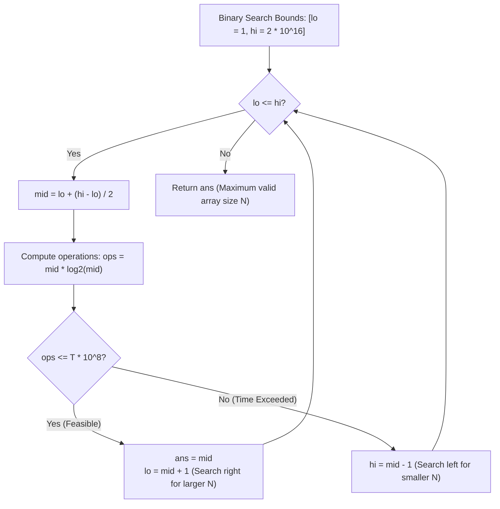
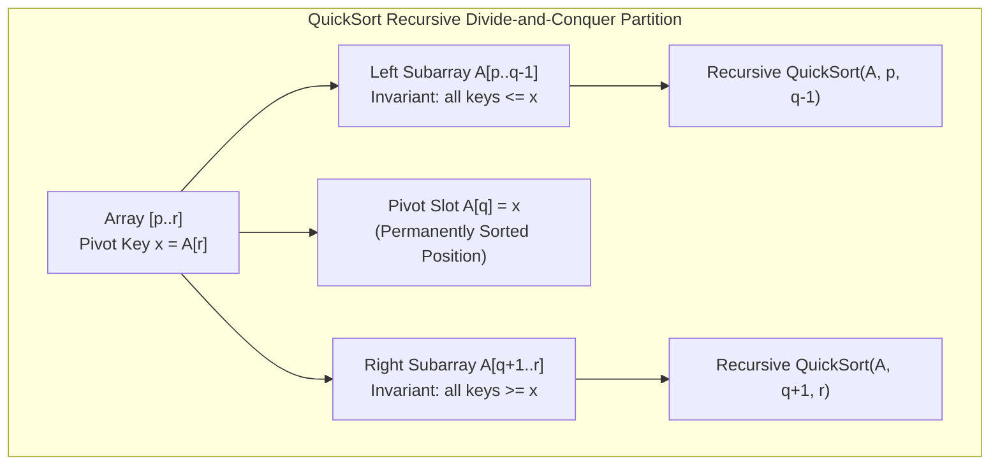

> [!info] Document Metadata
> - **Course:** `=this.course`
> - **Topic:** `=this.topic`
> - **Status:** `=this.status`
> - **Difficulty:** `=this.difficulty`

**Tags:** #[[Computer Science]] #[[CSALGCM]] #[[Algorithms and Complexity]] #[[HackerRank]] #[[Empress Arcana]]

---

# QUIIIIICKSOOOOORT!!!!!!!!!!!

## Problem Description
While taking CSALGCM, you got so fascinated by the quicksort algorithm. On average, quicksort has
a time complexity of O(N log_2 N).
One way to estimate how long it will take an algorithm to run is to simply substitute a value for N.
For example, if N = 10^7, N log_2 N = 232,534,966.6421. After this, you divide the result by 10^8.
The result is the number of seconds it will take to execute the program. (assuming a processor can
execute 10^8 operations sequentially in a second.)
For our example, this will yield 2.3253 seconds. For this problem, you can simply take the ceiling of
the time, which yields ceil(2.3253) = 3 seconds. Depending on our time limit, we may or may not be
able to sort 10^7 elements.
Given the time limit T in seconds, determine the largest array size N you can apply quicksort to that
will not exceed the time limit.

**Input Format:**
Input consists of a single test case consisting of a line with a single integer T which is the number of
seconds you have to execute quicksort.

**Output Format:**
Output one line with a single integer N denoting the maximum array size that you can sort in T
seconds. It is guaranteed that N will not exceed 2 \cdot 10^{15}.

**Constraints:**
$1 \le T \le 10^9$

**Sample:**
| Input | Output |
|-------|--------|
| `1` | `4523071` |

---

## Approach & Intuition

**Abstract the problem:**
Quicksort runs in $N \log_2(N)$ operations. A processor executes $10^8$ operations per second. Given $T$ seconds, find the **largest** array size $N$ that can be sorted within the time limit:
$$\left\lceil \frac{N \log_2 N}{10^8} \right\rceil \le T \iff N \log_2 N \le T \cdot 10^8$$

**Brute Force Approach:**
Linearly test $N = 1, 2, 3, \dots$ until $N \log_2 N$ exceeds the threshold.
Time Complexity: $O(N)$ — since $N$ can reach $2 \cdot 10^{16}$, this is completely intractable.

**Optimal Monotonic Binary Search:**
The function $f(N) = N \log_2 N$ is **strictly monotonically increasing** for $N \ge 1$. Hence, the predicate $P(N) = (N \log_2 N \le T \cdot 10^8)$ produces a monotonic boolean sequence $[T, T, \dots, T, F, F, \dots]$. We can binary search for the boundary in $O(\log(\text{MAX\_N})) \approx 54$ iterations.



## Theoretical Framework: QuickSort Partitioning Mechanism



## Why Binary Search Works

$f(N) = N \log_2(N)$ is **strictly increasing** for $N \ge 1$:
- $N$ grows linearly
- $\log_2(N)$ grows monotonically
- Product $N \log_2 N$ is strictly monotonic

So if $f(\text{mid}) \le \text{target}$, all smaller values are guaranteed feasible, allowing pruning of the entire left half.

---

## Trace (T = 1)

```text
target = 1 * 10^8 = 100,000,000

Binary search between lo = 1 and hi = 2 * 10^16:
  mid = 4523072: 4523072 * log2(4523072) ~ 100,000,004 > 10^8 -> hi = 4523071
  mid = 4523071: 4523071 * log2(4523071) ~  99,999,982 <= 10^8 -> lo = 4523071
  lo == hi -> answer = 4523071
```

---

## Pitfall: Integer Overflow and Precision Considerations

```
target = T × 10^8 where T can be 10^9
target = 10^17 — fits in unsigned long long (max ~1.8×10^19) [Pass]

N can be up to 2×10^16 — also fits [Pass]

But N × log2(N) ≈ 2×10^16 × 54 ≈ 10^18 — we compute this as double,
which has ~15 significant digits. At 10^18, precision is ±1000.
For this problem that's fine since we're comparing against target which
is also in double.
```

---

## Complexity Analysis

| | Complexity |
|--|--|
| **Time** | $O(\log(2\cdot 10^{16}))$ | Based on optimal algorithm
| **Space** | $O(1)$ | Required memory

---

## Original Stub (HackerRank Template)
```c
#include <stdio.h>

unsigned long long int compute_ans(unsigned long long int n){
	// solve for and return ans here
  	
}

int main() {
	unsigned long long int n, lo, hi, mid, temp;
	scanf("%llu",&n);
	printf("%llu\n",compute_ans(n));
}
```

## Full Solution
```c
#include <stdio.h>

unsigned long long int compute_ans(unsigned long long int n){
	// solve for and return ans here
    // Find max N such that N * log2(N) <= n * 10^8
    // Binary search on N.
    // n here is T (seconds). Target = T * 10^8 operations.
    unsigned long long int target = n * 100000000ULL;
    unsigned long long int lo = 1, hi = 20000000000000000ULL; // 2*10^16
    
    while (lo < hi) {
        unsigned long long int mid = lo + (hi - lo + 1) / 2;
        // Compute mid * log2(mid) using floating point
        double val = (double)mid * __builtin_log2((double)mid);
        if (val <= (double)target) {
            lo = mid;
        } else {
            hi = mid - 1;
        }
    }
    return lo;
}

int main() {
	unsigned long long int n, lo, hi, mid, temp;
	scanf("%llu",&n);
	printf("%llu\n",compute_ans(n));
}
```


## References & Navigation
- **Related Notes:** [[Divide and Conquer Introduction]]
- **Previous Problem:** [[04 - Never Fade Away]]
- **Next Problem:** [[06 - Swapper, No Swapping!!!]]
- **Parent Set:** [[[PS] Empress Arcana|Empress Arcana Index]]
