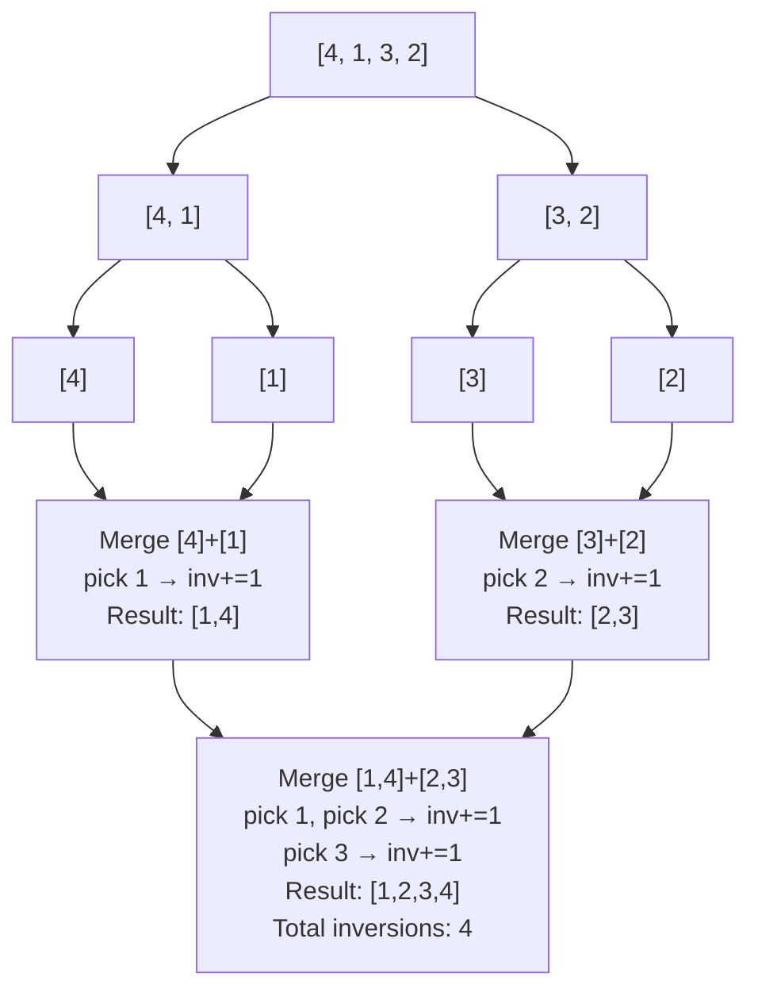

> [!info] Document Metadata
> - **Course:** `=this.course`
> - **Topic:** `=this.topic`
> - **Status:** `=this.status`
> - **Difficulty:** `=this.difficulty`

**🏷️ Tags:** #[[Computer Science]] #[[CSALGCM]] #[[Algorithms and Complexity]] #[[HackerRank]] #[[Empress Arcana]]

---

# Swapper, No Swapping!!!

## Problem Description
Swapper is a notorious, well, swapper. Whenever he sees objects in a line, he like to swap them. He
can, however, only swap two objects that are adjacent. He does this randomly, but every now and
then, through astronomical odds, after performing enough swaps, the objects find themselves in a
particularly desirable order.
Take for example playing cards. If Swapper sees four playing cards with values {4, 1, 3, 2}, he can do
the following:
1. Swap 1 and 3, resulting in {4, 3, 1, 2};
2. Swap 1 and 2, resulting in {4, 3, 2, 1}
Through astronomical odds, Swapper has accidentally arranged the playing cards in descending
order.
Butz is an agent of chaos, who happens to be a monkey as well, and he hates it when objects are
organized. He has a particularly intense disdain for objects arranged in ascending or descending
order. He believes sorted lists to be an abomination to the natural order of the universe, which is
chaos. All things gravitate towards a natural state of entropy.
Butz likes going around various universes, simply to preserve the natural order of things, which is a
lack thereof, and he goes by many names: Nyarlathotep, Randall Flagg, or Richard Faraday. The list
goes on. Unfortunately, this time around, he landed in a small Spanish village, where Swapper resides.
Currently, Swapper has stumbled upon a library with shelves and shelves of books. Most of them are
sorted, but a new assortment of N books has just come in and is not arranged at all. Swapper's
compulsion kicks in he would like to begin his crazy trend of randomly swapping pairs of books. Butz
is none too pleased at this new circumstance and would like to account for the worst case scenario,
which is that, by astronomical odds, Swapper succeeds in sorting the books, either in ascending or
descending order.
Butz can fire a quantum blast at Swapper to slow him down. Swapper can take S quantum blasts
before being blasted into the Todash space, the realm between realities. However, Swapper can swap
exactly one pair of books each second.
Butz isn't taking any chances. Assuming the universe bestows the ultimate curse, which is that
Swapper swaps randomly and through astronomical odds sorts the books either in ascending or
descending order (either is equally displeasing to Butz) as fast as possible, how many quantum blasts
per second must Butz fire at Swapper to prevent the atrocity of a sorted set of books from ever
manifesting on any level of reality?

**Input Format:**
Input consists of one test case, containing N and S indicating the number of books on the shelf and
the number of quantum blasts Swapper can take before being banished into Todash space.
The second line contains N distinct space-separated integers B_i, representing the ID codes of the
books. If Swapper sorts the books in either ascending or descending ID codes B_i, Butz will be royally
cross with him and will probably destroy several realities to relax.
NOTE: If you were an innocent bystander, you may, of course, play this as a classic trolley problem of
a.) let Swapper be banished to Todash, or b.) let countless realities perish, but in this example, you are
Butz, so no need to worry about the ramifications. :D

**Output Format:**
Output consists of one line containing an integer indicating the number of quantum blasts per second
that Butz must fire at Swapper to prevent him from sorting the books in the worst case scenario (best
case for Swapper). If this number is not a whole number, just to prevent Swapper from ever
succeeding, round up to the nearest whole number. If it is impossible for Butz to stop Swapper from
restoring order to the shelf, print "Butz loses!" without quotes.

**Constraints:**
$1 \le N, S \le 2 \cdot 10^5$
$0 \le B_i \le 10^7$

**Sample:**
| Input | Output |
|-------|--------|
| `4 3<br>4 1 3 2` | `2` |

---

## Approach & Intuition
> **🗂️ Abstract the problem**
> Swapper can swap adjacent books to sort them. The minimum swaps to sort = number of **inversions**. Find the fewest swaps to sort either ascending OR descending (whichever is faster). Butz fires `ceil(S / min_swaps)` blasts per second. If already sorted → "Butz loses!"

> **🐢 Dumb sol?**
> Count inversions with nested loops: for each pair (i,j) where i<j, check if arr[i]>arr[j].
> **O(N²)** — with N = 200,000 that's **40 billion comparisons** → TLE.

> **🚀 Smart sol?**
> Count inversions using **merge sort** — during the merge step, every time a right element is placed before remaining left elements, that's exactly the number of inversions it resolves.
> **O(N log N)** — fast.

---

## What Are Inversions?

An inversion is a pair (i, j) where i < j but arr[i] > arr[j]. Each adjacent swap fixes exactly one inversion. So **minimum swaps = number of inversions**.

```
Array: [4, 1, 3, 2]
Inversions for ascending sort:
  (4,1) (4,3) (4,2) (3,2) = 4 inversions

Inversions for descending sort:
  For descending [4,3,2,1], count pairs where i<j and arr[i]<arr[j]:
  (1,3) (1,2) = total_pairs - asc_inversions = 6 - 4 = 2 inversions
```

**Key insight:** `desc_inversions = n·(n−1)/2 − asc_inversions` (because every pair is either an ascending or descending inversion, and total pairs = n·(n−1)/2).

---

## Merge Sort Inversion Counting

During merge, when we pick from the right array, all remaining left elements form inversions with it:

```
Merge [4, 3] and [1, 2]:
  Compare 4 vs 1: pick 1. Inversions += 2 (both 4,3 are > 1)
  Compare 4 vs 2: pick 2. Inversions += 2 (both 4,3 are > 2)
  Pick 3, then 4.
  Total from this merge: 4
```



---

## The Final Calculation

```
min_swaps = min(asc_inversions, desc_inversions)

if min_swaps == 0:
    print("Butz loses!")        # Already sorted!
else:
    blasts_per_sec = ceil(S / min_swaps)
    print(blasts_per_sec)
```

**Why ceil?** Butz needs Swapper to take ALL S blasts BEFORE finishing min_swaps seconds of sorting. If `S / min_swaps` isn't a whole number, Butz must round up to ensure Swapper is fully blasted in time.

---

## Trace (Sample 0: books=[4,1,3,2], S=3)

**Step 1 — Count ascending inversions:**
```
Pairs where i<j but arr[i]>arr[j]:
  (4,1) (4,3) (4,2) (3,2) → asc_inv = 4
```

**Step 2 — Count descending inversions:**
```
total_pairs = 4×3/2 = 6
desc_inv = 6 - 4 = 2
```

**Step 3 — Pick minimum:**
```
min_swaps = min(4, 2) = 2   (faster to sort descending: only 2 swaps!)
```

**Step 4 — Compute blasts:**
```
blasts = ceil(3 / 2) = ceil(1.5) = 2

Why: Swapper needs 2 seconds to sort. In 2 seconds at 1 blast/sec,
Swapper takes 2 blasts but can survive 3. At 2 blasts/sec, Swapper
takes 4 blasts > 3 → banished before finishing! ✓
```

---

## All Samples Verified

| Books | S | asc_inv | desc_inv | min_swaps | blasts/sec |
|---|---|---|---|---|---|
| [4,1,3,2] | 3 | 4 | 2 | 2 | ceil(3/2) = **2** ✓ |
| [2,4,0,3,1] | 3 | 6 | 4 | 4 | ceil(3/4) = **1** ✓ |
| [5,0,1,2,4,3] | 5 | 6 | 9 | 6 | ceil(5/6) = **1** ✓ |

---

## Complexity Analysis

| | Complexity |
|--|--|
| **Time** | $O(N \log N)$ | Based on optimal algorithm
| **Space** | $O(N)$ | Required memory

---

## Original Stub (HackerRank Template)
```python
def solve(books,n,s):
    # TODO: Compute and print answer here
    pass

def main():
    n, s = list(map(int,input().strip().split(" ")))
    books = list(map(int,input().strip().split(" ")))
    solve(books,n,s)

if __name__ == "__main__":
    main()
```

## Full Solution
```python
def solve(books,n,s):
    # TODO: Compute and print answer here
    # Count inversions for ascending sort and descending sort.
    # min_swaps = min(asc_inversions, desc_inversions)
    # This is the minimum adjacent swaps needed (= bubble sort swaps = inversions).
    # If min_swaps == 0: already sorted → "Butz loses!"
    # Otherwise: blasts_per_second = ceil(s / min_swaps)
    
    import math
    
    # Count inversions using merge sort for O(n log n)
    def count_inversions(arr):
        if len(arr) <= 1:
            return arr, 0
        mid = len(arr) // 2
        left, left_inv = count_inversions(arr[:mid])
        right, right_inv = count_inversions(arr[mid:])
        merged = []
        inversions = left_inv + right_inv
        i = j = 0
        while i < len(left) and j < len(right):
            if left[i] <= right[j]:
                merged.append(left[i])
                i += 1
            else:
                merged.append(right[j])
                inversions += len(left) - i
                j += 1
        merged.extend(left[i:])
        merged.extend(right[j:])
        return merged, inversions
    
    # Inversions for ascending: count inversions in the array as-is
    _, asc_inv = count_inversions(books[:])
    
    # Inversions for descending: count inversions in the reversed array
    # Or equivalently: n*(n-1)/2 - asc_inv (total pairs minus ascending inversions)
    total_pairs = n * (n - 1) // 2
    desc_inv = total_pairs - asc_inv
    
    min_swaps = min(asc_inv, desc_inv)
    
    if min_swaps == 0:
        print("Butz loses!")
    else:
        blasts = math.ceil(s / min_swaps)
        print(blasts)

def main():
    n, s = list(map(int,input().strip().split(" ")))
    books = list(map(int,input().strip().split(" ")))
    solve(books,n,s)

if __name__ == "__main__":
    main()
```

---

## References & Navigation
- **Related Notes:** [[Divide and Conquer Introduction]]
- **Previous Problem:** [[05 - QUIIIIICKSOOOOORT!!!!!!!!!!!]]
- **Parent Set:** [[[PS] Empress Arcana|Empress Arcana Index]]
