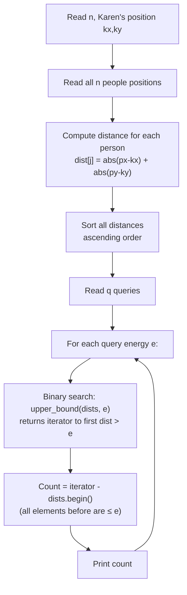
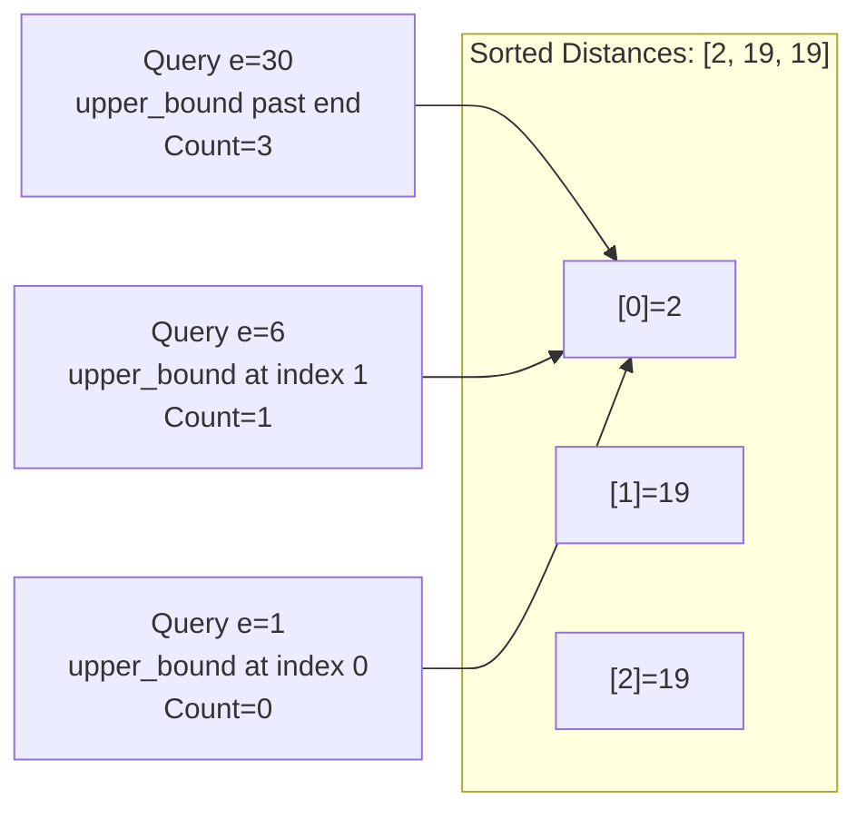

> [!info] Document Metadata
> - **Course:** `=this.course`
> - **Topic:** `=this.topic`
> - **Status:** `=this.status`
> - **Difficulty:** `=this.difficulty`

**Tags:** #[[Computer Science]] #[[CSALGCM]] #[[Algorithms and Complexity]] #[[HackerRank]] #[[Priestess Arcana]] #[[Order Statistics]] #[[Merge Sort Tree]]

---

# It's Like I Have ESPN Or Something

## Problem Description
Karen can read minds within a certain range based on her energy level. Given the coordinates of $N$ people in a cafeteria, her goal is to find out how many people she can reach for $Q$ queries, each specifying a different energy level. The distance between Karen and any person is defined as the Manhattan distance ($|x_1 - x_2| + |y_1 - y_2|$).

**Input Format:**
Input consists of one test case beginning with three space-separated integers $N$, $K_x$, and $K_y$ which are the number of people in the cafeteria, and Karen's location respectively.
$N$ lines follow, the $i$-th of which containing two space-separated integers $x_i$ and $y_i$ denoting the coordinates of the $i$-th person.
The next line contains a single integer $Q$. You must answer $Q$ queries.
The next $Q$ lines contain an integer $E$, which is the energy of Karen for that query.

**Output Format:**
For each query, output one line containing a single integer which denotes the number of people within range of Karen's ESPN.

**Constraints:**


**Sample:**
| Input | Output |
|-------|--------|
| `3 6 7`<br>`-10 10`<br>`-6 0`<br>`8 7`<br>`3`<br>`30`<br>`6`<br>`1` | `3`<br>`1`<br>`0` |

---

## Approach & Intuition
> ** Abstract the problem**
> Karen can read minds up to distance `e`. Given `n` people scattered on a grid and `q` queries each asking "how many people can Karen sense at energy level e?", answer each query.
> "Sense" = Manhattan distance ≤ e.

> ** Dumb sol?**
> For every query, loop through ALL `n` people and check each one's distance.
> **O(n × q)** — if n = q = 100,000, that's **10 billion ops** → TLE.

> ** Smart sol?**
> Compute ALL distances once upfront, sort them. Each query becomes a single binary search (`upper_bound`) to count how many distances ≤ e.
> **O(n log n + q log n)** — fast enough for any input.

---

## What Is Manhattan Distance?

**Manhattan Distance** = |x₁ - x₂| + |y₁ - y₂|. Think of a city grid: you can't cut diagonally through buildings — only move up/down/left/right.

```
   ^ y
   |
10 +  P1(-10,10)
   |              dist(K,P1) = |6-(-10)| + |7-10| = 16 + 3 = 19
 7 +        K(6,7)---P3(8,7)
   |         dist(K,P3) = |6-8| + |7-7| = 2 + 0 = 2
 0 +  P2(-6,0)
   |              dist(K,P2) = |6-(-6)| + |7-0| = 12 + 7 = 19
   +--------+---------> x
  -10        6  8
```

---

## Algorithm Walkthrough



---

## Code: Every Line Explained

```cpp
#include <bits/stdc++.h>
using namespace std;

int n, q, ans;
long long kx, ky, x, y, e, people[100000][2];
// n = number of people
// q = number of queries
// kx, ky = Karen's coordinates (long long because coordinates can be large)
// people[i][0] = x-coord of person i
// people[i][1] = y-coord of person i

int main() {
    cin >> n >> kx >> ky;       // Read: how many people, and Karen's position
    for(int i = 0; i < n; i++) {
        // fscanf is faster than cin for large inputs (stub already uses it)
        fscanf(stdin, "%lld%lld", &people[i][0], &people[i][1]);
    }

    // ---- PRECOMPUTATION PHASE ----
    vector<long long> dists(n);          // Allocate array of n distances
    for(int j = 0; j < n; j++) {
        // Manhattan distance formula: |px - kx| + |py - ky|
        dists[j] = abs(people[j][0] - kx) + abs(people[j][1] - ky);
    }
    sort(dists.begin(), dists.end());    // Sort ascending: [2, 19, 19, ...]
    // After this point: dists[0] <= dists[1] <= dists[2] <= ... <= dists[n-1]

    // ---- QUERY PHASE ----
    cin >> q;
    for(int i = 0; i < q; i++) {
        fscanf(stdin, "%lld", &e);       // Read energy level for this query

        // upper_bound returns iterator to first element STRICTLY GREATER THAN e
        // Everything before that iterator is <= e
        // Subtracting begin() gives the count of those elements
        ans = (int)(upper_bound(dists.begin(), dists.end(), e) - dists.begin());

        fprintf(stdout, "%d\n", ans);    // Print result
    }
}
```

---

## Step-by-Step Trace (Sample Input)

**Input:** Karen at (6,7). People: (-10,10), (-6,0), (8,7). Queries: 30, 6, 1.

**Step 1 — Compute Distances:**
| Person | Coords | Calculation | Distance |
|---|---|---|---|
| 0 | (-10, 10) | \|(-10)-6\| + \|10-7\| = 16 + 3 | **19** |
| 1 | (-6, 0) | \|(-6)-6\| + \|0-7\| = 12 + 7 | **19** |
| 2 | (8, 7) | \|8-6\| + \|7-7\| = 2 + 0 | **2** |

**Step 2 — Sort:**
```
Before sort: [19, 19, 2]
After sort:  [2, 19, 19]
              ^index 0
```

**Step 3 — Queries using upper_bound:**
```
Query e=30: upper_bound([2,19,19], 30) → past last element → index 3. Answer: 3 
Query e=6:  upper_bound([2,19,19], 6)  → points to first 19  → index 1. Answer: 1 
Query e=1:  upper_bound([2,19,19], 1)  → points to 2         → index 0. Answer: 0 
```



## Complexity Analysis
| | Complexity |
|--|--|
| **Time** | O(n log n + q log n) |
| **Space** | O(n) |

---

## Original Stub (HackerRank Template)

```cpp
#include <bits/stdc++.h>
using namespace std;

int main() {
    int n, q;
    int kx, ky;
    cin >> kx >> ky >> n;

    for (int i = 0; i < n; i++) {
        int x, y;
        cin >> x >> y;
        // Write your code here
    }

    cin >> q;
    while (q--) {
        long long e;
        cin >> e;
        // Write your code here
    }

    return 0;
}
```

---

## Full Solution
```cpp
#include <bits/stdc++.h>

using namespace std;

int n, q, ans;
long long kx, ky, x, y, e, people[100000][2];

int main() {
	cin >> n >> kx >> ky;
	for(int i = 0; i < n; i++) {
      	// using fscanf to prevent TLE
		fscanf(stdin,"%lld%lld",&people[i][0],&people[i][1]);
	}
	// Precompute all distances and sort for O(log n) per query
	vector<long long> dists(n);
	for(int j = 0; j < n; j++) {
		dists[j] = abs(people[j][0] - kx) + abs(people[j][1] - ky);
	}
	sort(dists.begin(), dists.end());

	cin >> q;
	for(int i = 0; i < q; i++) {
		fscanf(stdin,"%lld",&e);
		// solve for ans here
		// Binary search: count how many distances <= e
		ans = (int)(upper_bound(dists.begin(), dists.end(), e) - dists.begin());
		fprintf(stdout,"%d\n",ans);
	}
}
```


## References & Navigation
- **Related Notes:** [[Divide and Conquer Introduction]]
- **Next Problem:** [[02 - Laughter Is The Best Medicine]]
- **Parent Set:** [[[PS] Priestess Arcana|Priestess Arcana Index]]
