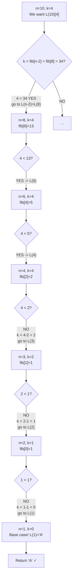

> [!info] Document Metadata
> - **Course:** `=this.course`
> - **Topic:** `=this.topic`
> - **Status:** `=this.status`
> - **Difficulty:** `=this.difficulty`

**🏷️ Tags:** #[[Computer Science]] #[[CSALGCM]] #[[Algorithms and Complexity]] #[[HackerRank]] #[[Priestess Arcana]] #[[Merge Sort]] #[[Inversion Count]]

---

# Laughter Is The Best Medicine

## Problem Description
The Laughter sequence is defined recursively: $L(0) = \text{"H"}$, $L(1) = \text{"A"}$, and $L(n) = L(n-1) + L(n-2)$ for $n \ge 2$. Given $n$ and $k$, the task is to determine whether the $k$-th character (0-indexed) in the string $L(n)$ is an "H" or an "A".

**Input Format:**
Input consists of one test case. Each test case consists of one line with two space separated integers $N$ and $K$, denoting the index of the string in the Laughter sequence, and the index of the character to be checked. $K$ is a 0-based index.

**Output Format:**
Output consists of one line containing "H" (without the quotes), if the $K$-th character in $L(N)$ is an H, or "A" (also without quotes), if the $K$-th character in $L(N)$ is an A.

**Constraints:**


**Sample:**
| Input | Output |
|-------|--------|
| `3 1` | `H` |
| `4 3` | `H` |
| `10 4` | `A` |

---

## Approach & Intuition
> **🗂️ Abstract the problem**
> A string sequence is built recursively where each string = previous-previous + previous. Given a huge string index `n` and a character position `k`, find which character ('H' or 'A') is at that position — without building the string.

> **🐢 Dumb sol?**
> Actually build `L(0)`, `L(1)`, ..., `L(n)` by concatenation, then index into it.
> **Impossible** — L(50) has 12.5 billion characters. You'd run out of RAM at L(40).

> **🚀 Smart sol?**
> Use the Fibonacci-length structure to *navigate* which half of the string the character falls in, cutting the problem in half each step — like binary search on a tree.
> **O(n)** to build the length table, **O(n)** descent steps — handles any n up to 10^18.

---

## Building The First Few Strings

```
L(0) = "H"                    length = 1
L(1) = "A"                    length = 1
L(2) = L(0)+L(1) = "HA"       length = 2
L(3) = L(1)+L(2) = "AHA"      length = 3
L(4) = L(2)+L(3) = "HAAHA"    length = 5
L(5) = L(3)+L(4) = "AHAHAAHA" length = 8
```

Notice: the **lengths are Fibonacci numbers**! L(n) is ALWAYS L(n-2) on the left, L(n-1) on the right.

## Why We Cannot Build The String

```
L(10)  has 89                       characters
L(20)  has 10,946                   characters
L(50)  has 12,586,269,025           characters (~12.5 billion!)
L(90)  has 2,880,067,194,370,816,120 characters (max uint64!)
```

We need to **navigate** the structure instead of building it.

---

## The Critical Bug: Wrong Recursion Direction

```
WRONG (old code):
  L(n) = L(n-1) + L(n-2)   <- assumes n-1 comes FIRST
  lenPrev = fib[n-1]        <- wrong split point!

CORRECT (fixed code):
  L(n) = L(n-2) + L(n-1)   <- n-2 comes FIRST
  lenFirst = fib[n-2]       <- correct split point!
```

### Why This Matters — A Concrete Example

Verify: `L(4) = "HAAHA"`. Character at index 2:
```
With WRONG split (n-1 first):
  L(4) = L(3)+L(2) = "AHA" + "HA"
  lenPrev = fib[3] = 3
  k=2 < 3? YES -> look in "AHA" -> position 2 -> 'A'

With CORRECT split (n-2 first):
  L(4) = L(2)+L(3) = "HA" + "AHA"
  lenFirst = fib[2] = 2
  k=2 < 2? NO -> k=2-2=0, look in "AHA" -> position 0 -> 'A'
```

Both give 'A' here by coincidence! But on other positions they diverge — that's why it passed SOME test cases but not all.

---

## The Fibonacci Length Table

```
fib[0] = 1    (length of L(0) = "H")
fib[1] = 1    (length of L(1) = "A")
fib[2] = 2    (length of L(2) = "HA")
fib[3] = 3    (length of L(3) = "AHA")
fib[4] = 5    (length of L(4) = "HAAHA")
fib[5] = 8    ...
fib[90] = 2,880,067,194,370,816,120  <- near max of unsigned long long
```

We cap at 90 levels and use **saturating arithmetic** — if sum would overflow, clamp to `UINT64_MAX` to prevent the length from wrapping back to a small number and causing wrong branch selection.

---

## Algorithm: Recursive Descent

Think of L(n) as a folder containing two sub-folders: `L(n-2)` on the left, `L(n-1)` on the right. We keep choosing which sub-folder our character is in.



---

## Code: Every Line Explained

```c
char solve(int n, unsigned long long int k) {

    // ---- SETUP: Build Fibonacci length table ----
    const unsigned long long INF = (unsigned long long)(-1);
    // INF = 18,446,744,073,709,551,615 (max value of uint64)
    // Used as sentinel: "this string is astronomically long"

    unsigned long long fib[91];
    fib[0] = 1; fib[1] = 1;
    int i;
    for (i = 2; i <= 90; i++) {
        // Saturating addition: clamp to INF instead of overflowing
        if (fib[i-1] > INF - fib[i-2]) fib[i] = INF;
        else fib[i] = fib[i-1] + fib[i-2];
        // Why? If we overflow, a huge length might look small,
        // causing us to descend into the wrong branch.
    }

    if (n > 90) n = 90;
    // Strings L(91)+ are so large that any valid k fits within L(90)'s structure.

    // ---- DESCENT: Navigate the string structure ----
    while (n > 1) {
        // L(n) = L(n-2) + L(n-1)
        // First part: L(n-2) has length fib[n-2]
        unsigned long long lenFirst = fib[n - 2];

        if (k < lenFirst) {
            n = n - 2;      // Character is in the FIRST half L(n-2)
        } else {
            k -= lenFirst;  // Offset k past the first half
            n = n - 1;      // Character is in the SECOND half L(n-1)
        }
    }

    if (n == 0) return 'H';   // L(0) = "H"
    return 'A';                // L(1) = "A"
}
```

---

## Trace Table: L(10)[4] → expected 'A'

| Step | n | k | lenFirst = fib[n-2] | k < lenFirst? | Action |
|---|---|---|---|---|---|
| 1 | 10 | 4 | fib[8] = 34 | 4 < 34 ✓ | n = 8 |
| 2 | 8 | 4 | fib[6] = 13 | 4 < 13 ✓ | n = 6 |
| 3 | 6 | 4 | fib[4] = 5 | 4 < 5 ✓ | n = 4 |
| 4 | 4 | 4 | fib[2] = 2 | 4 < 2 ✗ | k = 4−2 = 2, n = 3 |
| 5 | 3 | 2 | fib[1] = 1 | 2 < 1 ✗ | k = 2−1 = 1, n = 2 |
| 6 | 2 | 1 | fib[0] = 1 | 1 < 1 ✗ | k = 1−1 = 0, n = 1 |
| — | 1 | 0 | — | n=1, exit loop | **return 'A'** ✓ |

## Complexity Analysis
| | Complexity |
|--|--|
| **Time** | O(n) build + O(log n) per query |
| **Space** | O(1) |

---

## Original Stub (HackerRank Template)

```cpp
#include <stdio.h>

char solve(int n, unsigned long long int k) {
    // Write your code here
}

int main() {
    int n;
    unsigned long long int k;
    scanf("%d%llu",&n,&k);
    printf("%c\n",solve(n,k));
}
```

---

## Full Solution
```cpp
#include <stdio.h>

char solve(int n, unsigned long long int k){
    // solve for the answer here. Return the correct answer
    // L(0)="H", L(1)="A", L(n) = L(n-2) + L(n-1)
    // Lengths follow Fibonacci: fib[0]=1, fib[1]=1, fib[2]=2, ...
    const unsigned long long INF = (unsigned long long)(-1);
    unsigned long long fib[91];
    fib[0] = 1; fib[1] = 1;
    int i;
    for (i = 2; i <= 90; i++) {
        if (fib[i-1] > INF - fib[i-2]) fib[i] = INF;
        else fib[i] = fib[i-1] + fib[i-2];
    }
    if (n > 90) n = 90;
    while (n > 1) {
        // L(n) = L(n-2) + L(n-1): first part is L(n-2) with length fib[n-2]
        unsigned long long lenFirst = fib[n - 2];
        if (k < lenFirst) n = n - 2;
        else { k -= lenFirst; n = n - 1; }
    }
    if (n == 0) return 'H';
    return 'A';
}

int main() {
  	int n;
  	unsigned long long int k;
	scanf("%d%llu",&n,&k);
	printf("%c\n",solve(n,k));
}
```

---

## References & Navigation
- **Related Notes:** [[Divide and Conquer Introduction]]
- **Previous Problem:** [[01 - Its Like I Have ESPN Or Something]]
- **Next Problem:** [[03 - Lets Plant Rice]]
- **Parent Set:** [[[PS] Priestess Arcana|Priestess Arcana Index]]
