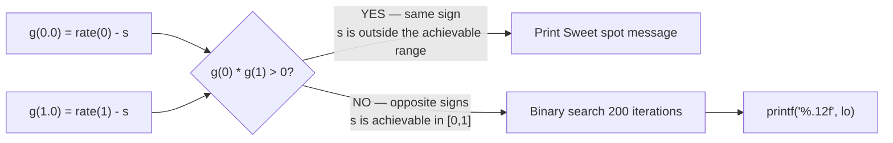

> [!info] Document Metadata
> - **Course:** `=this.course`
> - **Topic:** `=this.topic`
> - **Status:** `=this.status`
> - **Difficulty:** `=this.difficulty`

**🏷️ Tags:** #[[Computer Science]] #[[CSALGCM]] #[[Algorithms and Complexity]] #[[HackerRank]] #[[Priestess Arcana]] #[[Bisection Method]] #[[Binary Search]]

---

# Let's Plant Rice

## Problem Description
A game uses a complex evaporation function controlled by daily factors $a$, $b$, and $c$. The water level $W$ in the rice paddy ranges from $0$ (empty) to $1$ (full). Given these factors and a target "sweet spot" evaporation rate $E$, the task is to determine the lowest starting water level $W$ that hits $E$ within an acceptable error margin ($10^{-6}$). If the sweet spot is unreachable, we must output a specific failure string.

**Input Format:**
The first line of the input contains an integer $T$, indicating the number of days you would need to figure out the starting water level for.
$T$ lines follow, each containing four space-separated real numbers that correspond to the value of $a$, $b$, $c$, and $E$. $E$ is the sweet spot evaporation rate. $a$, $b$, and $c$ are described in the problem statement.

**Output Format:**
There will be $T$ lines of outputs, each line being the lowest starting water level that would get to within the acceptable margins for the sweet spot evaporation rate $E$. Absolute or relative error must not exceed $10^{-6}$. Print "Sweet spot cannot be reached! Those cheeky developers!" (without the quotation marks) if the sweet spot is impossible to be reached.

**Constraints:**


**Sample:**
| Input | Output |
|-------|--------|
| `5`<br>`0.7119 -0.1206 2.9930 4.0577`<br>`0.9219 0.1963 2.7140 4.3201`<br>`0.2692 -0.0695 2.9132 1.6116`<br>`0.3601 -0.1771 0.6213 1.1870`<br>`0.3492 -0.3865 3.8889 2.5649` | `0.697784503037`<br>`0.887908531876`<br>`0.921929270250`<br>`0.645118392190`<br>`0.599166042326` |
| `7`<br>`0.2772 0.2253 4.2550 1.9385`<br>`0.2807 -0.2682 1.5963 1.6372`<br>`0.9055 0.0522 2.5857 2.2600`<br>`0.3196 -0.2520 2.7628 0.9047`<br>`0.6853 -0.2366 3.6572 2.5567`<br>`0.7148 -0.1846 0.9737 4.1721`<br>`0.9411 -0.1370 2.0860 2.6794` | `Sweet spot cannot be reached! Those cheeky developers!`<br>`0.793247141838`<br>`0.387402764833`<br>`0.340837109300`<br>`0.353158012405`<br>`0.817511673620`<br>`Sweet spot cannot be reached! Those cheeky developers!` |

---

## Approach & Intuition
> **🗂️ Abstract the problem**
> A rice paddy evaporates water at a rate that depends on how full it is, following a sigmoid-shaped formula. Given the target evaporation rate `s` and formula parameters, find the exact starting water level `x ∈ [0,1]` that produces that rate.

> **🐢 Dumb sol?**
> Try every possible value of x from 0.000000 to 1.000000 in tiny steps (say 0.000001).
> **O(1,000,000 per query)** — slow and imprecise; you'd need millions of steps for 10⁻⁶ precision.

> **🚀 Smart sol?**
> The formula is monotone (always decreasing in x), so use **bisection** — halve the search interval each iteration. After 200 halvings, precision is 2⁻²⁰⁰ ≈ 10⁻⁶⁰ — absurdly more precise than needed.
> **O(200) per query** — instant.

---

## The Actual Formula

$$rate(x) = 1 - \left(\frac{1}{1+e^{-k(x-0.5)}}\right)^a + d$$

Where `x` = starting water level ∈ [0.0, 1.0]. Parameters `d`, `k`, `a` are given per day.

---

## Understanding the Formula Component by Component

### Part 1: The Sigmoid (S-curve)

```
sigma(x) = 1 / (1 + exp(-k * (x - 0.5)))
```

The sigmoid maps x → a number strictly between 0 and 1:

```
sigma(x) for k=3, centered at x=0.5:

1.0 |                                           *****
    |                                      *****
    |                                 *****
0.5 |                        **********
    |                   *****
    |              *****
    |         *****
0.0 |*****
    +---+---+---+---+---+---+---+---+---+---+---
      0.0 0.1 0.2 0.3 0.4 0.5 0.6 0.7 0.8 0.9 1.0
                          ^
                          Always = 0.5 here, regardless of k
```

Key facts:
- At x = 0.5: sigma = 0.5 **always** (center is fixed)
- Larger k → steeper S-curve (more abrupt transition)
- As x increases → sigma increases (monotone)

### Part 2: sigma raised to power `a`

Since sigma ∈ (0,1), raising to a power reshapes the range:

```
sigma = 0.7:
  a=0.5  -> 0.7^0.5 = 0.836  (pulled toward 1)
  a=1.0  -> 0.7^1.0 = 0.700  (unchanged)
  a=2.0  -> 0.7^2.0 = 0.490  (pulled toward 0)
  a=4.0  -> 0.7^4.0 = 0.240  (much closer to 0)
```

### Part 3: 1 − sigma^a + d

```
rate(x) = 1 - sigma(x)^a + d
```

- As x increases → sigma↑ → sigma^a↑ → 1−sigma^a **↓**
- So `rate(x)` is **monotone DECREASING** in x (for k > 0)
- The `+d` shifts the whole curve up (d>0) or down (d<0)

```
rate(x) shape (d=-0.1206, k=2.993, a=4.0577):

HIGH  0.877 |* (x=0.0, empty paddy — high evaporation)
            | *
            |  *
            |   *
target 0.711|------*--- <- we want THIS x (answer ≈ 0.698)
            |       *
            |        *
            |         *
LOW   0.271 |          * (x=1.0, full paddy — lower evaporation)
            +----------->
              0         1
```

---

## Why Bisection Works Here

The function is **strictly monotone** → at most ONE solution exists. We check if the target `s` is achievable by seeing if `rate(0)` and `rate(1)` bracket it:



### The Bisection Step by Step (target s=0.7119)

```
Iter 1: lo=0.000, hi=1.000, mid=0.500
  g(lo)=+0.165 (+), g(mid)=+0.038 (+) → same sign → lo=0.500

Iter 2: lo=0.500, hi=1.000, mid=0.750
  g(lo)=+0.038 (+), g(mid)=-0.139 (-) → opposite! → hi=0.750

Iter 3: lo=0.500, hi=0.750, mid=0.625
  g(lo)=+0.038, g(mid)=-0.076 → opposite → hi=0.625

...200 iterations...
  lo = hi = 0.697784503037 ← converged ✓
```

Each iteration cuts the interval in half → after 200 steps: width = 1/2²⁰⁰ ≈ 10⁻⁶⁰.

---

## Code: Every Line Explained

```cpp
void solve(double s, double d, double k, double a) {
    // s = target evaporation rate (what we want rate(x) to equal)
    // d = vertical shift of the curve
    // k = sigmoid steepness
    // a = power applied to sigmoid

    // g(x) = rate(x) - s  (we want to find x where g(x) = 0)
    auto g = [&](double x) -> double {
        // Step 1: compute sigmoid centered at 0.5
        double sig = 1.0 / (1.0 + exp(-k * (x - 0.5)));

        // Step 2: full formula minus the target → "residual"
        return 1.0 - pow(sig, a) + d - s;
    };

    double g0 = g(0.0);   // residual at x=0 (empty paddy)
    double g1 = g(1.0);   // residual at x=1 (full paddy)

    // Same sign = target is above both OR below both endpoints
    // = impossible to reach with any x ∈ [0,1]
    if (g0 * g1 > 0) {
        printf("Sweet spot cannot be reached! Those cheeky developers!\n");
        return;
    }

    // Root is guaranteed between lo and hi → bisect
    double lo = 0.0, hi = 1.0;
    for (int iter = 0; iter < 200; iter++) {
        double mid = (lo + hi) / 2.0;

        // If g(lo) and g(mid) have opposite signs: root is in [lo, mid]
        // Otherwise: root is in [mid, hi]
        if (g(lo) * g(mid) <= 0) hi = mid;
        else lo = mid;
    }

    printf("%.12f\n", lo);   // 12 decimal places (required: 10^-6 precision)
}
```

---

## Feasibility Table (Sample Inputs)

| s (target) | d | k | a | rate(0) | rate(1) | s in [rate1,rate0]? | Answer |
|---|---|---|---|---|---|---|---|
| 0.7119 | -0.1206 | 2.993 | 4.058 | 0.877 | 0.271 | ✅ | 0.697784503037 |
| 0.9219 | 0.1963 | 2.714 | 4.320 | 1.073 | 0.413 | ✅ | 0.887908531876 |
| 0.2772 | 0.2253 | 4.255 | 1.939 | 1.212 | 0.421 | ❌ s < rate(1) | Sweet spot! |
| 0.9411 | -0.1370 | 2.086 | 2.679 | 0.836 | 0.418 | ❌ s > rate(0) | Sweet spot! |

## Complexity Analysis
| | Complexity |
|--|--|
| **Time** | O(200 × n) |
| **Space** | O(1) |

---

## Original Stub (HackerRank Template)

```cpp
#include <bits/stdc++.h>
using namespace std;

double evaporate(double W, double a, double b, double c) {
    // Write your code here
}

int main() {
    int T;
    cin >> T;
    while (T--) {
        double a, b, c, E;
        cin >> a >> b >> c >> E;

        // Write your code here
    }
    return 0;
}
```

---

## Full Solution
```cpp
#include <bits/stdc++.h>

#define EPS 1e-8

using namespace std;

void solve(double s, double d, double k, double a){
 	// compute and print answer here
    // Formula: rate(x) = 1 - (1 / (1 + exp(-k*(x-0.5))))^a + d
    // Find lowest x in [0,1] such that rate(x) = s

    auto g = [&](double x) -> double {
        double sig = 1.0 / (1.0 + exp(-k * (x - 0.5)));
        return 1.0 - pow(sig, a) + d - s;
    };

    double g0 = g(0.0), g1 = g(1.0);

    // If both endpoints are on the same side of zero, sweet spot is unreachable
    if (g0 * g1 > 0) {
        printf("Sweet spot cannot be reached! Those cheeky developers!\n");
        return;
    }

    // Binary search for root in [0, 1]
    double lo = 0.0, hi = 1.0;
    for (int iter = 0; iter < 200; iter++) {
        double mid = (lo + hi) / 2.0;
        if (g(lo) * g(mid) <= 0) hi = mid;
        else lo = mid;
    }
    printf("%.12f\n", lo);
}

int main() {
    int n;
    scanf("%d",&n);
    
    vector<vector<double>> vals(n,vector<double>(4));
    for(int i = 0; i < n; i++){
      	double s,d,k,a;
      	scanf("%lf%lf%lf%lf",&s,&d,&k,&a);
      	solve(s,d,k,a);
    }
}
```

---

## References & Navigation
- **Related Notes:** [[Divide and Conquer Introduction]]
- **Previous Problem:** [[02 - Laughter Is The Best Medicine]]
- **Next Problem:** [[04 - POWAH UNLIMITED POWAH]]
- **Parent Set:** [[[PS] Priestess Arcana|Priestess Arcana Index]]
