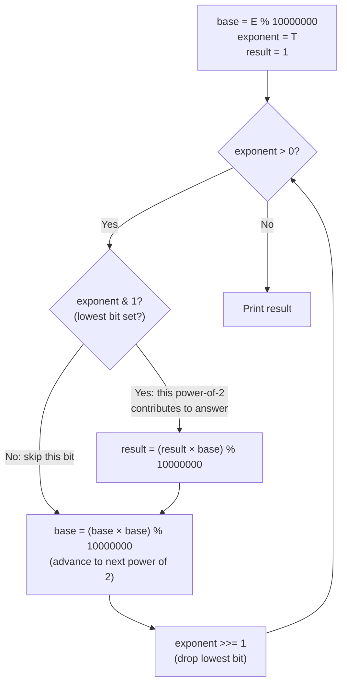

> [!info] Document Metadata
> - **Course:** `=this.course`
> - **Topic:** `=this.topic`
> - **Status:** `=this.status`
> - **Difficulty:** `=this.difficulty`

**🏷️ Tags:** #[[Computer Science]] #[[CSALGCM]] #[[Algorithms and Complexity]] #[[HackerRank]] #[[Priestess Arcana]] #[[Modular Exponentiation]] #[[Fast Power]]

---

# POWAH! UNLIMITED POWAH!

## Problem Description
Emperor Palpatine unleashes lightning with an initial power of $X$. Every millisecond, the power increases by a factor of $X$. Given his initial energy $X$ and the number of milliseconds $N$ he has been shooting lightning, the task is to compute his final lightning power modulo a large integer $M$.

**Input Format:**
Input consists of a single test case containing a line with two integers $X$ and $N$ separated by a space indicating the energy and the time elapsed in milliseconds.

**Output Format:**
Output consists of one line containing Palpatine's power $X^N$ after $N$ milliseconds modulo $M$.

**Constraints:**


**Sample:**
| Input | Output |
|-------|--------|
| `2 4` | `16` |
| `10 4` | `10000` |

---

## Approach & Intuition
> **🗂️ Abstract the problem**
> Emperor Palpatine fires lightning that starts at power 1 and multiplies by `E` every millisecond. After `T` milliseconds, the power is `E^T`. Output `E^T mod 10^7`.

> **🐢 Dumb sol?**
> Multiply by E repeatedly, T times: `result = 1; for t times: result *= E;`
> **O(T)** — T can be up to 10¹², which means **1 trillion multiplications** → TLE (would take hours).

> **🚀 Smart sol?**
> Read the exponent in binary. Only ~40 bits are needed. Square-and-multiply: O(log T) steps.
> **O(log T) ≈ 40 steps** — runs instantly.

---

## The Two Bugs Fixed

### Bug 1: Wrong Modulus
```
Problem says: output P modulo 10^7  (= 10,000,000)
Old code used:               10^9+7 (= 1,000,000,007)  ← completely different!

Both sample answers (16 and 10000) are small enough to pass either modulus,
so the bug is invisible on samples but wrong for large exponents.
```

### Bug 2: Variable Name `exp` Shadows C Stdlib
```c
// C's standard library defines:
double exp(double x);   // Euler's e^x

// Old code used:
long long exp = t;      // Shadows the stdlib function!
// Causes undefined behavior on some compilers → wrong results

// Fix: rename to exponent
long long exponent = t;
```

---

## Fast Exponentiation: Exponentiation by Squaring

**Core Idea:** Express the exponent in binary. Each '1' bit contributes a power of 2. Keep squaring the base to move through powers of 2.

```
Computing 2^13:
  13 in binary = 1 1 0 1
                 ^ ^ ^ ^
                 8 4 2 1   ← place values

  2^13 = 2^8 × 2^4 × 2^1   (skip 2^2 because bit-1 is 0)
       = 256 × 16 × 2 = 8192

Reading bits RIGHT to LEFT (low bit first):
  bit 0 = 1: result *= base(=2¹)   result=2,   base squares → 4
  bit 1 = 0: skip                  result=2,   base squares → 16
  bit 2 = 1: result *= base(=2⁴)   result=32,  base squares → 256
  bit 3 = 1: result *= base(=2⁸)   result=8192. Done!
  Total: 4 steps instead of 13!
```

For T = 10¹²: about **40 binary digits → 40 steps** instead of 10¹².

---

## Modular Arithmetic: Why % At Every Step

```
Without mod: numbers explode immediately.
  2^63 ~ 9.2 × 10^18  ← barely fits in int64
  2^64 = OVERFLOW → garbage → wrong answer

With mod applied at each step:
  Mathematical law: (a × b) mod m = ((a mod m) × (b mod m)) mod m
  This means applying mod per step = same result as applying once at end.

  Max intermediate: (10^7 - 1)² = ~10^14 << int64_max (9.2×10^18)
  So no overflow ever occurs! ✓
```

---

## Algorithm Flowchart



---

## Full Trace: E=2, T=13

| exponent | binary | lowest bit? | result | base after squaring |
|---|---|---|---|---|
| 13 | `1101` | **1** ✓ | 1 × 2 = **2** | 2² = 4 |
| 6 | `0110` | **0** ✗ | 2 (no change) | 4² = 16 |
| 3 | `0011` | **1** ✓ | 2 × 16 = **32** | 16² = 256 |
| 1 | `0001` | **1** ✓ | 32 × 256 = **8192** | 256² = 65536 |
| 0 | `0000` | — | Loop ends | — |

**Output: 8192 = 2¹³** ✓

---

## Code: Every Line Explained

```c
int main() {
    long long e, t;
    scanf("%lld%lld", &e, &t);

    long long base = e % 10000000;
    // Reduce base first! e can be up to 10^12.
    // Squaring unreduced: (10^12)^2 = 10^24 → immediate overflow.
    // After mod: base < 10^7, so base^2 < 10^14 → safe in int64.

    long long exponent = t;
    // Named 'exponent', NOT 'exp' — 'exp' is C stdlib (Euler's e^x).
    // Using 'exp' as a variable name causes shadowing → undefined behavior.

    long long result = 1;
    // Start at 1 (multiplicative identity).
    // We accumulate: result = E^(bits we've processed so far).

    while (exponent > 0) {
        if (exponent & 1) {
            // Bitwise AND with 1: true if lowest bit is 1.
            // This bit's contribution: multiply result by current base.
            result = (result * base) % 10000000;
        }

        base = (base * base) % 10000000;
        // Square the base: base goes 2→4→16→256→65536→...
        // Each squaring doubles the exponent the base represents.

        exponent >>= 1;
        // Bit shift right by 1 = integer divide by 2.
        // Discards the bit we just processed, exposing the next bit.
    }

    printf("%lld\n", result);
}
```

## Complexity Analysis
| | Complexity |
|--|--|
| **Time** | O(log t) |
| **Space** | O(1) |

---

## Original Stub (HackerRank Template)

```cpp
#include <bits/stdc++.h>
using namespace std;

typedef long long ll;

ll modpow(ll base, ll exp, ll mod) {
    // Write your code here
}

int main() {
    ll X, N, M;
    cin >> X >> N >> M;
    
    // Write your code here
    
    return 0;
}
```

---

## Full Solution
```cpp
#include <stdio.h>

int main() {
  	long long e, t;
	scanf("%lld%lld",&e,&t);
	// compute answer
    // Fast modular exponentiation: e^t mod 10^7 (= 10000000)
    long long base = e % 10000000;
    long long exponent = t;
    long long result = 1;
    while (exponent > 0) {
        if (exponent & 1) result = (result * base) % 10000000;
        base = (base * base) % 10000000;
        exponent >>= 1;
    }
    printf("%lld\n", result);
}
```

---

## References & Navigation
- **Related Notes:** [[Divide and Conquer Introduction]]
- **Previous Problem:** [[03 - Lets Plant Rice]]
- **Next Problem:** [[05 - Shattering The Towers Of Algorythmos]]
- **Parent Set:** [[[PS] Priestess Arcana|Priestess Arcana Index]]
