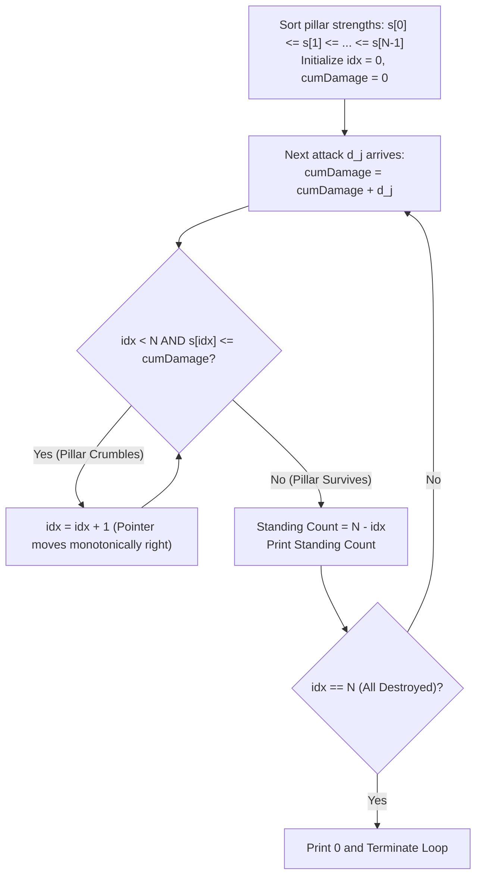
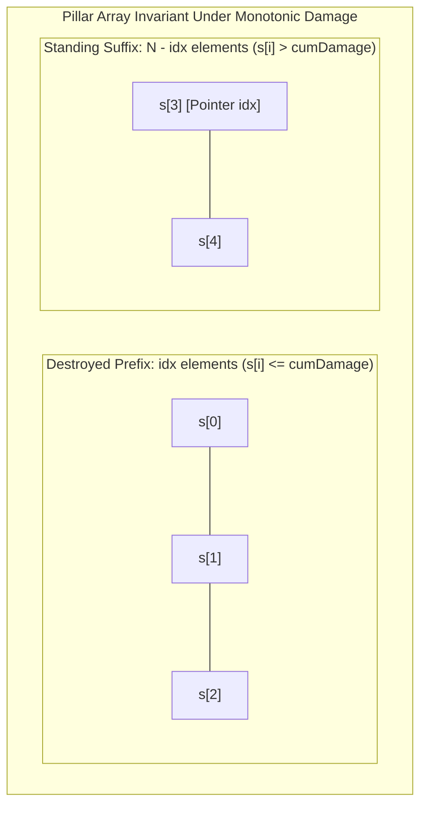
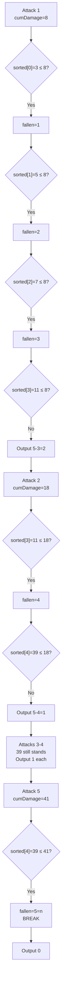

> [!info] Document Metadata
> - **Course:** `=this.course`
> - **Topic:** `=this.topic`
> - **Status:** `=this.status`
> - **Difficulty:** `=this.difficulty`

**Tags:** #[[Computer Science]] #[[CSALGCM]] #[[Algorithms and Complexity]] #[[HackerRank]] #[[Priestess Arcana]] #[[Sorting]] #[[Prefix Sum]]

---

# Shattering the Towers of Algorythmos

## Problem Description
A tower is held up by $N$ pillars, each with a specific strength $s_i$. A party leader unleashes an infinite loop of $K$ sequential attacks, where the $j$-th attack deals $d_j$ damage to all standing pillars simultaneously. A pillar crumbles when its accumulated damage exceeds its strength. We must determine how many pillars are still standing after each attack until all pillars are destroyed.

**Input Format:**
Input begins with a line containing two space-separated integers $N$ and $K$, indicating the number of pillars holding up the tower and the number of attacks your team leader has.
$K$ lines follow, each containing a single integer $d_j$, the damage dealt to all the pillars by your party leader's $j$-th attack.
$N$ lines follow, each containing a single integer $s_i$, indicating the strength of the $i$-th pillar.

**Output Format:**
For each attack executed before the collapse of a tower, print a line containing a single integer indicating how many of the $N$ pillars are still standing. Once all pillars are destroyed, print $0$ to indicate that no pillars are standing. This is the last line of the output.

**Constraints:**


**Sample:**
| Input | Output |
|-------|--------|
| `5 1`<br>`8`<br>`3`<br>`7`<br>`11`<br>`5`<br>`39` | `2`<br>`1`<br>`1`<br>`1`<br>`0` |
| `6 1`<br>`23`<br>`21`<br>`56`<br>`51`<br>`51`<br>`56`<br>`92` | `5`<br>`5`<br>`1`<br>`0` |
| `7 1`<br>`54`<br>`60`<br>`55`<br>`57`<br>`367`<br>`42`<br>`57`<br>`19` | `5`<br>`1`<br>`1`<br>`1`<br>`1`<br>`1`<br>`0` |

---

## Approach & Intuition

**Abstract the problem:**
$N$ pillars have distinct health capacities. You cycle through $K$ cyclic attack values, each contributing additively to cumulative damage. After each attack, output the number of pillars currently standing. A pillar falls when $\text{cumDamage} \ge s_i$.

**Brute Force Approach:**
After each attack, iterate through all $N$ pillars to count survivors.
Time Complexity: $O(K \times N)$ — with $K = N = 100,000$, this requires $10^{10}$ comparisons, causing Time Limit Exceeded (TLE).

**Optimal Two-Pointer Monotonic Sweep:**
1. Sort pillar strengths in $O(N \log N)$ time: $s_0 \le s_1 \le \dots \le s_{N-1}$.
2. Maintain a persistent pointer `idx` tracking the weakest surviving pillar. Because cumulative damage is strictly monotonically non-decreasing ($\Delta d \ge 0$), fallen pillars never revive.
3. The pointer moves exclusively to the right ($0 \to N$). Total pointer advances across all $K$ rounds sum to at most $N$.
4. Total Complexity: $O(N \log N + K)$ time, $O(1)$ auxiliary space.



## Theoretical Framework: Monotonic Array Partition



## Why Sorting Is The Key

**Observation:** The weakest pillar ALWAYS falls first. After any attack, ALL pillars with health ≤ cumulative_damage have fallen. Sorting lets us track this with a single pointer.

```
Unsorted: [11, 3, 39, 7, 5]   ← must scan all 5 every time
Sorted:   [ 3, 5,  7,11,39]   ← pointer only ever moves right →
           ^
           next to potentially fall
```

---

## Two-Pointer Sweep Step by Step

```
Setup: sorted=[3,5,7,11,39], attacks=[8,10,5,8,10,...], cumDamage=0, fallen=0

== Attack 1: +8 → cumDamage=8 ==
  sorted[0]=3  → 3 ≤ 8?  YES → fallen=1
  sorted[1]=5  → 5 ≤ 8?  YES → fallen=2
  sorted[2]=7  → 7 ≤ 8?  YES → fallen=3
  sorted[3]=11 → 11 ≤ 8? NO  → STOP
  Output: 5 - 3 = 2 still standing

== Attack 2: +10 → cumDamage=18 ==
  (pointer resumes at index 3, NOT from 0!)
  sorted[3]=11 → 11 ≤ 18? YES → fallen=4
  sorted[4]=39 → 39 ≤ 18? NO  → STOP
  Output: 5 - 4 = 1 still standing

== Attacks 3,4: cumDamage=23, 31 ==
  sorted[4]=39 → 39 > 23, > 31 → STOP both times
  Output: 1 both times

== Attack 5: +10 → cumDamage=41 ==
  sorted[4]=39 → 39 ≤ 41? YES → fallen=5=n → BREAK
  Output: 0
```

---

## Why The Pointer Never Goes Backwards

```
cumDamage always increases (attacks always deal positive damage).
If pillar[i] survived the last attack: health[i] > cumDamage_old.
For the next attack:                   cumDamage_new > cumDamage_old.
Pillar[i] still might survive:         health[i] might still > cumDamage_new.
But once it falls (health[i] ≤ cumDamage), it STAYS fallen.

Therefore: the 'fallen' pointer moves right only. Total moves across all attacks = n.
This makes the inner while loop O(n) amortized, not O(n) per attack.
```

---

## Complexity Comparison

| Approach | Complexity | n=k=100,000 |
|---|---|---|
| Naive (scan all per attack) | O(k × n) | 10¹⁰ ops → TLE |
| Sort + sweep pointer | O(n log n + k) | ~1.7 million ops → [Pass] |

---

## Code: Every Line Explained

```cpp
void solve() {
    // Sort a COPY (preserve original order for other uses)
    std::vector<int> sorted_s(s_i, s_i + n);
    std::sort(sorted_s.begin(), sorted_s.end());
    // sorted_s[0] ≤ sorted_s[1] ≤ ... ≤ sorted_s[n-1]

    long long cumDamage = 0;   // Running total of all damage dealt
    int fallen = 0;            // Count of pillars fallen = index of NEXT to check
    int attackIdx = 0;         // Which attack in the cycle we're on

    while (fallen < n) {
        cumDamage += d_i[attackIdx % k];
        // attackIdx % k: cycles 0→1→...→k-1→0→1→... (modulo for cycling)
        attackIdx++;

        // Check if more pillars fall now
        while (fallen < n && sorted_s[fallen] <= cumDamage) {
            fallen++;
            // 'fallen' ONLY MOVES RIGHT → amortized O(1) per attack
        }

        answers[answer_line_count++] = n - fallen;
        // n = total pillars, fallen = how many are down
        // n - fallen = still standing

        if (fallen == n) break;  // Everyone's down, no point continuing
    }
}
```



## Complexity Analysis
| | Complexity |
|--|--|
| **Time** | O(n log n + k) |
| **Space** | O(n) |

---

## Original Stub (HackerRank Template)

```cpp
#include <bits/stdc++.h>

#define MAX_N 100000

using namespace std;

int n, k, d_i[MAX_N], s_i[MAX_N];

void solve() {
    // Write your code here
}

int main() {
    scanf("%d%d",&n,&k);
    for(int i = 0; i < k; i++){
        scanf("%d",&d_i[i]);
    }
    for(int i = 0; i < n; i++) {
        scanf("%d",&s_i[i]);
    }

    solve();

    // Write your code here
}
```

---

## Full Solution
```cpp
#include <bits/stdc++.h>

#define MAX_N 100000

using namespace std;

int n, k, d_i[MAX_N], s_i[MAX_N];
int answers[MAX_N]; // SAVE ANSWERS HERE
int answer_line_count; // SAVE NUMBER OF ANSWERS TO PRINT HERE

/*
Takes in the key input values and saves all answers in the 'answers' array. 
Save the number of answers to print in the 'answer_line_count' variable.
*/
void solve() {
    // TODO
    std::vector<int> sorted_s(s_i, s_i + n);
    std::sort(sorted_s.begin(), sorted_s.end());
    long long cumDamage = 0;
    int fallen = 0;
    int attackIdx = 0;
    answer_line_count = 0;
    while (fallen < n) {
        cumDamage += d_i[attackIdx % k];
        attackIdx++;
        while (fallen < n && sorted_s[fallen] <= cumDamage) fallen++;
        answers[answer_line_count++] = n - fallen;
        if (fallen == n) break;
    }
    return;
}

int main() {
    scanf("%d%d",&n,&k);
    for(int i = 0; i < k; i++){
        scanf("%d",&d_i[i]);
    }
    for(int i = 0; i < n; i++) {
        scanf("%d",&s_i[i]);
    }

    solve();

    for(int i = 0; i < answer_line_count; i++) {
        printf("%d\n",answers[i]);
    }
}
```


## References & Navigation
- **Related Notes:** [[Divide and Conquer Introduction]]
- **Previous Problem:** [[04 - POWAH UNLIMITED POWAH]]
- **Next Problem:** [[06 - The Monkeys Paw]]
- **Parent Set:** [[[PS] Priestess Arcana|Priestess Arcana Index]]
