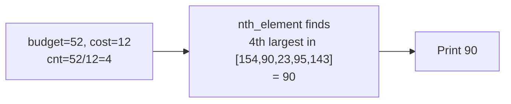

> [!info] Document Metadata
> - **Course:** `=this.course`
> - **Topic:** `=this.topic`
> - **Status:** `=this.status`
> - **Difficulty:** `=this.difficulty`

**Tags:** #[[Computer Science]] #[[CSALGCM]] #[[Algorithms and Complexity]] #[[HackerRank]] #[[Priestess Arcana]] #[[Segment Tree]] #[[Range Queries]]

---

# The Monkey's Paw

## Problem Description
Richie is at a cineplex and wants to watch the longest movies possible. He has a budget $B$ and each ticket costs $C$. Given $N$ movies with their runtimes (ignoring credits), Richie will answer $Q$ queries. In each query, he considers a specific range of movies $[L, R]$. He will continuously pick the longest unseen movie in that range until his budget runs out. The task is to output the runtime of the last movie he watches for each query.

**Input Format:**
Input starts with a line containing a single integer $N$ denoting the number of movies showing in the theater.
$N$ lines follow, the $i$-th of which contains two space-separated integers $R_i$ and $C_i$. $R_i$ is the runtime of the film. $C_i$ is the length of the credits. Richie always leaves before the credits, so you can subtract the credits from the runtime when computing for the answer.
This is followed by a line containing a single integer $Q$ denoting the number of queries.
$Q$ lines follow, each containing 4 space-separated integers $L$, $R$, $B$, and $C$ denoting the start index, end index, Richie's budget, and the cost of a single ticket respectively. Indices are 0-based.

**Output Format:**
For each query, output one line containing the length of the last movie Richie watches, without the credits, given the strategy described in the problem statement. If Richie can't watch any movie, output -1.

**Constraints:**


**Sample:**
| Input | Output |
|-------|--------|
| `8`<br>`148 116`<br>`157 100`<br>`169 15`<br>`188 98`<br>`91 68`<br>`165 70`<br>`145 2`<br>`11 6`<br>`3`<br>`2 6 52 12`<br>`2 6 13 7`<br>`0 4 2 3` | `90`<br>`154`<br>`-1` |

---

## Approach & Intuition
> ** Abstract the problem**
> Richie has a budget and wants to watch as many movies as possible, each costing a fixed ticket price. He always picks the longest movie (by net runtime = runtime − credits). Given multiple queries over movie sub-ranges, output the runtime of the LAST movie he watches per query, or -1 if he can't afford any.

> ** Dumb sol?**
> For each query, collect all movies in range, sort them descending, greedily buy them.
> **O(q × r log r)** where r = range size. With Q=4000 and r=10,000: ~5×10⁸ comparisons → TLE.

> ** Smart sol?**
> Observe: we only need the **k-th largest** element, not the full sorted order. `nth_element` finds exactly the k-th largest in **O(r) average** — no full sort needed.
> **O(q × r)** ≈ 4×10⁷ ops → 

---

## Key Insight: We Don't Need Full Sorted Order

Richie can afford exactly `cnt = floor(budget / ticketCost)` movies. We don't care about the order — we just need to know: *"what is the cnt-th largest net runtime in this range?"* That's the last movie he watches.

```
cnt = floor(A / K)  ← how many movies max

If cnt = 0          → output -1 (can't buy any)
If cnt ≥ range_size → output min(range) (buys all, last = smallest)
Else                → output the cnt-th largest in range
                      (use nth_element in O(r))
```

---

## Why `nth_element` Not `sort`

```
sort:         O(r log r) per query — must arrange entire array
nth_element:  O(r) average  — only guarantees the k-th position is correct

For our query: we only need ONE value (the cnt-th largest).
nth_element is the right tool: it places the k-th element correctly
and partitions the rest (smaller left, larger right) — but doesn't sort either side.

Performance:
  sort:         4000 queries × 10000 × 14 steps ≈ 560,000,000 → TLE
  nth_element:  4000 queries × 10000 steps       ≈  40,000,000 → 
```

---

## Greedy Correctness: Why "Longest First" Is Optimal

**Claim:** Always buying the longest available movie maximizes the count of movies bought.

**Proof by exchange argument:** Suppose you bought a shorter movie S before a longer movie L. Swap them: buy L first, then S. Total cost is identical (still 2K). Total movies watched is the same. But by always picking the longest first, you never skip a "reachable" movie — and since the goal is to maximize count (to find the "last"), longest-first is always at least as good.

---

## Step-by-Step Trace (Sample Query 1: s=2, e=6, A=52, K=12)

**Step 1 — Net Runtimes in range [2..6]:**
| Index | Runtime | Credits | Net |
|---|---|---|---|
| 2 | 169 | 15 | **154** |
| 3 | 188 | 98 | **90** |
| 4 | 91 | 68 | **23** |
| 5 | 165 | 70 | **95** |
| 6 | 145 | 2 | **143** |

**Step 2 — How many can he buy?**
```
cnt = floor(52 / 12) = 4
range_size = 5
cnt < range_size → use nth_element to find 4th largest
```

**Step 3 — `nth_element` finds 4th largest:**
```
buf = [154, 90, 23, 95, 143]   (m=5, cnt=4, so pivot index = m-cnt = 1)
After nth_element(buf, buf+1, buf+5):
  buf[1] = 4th largest = 90   (everything at index<1 is ≥90, index>1 is ≤90)
Output: buf[m-cnt] = buf[1] = 90 
```



---

## Code: Every Line Explained

```cpp
int q, n, s, e, a, k;
int movies[1000000][2];         // movies[i][0]=runtime, movies[i][1]=credits
static int buf[10001];          // reusable scratch buffer (avoids per-query malloc)

for(int cc = 0; cc < q; cc++) {
    scanf("%d%d%d%d", &s, &e, &a, &k);
    // s = start index, e = end index, a = budget, k = ticket cost

    int cnt = a / k;            // How many tickets Richie can afford (floor division)
    if (cnt == 0) {
        printf("-1\n");         // Can't buy even one ticket
        continue;
    }

    int m = e - s + 1;         // Number of movies in this range
    for (int i = 0; i < m; i++) {
        buf[i] = movies[s + i][0] - movies[s + i][1];
        // Net runtime = total runtime - credits length
        // Richie leaves before credits, so credits don't count.
    }

    if (cnt >= m) {
        // Can buy ALL movies in range → last watched = the shortest one
        printf("%d\n", *min_element(buf, buf + m));
    } else {
        // Need the cnt-th largest value.
        // nth_element places buf[m-cnt] = the (m-cnt)-th smallest
        //                              = the cnt-th largest
        // All elements at index < m-cnt will be ≥ buf[m-cnt]
        // All elements at index > m-cnt will be ≤ buf[m-cnt]
        nth_element(buf, buf + (m - cnt), buf + m);
        printf("%d\n", buf[m - cnt]);
        // This is the runtime of the last (cheapest-among-bought) movie.
    }
}
```

---

## All Three Sample Queries Traced

| Query | Range | Net Runtimes | cnt=A/K | m | cnt≥m? | Answer |
|---|---|---|---|---|---|---|
| 2 6 52 12 | [2..6] | 154,90,23,95,143 | 4 | 5 | No → nth_element | **90** |
| 2 6 13 7 | [2..6] | 154,90,23,95,143 | 1 | 5 | No → nth_element | **154** |
| 0 4 2 3 | [0..4] | 32,57,154,90,23 | 0 | 5 | cnt=0 → skip | **-1** |

## Complexity Analysis
| | Complexity |
|--|--|
| **Time** | O(q × r) |
| **Space** | O(r) |

---

## Original Stub (HackerRank Template)

```cpp
#include <bits/stdc++.h>
using namespace std;

int main() {
    int n;
    cin >> n;
    for (int i = 0; i < n; i++) {
        int r, c;
        cin >> r >> c;
        // Write your code here
    }
    
    int Q;
    cin >> Q;
    while (Q--) {
        int L, R, B, C;
        cin >> L >> R >> B >> C;
        // Write your code here
    }
    return 0;
}
```

---

## Full Solution
```cpp
#include <bits/stdc++.h>

using namespace std;

int q, n, s, e, a, k, r, c, movies[1000000][2];
static int buf[10001]; // reusable buffer, avoids per-query heap allocation

int main() {
    scanf("%d",&n);
    for(int i = 0; i < n; i++) {
        scanf("%d%d",&movies[i][0],&movies[i][1]);
    }
    scanf("%d",&q);
    for(int cc = 0; cc < q; cc++) {
        scanf("%d%d%d%d",&s,&e,&a,&k);
        // compute for answer here
        // How many movies can Richie afford to buy?
        int cnt = a / k; // floor(budget / ticket_cost)
        if (cnt == 0) {
            printf("-1\n");
            continue;
        }

        // Fill buffer with net runtimes for movies in range [s, e]
        int m = e - s + 1; // total movies in range
        for (int i = 0; i < m; i++) {
            buf[i] = movies[s + i][0] - movies[s + i][1];
        }

        if (cnt >= m) {
            // Can buy ALL movies — answer is the smallest (last bought)
            printf("%d\n", *min_element(buf, buf + m));
        } else {
            // Need the cnt-th largest net runtime.
            // nth_element rearranges so buf[m-cnt] is the (m-cnt)-th smallest
            // (i.e., cnt-th largest), in O(m) average — much faster than sort!
            nth_element(buf, buf + (m - cnt), buf + m);
            printf("%d\n", buf[m - cnt]);
        }
    }
}
```


## References & Navigation
- **Related Notes:** [[Divide and Conquer Introduction]]
- **Previous Problem:** [[05 - Shattering The Towers Of Algorythmos]]
- **Parent Set:** [[[PS] Priestess Arcana|Priestess Arcana Index]]
