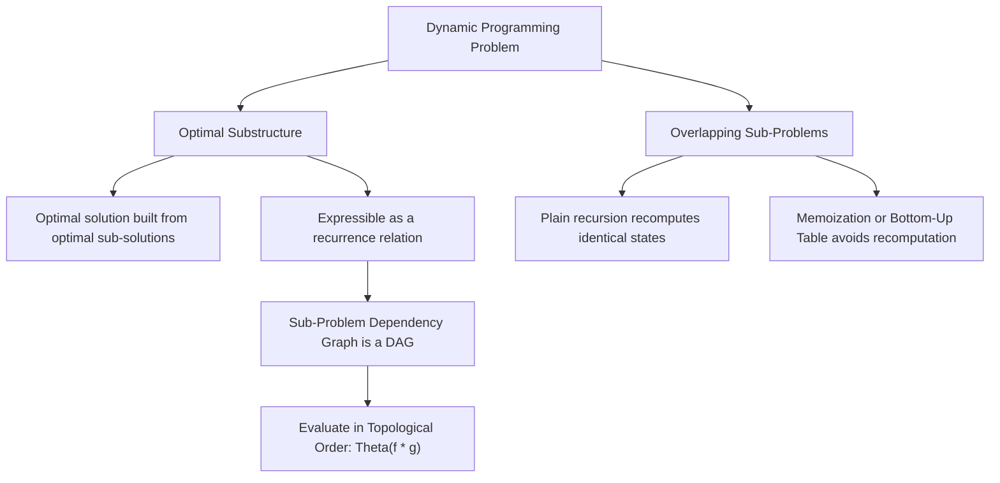

# [QZ] Dynamic Programming Basics

> [!info] Document Metadata
> **Course:** `=this.course` | **Topic:** `=this.topic` | **Status:** `=this.status`

**Tags:** #[[Computer Science]] #[[CSALGCM]] #[[Algorithms]] #[[Quiz]] #[[Dynamic Programming]] #[[DAG]]

---

## Overview

Dynamic programming (DP) solves optimization and counting problems efficiently when two structural conditions hold: optimal substructure and overlapping sub-problems. Rather than recomputing shared sub-problems exponentially many times via plain recursion, DP stores each sub-problem's solution once via memoization or bottom-up tabulation. Modeling sub-problem dependencies as a Directed Acyclic Graph (DAG) reveals the exact topological order required to evaluate every state without circular dependencies.

## Structural Pillars of Dynamic Programming

| Concept | Formal Meaning | Consequence |
| :--- | :--- | :--- |
| **Optimal Substructure** | An optimal solution contains optimal solutions to smaller sub-problems | Enables a valid recurrence relation |
| **Overlapping Sub-Problems** | The same sub-problems recur repeatedly across recursive branches | Storing results converts exponential recursion to polynomial/DP time |
| **Sub-Problem DAG** | Vertices = sub-problems; directed edge $(x, y)$ means $y$ depends on $x$ | Acyclicity guarantees a valid topological evaluation order |
| **DP Running Time** | $\Theta(f)$ sub-problems $\times \Theta(g)$ time per sub-problem | Total time is $\Theta(f \cdot g)$ (and therefore $O(f \cdot g)$) |

## Quiz Compilation & Explanations

### Question 1 (2.5 pts)

**Prompt:**
Optimal sub-structure property refers to which of the following *(select all that are true)*:

**Choices:**

- Sub-optimal solutions can be combined to get an optimal solution
- Optimal solution of a sub-problem contains within it optimal solutions of smaller sub-problems *(Correct)*
- Sub-problems have the same optimal solution
- Optimal solution of a sub-problem can be expressed as a recurrence relation/recursive formula *(Correct)*

**Correct Answers:**

- **Optimal solution of a sub-problem contains within it optimal solutions of smaller sub-problems**
- **Optimal solution of a sub-problem can be expressed as a recurrence relation/recursive formula**

**Rationale:**

- **Why Option 1 is wrong:** Optimal substructure specifically requires combining **optimal** solutions of smaller sub-problems, not sub-optimal ones (if a sub-solution were sub-optimal, a cut-and-paste argument would yield an even better overall solution).
- **Why Option 2 is correct:** This is the textbook definition of optimal substructure — an optimal solution to a problem/sub-problem incorporates optimal solutions to its constituent smaller sub-problems.
- **Why Option 3 is wrong:** Different sub-problems have different inputs/parameters and generally have distinct optimal values and solutions.
- **Why Option 4 is correct:** Because an optimal solution is constructed from optimal solutions to smaller sub-problems, its value can be written directly as a recursive formula (recurrence relation) over those smaller sub-problems.

---

### Question 2 (2.5 pts)

**Prompt:**
Suppose we are solving a problem by dynamic programming, and we have defined $\Theta(f)$ sub-problems, each of which can be solved in $\Theta(g)$ time, where $f$ and $g$ are functions of the input size.
The running time of the dynamic programming algorithm can be expressed as which of the following *(select all that are true)*:

**Choices:**

- $\Theta(f + g)$
- $O(f \cdot g)$ *(Correct)*
- $\Theta(f \cdot g)$ *(Correct)*
- $O(f + g)$

**Correct Answers:**

- **$O(f \cdot g)$**
- **$\Theta(f \cdot g)$**

**Rationale:**

- **Why $\Theta(f + g)$ is wrong:** Each of the $\Theta(f)$ sub-problems requires $\Theta(g)$ work, so total work is the product $\Theta(f \cdot g)$, not the sum $\Theta(f + g)$.
- **Why $O(f \cdot g)$ is correct:** Any function in $\Theta(f \cdot g)$ is automatically bounded above by $O(f \cdot g)$.
- **Why $\Theta(f \cdot g)$ is correct:** Solving $\Theta(f)$ distinct sub-problems once each at $\Theta(g)$ cost per sub-problem gives an exact tight bound of $\Theta(f) \times \Theta(g) = \Theta(f \cdot g)$.
- **Why $O(f + g)$ is wrong:** Unless one of $f$ or $g$ is $O(1)$, $f \cdot g$ grows strictly faster than $f + g$, so $O(f + g)$ is not a valid upper bound in general.

---

### Question 3 (2.5 pts)

**Prompt:**
Although in dynamic programming we obtain recursive formula (recurrence relations) for solutions of sub-problems, we don't solve the problem using plain recursion because *(select all that are true)*:

**Choices:**

- programming languages might not support recursion
- sub-problems overlap *(Correct)*
- plain recursion does not remember the solutions of previously solved sub-problems *(Correct)*
- computer scientists don't like recursions

**Correct Answers:**

- **sub-problems overlap**
- **plain recursion does not remember the solutions of previously solved sub-problems**

**Rationale:**

- **Why "programming languages might not support recursion" is wrong:** Modern general-purpose languages support recursion; avoiding plain recursion in DP is an algorithmic efficiency issue, not a language limitation.
- **Why "sub-problems overlap" is correct:** In DP problems (like Fibonacci, Longest Common Subsequence, or Knapsack), the same sub-problems are invoked repeatedly along many different recursive paths.
- **Why "plain recursion does not remember the solutions of previously solved sub-problems" is correct:** Without memoization or a DP table, plain recursion re-solves the exact same sub-problem from scratch every time it is encountered, often causing exponential blowup.
- **Why "computer scientists don't like recursions" is wrong:** Recursion is widely used in divide-and-conquer, tree/graph traversals, and top-down memoized DP; only unmemoized overlapping recursion is avoided.

---

### Question 4 (2.5 pts)

**Prompt:**
Consider the following graph representation of a dynamic programming solution. A node corresponds to a sub-problem, and a directed edge from node $x$ to node $y$ means that computing an optimal solution of $y$ depends on computing an optimal solution of $x$, i.e. optimal solution of $x$ appears in the recurrence relation/recursive formula describing an optimal solution of $y$. Which of the following are true about this graph? Select all that are true.

**Choices:**

- It is a directed graph. *(Correct)*
- It contains exactly 1 cycle.
- It is acyclic. *(Correct)*
- The vertices can be ordered such that for any edge $(i, j)$, $i < j$ in the order. *(Correct)*

**Correct Answers:**

- **It is a directed graph.**
- **It is acyclic.**
- **The vertices can be ordered such that for any edge $(i, j)$, $i < j$ in the order.**

**Rationale:**

- **Why "It is a directed graph." is correct:** Dependency is asymmetric — if $y$ depends on $x$, there is a directed edge $x \to y$, so the graph is directed.
- **Why "It contains exactly 1 cycle." is wrong:** Any cycle $x_1 \to x_2 \to \dots \to x_1$ represents a circular dependency where a sub-problem depends on itself, making finite DP evaluation impossible.
- **Why "It is acyclic." is correct:** Each sub-problem must depend strictly on smaller/previously resolved sub-problems, ensuring zero directed cycles — the dependency graph is a **Directed Acyclic Graph (DAG)**.
- **Why "The vertices can be ordered such that for any edge $(i, j)$, $i < j$ in the order." is correct:** Every finite DAG admits a **topological sort** (linear ordering) in which every dependency $i$ appears before the sub-problem $j$ that requires it; bottom-up DP fills the table in this exact topological order.

## Multiple Choice Questions

1. What distinguishes divide-and-conquer (such as Merge Sort) from dynamic programming?
    - **A)** Divide-and-conquer sub-problems are disjoint, whereas DP sub-problems overlap
    - **B)** Divide-and-conquer does not use recurrence relations
    - **C)** Dynamic programming cannot be implemented iteratively
    - **D)** Divide-and-conquer always runs in $O(\log n)$ time

2. What would happen if a DP sub-problem dependency graph contained a directed cycle?
    - **A)** The algorithm would run twice as fast
    - **B)** A valid topological evaluation order would not exist due to circular dependency
    - **C)** The graph would become an undirected tree
    - **D)** Memoization would automatically break the cycle optimally

3. If a DP algorithm defines $\Theta(n^2)$ sub-problems and each sub-problem loops over $\Theta(n)$ split points, what is its total running time?
    - **A)** $\Theta(n^2)$
    - **B)** $\Theta(n^2 + n)$
    - **C)** $\Theta(n^3)$
    - **D)** $\Theta(2^n)$

4. In a DP dependency DAG where directed edge $(u, v)$ means sub-problem $v$ depends on sub-problem $u$, which nodes correspond to the base cases?
    - **A)** Nodes with out-degree $0$
    - **B)** Nodes with in-degree $0$
    - **C)** Nodes with maximum degree
    - **D)** Nodes belonging to the longest cycle

5. What is the main difference between top-down memoization and bottom-up tabulation in dynamic programming?
    - **A)** Top-down has worse asymptotic complexity on every problem
    - **B)** Top-down solves only reachable sub-problems recursively while caching results; bottom-up fills all states iteratively in topological order
    - **C)** Bottom-up does not require optimal substructure
    - **D)** Top-down does not store solutions to sub-problems

6. [MSQ] Which statements accurately characterize optimal substructure? (Select all that apply)
    - **A)** Sub-optimal solutions can be combined to construct a globally optimal solution
    - **B)** An optimal solution to a sub-problem contains optimal solutions to smaller sub-problems
    - **C)** All sub-problems share the exact same optimal objective value
    - **D)** An optimal solution to a sub-problem can be expressed as a recurrence relation over smaller sub-problems

7. [MSQ] If a dynamic programming formulation defines $\Theta(f)$ distinct sub-problems, each solvable in $\Theta(g)$ time, which bounds accurately describe its total running time? (Select all that apply)
    - **A)** $\Theta(f + g)$
    - **B)** $O(f \cdot g)$
    - **C)** $\Theta(f \cdot g)$
    - **D)** $O(f + g)$

8. [MSQ] In a dynamic programming dependency graph where vertices are sub-problems and a directed edge $(x, y)$ indicates that $y$ depends on $x$, which properties hold? (Select all that apply)
    - **A)** It is a directed graph
    - **B)** It must contain at least one cycle
    - **C)** It is acyclic
    - **D)** Its vertices can be topologically ordered so that $i < j$ for every edge $(i, j)$

### Answer Key & Explanations

1. **A)** Divide-and-conquer partitions a problem into independent, non-overlapping sub-problems, while DP handles overlapping sub-problems by storing their answers. B, C, and D are false.
2. **B)** A directed graph has a topological sort if and only if it is acyclic; a cycle means sub-problem $A$ needs $B$ and $B$ needs $A$, causing infinite recursion or unsolvable dependencies. A, C, and D are false.
3. **C)** Multiplying $\Theta(n^2)$ sub-problems by $\Theta(n)$ work per sub-problem yields $\Theta(n^3)$ (as in Matrix Chain Multiplication). A omits per-sub-problem cost, B adds instead of multiplying, and D is exponential.
4. **B)** Because edge $u \to v$ means $v$ depends on $u$, a base case depends on no other sub-problems and therefore has in-degree $0$. A describes the final target problem(s) that nothing else depends on, C is arbitrary, and D is impossible in a DAG.
5. **B)** Both paradigms avoid recomputation and rely on optimal substructure, differing in evaluation strategy: top-down caches recursive calls on demand, whereas bottom-up iterates through states in topological order. A, C, and D are false.
6. **B, D)** Optimal substructure means optimal solutions compose from optimal (not sub-optimal) sub-solutions, which directly induces a recurrence relation. Different sub-problems have different parameters and generally distinct optimal values (C).
7. **B, C)** Solving $\Theta(f)$ distinct sub-problems once each at $\Theta(g)$ work per sub-problem takes $\Theta(f \cdot g)$ time, which is also $O(f \cdot g)$. Additive expressions $\Theta(f + g)$ and $O(f + g)$ underestimate the product cost.
8. **A, C, D)** Dependency edges have direction ($x \to y$), cannot contain cycles without circular evaluation, and therefore form a DAG that admits a linear topological ordering for bottom-up evaluation.

## References & Navigation

- **Previous Quiz:** [[[QZ] Divide and Conquer]]
- **Next Quiz:** [[[QZ] Dynamic Programming Problem 1]]
- **Related Notes:** [[Dynamic Programming Introduction]], [[Divide and Conquer Introduction]]
