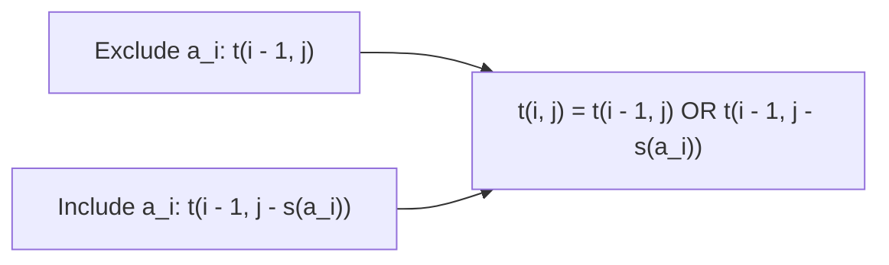

# [QZ] Dynamic Programming Problem 1

> [!info] Document Metadata
> **Course:** `=this.course` | **Topic:** `=this.topic` | **Status:** `=this.status`

**Tags:** #[[Computer Science]] #[[CSALGCM]] #[[Algorithms]] #[[Quiz]] #[[Dynamic Programming]] #[[Pseudo-Polynomial Time]]

---

## Overview

The Partition Problem asks whether a finite set of positive integers can be split into two disjoint subsets with equal total sums. Formulating this decision problem as a two-dimensional boolean dynamic programming table $t(i, j)$ demonstrates how subset-sum sub-problems build bottom-up from base cases. Crucially, the resulting $\Theta(n \times B)$ algorithm illustrates the distinction between true polynomial time and pseudo-polynomial time complexity.

## Problem Definition & DP Formulation

**Input:** A finite set $A = \{a_1, a_2, \dots, a_n\}$ of positive integers, with a "size" $s(a)$ for each $a \in A$, and total sum $B = \sum_{a \in A} s(a)$.

**Question:** Is there a subset $A' \subseteq A$ such that the sum of sizes in $A'$ equals the sum of sizes in $A - A'$, i.e., equals $B / 2$?

**Examples from Problem Statement:**

- **YES instance:** $A = \{a_1, a_2, a_3, a_4, a_5\}$ with sizes $1, 9, 5, 3, 8$. Total $B = 26$ (even), target $B/2 = 13$. Subset $\{a_1, a_2, a_4\}$ sums to $1 + 9 + 3 = 13 = 5 + 8$.
- **NO instance:** Sizes $1, 9, 5, 3, 7$. Total $B = 25$ (odd), not divisible by $2$, so no valid partition exists.

**Sub-Problem Definition:**
Assuming $B$ is even, for $1 \le i \le n$ and $0 \le j \le B/2$, let $t(i, j)$ be the truth value of:

> *"There is a subset of $\{a_1, a_2, \dots, a_i\}$ whose sum of sizes is exactly $j$."*

| DP Component | Specification |
| :--- | :--- |
| **Base Case ($j = 0$)** | $t(i, 0) = \text{TRUE}$ for all $1 \le i \le n$ (empty subset $\emptyset$ sums to $0$) |
| **Base Case ($i = 1, j \ge 1$)** | $t(1, j) = \text{TRUE} \iff j = s(a_1)$ |
| **Recurrence ($i > 1$)** | $t(i, j) = t(i - 1, j) \lor t(i - 1, j - s(a_i))$ (with second term FALSE if $j < s(a_i)$) |
| **Table Dimensions** | $n$ rows $\times (B/2 + 1)$ columns $= \Theta(n \times B)$ cells |
| **Final Answer** | $t(n, B/2)$ |

## Quiz Compilation & Explanations

### Question 1 (1 pt)

**Prompt:**
Is the value of $t(1, 0)$ True or False?

**Choices:**

- True *(Correct)*
- False

**Correct Answer:** **True**

**Rationale:**

- **Why True is correct:** $t(1, 0)$ asks whether there exists a subset of $\{a_1\}$ whose elements sum to $0$. The empty subset $\emptyset \subseteq \{a_1\}$ always exists and has an empty sum of $0$, so $t(1, 0) = \text{TRUE}$.
- **Why False is wrong:** Forgetting that the empty set $\emptyset$ is a valid subset of $\{a_1\}$ leads to thinking the only possible sum is $s(a_1) > 0$.

---

### Question 2 (2 pts)

**Prompt:**
Which one of the following statements is true regarding $t(1, j)$ for $j$ between $1$ and $B/2$?

**Choices:**

- $t(1, j)$ is TRUE if and only if $s(a_j) = 1$
- $t(1, j)$ is FALSE if and only if $j = s(a_1)$
- $t(1, j)$ is TRUE if and only if $j = s(a_1)$ *(Correct)*

**Correct Answer:** **$t(1, j)$ is TRUE if and only if $j = s(a_1)$**

**Rationale:**

- **Why "$t(1, j)$ is TRUE if and only if $j = s(a_1)$" is correct:** The set $\{a_1\}$ has only two subsets: $\emptyset$ (sum $0$) and $\{a_1\}$ (sum $s(a_1)$). Since $j \ge 1$, the empty subset cannot achieve sum $j$, so a subset summing to $j$ exists if and only if $j$ equals $s(a_1)$.
- **Why "$t(1, j)$ is TRUE if and only if $s(a_j) = 1$" is wrong:** $j$ represents a target sum (up to $B/2$), not an element index into $A$; $a_j$ need not even exist when $j > n$, and $i = 1$ restricts us exclusively to $\{a_1\}$.
- **Why "$t(1, j)$ is FALSE if and only if $j = s(a_1)$" is wrong:** This inverts the truth value — when $j = s(a_1)$, selecting $\{a_1\}$ makes $t(1, j)$ TRUE, not FALSE.

---

### Question 3 (2 pts)

**Prompt:**
Below is an (incomplete) recurrence relation involving $t(i, j)$:

$$t(i, j) = \text{TRUE} \text{ if and only if:}$$

either $t(i - 1, j) =$ `[Blank 1]`, or $t(i - 1, j - s(a_i)) =$ `[Blank 2]`.

**Correct Answers:**

- **Blank 1:** `TRUE`
- **Blank 2:** `TRUE`

**Rationale:**

- **Why both blanks are `TRUE`:** To form a subset of $\{a_1, \dots, a_i\}$ with exact sum $j$, element $a_i$ is either excluded or included:
  1. **Exclude $a_i$:** A subset of $\{a_1, \dots, a_{i-1}\}$ must already sum to $j$, meaning $t(i - 1, j) = \text{TRUE}$.
  2. **Include $a_i$:** The remaining elements from $\{a_1, \dots, a_{i-1}\}$ must sum to $j - s(a_i)$, meaning $t(i - 1, j - s(a_i)) = \text{TRUE}$.
- **Why `FALSE` would be wrong in either blank:** A `FALSE` value means no subset of the first $i - 1$ elements achieves that required sub-sum, which cannot justify setting $t(i, j) = \text{TRUE}$.

---

### Question 4 (2 pts)

**Prompt:**
Consider a dynamic programming solution using the recurrence above, where you build a table to hold the solutions to the sub-problem. The rows of the table correspond to $i$ and columns correspond to $j$. How many cells does this table have?

**Choices:**

- $\Theta(i \times j)$
- $\Theta(n + B/2)$
- $\Theta(n \times B)$ *(Correct)*
- $o(n \times B/2)$

**Correct Answer:** **$\Theta(n \times B)$**

**Rationale:**

- **Why $\Theta(n \times B)$ is correct:** Row index $i$ runs from $1$ to $n$ ($n$ rows) and column index $j$ runs from $0$ to $B/2$ ($B/2 + 1$ columns). Total cells $= n \cdot (B/2 + 1) = \frac{1}{2}nB + n = \Theta(n \times B)$, since constant factor $\frac{1}{2}$ drops out in $\Theta$ notation.
- **Why $\Theta(i \times j)$ is wrong:** $i$ and $j$ are loop/index variables for a single cell, not the full problem parameters $n$ and $B$.
- **Why $\Theta(n + B/2)$ is wrong:** A 2D grid multiplies rows by columns rather than adding them.
- **Why $o(n \times B/2)$ is wrong:** Little-$o$ claims strictly fewer than $n \times B/2$ cells asymptotically, whereas the exact count $\frac{1}{2}nB + n$ is strictly greater than $n \times B/2$.

---

### Question 5 (2 pts)

**Prompt:**
What is the running time of this dynamic programming algorithm?

**Choices:**

- $\Theta(i \times j)$
- $\Theta(n \times B)$ *(Correct)*
- $\Theta(n + B/2)$
- $o(n \times B/2)$

**Correct Answer:** **$\Theta(n \times B)$**

**Rationale:**

- **Why $\Theta(n \times B)$ is correct:** The table contains $\Theta(n \times B)$ sub-problems, and filling each cell $t(i, j)$ performs at most two constant-time table lookups ($t(i - 1, j)$ and $t(i - 1, j - s(a_i))$) and one boolean OR, taking $\Theta(1)$ time per cell. Total time $= \Theta(n \times B) \times \Theta(1) = \Theta(n \times B)$.
- **Why $\Theta(i \times j)$ is wrong:** Running time must be expressed in terms of the input parameters $n$ and $B$, not cell indices $i, j$.
- **Why $\Theta(n + B/2)$ is wrong:** Filling all cells of an $n \times (B/2 + 1)$ table requires visiting every row-column pair, not their sum.
- **Why $o(n \times B/2)$ is wrong:** Total work is $\Theta(n \times B)$, not strictly smaller than $nB/2$.

---

### Question 6 (1 pt)

**Prompt:**
This algorithm has a polynomial time complexity. Choose whether True or False.

**Choices:**

- True
- False *(Correct)*

**Correct Answer:** **False**

**Rationale:**

- **Why False is correct:** Complexity is formally measured in the **bit length** of the encoded input, not the numeric magnitude of the integers. Representing integer $B$ in binary takes only $k = \lceil \log_2 B \rceil$ bits, so $B = \Theta(2^k)$. Thus $\Theta(n \times B) = \Theta(n \cdot 2^k)$, which is **exponential** in the input size in bits (known as **pseudo-polynomial time**, not true polynomial time).
- **Why True is wrong:** $\Theta(n \times B)$ looks like a polynomial formula visually, which is a classic trap; because $B$ is a numeric value rather than an input length, the Partition Problem remains NP-complete and this DP solution is only pseudo-polynomial.

## Multiple Choice Questions

1. In the Partition Problem DP formulation, why can the algorithm immediately output NO when the total sum $B$ is odd?
    - **A)** Because odd numbers cannot be represented in binary
    - **B)** Because no subset of integers can sum to the non-integer value $B / 2$
    - **C)** Because the DP table requires an even number of rows $n$
    - **D)** Because $t(1, 0)$ becomes FALSE when $B$ is odd

2. For $A = \{a_1, a_2, a_3\}$ with sizes $s = (3, 1, 2)$ and $B/2 = 3$, what is the value of $t(2, 2)$?
    - **A)** TRUE, because $\{a_1, a_2\}$ sums to $2$
    - **B)** FALSE, because no subset of $\{3, 1\}$ sums to $2$
    - **C)** TRUE, because $s(a_3) = 2$
    - **D)** FALSE, because $B$ is odd

3. Why is the $\Theta(n \times B)$ Partition DP algorithm classified as pseudo-polynomial rather than polynomial?
    - **A)** Because $n$ can be arbitrarily large
    - **B)** Because the factor $B$ is exponential in the number of bits required to encode $B$
    - **C)** Because boolean OR operations take $O(\log B)$ time
    - **D)** Because the table requires $O(2^n)$ memory

4. Which cell of the completed DP table stores the final answer to the Partition Problem?
    - **A)** $t(1, B/2)$
    - **B)** $t(n, 0)$
    - **C)** $t(n, B/2)$
    - **D)** $t(n, B)$

5. When computing $t(i, j)$ with $j < s(a_i)$, how does the recurrence simplify?
    - **A)** $t(i, j) = \text{FALSE}$ automatically
    - **B)** $t(i, j) = t(i - 1, j)$ because $a_i$ cannot be included without exceeding $j$
    - **C)** $t(i, j) = \text{TRUE}$ automatically
    - **D)** $t(i, j) = t(i - 1, s(a_i) - j)$

6. [BLANK] Complete the Partition DP table entries for $A = \{a_1, a_2, a_3\}$ with sizes $s = (1, 3, 2)$ and $B/2 = 3$ (enter `T` for TRUE or `F` for FALSE):

| Cell | Meaning | Value |
| :--- | :--- | :--- |
| $t(1, 0)$ | Subset of $\{1\}$ summing to $0$ | {{1}} |
| $t(1, 2)$ | Subset of $\{1\}$ summing to $2$ | {{2}} |
| $t(2, 2)$ | Subset of $\{1, 3\}$ summing to $2$ | {{3}} |
| $t(3, 3)$ | Subset of $\{1, 3, 2\}$ summing to $3$ | {{4}} |

7. [INPUT] For $A = \{a_1, a_2, a_3, a_4, a_5\}$ with sizes $(1, 9, 5, 3, 8)$ ($B = 26$, $B/2 = 13$), how many total cells are in the Partition DP table $t(i, j)$ for $1 \le i \le 5$ and $0 \le j \le 13$?

8. [BLANK] Complete the Partition DP recurrence conditions for $t(i, j) = \text{TRUE}$ when $i > 1$ and $j \ge s(a_i)$ (enter `TRUE` or `FALSE`):

| Case | Sub-Problem Condition |
| :--- | :--- |
| Exclude $a_i$ | $t(i - 1, j) =$ {{1}} |
| Include $a_i$ | $t(i - 1, j - s(a_i)) =$ {{2}} |

### Answer Key & Explanations

1. **B)** Sizes are integers, so any subset sum is an integer. If $B$ is odd, $B/2$ is not an integer and no two equal integer sums can add up to $B$. A, C, and D are false statements.
2. **B)** Subsets of $\{a_1, a_2\}$ with sizes $\{3, 1\}$ produce sums $\{0, 1, 3, 4\}$, none of which equals $2$. A miscomputes $3 + 1 = 4$, C illegally uses $a_3$ when $i = 2$, and D is false since $B = 6$ is even.
3. **B)** A number $B$ occupies $\Theta(\log B)$ input bits, so runtime proportional to $B = 2^{\log_2 B}$ is exponential in the bit-length of the input. A does not make an algorithm non-polynomial, C is wrong (boolean OR is $O(1)$), and D is wrong (table size is $\Theta(nB)$).
4. **C)** $t(n, B/2)$ asks whether a subset of all $n$ elements $\{a_1, \dots, a_n\}$ has sum $B/2$. A only checks $\{a_1\}$, B always returns TRUE (empty subset), and D exceeds the column bound $B/2$.
5. **B)** Since all element sizes are positive, including $a_i$ when $s(a_i) > j$ would yield a sum strictly exceeding $j$, leaving only the exclusion option $t(i - 1, j)$. A ignores valid subsets without $a_i$, C is baseless, and D reverses the subtraction illegally.
6. **[1: T/true; 2: F/false; 3: F/false; 4: T/true]** The empty subset sums to $0$, giving $t(1, 0) = \text{T}$. Subsets of $\{1\}$ only sum to $0$ or $1$, so $t(1, 2) = \text{F}$. Subsets of $\{1, 3\}$ only sum to $\{0, 1, 3, 4\}$, so $t(2, 2) = \text{F}$. Finally, including $a_3 = 2$ with $t(2, 1) = \text{T}$ (or $\{3\}$) achieves sum $3$, so $t(3, 3) = \text{T}$.
7. **[70; 70 cells]** With $i \in \{1, 2, 3, 4, 5\}$ ($5$ rows) and $j \in \{0, 1, \dots, 13\}$ ($14$ columns), the table contains $5 \times 14 = 70$ cells.
8. **[1: TRUE/T; 2: TRUE/T]** A subset of $\{a_1, \dots, a_i\}$ summing to $j$ exists if and only if either a subset of $\{a_1, \dots, a_{i-1}\}$ already sums to $j$ ($t(i - 1, j) = \text{TRUE}$) or a subset of $\{a_1, \dots, a_{i-1}\}$ sums to $j - s(a_i)$ ($t(i - 1, j - s(a_i)) = \text{TRUE}$) to which $a_i$ is added.

## References & Navigation

- **Previous Quiz:** [[[QZ] Dynamic Programming Basics]]
- **Next Quiz:** [[[QZ] Huffman Encoding]]
- **Related Notes:** [[Dynamic Programming Introduction]], [[Complexity Analysis]]
