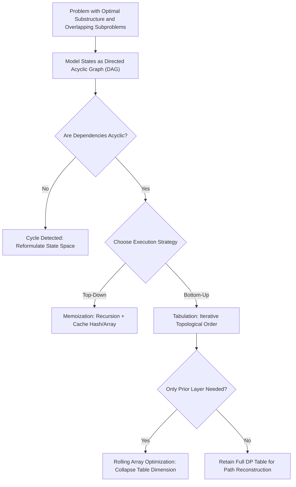

# Dynamic Programming Introduction

> [!info] Document Metadata
> - **Course:** CSALGCM
> - **Module:** Module 3 - Dynamic Programming
> - **Topic:** Dynamic Programming Introduction

**Tags:** #[[Computer Science]] #[[CSALGCM]] #[[Algorithms]] #[[Dynamic Programming Introduction]]

## Overview

**Dynamic Programming (DP)** is an exact optimization and counting paradigm designed for problems whose recursive decompositions visit the same subproblems repeatedly. Where pure Divide and Conquer recomputes overlapping states—resulting in exponential blowup—Dynamic Programming systematically solves each distinct subproblem **only once**, stores its result in a lookup table, and reuses that result across all dependent transitions.

Formally, Dynamic Programming bridges recursive mathematical recurrences and graph theory: every valid DP formulation induces a **Directed Acyclic Graph (DAG)** of state dependencies, ensuring that optimal substructure can be evaluated cleanly in topological order.

---

## Core Theoretical Foundations

A problem is amenable to Dynamic Programming if and only if it exhibits two structural invariants:

### 1. Optimal Substructure (Bellman's Principle of Optimality)
A problem possesses **optimal substructure** if an optimal solution to the overall problem can be constructed directly from optimal solutions to its smaller subproblems.
- **When it holds:** In Shortest Path (with non-negative weights or no negative cycles), if the shortest path $u \leadsto v$ passes through intermediate vertex $w$, then the prefix $u \leadsto w$ and suffix $w \leadsto v$ must themselves be shortest paths. Similarly, in 0/1 Knapsack, an optimal choice on items $\{1 \dots i\}$ with capacity $w$ depends solely on optimal values over $\{1 \dots i-1\}$ at capacities $w$ and $w - w_i$.
- **When it fails:** In the **Longest Simple Path** problem on graphs with cycles, the optimal simple path $u \leadsto v$ through $w$ cannot safely combine independently computed longest simple paths $u \leadsto w$ and $w \leadsto v$, because those subpaths might share vertices and violate simplicity. Subproblems are no longer independent of shared state.

### 2. Overlapping Subproblems
A recursive formulation has **overlapping subproblems** when the recursion tree revisits a relatively small (polynomial or pseudo-polynomial) set of unique parameter tuples exponentially many times.
- Naive recursion for Fibonacci $F(n) = F(n-1) + F(n-2)$ performs $\Theta(\phi^n)$ calls ($\phi \approx 1.618$), even though there are only $n + 1$ distinct subproblems $F(0), F(1), \dots, F(n)$.
- Caching each state collapses time complexity from $\Theta(\phi^n)$ to $\Theta(n)$.

### 3. Modeling DP Problems as a Directed Acyclic Graph (DAG)
Every Dynamic Programming recurrence defines a **state-dependency DAG** $G = (V, E)$:
- **Vertices ($V$):** Each vertex represents a unique subproblem state (for example, $(i, w)$ in Knapsack or $(i, j)$ in Edit Distance).
- **Directed Edges ($E$):** A directed edge $u \to v$ exists whenever computing state $v$ depends directly on the value of state $u$.
- **Acyclicity Requirement:** The dependency graph **must be acyclic**. If a cycle $u \to \dots \to u$ existed, the recurrence would become circular and unsolvable in a single pass.
- **Topological Evaluation:** Solving a DP bottom-up is literally evaluating states along a **topological sort** of the state DAG, guaranteeing every prerequisite state $u$ is finalized before any successor state $v$ reads it.



---

## Top-Down Memoization vs. Bottom-Up Tabulation

| Dimension | Top-Down Memoization | Bottom-Up Tabulation |
| :--- | :--- | :--- |
| **Execution Mechanics** | Recursive DFS over the state DAG with a cache (`memo[state]`) checked on entry | Iterative loops filling a DP array/matrix in explicit topological order |
| **States Evaluated** | **Lazy:** Computes only states reachable from the initial root query | **Eager:** Evaluates every state in the table up to the target state |
| **Dependency Ordering** | Handled implicitly by the call stack | Must be designed explicitly via loop bounds and direction |
| **Overhead & Safety** | Function-call overhead; vulnerable to stack overflow on deep recursions ($n > 10^5$) | Zero recursion overhead; superior CPU cache locality |
| **Space Optimization** | Difficult to discard old layers dynamically | Easily compressed via **rolling arrays** |

### Space-Optimization: The Rolling Array Technique

In many 2D DP tables $DP[i][j]$, computing row $i$ depends solely on row $i - 1$ (or rows $i-1$ and $i-2$). Rather than allocating $\Theta(n \cdot W)$ memory, we compress the first dimension:
1. **Two-Row Ping-Pong (`prev` and `curr`):** Store only two 1D arrays of size $W+1$ (or $\min(m, n) + 1$) and swap references after each row, reducing space from $O(nW)$ to $O(W)$.
2. **Single-Row In-Place Compression (Critical Loop Direction):** When updating a single 1D array `dp[0..W]`, the iteration direction controls whether items can be reused:
   - **0/1 Knapsack (at most once per item):** Iterate capacity **backwards** from $w = W$ down to $w_i$. Because $w - w_i < w$, `dp[w - w_i]` has not yet been updated in iteration $i$ and still holds row $i-1$!
   - **Unbounded Knapsack / Coin Change (unlimited reuse):** Iterate capacity **forwards** from $w = w_i$ up to $W$. Because $w - w_i$ has already been updated in iteration $i$, `dp[w - w_i]` reflects row $i$, allowing item $i$ to be chosen multiple times.

*Trade-off:* Compressing the table reduces auxiliary memory to $O(W)$ or $O(\min(m, n))$, but discards intermediate states needed for straightforward parent-pointer traceback (unless paired with Hirschberg's divide-and-conquer DP recovery).

---

## Worked Classic DP Formulations

### 1. 0/1 Knapsack vs. Unbounded Knapsack

Given $n$ items with positive integer weights $w_i$ and values $v_i$, and capacity $W$:

#### 0/1 Knapsack (Each item taken $0$ or $1$ time)
Let $DP[i][w]$ be the maximum value achievable using the first $i$ items within capacity $w$:

$$
DP[i][w] = \begin{cases}
0 & \text{if } i = 0 \text{ or } w = 0 \\
DP[i-1][w] & \text{if } w < w_i \\
\max\!\big(DP[i-1][w],\; DP[i-1][w - w_i] + v_i\big) & \text{if } w \ge w_i
\end{cases}
$$

- **Trace Example ($n = 3, W = 5$):** Items $(w_1=2, v_1=3)$, $(w_2=3, v_2=4)$, $(w_3=4, v_3=5)$.
  - Row 1 $(2, 3)$: `[0, 0, 3, 3, 3, 3]`
  - Row 2 $(3, 4)$: `[0, 0, 3, 4, 4, 7]` (at $w=5$: $\max(3, DP[1][2]+4) = 7$)
  - Row 3 $(4, 5)$: `[0, 0, 3, 4, 5, 7]` (optimal value **7** using items 1 and 2).
- **Complexity & Pseudo-Polynomial Nature:** Time is $\Theta(nW)$. Although $nW$ looks polynomial in the numeric value $W$, the input representation of $W$ uses only $b = \lceil \log_2 W \rceil$ bits, making $W = \Theta(2^b)$ exponential in input bit-length. Thus, 0/1 Knapsack DP runs in **pseudo-polynomial time**, remaining consistent with its NP-Completeness.

#### Unbounded Knapsack (Infinite copies per item)
When each item has unlimited supply, including item $i$ transitions to the **same** item index $i$ rather than $i - 1$, allowing direct 1D formulation:

$$
DP[w] = \max_{i:\, w_i \le w} \big(DP[w - w_i] + v_i\big)
$$

### 2. Longest Common Subsequence (LCS) and Longest Increasing Subsequence (LIS)

For strings $X = \langle x_1, \dots, x_m \rangle$ and $Y = \langle y_1, \dots, y_n \rangle$, let $L[i][j]$ be the LCS length of prefixes $X[1 \dots i]$ and $Y[1 \dots j]$:

$$
L[i][j] = \begin{cases}
0 & \text{if } i = 0 \text{ or } j = 0 \\
1 + L[i-1][j-1] & \text{if } x_i = y_j \\
\max\!\big(L[i-1][j],\; L[i][j-1]\big) & \text{if } x_i \ne y_j
\end{cases}
$$

- **Complexity:** $\Theta(mn)$ time; $\Theta(mn)$ space for full traceback (reconstructing the characters in $O(m+n)$), or $\Theta(\min(m, n))$ space with a rolling row if only the length is required.
- **Longest Increasing Subsequence (LIS):** Given array $A[0 \dots n-1]$, $DP[i] = 1 + \max_{j < i,\, A[j] < A[i]} DP[j]$ computes the longest strictly increasing subsequence ending at $i$ in $\Theta(n^2)$ time (and can be accelerated to $\Theta(n \log n)$ via patience sorting and binary search on minimum tail values).

### 3. Edit Distance (Levenshtein) and Coin Change

#### Edit Distance
Let $E[i][j]$ be the minimum single-character insertions, deletions, or substitutions to transform $A[1 \dots i]$ into $B[1 \dots j]$:

$$
E[i][j] = \begin{cases}
j & \text{if } i = 0 \text{ (insert } j \text{ chars)} \\
i & \text{if } j = 0 \text{ (delete } i \text{ chars)} \\
E[i-1][j-1] & \text{if } A[i] = B[j] \\
1 + \min\!\big(E[i-1][j],\; E[i][j-1],\; E[i-1][j-1]\big) & \text{if } A[i] \ne B[j]
\end{cases}
$$

For `"horse"` $\to$ `"ros"`, evaluating the $6 \times 4$ matrix yields minimum edit distance **3** (replace `'h'` $\to$ `'r'`, delete `'r'`, delete `'e'`), in $\Theta(mn)$ time and $\Theta(\min(m, n))$ length-only space.

#### Coin Change (Minimum Coins)
Given denominations $C = \{c_1, \dots, c_k\}$ and target $A$, let $DP[a]$ denote the minimum coins summing to $a$:

$$
DP[0] = 0, \qquad DP[a] = 1 + \min_{c \in C,\, c \le a} DP[a - c] \quad (\text{or } \infty \text{ if unreachable})
$$

Unlike Greedy coin selection—which fails on non-canonical systems such as $C = \{1, 3, 4\}$ with target $A = 6$ (greedy yields $4+1+1 = 3$ coins whereas DP finds $3+3 = 2$)—DP evaluates all predecessors $a - c$ in $\Theta(kA)$ time and guarantees global optimality.

---

## Code Examples

### C++: Space-Optimized 0/1 Knapsack & Coin Change (`O(NW)` and `O(kA)`)

```cpp
#include <algorithm>
#include <iostream>
#include <vector>

using namespace std;

// 0/1 Knapsack in O(W) auxiliary space via backward capacity iteration
int knapsack01(int W, const vector<int>& weights, const vector<int>& values) {
    vector<int> dp(W + 1, 0);
    for (size_t i = 0; i < weights.size(); ++i) {
        // Backward loop prevents reusing item i within the same layer
        for (int w = W; w >= weights[i]; --w) {
            dp[w] = max(dp[w], dp[w - weights[i]] + values[i]);
        }
    }
    return dp[W];
}

// Minimum Coin Change in O(k * amount) time and O(amount) space
int minCoinChange(const vector<int>& coins, int amount) {
    const int INF = amount + 1;
    vector<int> dp(amount + 1, INF);
    dp[0] = 0;
    for (int a = 1; a <= amount; ++a) {
        for (int c : coins) {
            if (a >= c) {
                dp[a] = min(dp[a], dp[a - c] + 1);
            }
        }
    }
    return (dp[amount] > amount) ? -1 : dp[amount];
}

int main() {
    cout << "0/1 Knapsack Max Value: " << knapsack01(5, {2, 3, 4}, {3, 4, 5}) << "\n";
    cout << "Min Coins for 6 with {1,3,4}: " << minCoinChange({1, 3, 4}, 6) << "\n";
    return 0;
}
```

### Python: Top-Down Memoized LCS & Rolling-Array Edit Distance

```python
from functools import lru_cache


def lcs_memoized(x: str, y: str) -> int:
    """Top-down memoized Longest Common Subsequence in O(m * n) time."""
    @lru_cache(maxsize=None)
    def dp(i: int, j: int) -> int:
        if i == 0 or j == 0:
            return 0
        if x[i - 1] == y[j - 1]:
            return 1 + dp(i - 1, j - 1)
        return max(dp(i - 1, j), dp(i, j - 1))

    return dp(len(x), len(y))


def edit_distance_space_opt(a: str, b: str) -> int:
    """Bottom-up Levenshtein distance in O(min(m, n)) space via rolling rows."""
    if len(a) < len(b):
        a, b = b, a
    prev = list(range(len(b) + 1))

    for i, ch_a in enumerate(a, start=1):
        curr = [i] + [0] * len(b)
        for j, ch_b in enumerate(b, start=1):
            if ch_a == ch_b:
                curr[j] = prev[j - 1]
            else:
                curr[j] = 1 + min(prev[j], curr[j - 1], prev[j - 1])
        prev = curr

    return prev[-1]


if __name__ == "__main__":
    print("LCS:", lcs_memoized("ABCBDAB", "BDCABA"))      # 4
    print("Edit Distance:", edit_distance_space_opt("horse", "ros"))  # 3
```

---

## Requirements and Limitations of Dynamic Programming

1. **Acyclicity & Markovian State Property:** Every state $s$ must encapsulate *all* past information needed to determine valid future transitions without cycles. Adding path-history constraints (such as "no repeated vertices" in Longest Simple Path) breaks optimal substructure unless exponential subset masks are folded into the state.
2. **State-Space Explosion (Curse of Dimensionality):** When the state requires tracking subsets (e.g., Held-Karp Bitmask DP for Traveling Salesperson takes $\Theta(n^2 2^n)$ time and $\Theta(n 2^n)$ space) or multiple numeric dimensions, memory and runtime quickly become intractable.
3. **Pseudo-Polynomial Trap:** DP algorithms whose complexity depends on numeric magnitude (such as $O(nW)$ in 0/1 Knapsack or $O(nT)$ in Subset Sum) fail to scale when capacities reach $W \ge 10^9$.
4. **Slower Than Greedy When Greedy Applies:** If a problem satisfies the Greedy Choice Property (like Fractional Knapsack or Interval Scheduling), DP unnecessarily explores inferior branches and incurs higher time/memory overhead.

---

## Multiple Choice Questions

1. What two structural properties must a problem satisfy for Dynamic Programming to provide an exact and non-redundant solution?
    - **A)** Disjoint subproblems and greedy exchange invariance
    - **B)** Optimal substructure and overlapping subproblems
    - **C)** Polynomial reducibility and NP-completeness
    - **D)** Monotonic feasibility and balanced binary splits

2. When modeling a Dynamic Programming recurrence as a dependency graph $G = (V, E)$, why must $G$ be a Directed Acyclic Graph (DAG)?
    - **A)** Because bottom-up evaluation processes states in a topological order, and cycles would cause circular dependencies
    - **B)** Because every vertex in a DP table must have out-degree at most two
    - **C)** Because top-down memoization cannot store results in hash maps if vertices have negative weights
    - **D)** Because DAGs guarantee every DP algorithm runs in O(n log n) time

3. In a 1D space-optimized 0/1 Knapsack implementation using a single array `dp[0..W]`, why must the inner loop iterate capacity backwards from $W$ down to $w_i$?
    - **A)** To minimize CPU cache misses when weights are sorted in descending order
    - **B)** Because Knapsack values decrease monotonically as capacity approaches W
    - **C)** To allow the same item to be selected multiple times within capacity W
    - **D)** To ensure that dp[w - wᵢ] still holds the previous item layer (i − 1) so the current item is used at most once

4. If you reverse the inner loop of a 1D Knapsack implementation so capacity iterates forwards from $w_i$ up to $W$, which problem variant does the recurrence solve?
    - **A)** Fractional Knapsack
    - **B)** 0/1 Knapsack with negative item weights
    - **C)** Unbounded Knapsack (where each item may be used an unlimited number of times)
    - **D)** Matrix Chain Multiplication

5. Why is the $\Theta(nW)$ Dynamic Programming solution to the 0/1 Knapsack problem classified as pseudo-polynomial rather than truly polynomial?
    - **A)** Because its runtime is polynomial in the numeric magnitude of W, which is exponential in the bit-length log₂ W of W
    - **B)** Because it requires floating-point arithmetic during value comparisons
    - **C)** Because it relies on top-down memoization rather than bottom-up tabulation
    - **D)** Because sorting the n items takes O(n log n) preprocessing time

6. Why does the Longest Simple Path problem in a general directed graph with cycles FAIL the optimal substructure requirement for straightforward DP?
    - **A)** Because graphs with cycles cannot be stored in adjacency matrices
    - **B)** Because DFS runs in O(V + E) time and always finds the longest simple path
    - **C)** Because edge weights in simple paths must always be powers of two
    - **D)** Because combining optimal simple subpaths u ⇝ w and w ⇝ v can share intermediate vertices and create a cycle

7. In Levenshtein Edit Distance, what is the recurrence when the current characters mismatch ($A[i] \ne B[j]$)?
    - **A)** E[i][j] = E[i−1][j−1]
    - **B)** E[i][j] = 1 + max(E[i−1][j], E[i][j−1])
    - **C)** E[i][j] = 1 + min(E[i−1][j], E[i][j−1], E[i−1][j−1])
    - **D)** E[i][j] = 0

8. For Longest Common Subsequence (LCS) on strings of lengths $m$ and $n$, what is the tightest auxiliary space complexity needed if only the LCS **length** (not the character sequence) is required?
    - **A)** O(m · n)
    - **B)** O(min(m, n)) using a rolling array
    - **C)** O(1) regardless of string content
    - **D)** O(m² + n²)

9. Given coin denominations $C = \{1, 3, 4\}$ and target $A = 6$, why does Dynamic Programming outperform a greedy "largest coin first" strategy?
    - **A)** Greedy selects 4 + 1 + 1 (3 coins), whereas DP evaluates all subproblems and finds 3 + 3 (2 coins)
    - **B)** Greedy cannot use the same coin denomination more than once
    - **C)** DP runs in O(log A) time, whereas greedy runs in O(A²) time
    - **D)** Greedy fails to terminate when coin 1 is present

10. What is a primary limitation of top-down memoization compared to bottom-up tabulation on large sequential inputs ($n \ge 10^6$)?
    - **A)** Top-down memoization cannot detect overlapping subproblems
    - **B)** Top-down memoization always computes strictly more states than bottom-up tabulation
    - **C)** Top-down memoization incurs recursive function-call overhead and risks call-stack overflow, while making rolling-array space compression difficult
    - **D)** Top-down memoization only works when the state graph contains directed cycles

### Answer Key & Explanations

1. **B)** Optimal substructure allows assembling an optimal global answer from optimal subproblem answers, while overlapping subproblems justify caching each unique state so it is solved only once.
2. **A)** Bottom-up DP computes states in a valid topological order of the dependency DAG; any directed cycle would mean a state depends on itself, making evaluation ill-defined.
3. **D)** Traversing $w$ from $W$ down to $w_i$ guarantees that when updating `dp[w]`, the lookup `dp[w - w_i]` has not yet been overwritten in the current iteration and thus represents layer $i-1$.
4. **C)** Iterating forwards means `dp[w - w_i]` has already been updated for item $i$, enabling item $i$ to be added multiple times—the exact transition of Unbounded Knapsack.
5. **A)** Encoding integer $W$ in binary takes $b = \lceil \log_2(W+1) \rceil$ bits, so $W = \Theta(2^b)$. Running in $\Theta(nW)$ is therefore exponential in the input size in bits.
6. **D)** A valid simple path cannot repeat vertices; concatenating two independently optimal simple subpaths $u \leadsto w$ and $w \leadsto v$ may repeat vertices and fail simplicity.
7. **C)** When $A[i] \ne B[j]$, we take 1 plus the minimum cost among deleting $A[i]$ ($E[i-1][j]$), inserting $B[j]$ ($E[i][j-1]$), or replacing $A[i]$ with $B[j]$ ($E[i-1][j-1]$).
8. **B)** Because row $i$ of the LCS matrix depends only on row $i-1$ and the previous column, keeping two rows (or one row plus a diagonal temporary) across the shorter string achieves $O(\min(m, n))$ space.
9. **A)** On $\{1, 3, 4\}$ for target $6$, greedy irreversibly picks $4$ first and is forced into $4+1+1 = 3$ coins, while DP tests $6-3 = 3$ and finds $3+3 = 2$ coins.
10. **C)** Deep recursion in top-down DP risks stack overflow at $n \ge 10^6$ and retains all visited states in the memoization table, preventing simple rolling-array compression.

## References & Navigation

- **Previous Topic:** [[Divide and Conquer Introduction]]
- **Next Topic:** [[Greedy Algorithms Introduction]]
- **Related Notes:** [[[PS] Emperor Arcana]], [[[PS] Hierophant Arcana]], [[[PS] Lovers Arcana]]
