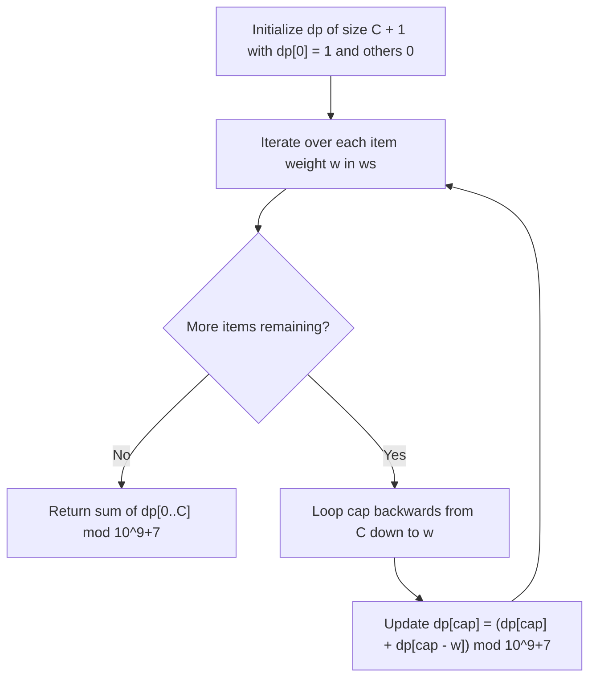

# Basic Knapsack

> [!info] Document Metadata
> **Course:** `=this.course` | **Topic:** `=this.topic` | **Status:** `=this.status` | **Difficulty:** `=this.difficulty`

**Tags:** #[[Computer Science]] #[[CSALGCM]] #[[Algorithms and Complexity]] #[[HackerRank]] #[[Emperor Arcana]] #[[Knapsack DP]]
---

## Problem Description

You are given $N$ distinct items numbered $1$ to $N$, where item $i$ has an integer weight $W_i$. Unlike the classical optimization variant of the knapsack problem, the items carry no values. Instead, given a knapsack of total capacity $C$, count the total number of distinct ways to select a subset of items (including the empty subset) whose combined weight does not exceed $C$.

Because items are uniquely indexed from $1$ to $N$, two subsets that contain different item indices are counted separately even if those items share identical weights. Since the count can grow exponentially large, output the result modulo $10^9 + 7$.

### Input Format
Input contains a single test case starting with a line containing two space-separated integers $N$ and $C$, indicating the number of items and knapsack capacity respectively.

$N$ lines follow, the $i$-th line containing a single integer $W_i$, the weight of the $i$-th item.

### Output Format
Output one line containing a single integer representing the number of valid subsets with total weight at most $C$, printed modulo $10^9 + 7$.

### Constraints
- $1 \le N, W_i \le 2 \cdot 10^3$
- $0 \le C \le 2 \cdot 10^3$

### Sample Test Cases

**Sample Input 0**
```text
3 9
3
5
7
```

**Sample Output 0**
```text
5
```

*Sample 0 Explanation:* With weights $\{3, 5, 7\}$ and capacity $C = 9$, the five valid subsets are $\emptyset$ (weight $0$), $\{3\}$, $\{5\}$, $\{7\}$, and $\{3, 5\}$ (weight $8 \le 9$).

**Sample Input 1**
```text
3 23
15
16
15
```

**Sample Output 1**
```text
4
```

*Sample 1 Explanation:* Items $1$ and $3$ both weigh $15$, but they are distinct items. No two items fit together ($15 + 15 = 30 > 23$), leaving four valid subsets: $\emptyset$, $\{1\}$, $\{2\}$, and $\{3\}$.

---

## Approach & Intuition

- **Problem Abstraction:** Given an indexed multiset of weights $W = [W_1, W_2, \dots, W_N]$ and capacity bound $C$, compute the cardinality $|\{S \subseteq \{1, \dots, N\} : \sum_{i \in S} W_i \le C\}| \bmod (10^9 + 7)$.
- **Naive / Brute-Force Approach:** Enumerating all $2^N$ subsets recursively checks every include/exclude branch and sums valid combinations. With $N \le 2000$, $2^{2000}$ operations is astronomically beyond time limits and causes immediate TLE.
- **Optimal Strategy:** Use 1D 0/1 Knapsack counting DP. Define $dp[w]$ as the number of subsets from the processed prefix of items whose exact total weight equals $w$ ($0 \le w \le C$), taken modulo $M = 10^9 + 7$.
  - **Base Case:** $dp[0] = 1$ (one empty subset of weight $0$), and $dp[w] = 0$ for $1 \le w \le C$.
  - **Transition:** For each item with weight $w_i$, update capacities **backwards** from $C$ down to $w_i$ so that each item contributes at most once per subset:
$$
dp[\text{cap}] \leftarrow \big(dp[\text{cap}] + dp[\text{cap} - w_i]\big) \bmod (10^9 + 7) \quad \text{for } \text{cap} = C, C-1, \dots, w_i
$$
  - **Final Answer:** Any subset with total weight $\le C$ lies at exactly one bucket $0 \le \text{cap} \le C$, so the total count is $\left(\sum_{\text{cap}=0}^{C} dp[\text{cap}]\right) \bmod (10^9 + 7)$. Items with $w_i > C$ naturally produce an empty descending loop and are skipped.

## Algorithm Walkthrough



## Step-by-Step Trace

Tracing **Sample Input 0** ($N = 3$, $C = 9$, weights $[3, 5, 7]$):

| Step / Item | `dp[0]` | `dp[1]` | `dp[2]` | `dp[3]` | `dp[4]` | `dp[5]` | `dp[6]` | `dp[7]` | `dp[8]` | `dp[9]` | Active Updates (Backwards) |
| :--- | :---: | :---: | :---: | :---: | :---: | :---: | :---: | :---: | :---: | :---: | :--- |
| **Init** | **1** | 0 | 0 | 0 | 0 | 0 | 0 | 0 | 0 | 0 | Base empty subset |
| **w = 3** | 1 | 0 | 0 | **1** | 0 | 0 | 0 | 0 | 0 | 0 | `dp[3] += dp[0]` |
| **w = 5** | 1 | 0 | 0 | 1 | 0 | **1** | 0 | 0 | **1** | 0 | `dp[8] += dp[3]`, `dp[5] += dp[0]` |
| **w = 7** | 1 | 0 | 0 | 1 | 0 | 1 | 0 | **1** | 1 | 0 | `dp[7] += dp[0]` |

Summing the final row yields $1 + 0 + 0 + 1 + 0 + 1 + 0 + 1 + 1 + 0 = 5$, matching Sample Output 0.

## Complexity Analysis

| Metric | Complexity | Rationale |
| :--- | :--- | :--- |
| **Time** | $O(N \cdot C)$ | Each of the $N$ items iterates over at most $C + 1$ capacities in $O(1)$ per transition; for $N, C \le 2000$, at most $4 \times 10^6$ operations occur. |
| **Space** | $O(N + C)$ | The 1D rolling DP table uses $O(C)$ space, while storing the input weight list `ws` takes $O(N)$ space. |

---

## Original Stub (HackerRank Template)

```python
def solve(n,c,ws):
	# compute and return answer here
    
MOD = 1000000007
n, c = list(map(int,input().rstrip().split(" ")))
ws = [int(input().rstrip()) for i in range(n)]
print(solve(n,c,ws))
```

## Full Solution

```python
def solve(n,c,ws):
    # 1D 0/1 Knapsack DP: dp[w] = number of subsets with exact weight w
    dp = [0] * (c + 1)
    dp[0] = 1
    for w in ws:
        # Traverse backwards so each item is used at most once
        for cap in range(c, w - 1, -1):
            dp[cap] = (dp[cap] + dp[cap - w]) % MOD
    return sum(dp) % MOD

MOD = 1000000007
n, c = list(map(int,input().rstrip().split(" ")))
ws = [int(input().rstrip()) for i in range(n)]
print(solve(n,c,ws))
```

## References & Navigation

- **Next Problem:** [[02 - Coin Change (Counting Version)]]
- **Parent Set:** [[[PS] Emperor Arcana|Emperor Arcana Index]]
- **Related Notes:** [[Dynamic Programming Introduction]]
