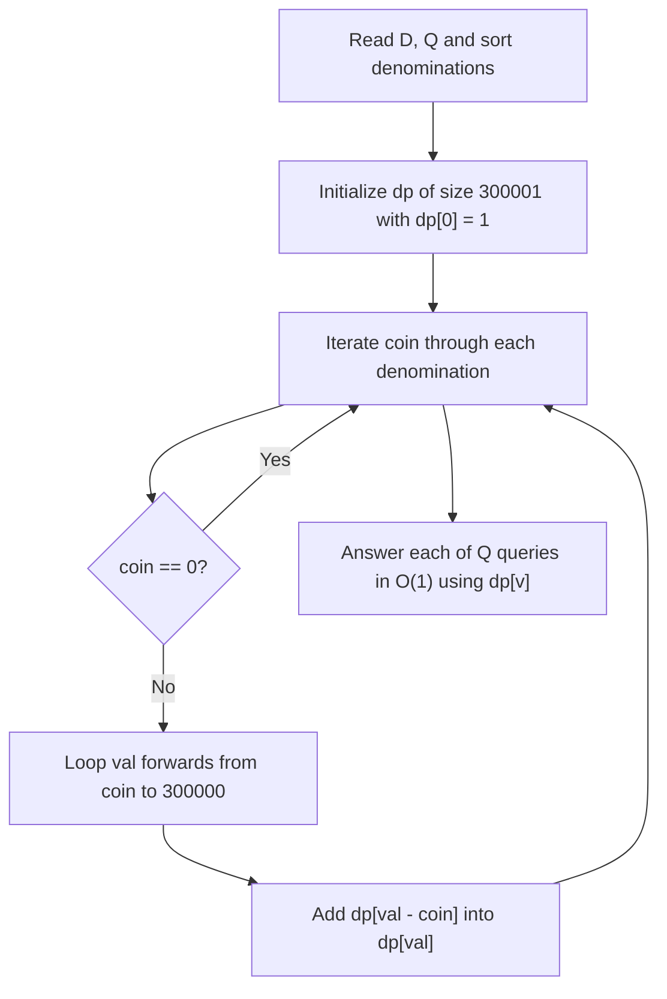

# Coin Change (Counting Version)

> [!info] Document Metadata
> **Course:** `=this.course` | **Topic:** `=this.topic` | **Status:** `=this.status` | **Difficulty:** `=this.difficulty`

**Tags:** #[[Computer Science]] #[[CSALGCM]] #[[Algorithms and Complexity]] #[[HackerRank]] #[[Emperor Arcana]] #[[Coin Change]]
---

## Problem Description

You have an infinite supply of $D$ distinct coin denominations, each having an integer value $C_i$. You must answer $Q$ independent queries. For each query, given a monetary amount $V$, count the total number of distinct ways to make change for $V$ using the available denominations.

Two combinations are considered identical if they use the same multiset of coin frequencies regardless of ordering. For example, using denominations $\{1, 5, 10\}$ to form $15$, there are $6$ distinct ways: $(10+5)$, $(10+5\times 1)$, $(3\times 5)$, $(2\times 5+5\times 1)$, $(5+10\times 1)$, and $(15\times 1)$. Notice that no modulus is applied to the output.

### Input Format
The first line contains two space-separated integers $D$ and $Q$, indicating the number of denominations and the number of queries respectively.

The second line contains $D$ space-separated non-negative integers representing the distinct coin denominations $C_i$ for $1 \le i \le D$.

$Q$ lines follow, each containing a single integer $V$ specifying the target amount for that query.

### Output Format
Output consists of $Q$ lines, where the $i$-th line contains a single integer equal to the number of ways to make change for the $i$-th query value $V$.

### Constraints
- $1 \le D \le 12$
- $1 \le Q, C_i \le 3 \cdot 10^5$
- $0 \le V \le 3 \cdot 10^5$

### Sample Test Cases

**Sample Input 0**
```text
3 3
1 5 10
10
12
15
```

**Sample Output 0**
```text
4
4
6
```

*Sample 0 Explanation:* For $V = 10$, the $4$ ways are $\{10\}$, $\{5, 5\}$, $\{5, 1\times 5\}$, and $\{1\times 10\}$. For $V = 12$, the $4$ ways are $\{10, 1, 1\}$, $\{5, 5, 1, 1\}$, $\{5, 1\times 7\}$, and $\{1\times 12\}$. For $V = 15$, there are $6$ combinations as enumerated in the statement.

---

## Approach & Intuition

- **Problem Abstraction:** Given a set of positive coin values $\{C_1, \dots, C_D\}$, for each query $V \in [0, 3 \cdot 10^5]$ find the number of non-negative integer tuples $(x_1, \dots, x_D)$ satisfying $\sum_{i=1}^{D} x_i C_i = V$.
- **Naive / Brute-Force Approach:** Running a recursive search per query or re-computing the DP table from scratch for each of the $Q \le 3 \cdot 10^5$ queries costs $O(Q \cdot D \cdot V) \approx 10^{12}$ operations in the worst case, causing immediate TLE. Furthermore, reversing the DP loop order (iterating amount outside and coins inside) erroneously counts ordered permutations instead of combinations.
- **Optimal Strategy:** Precompute a single 1D **Unbounded Knapsack Counting DP** table up to $V_{\max} = 300{,}000$ before processing queries. Let $dp[\text{val}]$ denote the number of combinations forming amount $\text{val}$ using the denominations processed so far.
  - **Base Case:** $dp[0] = 1$ (one way to form $0$: choose zero coins), and $dp[\text{val}] = 0$ for $\text{val} \ge 1$.
  - **Transition (Outer Coin Loop, Forward Amount Loop):** Processing one coin denomination $c$ at a time in the outer loop enforces a canonical coin order and eliminates permutation duplicates. Iterating $\text{val}$ **forwards** from $c$ to $V_{\max}$ permits unlimited reuse of coin $c$:
$$
dp[\text{val}] \leftarrow dp[\text{val}] + dp[\text{val} - c] \quad \text{for } \text{val} = c, c+1, \dots, V_{\max}
$$
  - **Query Resolution & Precision:** Each query $V$ resolves in $O(1)$ via `dp[v]`. Because no modulo is requested and combinations with $D = 12$ coins up to $300{,}000$ far exceed 64-bit signed integers, Python's arbitrary-precision `int` prevents integer overflow cleanly. Defensively skipping `coin == 0` guards against any degenerate zero entry.

## Algorithm Walkthrough



## Step-by-Step Trace

Tracing **Sample Input 0** (`denoms = [1, 5, 10]`, showing `dp[0..15]`):

| Stage | `0` | `1` | `2` | `3` | `4` | `5` | `6` | `7` | `8` | `9` | `10` | `11` | `12` | `13` | `14` | `15` |
| :--- | :---: | :---: | :---: | :---: | :---: | :---: | :---: | :---: | :---: | :---: | :---: | :---: | :---: | :---: | :---: | :---: |
| **Init** | 1 | 0 | 0 | 0 | 0 | 0 | 0 | 0 | 0 | 0 | 0 | 0 | 0 | 0 | 0 | 0 |
| **After coin = 1** | 1 | 1 | 1 | 1 | 1 | 1 | 1 | 1 | 1 | 1 | 1 | 1 | 1 | 1 | 1 | 1 |
| **After coin = 5** | 1 | 1 | 1 | 1 | 1 | 2 | 2 | 2 | 2 | 2 | 3 | 3 | 3 | 3 | 3 | 4 |
| **After coin = 10** | 1 | 1 | 1 | 1 | 1 | 2 | 2 | 2 | 2 | 2 | **4** | 4 | **4** | 4 | 4 | **6** |

Direct table lookups yield `dp[10] = 4`, `dp[12] = 4`, and `dp[15] = 6`.

## Complexity Analysis

| Metric | Complexity | Rationale |
| :--- | :--- | :--- |
| **Time** | $O(D \cdot V_{\max} + Q)$ | Preprocessing performs at most $D \cdot V_{\max} \le 12 \times 300{,}000 = 3.6 \times 10^6$ transitions (plus negligible $O(D \log D)$ sort for $D \le 12$), and each of the $Q$ queries takes $O(1)$ time. |
| **Space** | $O(V_{\max} + Q)$ | The precomputed table requires $300{,}001$ entries (`O(V_max)`), and storing outputs for batch printing takes `O(Q)` space. |

---

## Original Stub (HackerRank Template)

```python
def solve(d,denoms,v):
	# compute and return answer here
    

d, q = list(map(int,input().rstrip().split(" ")))
denoms = sorted(list(map(int,input().rstrip().split(" "))))

# preprocess here

ans_list = []
for i in range(q):
	v = int(input().rstrip())
    
    # build answer to avoid TLE
    # you can redefine the solve function as needed
	ans_list.append(solve(d,denoms,v))
print("{}".format("\n".join(list(map(str,ans_list)))))
```

## Full Solution

```python
def solve(d,denoms,v):
    # Return precomputed number of ways for value v
    return dp[v]

d, q = list(map(int,input().rstrip().split(" ")))
denoms = sorted(list(map(int,input().rstrip().split(" "))))

# Preprocess unbounded knapsack DP table up to max possible V (300,000)
MAX_V = 300000
dp = [0] * (MAX_V + 1)
dp[0] = 1
for coin in denoms:
    if coin == 0:
        continue
    # Traverse forwards so each coin can be used unlimited times
    for val in range(coin, MAX_V + 1):
        dp[val] += dp[val - coin]

ans_list = []
for i in range(q):
    v = int(input().rstrip())
    ans_list.append(solve(d,denoms,v))
print("{}".format("\n".join(list(map(str,ans_list)))))
```

## References & Navigation

- **Previous Problem:** [[01 - Basic Knapsack]]
- **Next Problem:** [[03 - How Many Ways (Easy Version)]]
- **Parent Set:** [[[PS] Emperor Arcana|Emperor Arcana Index]]
- **Related Notes:** [[Dynamic Programming Introduction]]
