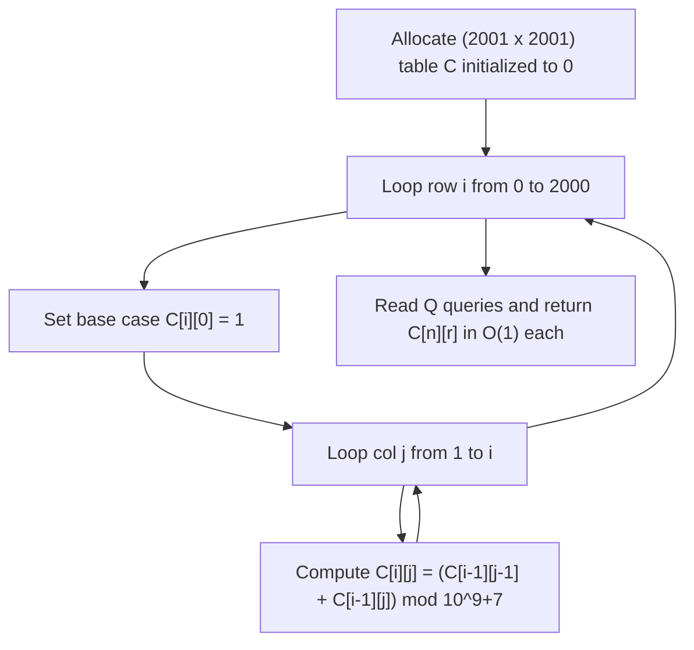

# How Many Ways? (Easy Version)

> [!info] Document Metadata
> **Course:** `=this.course` | **Topic:** `=this.topic` | **Status:** `=this.status` | **Difficulty:** `=this.difficulty`

**Tags:** #[[Computer Science]] #[[CSALGCM]] #[[Algorithms and Complexity]] #[[HackerRank]] #[[Emperor Arcana]] #[[Combinatorial DP]]
---

## Problem Description

You must answer $Q$ queries. Each query provides two integers $N$ and $R$, and asks for the number of ways to choose $R$ objects from a set of $N$ distinct objects (without regard to order), i.e., the binomial coefficient $\binom{N}{R}$. Because this value can grow rapidly, output each answer modulo $10^9 + 7$.

### Input Format
Input begins with one line containing a single integer $Q$, the number of queries to answer.

$Q$ lines follow, each containing two space-separated integers $N$ and $R$.

### Output Format
For each query, output one line containing a single integer equal to $\binom{N}{R} \bmod (10^9 + 7)$.

### Constraints
- $1 \le Q \le 2 \cdot 10^5$
- $0 \le R \le N \le 2 \cdot 10^3$

### Sample Test Cases

**Sample Input 0**
```text
4
8 3
2 1
10 10
10 5
```

**Sample Output 0**
```text
56
2
1
252
```

*Sample 0 Explanation:* $\binom{8}{3} = 56$, $\binom{2}{1} = 2$, $\binom{10}{10} = 1$, and $\binom{10}{5} = 252$.

---

## Approach & Intuition

- **Problem Abstraction:** Evaluate the binomial coefficient $\binom{N}{R} \bmod (10^9 + 7)$ across $Q \le 2 \cdot 10^5$ queries bounded by $0 \le R \le N \le 2000$.
- **Naive / Brute-Force Approach:** Naive top-down recursion $\binom{n}{r} = \binom{n-1}{r-1} + \binom{n-1}{r}$ without caching takes $O(2^N)$ per query. Computing $\frac{N!}{R!(N-R)!}$ independently per query takes $O(N)$ per query—reaching $O(Q \cdot N) = 4 \cdot 10^8$ multiplications/divisions across $2 \cdot 10^5$ queries—resulting in TLE in Python.
- **Optimal Strategy:** Because $N \le 2000$ is small while $Q \le 2 \cdot 10^5$ is large, precompute **Pascal's Triangle** once via bottom-up 2D Dynamic Programming before reading queries. Let $C[i][j]$ store $\binom{i}{j} \bmod (10^9 + 7)$.
  - **Base Cases:** $C[i][0] = 1$ for all $0 \le i \le 2000$, and $C[i][j] = 0$ for all $j > i$.
  - **Transition (Pascal's Identity):** For each element $i$, either include the $i$-th object (leaving $j - 1$ choices among $i - 1$ objects) or exclude it (leaving $j$ choices among $i - 1$ objects):
$$
C[i][j] = \big(C[i-1][j-1] + C[i-1][j]\big) \bmod (10^9 + 7) \quad \text{for } 1 \le j \le i
$$
  - This approach avoids modular inverses entirely, relies purely on modular additions, and resolves every query in $O(1)$ table lookup time.

## Algorithm Walkthrough



## Step-by-Step Trace

Pascal's Triangle rows $i = 0 \dots 10$ (covering all four queries of **Sample Input 0**):

| $i \backslash j$ | `0` | `1` | `2` | `3` | `4` | `5` | `6` | `7` | `8` | `9` | `10` |
| :--- | :---: | :---: | :---: | :---: | :---: | :---: | :---: | :---: | :---: | :---: | :---: |
| **0** | 1 | 0 | 0 | 0 | 0 | 0 | 0 | 0 | 0 | 0 | 0 |
| **1** | 1 | 1 | 0 | 0 | 0 | 0 | 0 | 0 | 0 | 0 | 0 |
| **2** | 1 | **2** | 1 | 0 | 0 | 0 | 0 | 0 | 0 | 0 | 0 |
| **3** | 1 | 3 | 3 | 1 | 0 | 0 | 0 | 0 | 0 | 0 | 0 |
| **4** | 1 | 4 | 6 | 4 | 1 | 0 | 0 | 0 | 0 | 0 | 0 |
| **5** | 1 | 5 | 10 | 10 | 5 | 1 | 0 | 0 | 0 | 0 | 0 |
| **6** | 1 | 6 | 15 | 20 | 15 | 6 | 1 | 0 | 0 | 0 | 0 |
| **7** | 1 | 7 | 21 | 35 | 35 | 21 | 7 | 1 | 0 | 0 | 0 |
| **8** | 1 | 8 | 28 | **56** | 70 | 56 | 28 | 8 | 1 | 0 | 0 |
| **9** | 1 | 9 | 36 | 84 | 126 | 126 | 84 | 36 | 9 | 1 | 0 |
| **10** | 1 | 10 | 45 | 120 | 210 | **252** | 210 | 120 | 45 | 10 | **1** |

Lookups yield $C[8][3] = 56$, $C[2][1] = 2$, $C[10][10] = 1$, and $C[10][5] = 252$.

## Complexity Analysis

| Metric | Complexity | Rationale |
| :--- | :--- | :--- |
| **Time** | $O(N_{\max}^2 + Q)$ | Building the lower triangle for $N_{\max} = 2000$ performs $\frac{2001 \times 2002}{2} \approx 2 \times 10^6$ constant-time additions, followed by $O(1)$ per query across $Q$ queries. |
| **Space** | $O(N_{\max}^2 + Q)$ | The 2D table `C` stores $2001 \times 2001 \approx 4 \times 10^6$ integers, and `outs` buffers $Q$ query outputs for fast I/O. |

---

## Original Stub (HackerRank Template)

```python
def solve(n,r):
	# compute and return answer here
    
q = int(input().rstrip())
for i in range(q):
    n, r = list(map(int,input().rstrip().split(" ")))
    print("{}".format(solve(n,r)))
```

## Full Solution

```python
MOD = 1000000007
MAX_N = 2000

# Precompute Pascal's Triangle: C[n][r] = nCr mod 10^9+7
C = [[0] * (MAX_N + 1) for _ in range(MAX_N + 1)]
for i in range(MAX_N + 1):
    C[i][0] = 1
    for j in range(1, i + 1):
        C[i][j] = (C[i - 1][j - 1] + C[i - 1][j]) % MOD

def solve(n,r):
    return C[n][r]

q = int(input().rstrip())
outs = []
for i in range(q):
    n, r = list(map(int,input().rstrip().split(" ")))
    outs.append(solve(n,r))
print("\n".join(map(str, outs)))
```

## References & Navigation

- **Previous Problem:** [[02 - Coin Change (Counting Version)]]
- **Next Problem:** [[04 - The Wet Bandits]]
- **Parent Set:** [[[PS] Emperor Arcana|Emperor Arcana Index]]
- **Related Notes:** [[Dynamic Programming Introduction]]
