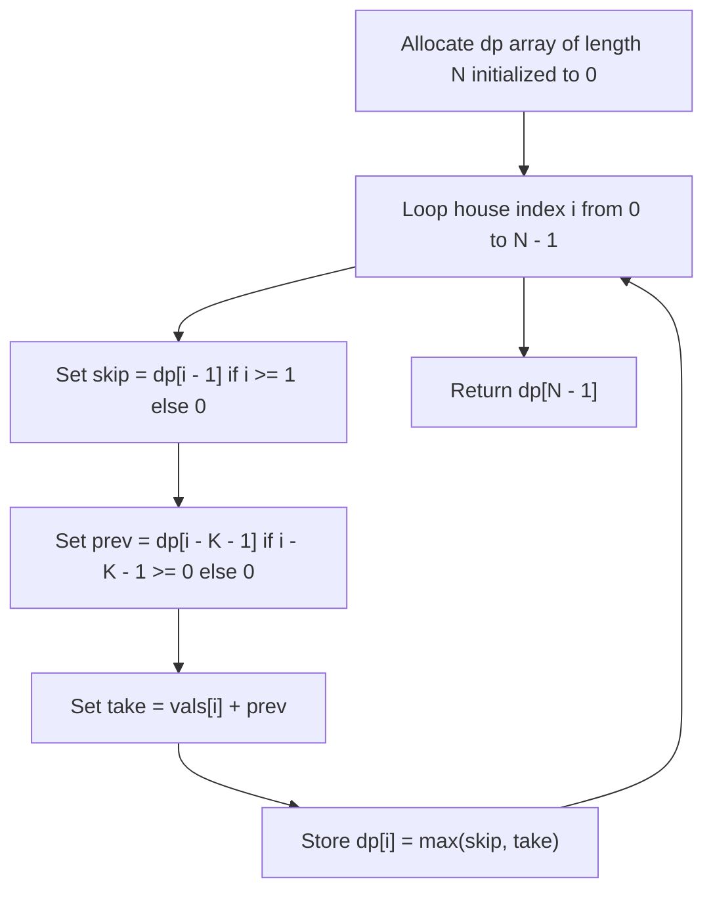

# The Wet Bandits

> [!info] Document Metadata
> **Course:** `=this.course` | **Topic:** `=this.topic` | **Status:** `=this.status` | **Difficulty:** `=this.difficulty`

**Tags:** #[[Computer Science]] #[[CSALGCM]] #[[Algorithms and Complexity]] #[[HackerRank]] #[[Emperor Arcana]] #[[Linear DP]]
---

## Problem Description

Harry and Marv (the Wet Bandits) plan to steal from a single street containing $N$ houses arranged in a line, numbered from $0$ to $N - 1$. Each house $i$ contains non-negative loot of value $V_i$.

To avoid arousing suspicion, if they steal from house $i$, they cannot steal from any other house located at most $K$ houses away—meaning any house $j$ satisfying $|j - i| \le K$ is forbidden. For example, if $K = 1$ and they steal from house $2$, houses $1$ and $3$ are off-limits, whereas houses $0$ and $4$ remain valid because $|4 - 2| = 2 > 1$. Determine the maximum total loot they can obtain from the street.

### Input Format
Input consists of a single test case starting with a line containing two space-separated integers $N$ and $K$, denoting the number of houses and the buffer distance between robbed houses.

$N$ lines follow, where the $i$-th line contains a single integer $V_i$.

### Output Format
Output a single line containing one integer representing the maximum possible loot attainable from the street.

### Constraints
- $1 \le N \le 10^5$
- $0 \le K, V_i \le 10^5$

### Sample Test Cases

**Sample Input 0**
```text
5 1
2
1
2
1
10
```

**Sample Output 0**
```text
14
```

*Sample 0 Explanation:* With $K = 1$, stealing from houses $0$, $2$, and $4$ respects the distance rule ($|2 - 0| = 2 > 1$ and $|4 - 2| = 2 > 1$) and achieves maximum loot $2 + 2 + 10 = 14$.

---

## Approach & Intuition

- **Problem Abstraction:** Maximize $\sum_{i \in S} V_i$ over subsets $S \subseteq \{0, 1, \dots, N - 1\}$ subject to $\lvert j - i \rvert > K$ for all distinct $i, j \in S$. This generalizes the classic House Robber (Maximum Weight Independent Set on a path graph) to a cooldown gap of $K$ steps.
- **Naive / Brute-Force Approach:** Branching recursively at each house (rob and jump $K + 1$ ahead, or skip and advance by $1$) without memoization explores up to $\Theta(\phi^N)$ subsets when $K = 1$, which times out for $N = 10^5$. Greedy selection of the highest-value house can also fail (e.g., picking a central house of value $5$ when two flanking houses outside its cooldown sum to $4 + 4 = 8$).
- **Optimal Strategy:** Apply 1D linear Dynamic Programming over prefixes. Define $dp[i]$ as the maximum attainable loot considering only houses $0$ through $i$. At house $i$, there are exactly two mutually exclusive decisions:
  1. **Skip house $i$:** Optimal loot equals the best achievable over $0 \dots i - 1$, namely $dp[i - 1]$ (or $0$ if $i = 0$).
  2. **Rob house $i$:** Collect $V_i$, forcing houses $i - K \dots i - 1$ to be skipped, and add the best loot up to index $i - K - 1$ (or $0$ if $i - K - 1 < 0$).

$$
dp[i] = \max\Big(\text{skip}(i),\; V_i + \text{prev}(i - K - 1)\Big)
$$
where
$$
\text{skip}(i) = \begin{cases} 0 & \text{if } i = 0 \\ dp[i - 1] & \text{if } i \ge 1 \end{cases}, \qquad
\text{prev}(j) = \begin{cases} 0 & \text{if } j < 0 \\ dp[j] & \text{if } j \ge 0 \end{cases}
$$

  - **Edge Cases:** When $K = 0$, $i - K - 1 = i - 1$, so every house can be taken independently (since $V_i \ge 0$, the sum of all $V_i$ is returned). When $K \ge N - 1$, at most one house can be robbed, returning $\max_i V_i$.

## Algorithm Walkthrough



## Step-by-Step Trace

Tracing **Sample Input 0** ($N = 5$, $K = 1$, $V = [2, 1, 2, 1, 10]$):

| Index `i` | House Value $V_i$ | `skip = dp[i-1]` | Cooldown Index `i - K - 1` | `take = V[i] + prev` | `dp[i] = max(skip, take)` | Chosen Action |
| :---: | :---: | :---: | :---: | :---: | :---: | :--- |
| **0** | 2 | 0 | $-2 < 0 \implies 0$ | $2 + 0 = 2$ | **2** | Rob house 0 |
| **1** | 1 | $dp[0] = 2$ | $-1 < 0 \implies 0$ | $1 + 0 = 1$ | **2** | Skip house 1 |
| **2** | 2 | $dp[1] = 2$ | $0 \implies dp[0] = 2$ | $2 + 2 = 4$ | **4** | Rob house 2 |
| **3** | 1 | $dp[2] = 4$ | $1 \implies dp[1] = 2$ | $1 + 2 = 3$ | **4** | Skip house 3 |
| **4** | 10 | $dp[3] = 4$ | $2 \implies dp[2] = 4$ | $10 + 4 = 14$ | **14** | Rob house 4 |

The final result is `dp[4] = 14`.

## Complexity Analysis

| Metric | Complexity | Rationale |
| :--- | :--- | :--- |
| **Time** | $O(N)$ | Each of the $N$ houses executes two $O(1)$ array lookups and one `max` comparison in a single linear pass. |
| **Space** | $O(N)$ | The `dp` array and input `vals` list each store $N$ integers (auxiliary DP space could be further compressed to $O(\min(N, K+1))$ via a circular buffer). |

---

## Original Stub (HackerRank Template)

```python
def solve(n,k,vals):
    # compute and return answer here
    
    
n,k = list(map(int,input().rstrip().split(" ")))
vals = []

for i in range(n):
	vals.append(int(input().rstrip()))
print("{}".format(solve(n,k,vals)))
```

## Full Solution

```python
def solve(n,k,vals):
    # dp[i] = max loot from houses 0..i
    dp = [0] * n
    for i in range(n):
        skip = dp[i - 1] if i >= 1 else 0
        take = vals[i] + (dp[i - k - 1] if i - k - 1 >= 0 else 0)
        dp[i] = max(skip, take)
    return dp[-1]

n,k = list(map(int,input().rstrip().split(" ")))
vals = []

for i in range(n):
    vals.append(int(input().rstrip()))
print("{}".format(solve(n,k,vals)))
```

## References & Navigation

- **Previous Problem:** [[03 - How Many Ways (Easy Version)]]
- **Next Problem:** [[05 - What Sequence Is This]]
- **Parent Set:** [[[PS] Emperor Arcana|Emperor Arcana Index]]
- **Related Notes:** [[Dynamic Programming Introduction]]
