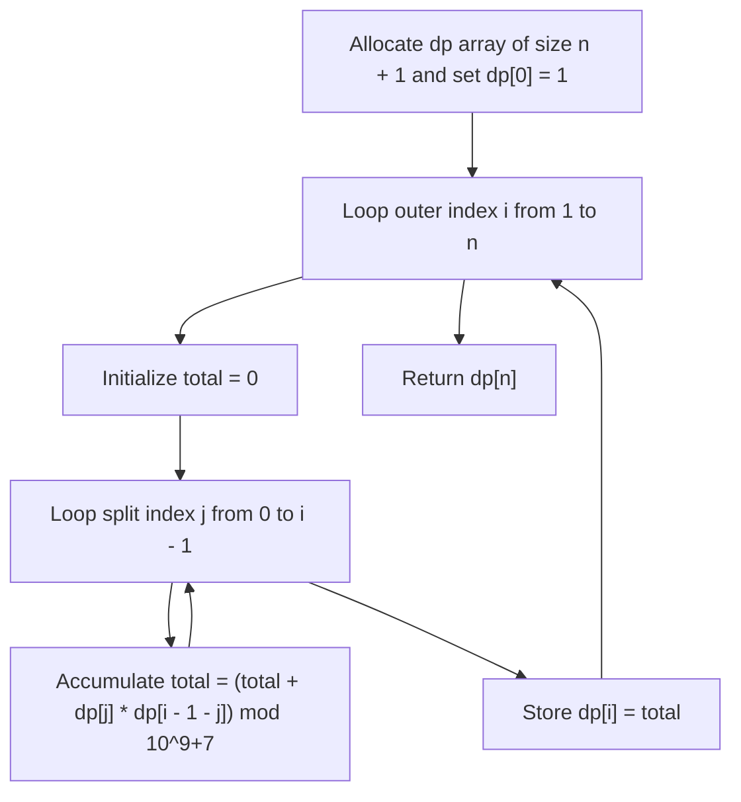

# What Sequence Is This?

> [!info] Document Metadata
> **Course:** `=this.course` | **Topic:** `=this.topic` | **Status:** `=this.status` | **Difficulty:** `=this.difficulty`

**Tags:** #[[Computer Science]] #[[CSALGCM]] #[[Algorithms and Complexity]] #[[HackerRank]] #[[Emperor Arcana]] #[[Catalan Numbers]]
---

## Problem Description

The problem statement opens with a 14-line acrostic sonnet describing memoization and tabulation—whose leading letters spell **CATALAN SEQUENCE** (`C-A-T-A-L-A-N-S-E-Q-U-E-N-CE`, with the final line starting `"CEase"`). The sequence $F_n$ is defined explicitly by the recurrence:

$$
F_0 = 1, \qquad F_n = \sum_{i=0}^{n-1} \big(F_i \cdot F_{n-1-i}\big)
$$

Given an integer $n$, compute and output $F_n \bmod (10^9 + 7)$.

### Input Format
Input consists of a single test case comprised of one line containing a single integer $n$.

### Output Format
Output one line containing a single integer equal to $F_n \bmod (10^9 + 7)$.

### Constraints
- $1 \le n \le 2 \cdot 10^3$

### Sample Test Cases

**Sample Input 0**
```text
2
```

**Sample Output 0**
```text
2
```

**Sample Input 1**
```text
3
```

**Sample Output 1**
```text
5
```

**Sample Input 2**
```text
4
```

**Sample Output 2**
```text
14
```

---

## Approach & Intuition

- **Problem Abstraction:** Compute the $n$-th **Catalan number** $C_n = F_n$ modulo $10^9 + 7$ from its quadratic Segner convolution recurrence.
- **Naive / Brute-Force Approach:** Directly implementing $F(n) = \sum_{i=0}^{n-1} F(i) F(n - 1 - i)$ as an unmemoized recursive function re-evaluates identical lower states exponentially many times (growing asymptotically faster than $\Omega(4^n / n^{3/2})$ in total recursive calls), immediately causing TLE well before $n = 30$.
- **Optimal Strategy:** Evaluate the recurrence bottom-up in $O(n^2)$ time using a 1D DP array `dp[0..n]` where `dp[i]` stores $F_i \bmod (10^9 + 7)$.
  - **Base Case:** $dp[0] = 1$.
  - **Transition:** Compute $dp[i]$ sequentially for $i = 1, 2, \dots, n$ so that all strictly smaller states $dp[0], \dots, dp[i-1]$ are finalized before being read:
$$
dp[i] = \left(\sum_{j=0}^{i-1} dp[j] \cdot dp[i - 1 - j]\right) \bmod (10^9 + 7)
$$
  - Applying modulo at each inner accumulation step keeps intermediate integers bounded under $10^{18} + 10^9$, avoiding arbitrary-precision multiplication overhead. (While an $O(n)$ closed form $\frac{1}{n+1}\binom{2n}{n}$ with modular inverses exists, $n \le 2000$ makes $O(n^2)$ DP trivial, division-free, and directly faithful to the problem's DP theme.)

## Algorithm Walkthrough



## Step-by-Step Trace

Tracing $n = 0$ through $n = 4$ (covering Sample Inputs 0, 1, and 2):

| State $i$ | Convolution Terms $\sum_{j=0}^{i-1} dp[j] \cdot dp[i-1-j]$ | Evaluation | Result `dp[i]` |
| :---: | :--- | :--- | :---: |
| **0** | Base case | $1$ | **1** |
| **1** | $dp[0]\cdot dp[0]$ | $1 \cdot 1$ | **1** |
| **2** | $dp[0]\cdot dp[1] + dp[1]\cdot dp[0]$ | $1\cdot 1 + 1\cdot 1$ | **2** |
| **3** | $dp[0]\cdot dp[2] + dp[1]\cdot dp[1] + dp[2]\cdot dp[0]$ | $1\cdot 2 + 1\cdot 1 + 2\cdot 1$ | **5** |
| **4** | $dp[0]\cdot dp[3] + dp[1]\cdot dp[2] + dp[2]\cdot dp[1] + dp[3]\cdot dp[0]$ | $1\cdot 5 + 1\cdot 2 + 2\cdot 1 + 5\cdot 1$ | **14** |

Outputs match `dp[2] = 2` (Sample 0), `dp[3] = 5` (Sample 1), and `dp[4] = 14` (Sample 2).

## Complexity Analysis

| Metric | Complexity | Rationale |
| :--- | :--- | :--- |
| **Time** | $O(n^2)$ | Computing $dp[i]$ performs $i$ multiply-add-mod iterations, totaling $\sum_{i=1}^{n} i = \frac{n(n+1)}{2} \approx 2 \times 10^6$ operations at $n = 2000$. |
| **Space** | $O(n)$ | Only a single 1D table `dp` of length $n + 1$ is allocated. |

---

## Original Stub (HackerRank Template)

```python
def solve(n):
    MOD = 1000000007
    # compute and return answer here
    

n = int(input().rstrip())
print("{}".format(solve(n)))
```

## Full Solution

```python
def solve(n):
    MOD = 1000000007
    # Catalan sequence DP: F_n = sum(F_i * F_{n-1-i}) mod 10^9+7
    dp = [0] * (n + 1)
    dp[0] = 1
    for i in range(1, n + 1):
        total = 0
        for j in range(i):
            total = (total + dp[j] * dp[i - 1 - j]) % MOD
        dp[i] = total
    return dp[n]

n = int(input().rstrip())
print("{}".format(solve(n)))
```

## References & Navigation

- **Previous Problem:** [[04 - The Wet Bandits]]
- **Next Problem:** [[06 - Which Line Is It Anyway (Easy Version)]]
- **Parent Set:** [[[PS] Emperor Arcana|Emperor Arcana Index]]
- **Related Notes:** [[Dynamic Programming Introduction]]
