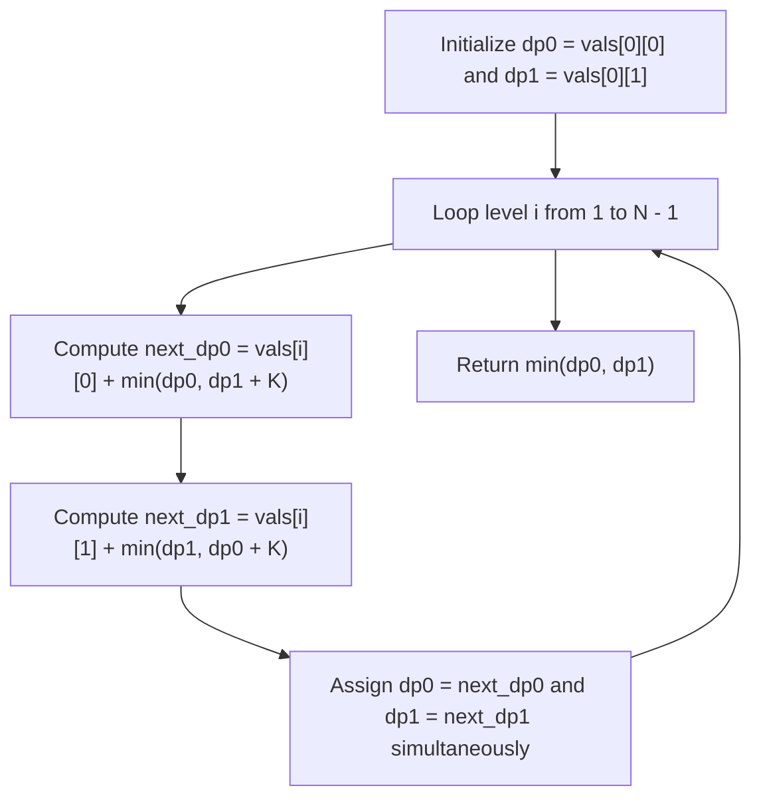

# Which Line Is It Anyway? (Easy Version)

> [!info] Document Metadata
> **Course:** `=this.course` | **Topic:** `=this.topic` | **Status:** `=this.status` | **Difficulty:** `=this.difficulty`

**Tags:** #[[Computer Science]] #[[CSALGCM]] #[[Algorithms and Complexity]] #[[HackerRank]] #[[Emperor Arcana]] #[[Assembly Line Scheduling]]
---

## Problem Description

You operate two parallel assembly lines, labeled **Line 0** and **Line 1**, each consisting of $N$ sequential station levels. Processing a product at the $j$-th station on Line $i$ requires $T_{i,j}$ seconds. A product must pass through exactly one station at every level from $1$ to $N$.

The product may begin on either line with zero entry penalty. After completing assembly at a station on level $j$, the product either advances directly to level $j + 1$ on the **same line** with zero transfer delay, or switches to level $j + 1$ on the **other line** at an additional cost of $K$ seconds. Find the minimum total processing time to assemble one product by choosing the optimal starting line and line-switching sequence.

### Input Format
The first line contains two space-separated integers $N$ and $K$, denoting the number of station levels and the transfer cost in seconds when switching lines.

$N$ lines follow, each containing two space-separated integers. On the $j$-th line ($1 \le j \le N$), the two values correspond to $T_{0,j}$ and $T_{1,j}$, the processing times at station level $j$ on Line 0 and Line 1 respectively.

### Output Format
Output one line containing a single integer equal to the minimum number of seconds required to complete assembly across all $N$ levels.

### Constraints
- $1 \le N \le 3 \cdot 10^5$
- $0 \le K, T_{i,j} \le 10^9$

### Sample Test Cases

**Sample Input 0**
```text
4 6
5 10
15 2
3 5
2 8
```

**Sample Output 0**
```text
23
```

*Sample 0 Explanation:* Start on Line 1 ($10\text{ s}$), stay on Line 1 at level 2 ($+2\text{ s}$), switch to Line 0 ($+6\text{ s}$), complete level 3 on Line 0 ($+3\text{ s}$), and finish level 4 on Line 0 ($+2\text{ s}$), totaling $10 + 2 + 6 + 3 + 2 = 23$ seconds.

**Sample Input 1**
```text
5 23
8 26
5 18
16 17
26 11
35 6
```

**Sample Output 1**
```text
69
```

*Sample 1 Explanation:* Start on Line 0 through levels 1–3 ($8 + 5 + 16 = 29\text{ s}$), switch to Line 1 ($+23\text{ s}$), and finish levels 4–5 on Line 1 ($+11 + 6 = 17\text{ s}$), totaling $29 + 23 + 17 = 69$ seconds.

---

## Approach & Intuition

- **Problem Abstraction:** Find a minimum-cost path through a layered DAG of $N$ stages, each containing $2$ vertices (Line 0 and Line 1), where vertex costs are $T_{i,j}$, same-line edges cost $0$, and cross-line edges cost $K$.
- **Naive / Brute-Force Approach:** Enumerating all $2^N$ line choices across $N$ levels (or taking a greedy local choice at every level without accounting for future station times) either runs in exponential $O(2^N)$ time or fails when an upfront switch fee $K$ unlocks much faster downstream stations.
- **Optimal Strategy:** Use **Assembly Line Scheduling DP** compressed to two rolling state variables. Let $dp_0(i)$ and $dp_1(i)$ denote the minimum total time to finish station level $i$ ($0$-indexed) ending on Line 0 and Line 1 respectively.
  - **Base Case ($i = 0$):** Since starting on either line incurs no initial penalty:
$$
dp_0(0) = T_{0,0}, \qquad dp_1(0) = T_{1,0}
$$
  - **Transitions ($1 \le i \le N - 1$):** Reaching Line 0 at level $i$ comes either from staying on Line 0 (cost $dp_0(i-1)$) or switching from Line 1 (cost $dp_1(i-1) + K$), and symmetrically for Line 1:
$$
dp_0(i) = T_{0,i} + \min\!\big(dp_0(i - 1),\; dp_1(i - 1) + K\big)
$$
$$
dp_1(i) = T_{1,i} + \min\!\big(dp_1(i - 1),\; dp_0(i - 1) + K\big)
$$
  - **Final Answer & Precision:** Return $\min(dp_0(N-1), dp_1(N-1))$. Both states for level $i$ depend solely on level $i - 1$, so simultaneous tuple unpacking updates `dp0, dp1` in $O(1)$ auxiliary DP space. Because $N \le 3 \cdot 10^5$ and $T_{i,j} \le 10^9$, totals can reach $\sim 3 \cdot 10^{14}$, which requires 64-bit integers in static languages and is handled automatically by Python's arbitrary-precision `int`.

## Algorithm Walkthrough



## Step-by-Step Trace

Tracing **Sample Input 0** ($N = 4$, $K = 6$, stations `[[5, 10], [15, 2], [3, 5], [2, 8]]`):

| Level `i` | Station Times $(T_{0,i}, T_{1,i})$ | `dp0` Computation | `dp1` Computation | Resulting `(dp0, dp1)` |
| :---: | :---: | :--- | :--- | :---: |
| **0** | $(5, 10)$ | Base: $5$ | Base: $10$ | $(5, 10)$ |
| **1** | $(15, 2)$ | $15 + \min(5,\; 10+6) = 15 + 5 = 20$ | $2 + \min(10,\; 5+6) = 2 + 10 = 12$ | $(20, 12)$ |
| **2** | $(3, 5)$ | $3 + \min(20,\; 12+6) = 3 + 18 = 21$ (switch) | $5 + \min(12,\; 20+6) = 5 + 12 = 17$ | $(21, 17)$ |
| **3** | $(2, 8)$ | $2 + \min(21,\; 17+6) = 2 + 21 = 23$ | $8 + \min(17,\; 21+6) = 8 + 17 = 25$ | **$(23, 25)$** |

At the end of level 3, $\min(23, 25) = 23$, matching Sample Output 0.

## Complexity Analysis

| Metric | Complexity | Rationale |
| :--- | :--- | :--- |
| **Time** | $O(N)$ | Each of the $N - 1$ station transitions performs a constant number of additions and `min` operations. |
| **Space** | $O(N)$ total / $O(1)$ auxiliary DP | The rolling state inside `solve` tracks only two integers (`dp0`, `dp1`) for $O(1)$ DP memory, while the input array `vals` stores $2N$ integers. |

---

## Original Stub (HackerRank Template)

```python
"""
Solves a test case

Parameters:
n    : int        - number of station levels
k    : int        - cost to transfer to the other line
vals : array-like - array of shape (n,2) containing the finishing times for each
                    station at each assembly line
"""
def solve(n,k,vals):
    # TODO

n, k = list(map(int,input().rstrip().split(" ")))
vals = []a
for i in range(n):
    vals.append(list(map(int,input().rstrip().split(" "))))
print("{}".format(solve(n,k,vals)))
```

## Full Solution

```python
"""
Solves a test case

Parameters:
n    : int        - number of station levels
k    : int        - cost to transfer to the other line
vals : array-like - array of shape (n,2) containing the finishing times for each
                    station at each assembly line
"""
def solve(n,k,vals):
    # dp0, dp1 = min time to finish level i at Line 0 and Line 1
    dp0, dp1 = vals[0][0], vals[0][1]
    for i in range(1, n):
        dp0, dp1 = (
            vals[i][0] + min(dp0, dp1 + k),
            vals[i][1] + min(dp1, dp0 + k),
        )
    return min(dp0, dp1)

n, k = list(map(int,input().rstrip().split(" ")))
vals = []
for i in range(n):
    vals.append(list(map(int,input().rstrip().split(" "))))
print("{}".format(solve(n,k,vals)))
```

## References & Navigation

- **Previous Problem:** [[05 - What Sequence Is This]]
- **Parent Set:** [[[PS] Emperor Arcana|Emperor Arcana Index]]
- **Related Notes:** [[Dynamic Programming Introduction]]
