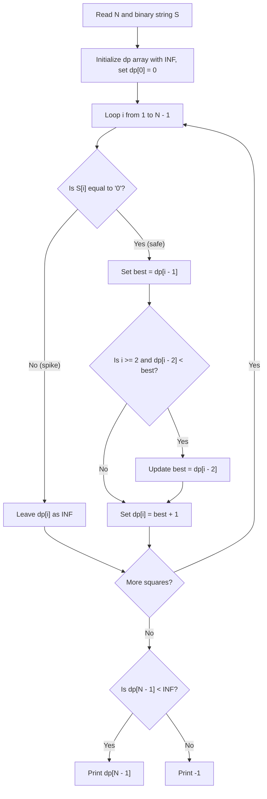

# Dodging Spikes (Easy)

> [!info] Document Metadata
> **Course:** `=this.course` | **Topic:** `=this.topic` | **Status:** `=this.status` | **Difficulty:** `=this.difficulty`

**Tags:** #[[Computer Science]] #[[CSALGCM]] #[[Algorithms and Complexity]] #[[HackerRank]] #[[Hierophant Arcana]] #[[1D Dynamic Programming]]
---

## Problem Description

You are standing on a line of $N$ squares numbered in order from $1$ to $N$. Starting at square $1$, your goal is to reach square $N$ using as few jumps as possible. From any square, you may perform one of two moves: jump $1$ square forward or jump $2$ squares forward.

Some squares contain spikes; landing on a spiked square is fatal and disallowed. Determine the minimum number of jumps required to reach square $N$ from square $1$, or report $-1$ if square $N$ is unreachable.

### Input Format
- The first line contains a single integer $N$, the number of squares in the line.
- The second line contains a binary string $S$ of length $N$ consisting of characters `'0'` and `'1'`. If the $i$-th character is `'1'`, square $i$ contains a spike; if it is `'0'`, square $i$ is safe to land on. Squares $1$ and $N$ are guaranteed to be safe.

### Output Format
Output a single line containing the minimum number of jumps needed to reach square $N$ from square $1$, or $-1$ if it is impossible.

### Constraints
- $1 \le N, |S| \le 3 \cdot 10^5$
- $S_i \in \{\text{'0'}, \text{'1'}\}$ with $S_1 = \text{'0'}$ and $S_N = \text{'0'}$

### Sample Test Cases

**Sample Input 0**
```text
5
01010
```

**Sample Output 0**
```text
2
```

*Explanation 0:* Jump $2$ squares from square $1$ to square $3$, then jump $2$ squares from square $3$ to square $5$.

**Sample Input 1**
```text
7
0000110
```

**Sample Output 1**
```text
-1
```

*Explanation 1:* Squares $5$ and $6$ both contain spikes (`'1'`), forming an impassable gap of two consecutive spikes so square $7$ cannot be reached.

---

## Approach & Intuition

- **Problem Abstraction:** Find the shortest path from index $0$ to index $N-1$ in an unweighted DAG where edges exist from $i$ to $i+1$ and $i+2$ whenever the destination square is safe ($S[\text{dest}] = \text{'0'}$).
- **Naive / Brute-Force Approach:** Recursive backtracking explores up to $2$ choices at every square, leading to $O(2^N)$ time complexity due to overlapping subproblems (many paths converge on the same square $i$), which immediately exceeds time limits for $N = 3 \cdot 10^5$.
- **Optimal Strategy:** Define $dp[i]$ (0-indexed, $0 \le i < N$) as the minimum number of jumps required to reach square $i+1$ from square $1$. Initialize $dp[0] = 0$ and all other entries to $\infty$. Because transitions only depend on $i-1$ and $i-2$, computing $dp[i]$ left-to-right satisfies topological order:

$$
dp[i] = \begin{cases}
0 & \text{if } i = 0 \\
\infty & \text{if } S[i] = \text{'1'} \\
1 + \min\bigl(dp[i-1],\; [i \ge 2] \cdot dp[i-2] + [i < 2] \cdot \infty\bigr) & \text{if } i \ge 1 \text{ and } S[i] = \text{'0'}
\end{cases}
$$

If $dp[N-1] < \infty$, output $dp[N-1]$; otherwise output $-1$.

## Algorithm Walkthrough



## Step-by-Step Trace

Tracing **Sample Input 0** ($N = 5$, $S = \text{"01010"}$, $\infty = 10^9$):

| Index $i$ (0-based) | Square ($i+1$) | $S[i]$ | Candidates $(dp[i-1], dp[i-2])$ | $dp[i]$ | Interpretation |
| :---: | :---: | :---: | :--- | :---: | :--- |
| $0$ | $1$ | `'0'` | Base case | $0$ | Start at square $1$ |
| $1$ | $2$ | `'1'` | Spike (skipped) | $\infty$ | Square $2$ blocked |
| $2$ | $3$ | `'0'` | $\min(dp[1], dp[0]) = \min(\infty, 0) = 0$ | $1$ | Jump $1 \to 3$ |
| $3$ | $4$ | `'1'` | Spike (skipped) | $\infty$ | Square $4$ blocked |
| $4$ | $5$ | `'0'` | $\min(dp[3], dp[2]) = \min(\infty, 1) = 1$ | $2$ | Jump $3 \to 5$ |

Result: $dp[4] = 2 < \infty$, so output is `2`.

## Complexity Analysis

| Metric | Complexity | Rationale |
| :--- | :--- | :--- |
| **Time** | $O(N)$ | Each index $i \in [1, N-1]$ performs $O(1)$ comparisons against at most two predecessors. |
| **Space** | $O(N)$ | Stores the input string $S$ and the 1D DP array of length $N$ (DP array can be reduced to $O(1)$ using two rolling variables). |

---

## Original Stub (HackerRank Template)

```python
n = int(input().rstrip())
s = input().rstrip()
# compute and print answer here
```

## Full Solution

```python
n = int(input().rstrip())
s = input().rstrip()

# dp[i] = min jumps to reach square i (0-indexed)
INF = 10**9
dp = [INF] * n
dp[0] = 0
for i in range(1, n):
    if s[i] == '0':
        best = dp[i - 1]
        if i >= 2 and dp[i - 2] < best:
            best = dp[i - 2]
        dp[i] = best + 1

print(dp[n - 1] if dp[n - 1] < INF else -1)
```

## References & Navigation

- **Next Problem:** [[02 - Dodging Spikes (Medium)]]
- **Parent Set:** [[[PS] Hierophant Arcana|Hierophant Arcana Index]]
- **Related Notes:** [[Dynamic Programming Introduction]]
