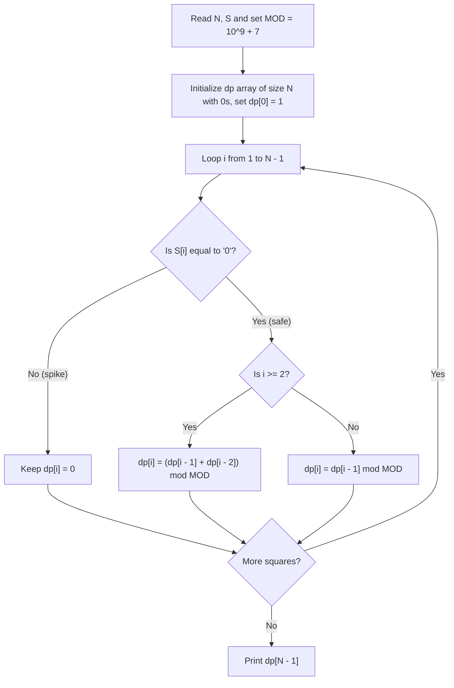

# Dodging Spikes (Medium)

> [!info] Document Metadata
> **Course:** `=this.course` | **Topic:** `=this.topic` | **Status:** `=this.status` | **Difficulty:** `=this.difficulty`

**Tags:** #[[Computer Science]] #[[CSALGCM]] #[[Algorithms and Complexity]] #[[HackerRank]] #[[Hierophant Arcana]] #[[1D Dynamic Programming]]
---

## Problem Description

You are on a line of $N$ squares numbered in order from $1$ to $N$. Starting at square $1$, you want to reach square $N$ using moves of $+1$ or $+2$ squares forward while avoiding any square containing spikes.

Instead of finding the shortest path, count the total number of distinct valid jump sequences from square $1$ to square $N$. Because this count can grow exponentially large, output the result modulo $10^9 + 7$.

### Input Format
- The first line contains a single integer $N$, the number of squares in the line.
- The second line contains a single string $S$ comprised of `'0'`s and `'1'`s. If the $i$-th character is `'1'`, there is a spike on square $i$; if it is `'0'`, the square is empty and safe to land on. Squares $1$ and $N$ are guaranteed to be safe.

### Output Format
Output a single line containing the number of valid ways to get from square $1$ to square $N$, modulo $10^9 + 7$.

### Constraints
- $1 \le N, |S| \le 3 \cdot 10^5$
- $S_i \in \{\text{'0'}, \text{'1'}\}$ with $S_1 = \text{'0'}$ and $S_N = \text{'0'}$

### Sample Test Cases

**Sample Input 0**
```text
5
00000
```

**Sample Output 0**
```text
5
```

*Explanation 0:* The five valid sequences from square $1$ to square $5$ are:
- $1 \to 2 \to 3 \to 4 \to 5$
- $1 \to 2 \to 3 \to 5$
- $1 \to 2 \to 4 \to 5$
- $1 \to 3 \to 4 \to 5$
- $1 \to 3 \to 5$

**Sample Input 1**
```text
7
0000110
```

**Sample Output 1**
```text
0
```

*Explanation 1:* Because squares $5$ and $6$ both have spikes, square $7$ cannot be reached, yielding $0$ ways.

---

## Approach & Intuition

- **Problem Abstraction:** Count the number of paths from node $0$ to node $N-1$ in a linear DAG where safe nodes accept incoming edges from $i-1$ and $i-2$ (a spike-constrained Fibonacci sequence).
- **Naive / Brute-Force Approach:** Enumerating all valid sequences of $+1$ and $+2$ jumps recursively takes $O(F_N) \approx O(1.618^N)$ time, which times out far before $N = 3 \cdot 10^5$.
- **Optimal Strategy:** Let $dp[i]$ (0-indexed) represent the number of distinct valid jump sequences reaching square $i+1$ modulo $M = 10^9 + 7$. Starting with $dp[0] = 1$, spiked squares retain $dp[i] = 0$ so they contribute zero paths forward, while safe squares sum the counts from their two predecessors:

$$
dp[i] = \begin{cases}
1 & \text{if } i = 0 \\
0 & \text{if } S[i] = \text{'1'} \\
\bigl(dp[i-1] + [i \ge 2] \cdot dp[i-2]\bigr) \bmod (10^9 + 7) & \text{if } i \ge 1 \text{ and } S[i] = \text{'0'}
\end{cases}
$$

Taking the modulus at each addition prevents arbitrary-precision integer bloat in Python.

## Algorithm Walkthrough



## Step-by-Step Trace

Tracing **Sample Input 0** ($N = 5$, $S = \text{"00000"}$):

| Index $i$ (0-based) | Square ($i+1$) | $S[i]$ | Formula | $dp[i]$ | Valid Paths Ending at Square $i+1$ |
| :---: | :---: | :---: | :--- | :---: | :--- |
| $0$ | $1$ | `'0'` | Base case | $1$ | `(1)` |
| $1$ | $2$ | `'0'` | $dp[0]$ | $1$ | `(1->2)` |
| $2$ | $3$ | `'0'` | $dp[1] + dp[0] = 1 + 1$ | $2$ | `(1->2->3)`, `(1->3)` |
| $3$ | $4$ | `'0'` | $dp[2] + dp[1] = 2 + 1$ | $3$ | `3` paths |
| $4$ | $5$ | `'0'` | $dp[3] + dp[2] = 3 + 2$ | $5$ | `5` paths |

Result: $dp[4] = 5$.

## Complexity Analysis

| Metric | Complexity | Rationale |
| :--- | :--- | :--- |
| **Time** | $O(N)$ | Computes each $dp[i]$ for $1 \le i < N$ in $O(1)$ arithmetic operations. |
| **Space** | $O(N)$ | Maintains the string $S$ and the 1D DP array of size $N$ (DP storage can be optimized to $O(1)$ with two rolling variables). |

---

## Original Stub (HackerRank Template)

```python
n = int(input().rstrip())
s = input().rstrip()
MOD = int(1e9) + 7

# compute and print answer here
```

## Full Solution

```python
n = int(input().rstrip())
s = input().rstrip()
MOD = int(1e9) + 7

# dp[i] = number of ways to reach square i (0-indexed)
dp = [0] * n
dp[0] = 1
for i in range(1, n):
    if s[i] == '0':
        dp[i] = (dp[i - 1] + (dp[i - 2] if i >= 2 else 0)) % MOD

print(dp[n - 1])
```

## References & Navigation

- **Previous Problem:** [[01 - Dodging Spikes (Easy)]]
- **Next Problem:** [[03 - Dodging Spikes (Hard)]]
- **Parent Set:** [[[PS] Hierophant Arcana|Hierophant Arcana Index]]
- **Related Notes:** [[Dynamic Programming Introduction]]
