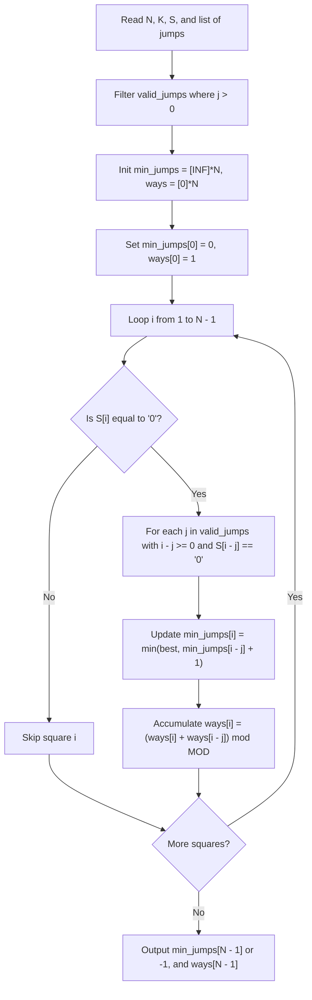

# Dodging Spikes (Hard)

> [!info] Document Metadata
> **Course:** `=this.course` | **Topic:** `=this.topic` | **Status:** `=this.status` | **Difficulty:** `=this.difficulty`

**Tags:** #[[Computer Science]] #[[CSALGCM]] #[[Algorithms and Complexity]] #[[HackerRank]] #[[Hierophant Arcana]] #[[1D Dynamic Programming]]
---

## Problem Description

You are on a line of $N$ squares numbered from $1$ to $N$, starting at square $1$ with the goal of reaching square $N$. Unlike the easier variants, you are restricted to a fixed set of $K$ distinct allowed jump distances $J_1, J_2, \dots, J_K$. Some squares contain spikes (`'1'`) and cannot be landed on.

You must compute **two** values simultaneously:
1. $X$: the minimum number of jumps needed to reach square $N$ from square $1$ using only allowed jump distances (or $-1$ if unreachable).
2. $Y$: the total number of distinct valid jump sequences reaching square $N$ (counting both optimal and suboptimal paths), printed modulo $10^9 + 7$.

### Input Format
- The first line contains two space-separated integers $N$ and $K$, the number of squares and the number of allowed jump distances.
- The second line contains a binary string $S$ of length $N$ consisting of `'0'`s (safe) and `'1'`s (spiked). Squares $1$ and $N$ are guaranteed to be safe.
- The next $K$ lines each contain a single integer $J_i$, an allowed forward jump distance. All $J_i$ values are distinct.

### Output Format
Output a single line containing two space-separated integers $X$ and $Y$.

### Constraints
- $1 \le N, |S|, J_i \le 10^5$
- $1 \le K \le 30$
- All $J_i$ are distinct.

### Sample Test Cases

**Sample Input 0**
```text
5 2
00110
1
4
```

**Sample Output 0**
```text
1 1
```

*Explanation 0:* Only jumping $+4$ directly from square $1$ to square $5$ avoids the spikes at squares $3$ and $4$. This uses $1$ jump and is the only valid path.

**Sample Input 1**
```text
6 3
010100
1
2
3
```

**Sample Output 1**
```text
2 2
```

*Explanation 1:* The optimal path $1 \to 3 \to 6$ uses $2$ jumps ($+2, +3$). A second valid path is $1 \to 3 \to 5 \to 6$ ($+2, +2, +1$), giving $X = 2$ and $Y = 2$.

**Sample Input 2**
```text
7 2
0001100
3
7
```

**Sample Output 2**
```text
-1 0
```

*Explanation 2:* No combination of jumps of size $3$ or $7$ can reach square $7$ from square $1$ without landing on spikes at squares $4$ and $5$.

---

## Approach & Intuition

- **Problem Abstraction:** On a weighted/unweighted DAG over vertices $0 \dots N-1$ with safe-node filtering and out-edges defined by $\{+J_1, \dots, +J_K\}$, compute both the shortest-path distance $X$ and the total path count $Y$ from vertex $0$ to vertex $N-1$.
- **Naive / Brute-Force Approach:** Exploring every allowed jump at each square recursively explores up to $O(K^N)$ sequences, causing immediate exponential blowup.
- **Optimal Strategy:** Maintain two parallel 1D DP tables over 0-indexed squares $0 \le i < N$:
  - `min_jumps[i]`: minimum jumps to reach square $i+1$ (initialized to $\infty$, with `min_jumps[0] = 0`).
  - `ways[i]`: total valid sequences reaching square $i+1$ modulo $M = 10^9 + 7$ (initialized to $0$, with `ways[0] = 1`).
  Any positive jump $j \in J$ (defensively filtering $j > 0$ so zero-length jumps cannot form cycles) transitions from predecessor $i - j$ whenever $i - j \ge 0$ and $S[i-j] = \text{'0'}$:

$$
\text{min\_jumps}[i] = 1 + \min_{\substack{j \in J \\ i - j \ge 0,\; S[i-j] = \text{'0'}}} \text{min\_jumps}[i - j]
$$

$$
\text{ways}[i] = \left( \sum_{\substack{j \in J \\ i - j \ge 0,\; S[i-j] = \text{'0'}}} \text{ways}[i - j] \right) \bmod (10^9 + 7)
$$

Notice that `ways[i]` sums over **all** valid predecessors, not only those achieving the minimum jump count, because the problem explicitly counts suboptimal sequences as well.

## Algorithm Walkthrough



## Step-by-Step Trace

Tracing **Sample Input 1** ($N = 6$, $K = 3$, $S = \text{"010100"}$, $J = [1, 2, 3]$):

| Index $i$ (0-based) | Square ($i+1$) | $S[i]$ | Valid Predecessors ($i - j$) | `min_jumps[i]` | `ways[i]` |
| :---: | :---: | :---: | :--- | :---: | :---: |
| $0$ | $1$ | `'0'` | Base case | $0$ | $1$ |
| $1$ | $2$ | `'1'` | Spike (skipped) | $\infty$ | $0$ |
| $2$ | $3$ | `'0'` | $j=2 \to idx\ 0$ | $1$ | $1$ |
| $3$ | $4$ | `'1'` | Spike (skipped) | $\infty$ | $0$ |
| $4$ | $5$ | `'0'` | $j=2 \to idx\ 2$ | $2$ | $1$ |
| $5$ | $6$ | `'0'` | $j=1 \to idx\ 4$, $j=3 \to idx\ 2$ | $\min(2+1, 1+1) = 2$ | $1 + 1 = 2$ |

Result: `2 2`.

## Complexity Analysis

| Metric | Complexity | Rationale |
| :--- | :--- | :--- |
| **Time** | $O(N \cdot K)$ | Iterates through $N-1$ squares, checking at most $K \le 30$ jump distances per square ($\le 3 \cdot 10^6$ operations). |
| **Space** | $O(N + K)$ | Stores the `min_jumps` and `ways` arrays of length $N$ alongside the jump list of size $K$. |

---

## Original Stub (HackerRank Template)

```python
MOD = 1000000007
n,k = list(map(int,input().rstrip().split(" ")))
s = input().rstrip()
jumps = []
for i in range(k):
	jumps.append(int(input().rstrip()))

# compute and print answer here
```

## Full Solution

```python
MOD = 1000000007
n,k = list(map(int,input().rstrip().split(" ")))
s = input().rstrip()
jumps = []
for i in range(k):
    jumps.append(int(input().rstrip()))

# Track both minimum jumps and total ways to reach each square i
INF = 10**9
min_jumps = [INF] * n
ways = [0] * n
min_jumps[0] = 0
ways[0] = 1
valid_jumps = [j for j in jumps if j > 0]

for i in range(1, n):
    if s[i] == '0':
        best = INF
        total_w = 0
        for j in valid_jumps:
            if i - j >= 0 and s[i - j] == '0':
                if min_jumps[i - j] + 1 < best:
                    best = min_jumps[i - j] + 1
                total_w = (total_w + ways[i - j]) % MOD
        min_jumps[i] = best
        ways[i] = total_w

ans_x = min_jumps[n - 1] if min_jumps[n - 1] < INF else -1
print(f"{ans_x} {ways[n - 1]}")
```

## References & Navigation

- **Previous Problem:** [[02 - Dodging Spikes (Medium)]]
- **Next Problem:** [[04 - Just A Few More Steps]]
- **Parent Set:** [[[PS] Hierophant Arcana|Hierophant Arcana Index]]
- **Related Notes:** [[Dynamic Programming Introduction]]
