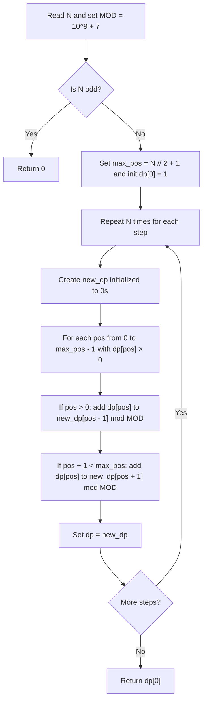

# Just A Few More Steps

> [!info] Document Metadata
> **Course:** `=this.course` | **Topic:** `=this.topic` | **Status:** `=this.status` | **Difficulty:** `=this.difficulty`

**Tags:** #[[Computer Science]] #[[CSALGCM]] #[[Algorithms and Complexity]] #[[HackerRank]] #[[Hierophant Arcana]] #[[2D Dynamic Programming]]
---

## Problem Description

You are standing on a 1D semi-infinite board of squares numbered $0, 1, 2, 3, 4, \dots$, starting at square $0$. On each move, you may step either $1$ square to the left ($-1$) or $1$ square to the right ($+1$), subject to the boundary constraint that you cannot move left when standing on square $0$.

Given an integer $N$, determine how many distinct sequences of $N$ moves begin and end at square $0$. Output the count modulo $10^9 + 7$.

### Input Format
A single line containing one integer $N$, indicating the exact number of moves to take.

### Output Format
Output one line containing the number of valid move sequences ending at square $0$ after $N$ steps, modulo $10^9 + 7$.

### Constraints
- $0 \le N \le 2 \cdot 10^3$

### Sample Test Cases

**Sample Input 0**
```text
4
```

**Sample Output 0**
```text
2
```

*Explanation 0:* Representing left as $L$ and right as $R$, the two valid sequences of length $4$ are `RLRL` and `RRLL`.

**Sample Input 1**
```text
6
```

**Sample Output 1**
```text
5
```

**Sample Input 2**
```text
7
```

**Sample Output 2**
```text
0
```

*Explanation 2:* Each move changes the parity of the square index. After an odd number of moves ($N = 7$), it is impossible to be on even square $0$.

---

## Approach & Intuition

- **Problem Abstraction:** Count the number of non-negative lattice paths (Dyck paths) of length $N$ starting at $(0, 0)$ and ending at $(N, 0)$ using steps $(+1, +1)$ and $(+1, -1)$ without dropping below $y = 0$. Note that for even $N = 2k$, this equals the $k$-th Catalan number $C_k = \frac{1}{k+1}\binom{2k}{k}$.
- **Naive / Brute-Force Approach:** Recursively trying both $L$ and $R$ branches at each step explores $O(2^N)$ sequences, completely infeasible for $N = 2000$.
- **Optimal Strategy:** Use 2D DP where $dp[t][\text{pos}]$ counts the number of valid sequences of $t$ moves ending at square $\text{pos}$.
  - Parity optimization: if $N$ is odd, immediately return $0$.
  - Position bound: to return to $0$ within $N$ total steps, the walk can never reach beyond $\lfloor N / 2 \rfloor$.
  - Space optimization: since step $t+1$ only depends on step $t$, compress the DP table to a 1D rolling array `dp[pos]` of size $\lfloor N/2 \rfloor + 2$:

$$
dp_{\text{next}}[\text{pos}] = \left( [\text{pos} > 0] \cdot dp[\text{pos} - 1] + [\text{pos} + 1 < \text{max\_pos}] \cdot dp[\text{pos} + 1] \right) \bmod (10^9 + 7)
$$

Equivalently, each non-zero entry `dp[pos]` pushes its count to `new_dp[pos - 1]` (if $\text{pos} > 0$) and `new_dp[pos + 1]` (if within `max_pos`). Base case is $dp[0] = 1$ before step $1$, and the final answer is $dp[0]$ after $N$ iterations.

## Algorithm Walkthrough



## Step-by-Step Trace

Tracing **Sample Input 0** ($N = 4$, `max_pos = 3`):

| Step $t$ | `dp[0]` (Square 0) | `dp[1]` (Square 1) | `dp[2]` (Square 2) | Valid Prefixes |
| :---: | :---: | :---: | :---: | :--- |
| $0$ | $1$ | $0$ | $0$ | `""` |
| $1$ | $0$ | $1$ | $0$ | `R` |
| $2$ | $1$ | $0$ | $1$ | `RL` at 0; `RR` at 2 |
| $3$ | $0$ | $2$ | $0$ | `RLR`, `RRL` at 1 |
| $4$ | **2** | $0$ | $2$ | `RLRL`, `RRLL` at 0 |

Result: `dp[0] = 2`.

## Complexity Analysis

| Metric | Complexity | Rationale |
| :--- | :--- | :--- |
| **Time** | $O(N^2)$ | Runs $N$ outer step iterations, each scanning `max_pos` $= \lfloor N/2 \rfloor + 1$ positions ($2000 \times 1001 \approx 2 \cdot 10^6$ operations). |
| **Space** | $O(N)$ | Rolling arrays `dp` and `new_dp` each allocate $\lfloor N/2 \rfloor + 2$ integers. |

---

## Original Stub (HackerRank Template)

```python
def solve(n):
	MOD = 1000000007
    # compute and return answer here
    

n = int(input().rstrip())
print(solve(n))
```

## Full Solution

```python
def solve(n):
    MOD = 1000000007
    if n % 2 == 1:
        return 0
    # dp[pos] = number of ways to be at square `pos` after current step
    max_pos = n // 2 + 1
    dp = [0] * (max_pos + 1)
    dp[0] = 1
    for _ in range(n):
        new_dp = [0] * (max_pos + 1)
        for pos in range(max_pos):
            val = dp[pos]
            if val:
                if pos > 0:
                    new_dp[pos - 1] = (new_dp[pos - 1] + val) % MOD
                if pos + 1 < max_pos:
                    new_dp[pos + 1] = (new_dp[pos + 1] + val) % MOD
        dp = new_dp
    return dp[0]

n = int(input().rstrip())
print(solve(n))
```

## References & Navigation

- **Previous Problem:** [[03 - Dodging Spikes (Hard)]]
- **Next Problem:** [[05 - Which Line Is It Anyway (Medium Version)]]
- **Parent Set:** [[[PS] Hierophant Arcana|Hierophant Arcana Index]]
- **Related Notes:** [[Dynamic Programming Introduction]]
