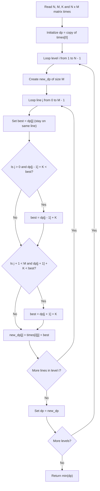

# Which Line Is It Anyway? (Medium Version)

> [!info] Document Metadata
> **Course:** `=this.course` | **Topic:** `=this.topic` | **Status:** `=this.status` | **Difficulty:** `=this.difficulty`

**Tags:** #[[Computer Science]] #[[CSALGCM]] #[[Algorithms and Complexity]] #[[HackerRank]] #[[Hierophant Arcana]] #[[2D Dynamic Programming]]
---

## Problem Description

You have $M$ assembly lines numbered from $1$ to $M$, each containing $N$ levels of assembly stations. Processing at the $j$-th station level on Line $i$ takes $T_{i,j}$ seconds. A product must pass through exactly one station at each of the $N$ levels in order from level $1$ to level $N$.

You may start at any of the $M$ lines at level $1$. After completing assembly at a station on level $r$, you can either stay on the same line at level $r+1$ with zero transfer cost, or transfer to an **adjacent** line ($i-1$ or $i+1$, if it exists) at an additional cost of $K$ seconds. Line $1$ has no line to its left, and Line $M$ has no line to its right. Find the minimum total seconds required to complete assembly across all $N$ levels.

### Input Format
- The first line contains three space-separated integers $N$, $M$, and $K$: the number of station levels, the number of assembly lines, and the transfer penalty in seconds when switching to an adjacent line.
- The next $N$ lines each contain $M$ space-separated integers, where the $i$-th integer on the $j$-th level line gives the station processing time $T_{i,j}$ for Line $i$ at level $j$.

### Output Format
Output one line with a single integer representing the minimum number of seconds required to assemble one product when the starting line and line switches are chosen optimally.

### Constraints
- $1 \le N, M \le 400$
- $0 \le K, T_{i,j} \le 10^4$

### Sample Test Cases

**Sample Input 0**
```text
4 4 6
4 8 15 16
21 19 42 23
50 91 21 100
10 12 30 2
```

**Sample Output 0**
```text
62
```

*Explanation 0:* Start on Line $2$ at level $1$ ($8$), stay on Line $2$ at level $2$ ($+19$), switch to Line $3$ at level $3$ ($+6 + 21$), and switch to Line $4$ at level $4$ ($+6 + 2$), totaling $8 + 19 + 6 + 21 + 6 + 2 = 62$ seconds.

**Sample Input 1**
```text
4 2 6
5 10
15 2
3 5
2 8
```

**Sample Output 1**
```text
23
```

*Explanation 1:* Start on Line $2$ ($10$), stay on Line $2$ ($+2$), transfer to Line $1$ ($+6 + 3$), and stay on Line $1$ ($+2$), giving $10 + 2 + 6 + 3 + 2 = 23$ seconds.

---

## Approach & Intuition

- **Problem Abstraction:** Find a minimum-weight path from any node in row $0$ to any node in row $N-1$ of an $N \times M$ grid where each node $(i, j)$ has cost $\text{times}[i][j]$, vertical edges $(i-1, j) \to (i, j)$ have weight $0$, and diagonal adjacent-line edges $(i-1, j \pm 1) \to (i, j)$ have weight $K$.
- **Naive / Brute-Force Approach:** Enumerating every valid path across $N$ levels branches up to $3$ ways per level from $M$ starting lines, yielding $O(M \cdot 3^{N-1})$ paths, which blows up exponentially long before $N = 400$.
- **Optimal Strategy:** Define $dp[i][j]$ as the minimum total assembly time to finish level $i$ ($0 \le i < N$) on assembly line $j$ ($0 \le j < M$). Since level $i$ only depends on level $i-1$, we collapse the table to a 1D rolling array `dp` of size $M$:

$$
dp[0][j] = \text{times}[0][j]
$$

$$
dp[i][j] = \text{times}[i][j] + \min\Bigl(dp[i-1][j],\; \min_{\substack{j' \in \{j-1, j+1\} \\ 0 \le j' < M}} \bigl(dp[i-1][j'] + K\bigr)\Bigr) \quad (i \ge 1)
$$

The final answer after processing level $N-1$ is $\min_{0 \le j < M} dp[N-1][j]$.

## Algorithm Walkthrough



## Step-by-Step Trace

Tracing **Sample Input 0** ($N = 4, M = 4, K = 6$):

| Level $i$ | Station Times `times[i]` | Line 1 ($j=0$) | Line 2 ($j=1$) | Line 3 ($j=2$) | Line 4 ($j=3$) |
| :---: | :--- | :---: | :---: | :---: | :---: |
| $0$ | `[4, 8, 15, 16]` | $4$ | $8$ | $15$ | $16$ |
| $1$ | `[21, 19, 42, 23]` | $21 + \min(4, 14) = 25$ | $19 + \min(10, 8, 21) = 27$ | $42 + \min(14, 15, 22) = 56$ | $23 + \min(21, 16) = 39$ |
| $2$ | `[50, 91, 21, 100]` | $50 + \min(25, 33) = 75$ | $91 + \min(31, 27, 62) = 118$ | $21 + \min(33, 56, 45) = 54$ | $100 + \min(62, 39) = 139$ |
| $3$ | `[10, 12, 30, 2]` | $10 + \min(75, 124) = 85$ | $12 + \min(81, 118, 60) = 72$ | $30 + \min(124, 54, 145) = 84$ | $2 + \min(60, 139) = \mathbf{62}$ |

Result: $\min(85, 72, 84, 62) = 62$.

## Complexity Analysis

| Metric | Complexity | Rationale |
| :--- | :--- | :--- |
| **Time** | $O(N \cdot M)$ | Processes $N-1$ levels, evaluating $M$ lines per level with $O(1)$ neighbor checks ($400 \times 400 = 1.6 \cdot 10^5$ states). |
| **Space** | $O(N \cdot M)$ | Stores the $N \times M$ input grid `times`; the rolling DP arrays use $O(M)$ auxiliary space. |

---

## Original Stub (HackerRank Template)

```python
def solve(n,m,k,times):
	# compute and return answer here
    
n, m, k = list(map(int,input().rstrip().split(" ")))
times = [list(map(int,input().rstrip().split(" "))) for i in range(n)]
print("{}".format(solve(n,m,k,times)))
```

## Full Solution

```python
def solve(n,m,k,times):
    # dp[j] = min time to finish current level at Line j
    dp = times[0][:]
    for i in range(1, n):
        new_dp = [0] * m
        row = times[i]
        for j in range(m):
            best = dp[j]
            if j > 0 and dp[j - 1] + k < best:
                best = dp[j - 1] + k
            if j + 1 < m and dp[j + 1] + k < best:
                best = dp[j + 1] + k
            new_dp[j] = row[j] + best
        dp = new_dp
    return min(dp)

n, m, k = list(map(int,input().rstrip().split(" ")))
times = [list(map(int,input().rstrip().split(" "))) for i in range(n)]
print("{}".format(solve(n,m,k,times)))
```

## References & Navigation

- **Previous Problem:** [[04 - Just A Few More Steps]]
- **Next Problem:** [[06 - Blasting Through With Sonic Speed]]
- **Parent Set:** [[[PS] Hierophant Arcana|Hierophant Arcana Index]]
- **Related Notes:** [[Dynamic Programming Introduction]]
