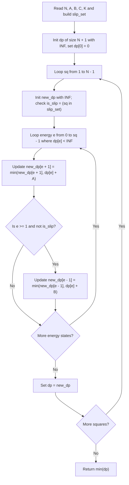

# Blasting Through With Sonic Speed

> [!info] Document Metadata
> **Course:** `=this.course` | **Topic:** `=this.topic` | **Status:** `=this.status` | **Difficulty:** `=this.difficulty`

**Tags:** #[[Computer Science]] #[[CSALGCM]] #[[Algorithms and Complexity]] #[[HackerRank]] #[[Hierophant Arcana]] #[[2D Dynamic Programming]]
---

## Problem Description

Sonic starts at square $1$ on a straight track of $N$ squares with $0$ stored energy and wants to reach square $N$ as fast as possible. At any square $x < N$, Sonic has two movement options to advance to square $x + 1$:
1. **Normal Run:** Takes $A$ seconds to move to square $x + 1$ and increases Sonic's stored energy by $1$.
2. **Spin Dash:** Available if Sonic has at least $1$ stored energy. Takes $B$ seconds to move to square $x + 1$ and consumes $1$ energy.

However, $K$ distinct squares $S_1, S_2, \dots, S_K$ are **slippery**. If Sonic attempts a spin dash while standing on a slippery square, he slips, takes $C$ seconds to get back up, loses $1$ energy, and remains on the **same** square. Determine the fastest time for Sonic to reach square $N$.

### Input Format
- The first line contains five space-separated integers $N$, $A$, $B$, $C$, and $K$: the goal square, normal run time, spin dash time, slip recovery penalty, and number of slippery squares.
- If $K > 0$, the second line contains $K$ distinct space-separated integers $S_i$ indicating the indices of the slippery squares.

### Output Format
Output a single line containing the fastest time in seconds to reach square $N$ from square $1$.

### Constraints
- $1 \le S_i \le N \le 2 \cdot 10^3$
- $0 \le A, B, C \le 10^9$
- $0 \le K \le N$
- All $S_i$ are guaranteed to be unique.

### Sample Test Cases

**Sample Input 0**
```text
5 2 1 4 1
3
```

**Sample Output 0**
```text
6
```

*Explanation 0:* Run $1 \to 2$ ($+2$s, energy $1$), Dash $2 \to 3$ ($+1$s, energy $0$), Run $3 \to 4$ ($+2$s, energy $1$ since square $3$ is slippery), Dash $4 \to 5$ ($+1$s, energy $0$). Total time is $6$ seconds.

**Sample Input 1**
```text
5 4 2 10 0
```

**Sample Output 1**
```text
12
```

*Explanation 1:* Run $1 \to 2 \to 3$ ($4 + 4$s, energy $2$), then Dash $3 \to 4 \to 5$ ($2 + 2$s, energy $0$), totaling $12$ seconds.

**Sample Input 2**
```text
7 1 5 0 2
1 2
```

**Sample Output 2**
```text
6
```

*Explanation 2:* Since normal running ($A = 1$) is faster than spin dashing ($B = 5$), running across all $6$ steps gives $6$ seconds.

---

## Approach & Intuition

- **Problem Abstraction:** Shortest path over states `(square, energy)` where `square` $\in [1, N]$ and `energy` $\in [0, N-1]$.
- **Key Observation on Slippery Penalty $C$:** Intentionally triggering a slip on a slippery square spends $C \ge 0$ seconds, reduces energy by $1$, and makes **zero forward progress** (Sonic stays on the exact same square). Because Sonic is never forced to spend energy and having more energy never hurts future transitions, reaching `(sq, e - 1)` at time $t + C$ is strictly dominated by staying at `(sq, e)` at time $t$. Therefore, an optimal trajectory **never spin-dashes on a slippery square**, making $C$ unnecessary once slippery squares disable the spin-dash transition.
- **Naive / Brute-Force Approach:** Branching between Run and Spin Dash at each square yields $O(2^N)$ action sequences, infeasible for $N = 2000$.
- **Optimal Strategy:** Track $dp[\text{sq}][e]$ as the minimum time to arrive at square $\text{sq}$ with $e$ energy stored. Starting with $dp[1][0] = 0$, iterate `sq` from $1$ to $N - 1$ using a rolling 1D array `dp` over energy $0 \le e < \text{sq}$:
  - **Run:** `new_dp[e + 1] = min(new_dp[e + 1], dp[e] + A)`
  - **Spin Dash (only if $e \ge 1$ and $\text{sq} \notin \text{slip\_set}$):** `new_dp[e - 1] = min(new_dp[e - 1], dp[e] + B)`

The minimum time to reach square $N$ is $\min_{0 \le e \le N} dp[N][e]$.

## Algorithm Walkthrough



## Step-by-Step Trace

Tracing **Sample Input 0** ($N = 5, A = 2, B = 1, C = 4, K = 1$, `slip_set = {3}`):

| Transition | Slippery? | Reachable `(energy: min_time)` Entering Next Square | Notes |
| :--- | :---: | :--- | :--- |
| Start at `sq = 1` | No | `0: 0` | Initial state |
| `sq = 1 -> 2` | No | `1: 2` | Only Run allowed (`e = 0`) |
| `sq = 2 -> 3` | No | `0: 3, 2: 4` | Dash gives `0: 2+1`, Run gives `2: 2+2` |
| `sq = 3 -> 4` | **Yes** | `1: 5, 3: 6` | Dash disallowed on square $3$; only Run (`+2`s, `+1` energy) |
| `sq = 4 -> 5` | No | `0: 6, 2: 7, 4: 8` | From `1: 5`, Dash gives `0: 5+1 = 6` |

Result: $\min(6, 7, 8) = 6$.

## Complexity Analysis

| Metric | Complexity | Rationale |
| :--- | :--- | :--- |
| **Time** | $O(N^2)$ | At square `sq`, up to `sq` energy levels are evaluated, giving $\sum_{\text{sq}=1}^{N-1} \text{sq} = \frac{N(N-1)}{2}$ transitions ($\approx 2 \cdot 10^6$ for $N = 2000$). |
| **Space** | $O(N + K)$ | Rolling DP arrays require $O(N)$ space and `slip_set` requires $O(K)$ space. |

---

## Original Stub (HackerRank Template)

```python
def solve(n,a,b,c,k,slippery):
	# compute and return answer here
    
n, a, b, c, k = list(map(int,input().rstrip().split(" ")))
slippery = [] if k == 0 else list(map(int,input().rstrip().split(" ")))
print(solve(n,a,b,c,k,slippery))
```

## Full Solution

```python
def solve(n,a,b,c,k,slippery):
    slip_set = set(slippery)
    INF = 10**18
    # dp[e] = minimum time to reach current square with energy e
    dp = [INF] * (n + 1)
    dp[0] = 0
    for sq in range(1, n):
        new_dp = [INF] * (n + 1)
        is_slip = sq in slip_set
        for e in range(sq):
            t = dp[e]
            if t == INF:
                continue
            # Option 1: Normal run (+A seconds, +1 energy)
            if t + a < new_dp[e + 1]:
                new_dp[e + 1] = t + a
            # Option 2: Spin dash (requires e >= 1 and non-slippery square: +B seconds, -1 energy)
            if e >= 1 and not is_slip:
                if t + b < new_dp[e - 1]:
                    new_dp[e - 1] = t + b
        dp = new_dp
    return min(dp)

n, a, b, c, k = list(map(int,input().rstrip().split(" ")))
slippery = [] if k == 0 else list(map(int,input().rstrip().split(" ")))
print(solve(n,a,b,c,k,slippery))
```

## References & Navigation

- **Previous Problem:** [[05 - Which Line Is It Anyway (Medium Version)]]
- **Next Problem:** [[07 - Tataru Taru, Disciple of the Hand]]
- **Parent Set:** [[[PS] Hierophant Arcana|Hierophant Arcana Index]]
- **Related Notes:** [[Dynamic Programming Introduction]]
