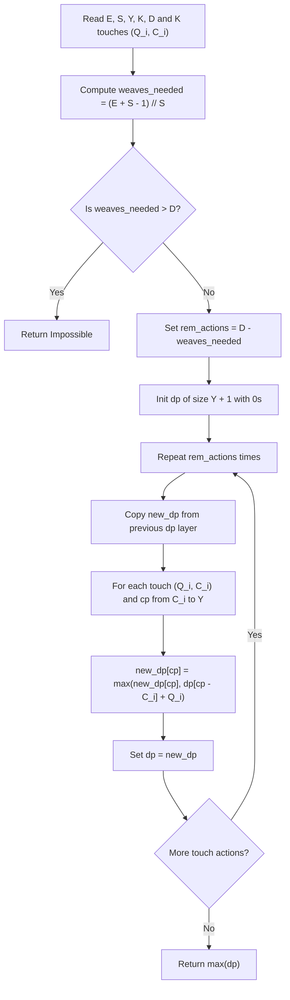

# Tataru Taru, Disciple of the Hand

> [!info] Document Metadata
> **Course:** `=this.course` | **Topic:** `=this.topic` | **Status:** `=this.status` | **Difficulty:** `=this.difficulty`

**Tags:** #[[Computer Science]] #[[CSALGCM]] #[[Algorithms and Complexity]] #[[HackerRank]] #[[Hierophant Arcana]] #[[Knapsack DP]]
---

## Problem Description

Tataru Taru must craft an outfit requiring total effort $E$ using at most $D$ total actions (the durability limit of the fabric) and at most $Y$ crafting points. She has two categories of actions, each consuming $1$ unit of durability:
1. **Weave:** Reduces the remaining effort by a fixed amount $S$ (costs $0$ crafting points).
2. **Touch ($1 \dots K$):** Touch $i$ increases the outfit's quality by $Q_i$ and consumes $C_i$ crafting points. Each touch skill can be used repeatedly as long as crafting points and durability remain.

To successfully complete the outfit, Tataru must reduce effort $E$ to $0$ or lower using weaves within the $D$-action budget, while maximizing the total quality gained from touches. If completing the outfit is impossible within $D$ actions, output `"Impossible"`.

### Input Format
- The first line contains five space-separated integers $E$, $S$, $Y$, $K$, and $D$: required effort, effort reduced per weave, Tataru's crafting points, number of known touches, and maximum actions supported by the fabric.
- The next $K$ lines each contain two space-separated integers $Q_i$ and $C_i$, the quality increase and crafting point cost of the $i$-th touch.

### Output Format
Output a single line containing the maximum achievable quality, or `"Impossible"` (without quotes) if the outfit cannot be finished within $D$ actions.

### Constraints
- $1 \le E, S, Y, K, D \le 100$
- $0 \le C_i \le 100$ for all $1 \le i \le K$
- $1 \le Q_i \le 100$ for all $1 \le i \le K$

### Sample Test Cases

**Sample Input 0**
```text
5 1 5 5 1
3 5
2 1
3 4
2 5
2 5
```

**Sample Output 0**
```text
Impossible
```

*Explanation 0:* Finishing effort $E = 5$ with $S = 1$ per weave requires $\lceil 5 / 1 \rceil = 5$ weaves, which exceeds the fabric durability $D = 1$.

**Sample Input 1**
```text
5 5 2 3 5
3 1
2 5
3 5
```

**Sample Output 1**
```text
6
```

*Explanation 1:* Completing the outfit requires $\lceil 5 / 5 \rceil = 1$ weave, leaving $5 - 1 = 4$ actions for touches. With $Y = 2$ crafting points, Tataru uses Touch $1$ ($Q_1 = 3, C_1 = 1$) twice to reach quality $6$ in $3$ total actions.

**Sample Input 2**
```text
6 4 6 2 5
1 5
4 1
```

**Sample Output 2**
```text
12
```

*Explanation 2:* Finishing requires $\lceil 6 / 4 \rceil = 2$ weaves, leaving $5 - 2 = 3$ touch actions. Applying Touch $2$ ($Q_2 = 4, C_2 = 1$) $3$ times spends $3 \le 6$ crafting points and achieves quality $12$.

---

## Approach & Intuition

- **Problem Abstraction:** Decouple completion feasibility from quality maximization. Since weaves never affect crafting points and touches never affect effort, any optimal plan uses the **minimum** required weaves $\lceil E / S \rceil$ so as many action slots as possible remain for quality-boosting touches. Thus, the problem reduces to an **action-bounded unbounded knapsack** with capacity $Y$ and at most $R = D - \lceil E / S \rceil$ items selected.
- **Naive / Brute-Force Approach:** Choosing among $K$ touches (or doing nothing) across $R$ steps explores $O((K+1)^R)$ sequences, which explodes exponentially up to $101^{100}$.
- **Optimal Strategy:**
  1. Compute $\text{weaves\_needed} = \lceil E / S \rceil = \lfloor (E + S - 1) / S \rfloor$. If $\text{weaves\_needed} > D$, return `"Impossible"`.
  2. Otherwise, let $R = D - \text{weaves\_needed}$. Define $dp[a][cp]$ as the maximum quality attainable using at most $a$ touch actions and exactly $cp$ crafting points (compressed to a rolling 1D array `dp[cp]` across $a = 1 \dots R$).
  3. At each action step, compute `new_dp` from the **previous** layer `dp` (not in-place) so that each iteration adds at most **one** touch—crucial both for enforcing the $R$-action cap and for preventing infinite updates when $C_i = 0$:

$$
dp_{\text{next}}[cp] = \max\Bigl(dp[cp],\; \max_{\substack{1 \le i \le K \\ C_i \le cp}} \bigl(dp[cp - C_i] + Q_i\bigr)\Bigr)
$$

After $R$ iterations, return $\max_{0 \le cp \le Y} dp[cp]$.

## Algorithm Walkthrough



## Step-by-Step Trace

Tracing **Sample Input 1** ($E = 5, S = 5, Y = 2, K = 3, D = 5$, touches `[(3, 1), (2, 5), (3, 5)]`):
- `weaves_needed` $= \lfloor (5 + 5 - 1) / 5 \rfloor = 1 \le 5$.
- `rem_actions` $= 5 - 1 = 4$.
- Only Touch $1$ `(Q=3, C=1)` has $C_i \le Y = 2$.

| Touch Action Step | `dp[0]` | `dp[1]` | `dp[2]` | Optimal Choice |
| :---: | :---: | :---: | :---: | :--- |
| $0$ (Init) | $0$ | $0$ | $0$ | $0$ touches used |
| $1$ | $0$ | $3$ | $3$ | Apply Touch $1$ once (`C=1, Q=3`) |
| $2$ | $0$ | $3$ | **6** | Apply Touch $1$ twice (`C=2, Q=6`) |
| $3$ | $0$ | $3$ | $6$ | Insufficient CP for a 3rd touch |
| $4$ | $0$ | $3$ | $6$ | Insufficient CP for a 4th touch |

Result: $\max(0, 3, 6) = 6$.

## Complexity Analysis

| Metric | Complexity | Rationale |
| :--- | :--- | :--- |
| **Time** | $O((D - \lceil E/S \rceil) \cdot K \cdot Y) \subseteq O(D \cdot K \cdot Y)$ | Up to $D$ outer action steps iterate over $K$ touches and at most $Y + 1$ CP states ($\le 100^3 = 10^6$ operations). |
| **Space** | $O(Y + K)$ | Rolling DP arrays occupy $O(Y)$ space and the input `touches` list uses $O(K)$ space. |

---

## Original Stub (HackerRank Template)

```python
num_cases = 20

"""
This function solves one test case.

Parameters:
e       : int        - effort needed to complete the outfit
s       : int        - amount a weave action does to reduce effort needed
y       : int        - Tataru's crafting points
k       : int        - number of touches known
d       : int        - number of actions Tataru can do
touches : array-like - Q_i and C_i values for each of the k touches known

Returns the maximum quality Tataru can achieve or "Impossible" if Tataru cannot
complete the outfit.
"""
def solve(e,s,y,k,d,touches):
    INF = int(1e9)
    

e, s, y, k, d = list(map(int,input().strip().split(" ")))

touches = [
    list(map(int,input().strip().split(" "))) for i in range(k)
]

print(str(solve(e,s,y,k,d,touches)))
```

## Full Solution

```python
num_cases = 20

"""
This function solves one test case.

Parameters:
e       : int        - effort needed to complete the outfit
s       : int        - amount a weave action does to reduce effort needed
y       : int        - Tataru's crafting points
k       : int        - number of touches known
d       : int        - number of actions Tataru can do
touches : array-like - Q_i and C_i values for each of the k touches known

Returns the maximum quality Tataru can achieve or "Impossible" if Tataru cannot
complete the outfit.
"""
def solve(e,s,y,k,d,touches):
    # Minimum weave actions needed to reduce effort E to <= 0
    weaves_needed = (e + s - 1) // s
    if weaves_needed > d:
        return "Impossible"
    
    rem_actions = d - weaves_needed
    # dp[cp] = max quality using at most current number of touch actions and `cp` crafting points
    dp = [0] * (y + 1)
    for _ in range(rem_actions):
        new_dp = dp[:]
        for q_i, c_i in touches:
            for cp in range(c_i, y + 1):
                if dp[cp - c_i] + q_i > new_dp[cp]:
                    new_dp[cp] = dp[cp - c_i] + q_i
        dp = new_dp
    return max(dp)

e, s, y, k, d = list(map(int,input().strip().split(" ")))

touches = [
    list(map(int,input().strip().split(" "))) for i in range(k)
]

print(str(solve(e,s,y,k,d,touches)))
```

## References & Navigation

- **Previous Problem:** [[06 - Blasting Through With Sonic Speed]]
- **Next Problem:** [[08 - Gigaman Z]]
- **Parent Set:** [[[PS] Hierophant Arcana|Hierophant Arcana Index]]
- **Related Notes:** [[Dynamic Programming Introduction]]
