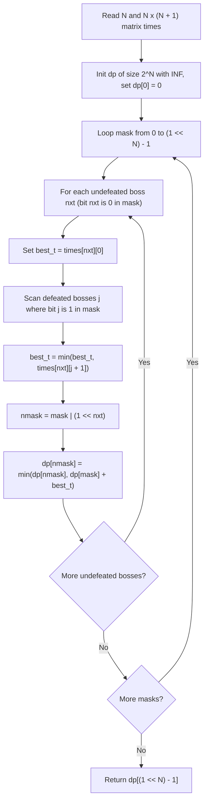

# Gigaman Z

> [!info] Document Metadata
> **Course:** `=this.course` | **Topic:** `=this.topic` | **Status:** `=this.status` | **Difficulty:** `=this.difficulty`

**Tags:** #[[Computer Science]] #[[CSALGCM]] #[[Algorithms and Complexity]] #[[HackerRank]] #[[Hierophant Arcana]] #[[Bitmask DP]]
---

## Problem Description

Gigaman Z must defeat $N$ bosses numbered $1$ to $N$ in some order of his choosing. Once a boss is defeated, Z claims that boss's signature weapon and keeps it permanently for all remaining battles.

Defeating boss $i$ without any boss weapons takes $T_{i,0}$ minutes. If Z has already defeated boss $j$, he may lock in boss $j$'s weapon before fighting boss $i$ (weapons cannot be swapped mid-battle) to defeat boss $i$ in $T_{i,j}$ minutes. Determine the minimum total combat time required to defeat all $N$ bosses under an optimal battle order.

### Input Format
- The first line contains a single integer $N$, the number of bosses.
- The next $N$ lines each contain $N + 1$ space-separated integers. On the $i$-th line, the first integer is $T_{i,0}$ (bare-handed combat time against boss $i$), followed by $T_{i,1}, T_{i,2}, \dots, T_{i,N}$ where $T_{i,j}$ is the time to defeat boss $i$ using boss $j$'s weapon.

### Output Format
Output a single line containing an integer representing the minimum number of minutes required to defeat all $N$ bosses.

### Constraints
- $1 \le N \le 12$
- $1 \le T_{i,0}, T_{i,j} \le 2 \cdot 10^3$

### Sample Test Cases

**Sample Input 0**
```text
3
7 4 9 6
8 3 7 6
8 4 1 5
```

**Sample Output 0**
```text
11
```

*Explanation 0:* Optimal order is $1, 2, 3$: Boss $1$ bare-handed ($7$), Boss $2$ using Boss $1$'s weapon ($T_{2,1} = 3$), and Boss $3$ using Boss $2$'s weapon ($T_{3,2} = 1$), totaling $7 + 3 + 1 = 11$ minutes.

**Sample Input 1**
```text
3
14 10 5 15
16 17 14 6
15 1 11 17
```

**Sample Output 1**
```text
21
```

*Explanation 1:* Optimal order is $1, 3, 2$: Boss $1$ bare-handed ($14$), Boss $3$ using Boss $1$'s weapon ($T_{3,1} = 1$), and Boss $2$ using Boss $3$'s weapon ($T_{2,3} = 6$), totaling $14 + 1 + 6 = 21$ minutes.

---

## Approach & Intuition

- **Problem Abstraction:** Find a permutation $\pi$ of $\{0, \dots, N-1\}$ minimizing $\sum_{k=0}^{N-1} \min\bigl(T_{\pi_k, 0},\; \min_{r < k} T_{\pi_k, \pi_r + 1}\bigr)$. Crucially, the cost of fighting boss $\text{nxt}$ after defeating a prefix of bosses depends **only on the set** of already-defeated bosses, not the order in which those earlier bosses were defeated.
- **Naive / Brute-Force Approach:** Testing all $N!$ permutations of bosses evaluates up to $12! = 479{,}001{,}600$ permutations, causing Time Limit Exceeded.
- **Optimal Strategy:** Apply **Bitmask Dynamic Programming**. Encode any subset of defeated bosses as an $N$-bit integer `mask` $\in [0, 2^N - 1]$, where bit $j$ is $1$ iff boss $j$ (0-indexed) has been defeated. Let $dp[\text{mask}]$ be the minimum total minutes to defeat the subset `mask`. Starting from $dp[0] = 0$, iterating `mask` from $0$ to $2^N - 1$ guarantees that every strict superset `mask | (1 << nxt)` is processed after `mask`:

$$
\text{best\_t}(\text{mask}, \text{nxt}) = \min\Bigl(\text{times}[\text{nxt}][0],\; \min_{j : (\text{mask} \gg j) \mathbin{\&} 1} \text{times}[\text{nxt}][j + 1]\Bigr)
$$

$$
dp[\text{mask} \mid 2^{\text{nxt}}] = \min\Bigl(dp[\text{mask} \mid 2^{\text{nxt}}],\; dp[\text{mask}] + \text{best\_t}(\text{mask}, \text{nxt})\Bigr)
$$

The answer is $dp[2^N - 1]$, when all $N$ bits are set.

## Algorithm Walkthrough



## Step-by-Step Trace

Tracing **Sample Input 0** ($N = 3$, `times = [[7, 4, 9, 6], [8, 3, 7, 6], [8, 4, 1, 5]]`):

| `mask` (binary) | Defeated Subset | Optimal Transitions Considered | `dp[mask]` |
| :---: | :--- | :--- | :---: |
| `000` | $\emptyset$ | Base case | $0$ |
| `001` | $\{1\}$ | $0 + T_{1,0} = 7$ | $7$ |
| `010` | $\{2\}$ | $0 + T_{2,0} = 8$ | $8$ |
| `100` | $\{3\}$ | $0 + T_{3,0} = 8$ | $8$ |
| `011` | $\{1, 2\}$ | $\min(dp[001] + T_{2,1},\; dp[010] + T_{1,0}) = \min(7 + 3,\; 8 + 7)$ | $10$ |
| `101` | $\{1, 3\}$ | $\min(dp[001] + T_{3,1},\; dp[100] + T_{1,3}) = \min(7 + 4,\; 8 + 6)$ | $11$ |
| `110` | $\{2, 3\}$ | $\min(dp[010] + T_{3,2},\; dp[100] + T_{2,3}) = \min(8 + 1,\; 8 + 6)$ | $9$ |
| `111` | $\{1, 2, 3\}$ | $\min(10 + T_{3,2},\; 11 + T_{2,1},\; 9 + T_{1,3}) = \min(10 + 1,\; 11 + 3,\; 9 + 6)$ | **11** |

Result: `dp[111] = 11`.

## Complexity Analysis

| Metric | Complexity | Rationale |
| :--- | :--- | :--- |
| **Time** | $O(2^N \cdot N^2)$ | Evaluates $2^N$ masks, up to $N$ undefeated bosses `nxt`, and $N$ weapon lookups `j` per transition ($4096 \times 144 \approx 5.9 \cdot 10^5$ operations for $N = 12$). |
| **Space** | $O(2^N + N^2)$ | Stores the $2^N$-entry DP array and the $N \times (N + 1)$ combat time matrix. |

---

## Original Stub (HackerRank Template)

```python
def solve(n,times):
	# compute and return answer here

n = int(input().rstrip())
times = [list(map(int,input().rstrip().split(" "))) for i in range(n)]
print("{}".format(solve(n,times)))
```

## Full Solution

```python
def solve(n,times):
    # Bitmask DP: dp[mask] = min time to defeat the subset of bosses in `mask`
    INF = 10**9
    dp = [INF] * (1 << n)
    dp[0] = 0
    for mask in range(1 << n):
        cur = dp[mask]
        if cur == INF:
            continue
        for nxt in range(n):
            if not (mask & (1 << nxt)):
                # Fastest time to defeat boss `nxt` using no weapon or any weapon from already defeated bosses
                best_t = times[nxt][0]
                for j in range(n):
                    if mask & (1 << j):
                        if times[nxt][j + 1] < best_t:
                            best_t = times[nxt][j + 1]
                nmask = mask | (1 << nxt)
                if cur + best_t < dp[nmask]:
                    dp[nmask] = cur + best_t
    return dp[(1 << n) - 1]

n = int(input().rstrip())
times = [list(map(int,input().rstrip().split(" "))) for i in range(n)]
print("{}".format(solve(n,times)))
```

## References & Navigation

- **Previous Problem:** [[07 - Tataru Taru, Disciple of the Hand]]
- **Parent Set:** [[[PS] Hierophant Arcana|Hierophant Arcana Index]]
- **Related Notes:** [[Dynamic Programming Introduction]]
