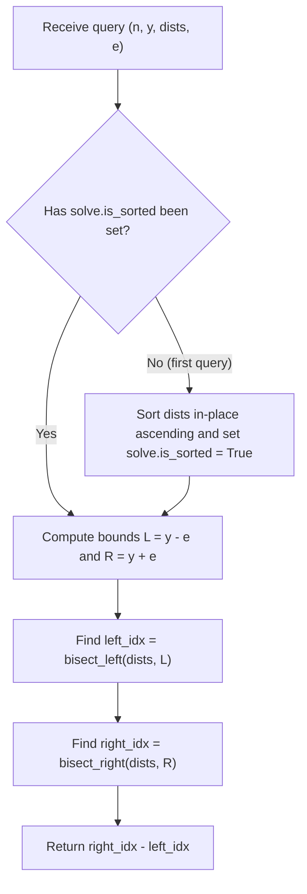

# Quantum Leap

> [!info] Document Metadata
> **Course:** `=this.course` | **Topic:** `=this.topic` | **Status:** `=this.status` | **Difficulty:** `=this.difficulty`

**Tags:** #[[Computer Science]] #[[CSALGCM]] #[[Algorithms and Complexity]] #[[HackerRank]] #[[Lovers Arcana]] #[[Binary Search]]
---

## Problem Description

Timmy the Time-Traveler has $N$ years of interest $Y_1, Y_2, \dots, Y_N$ that he wants to visit, starting from the current year $Y$. Given an energy cell with capacity $E$, Timmy can travel up to $E$ years before $Y$ or up to $E$ years after $Y$, meaning he can reach any year in the closed interval $[Y - E, Y + E]$ (equivalently, $|Y_i - Y| \le E$).

Because Timmy cannot carry spare energy cubes between jumps, he only needs to evaluate each query independently from the current year $Y$. Given $N$, $Y$, and $Q$ queries each specifying an energy capacity $E$, determine how many of Timmy's $N$ years of interest are reachable in his next jump.

### Input Format
- The first line contains three space-separated integers $N$, $Y$, and $Q$, indicating the number of years of interest, the current year, and the number of queries, respectively.
- The next $N$ lines each contain a single integer $Y_i$, indicating the $i$-th year of interest.
- The final $Q$ lines each contain a single integer $E$, indicating the energy capacity for that query.

### Output Format
Output $Q$ lines, the $i$-th of which contains a single integer indicating how many years of interest lie within $[Y - E, Y + E]$ for the $i$-th query.

### Constraints
- $1 \le N, Q \le 2 \cdot 10^5$
- $0 \le |Y|, |Y_i| \le 10^9$ for all $1 \le i \le N$
- $0 \le E \le 2 \cdot 10^9$ for all queries

### Sample Test Cases

**Sample Input 0**
```text
3 89 3
81
-85
-43
5
45
1176
```

**Sample Output 0**
```text
0
1
3
```

*Explanation 0:* With $Y = 89$ and years $\{81, -85, -43\}$:
- Query $1$ ($E = 5$): Reachable interval is $[84, 94]$ (printed as $(89 - 4, 89 + 4) \mapsto (85, 93)$ in the original PDF); $0$ years fall inside.
- Query $2$ ($E = 45$): Reachable interval is $[44, 134]$; only $81$ falls inside ($1$ year).
- Query $3$ ($E = 1176$): Reachable interval is $[-1087, 1265]$; all $3$ years fall inside.

**Sample Input 1**
```text
5 81 5
-114
191
-191
-98
177
103
33
132
207
48
```

**Sample Output 1**
```text
1
0
2
4
0
```

---

## Approach & Intuition

- **Problem Abstraction:** Given a static multiset of $N$ integers $Y_1, \dots, Y_N$ and a fixed pivot $Y$, answer $Q$ online range-count queries of the form $|\{i \in \{1, \dots, N\} : Y - E \le Y_i \le Y + E\}|$.
- **Naive / Brute-Force Approach:** Scanning all $N$ years on every query checks $Y - E \le Y_i \le Y + E$ in $O(N)$ per query and $O(Q \cdot N)$ total time. With $N, Q \le 2 \cdot 10^5$, $Q \cdot N$ reaches $4 \cdot 10^{10}$ operations, causing Time Limit Exceeded (TLE).
- **Optimal Strategy:** Since the list of years never mutates across queries, sort the array once in ascending order in $O(N \log N)$ time. For any query $E$, let $L = Y - E$ and $R = Y + E$. Using binary search:

$$
\text{count}(L, R) = \text{bisect\_right}(A, R) - \text{bisect\_left}(A, L)
$$

where `bisect_left` returns the first index $i$ with $A[i] \ge L$ and `bisect_right` returns the first index $j$ with $A[j] > R$. The HackerRank harness invokes `solve(n, y, dists, e)` inside a loop over the $Q$ queries, passing the shared list of years as `dists`. Using a function attribute (`solve.is_sorted`) ensures `dists.sort()` runs exactly once on the first query without modifying the driver code.

## Algorithm Walkthrough



## Step-by-Step Trace

Tracing **Sample Input 0** with $Y = 89$ and `dists = [81, -85, -43]`:

1. **First query (`e = 5`):** `solve.is_sorted` is absent, so `dists` is sorted in-place to `[-85, -43, 81]`.

| Query | $E$ | Interval $[Y - E, Y + E]$ | `bisect_left(dists, L)` | `bisect_right(dists, R)` | Output (`right - left`) |
| :---: | :---: | :---: | :---: | :---: | :---: |
| $1$ | $5$ | $[84, 94]$ | $3$ | $3$ | $0$ |
| $2$ | $45$ | $[44, 134]$ | $2$ | $3$ | $1$ |
| $3$ | $1176$ | $[-1087, 1265]$ | $0$ | $3$ | $3$ |

## Complexity Analysis

| Metric | Complexity | Rationale |
| :--- | :--- | :--- |
| **Time** | $O((N + Q) \log N)$ | One-time in-place Timsort takes $O(N \log N)$, and each of the $Q$ queries performs two binary searches in $O(\log N)$ time. |
| **Space** | $O(1)$ auxiliary | `dists.sort()` operates in-place on the input array (neglecting Timsort's $O(N)$ worst-case temporary buffer) and each query uses constant variables. |

---

## Full Solution

### Partial-Credit Solution (Brute Force)

```python
def solve(n,y,dists,e):
    # compute and return answer here
    return sum(1 for yr in dists if y - e <= yr <= y + e)
```

### Optimal Solution (Full AC)

```python
from bisect import bisect_left, bisect_right

def solve(n,y,dists,e):
    # compute and return answer here
    # NOTE: You can also add `years.sort()` once in main() after reading `years`.
    # The attribute check below sorts `dists` in-place once on the 1st query automatically!
    if not hasattr(solve, "is_sorted"):
        dists.sort()
        solve.is_sorted = True
    return bisect_right(dists, y + e) - bisect_left(dists, y - e)
```

## References & Navigation

- **Next Problem:** [[02 - Weird Recurrence]]
- **Parent Set:** [[[PS] Lovers Arcana|Lovers Arcana Index]]
- **Related Notes:** [[Dynamic Programming Introduction]], [[Divide and Conquer Introduction]]
