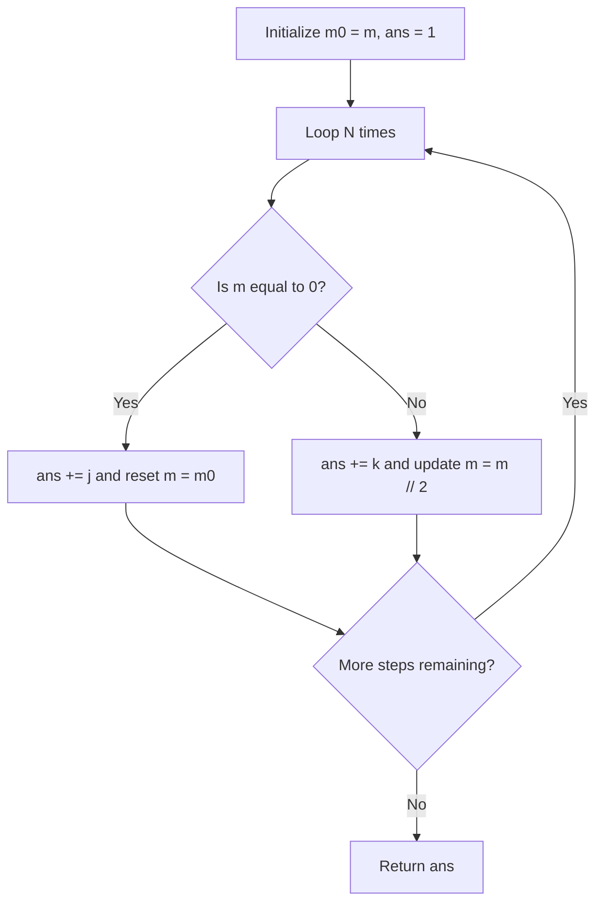

# Weird Recurrence

> [!info] Document Metadata
> **Course:** `=this.course` | **Topic:** `=this.topic` | **Status:** `=this.status` | **Difficulty:** `=this.difficulty`

**Tags:** #[[Computer Science]] #[[CSALGCM]] #[[Algorithms and Complexity]] #[[HackerRank]] #[[Lovers Arcana]] #[[Iterative Simulation]]
---

## Problem Description

Compute the integer function $f(N, M)$ defined by the following recurrence relation with initial parameter $M_0 = M$ and provided constants $J$ and $K$:

- $f(0, M) = 1$
- $f(N, 0) = f(N - 1, M_0) + J$, for $N > 0$
- $f(N, M) = f\left(N - 1, \left\lfloor \frac{M}{2} \right\rfloor\right) + K$, for $N > 0$ and $M > 0$

Given initial values $N, M, J, K$, output the exact value of $f(N, M)$.

### Input Format
A single line containing four space-separated integers $N$, $M$, $J$, and $K$.

### Output Format
A single line containing the integer value $f(N, M)$.

### Constraints
- $0 \le N, M \le 5 \cdot 10^3$
- $0 \le J, K \le 10^9$

### Sample Test Cases

**Sample Input 0**
```text
2 1 7 1
```

**Sample Output 0**
```text
9
```

*Explanation 0:* Unrolling from $(2, 1)$ with $M_0 = 1$, $J = 7$, $K = 1$:
- $f(2, 1) = f(1, \lfloor 1 / 2 \rfloor) + 1 = f(1, 0) + 1$
- $f(1, 0) = f(0, 1) + 7 = 1 + 7 = 8$
- $f(2, 1) = 8 + 1 = 9$

**Sample Input 1**
```text
3 2 14 10
```

**Sample Output 1**
```text
35
```

*Explanation 1:* Unrolling from $(3, 2)$ with $M_0 = 2$, $J = 14$, $K = 10$: $f(3, 2) = f(2, 1) + 10 = f(1, 0) + 20 = f(0, 2) + 14 + 20 = 1 + 34 = 35$.

---

## Approach & Intuition

- **Problem Abstraction:** The recurrence makes exactly one recursive call at every depth, decrementing $N$ by $1$ until $N = 0$. Therefore, $f(N, M)$ is a deterministic linear chain of length $N$ starting at state $(N, M)$ and accumulating either $+J$ (when the current $M = 0$) or $+K$ (when $M > 0$) before returning the base value $1$.
- **Naive / Brute-Force Approach:** Implementing the recurrence verbatim via recursion runs in $O(N)$ time, but consumes $O(N)$ call-stack frames. Because Python enforces a default recursion depth limit of $1000$ (`sys.getrecursionlimit()`), inputs with $N \ge 1000$ (up to $N = 5000$) raise `RecursionError` and fail on larger test cases unless the limit is manually raised or recursion is eliminated.
- **Optimal Strategy:** Convert the single-branch tail-like recurrence into an iterative bottom-up / forward accumulation loop. Initialize `ans = 1` (the base case $f(0, \cdot) = 1$) and $m_0 = m$. Across $N$ iterations:

$$
(\text{ans},\; m) \leftarrow \begin{cases}
(\text{ans} + J,\; m_0) & \text{if } m = 0 \\
(\text{ans} + K,\; \lfloor m / 2 \rfloor) & \text{if } m > 0
\end{cases}
$$

Notice that the sequence of $m$ values is periodic once $m$ resets to $m_0$: if $M_0 = 0$, every step adds $J$ (giving $1 + N \cdot J$); if $M_0 > 0$, each cycle takes $\lfloor \log_2 M_0 \rfloor + 1$ halving steps followed by $1$ reset step, allowing an $O(1)$-time closed-form solution as well, though a direct $O(N)$ loop easily runs within milliseconds for $N \le 5000$.

## Algorithm Walkthrough



## Step-by-Step Trace

Tracing **Sample Input 1** ($N = 3$, $M = 2$, $J = 14$, $K = 10$, so $m_0 = 2$ and initial `ans = 1`):

| Step | Current `m` | Condition | Transition Applied | Updated `ans` | Next `m` |
| :---: | :---: | :--- | :--- | :---: | :---: |
| Init | $2$ | Start | Base value $1$ | $1$ | $2$ |
| $1$ | $2$ | $m > 0$ | $\text{ans} \leftarrow 1 + 10$, $m \leftarrow \lfloor 2 / 2 \rfloor$ | $11$ | $1$ |
| $2$ | $1$ | $m > 0$ | $\text{ans} \leftarrow 11 + 10$, $m \leftarrow \lfloor 1 / 2 \rfloor$ | $21$ | $0$ |
| $3$ | $0$ | $m = 0$ | $\text{ans} \leftarrow 21 + 14$, $m \leftarrow m_0$ | **35** | $2$ |

## Complexity Analysis

| Metric | Complexity | Rationale |
| :--- | :--- | :--- |
| **Time** | $O(N)$ | Performs exactly $N$ constant-time loop iterations (up to $5 \cdot 10^3$ operations; can also be computed in $O(1)$ via cycle arithmetic of length $\lfloor \log_2 M_0 \rfloor + 2$). |
| **Space** | $O(1)$ | Eliminates recursion call stack overhead, using only scalar variables `m0`, `ans`, and `m`. |

---

## Full Solution

### Partial-Credit Solution (Brute Force)

```python
def solve(n, m, j, k):
    # compute and return answer here
    m0 = m
    def rec(curr_n, curr_m):
        if curr_n == 0:
            return 1
        if curr_m == 0:
            return rec(curr_n - 1, m0) + j
        return rec(curr_n - 1, curr_m // 2) + k
    return rec(n, m)
```

### Optimal Solution (Full AC)

```python
def solve(n, m, j, k):
    # compute and return answer here
    m0 = m
    ans = 1
    # Simulate the N transitions iteratively from N down to 0
    for _ in range(n):
        if m == 0:
            ans += j
            m = m0      # Reset M to its initial value M_0
        else:
            ans += k
            m //= 2     # Halve M (floor division)
    return ans
```

## References & Navigation

- **Previous Problem:** [[01 - Quantum Leap]]
- **Next Problem:** [[03 - Sequence Distillation]]
- **Parent Set:** [[[PS] Lovers Arcana|Lovers Arcana Index]]
- **Related Notes:** [[Dynamic Programming Introduction]], [[Divide and Conquer Introduction]]
