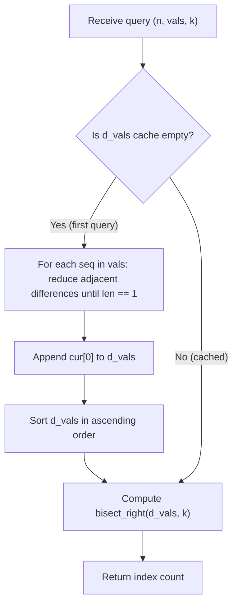

# Sequence Distillation

> [!info] Document Metadata
> **Course:** `=this.course` | **Topic:** `=this.topic` | **Status:** `=this.status` | **Difficulty:** `=this.difficulty`

**Tags:** #[[Computer Science]] #[[CSALGCM]] #[[Algorithms and Complexity]] #[[HackerRank]] #[[Lovers Arcana]] #[[Binary Search]]
---

## Problem Description

Let $S = (a_1, a_2, \dots, a_n)$ be a sequence of $n$ integers. The *immediate distillation* of $S$ is defined as the length-$(n - 1)$ difference sequence:

$$
d_1(S) = (a_2 - a_1,\; a_3 - a_2,\; \dots,\; a_n - a_{n-1})
$$

Stacked distillations are defined recursively by $d_0(S) = S$ and $d_k(S) = d_1(d_{k-1}(S))$. The *distillation* of $S$, denoted $d(S)$, is the single integer remaining in $d_{n-1}(S)$.

For example, given $S = (1, 5, 8, 2)$:
- $d_1(S) = (4, 3, -6)$
- $d_2(S) = (-1, -9)$
- $d_3(S) = (-8) \implies d(S) = -8$

Given $M$ sequences $S_1, S_2, \dots, S_M$ and $Q$ queries each specifying a threshold $K$, determine for each query how many sequences satisfy $d(S_i) \le K$.

### Input Format
- The first line contains two space-separated integers $M$ and $Q$, the number of sequences and the number of queries.
- $M$ sequence descriptions follow. Each starts with a line containing an integer $L_i$ (the length of $S_i$), followed by $L_i$ lines each containing an integer $A_{i,j}$.
- The final $Q$ lines each contain a single integer $K$, the distillation threshold for that query.

*(Note: In the original HackerRank problem PDF, the constraint and output text intermittently refers to $M$ as $N$, matching the driver parameter `n` in `solve(n, vals, k)`.)*

### Output Format
Output $Q$ lines, each containing a single integer indicating how many of the $M$ sequences satisfy $d(S_i) \le K$.

### Constraints
- $1 \le M \le 10^4$
- $1 \le Q \le 3 \cdot 10^5$
- $1 \le L_i \le 30$ for all $1 \le i \le M$
- $0 \le |K| \le 10^{18}$
- $0 \le |A_{i,j}| \le 10^4$ for all $1 \le i \le M$ and $1 \le j \le L_i$

### Sample Test Cases

**Sample Input 0**
```text
3 3
2
4
5
2
0
-1
3
0
-4
2
8
0
-10
```

**Sample Output 0**
```text
2
1
0
```

*Explanation 0:* The three sequences are $[4, 5]$ ($d = 1$), $[0, -1]$ ($d = -1$), and $[0, -4, 2]$ ($d_1 = [-4, 6] \implies d = 10$). The sorted distillation values are $[-1, 1, 10]$:
- $K = 8$: two sequences ($\{-1, 1\}$) have $d(S_i) \le 8$.
- $K = 0$: one sequence ($\{-1\}$) has $d(S_i) \le 0$.
- $K = -10$: zero sequences have $d(S_i) \le -10$.

**Sample Input 1**
```text
4 4
2
4
1
2
-1
4
2
-10
4
2
-2
-2
16
-17
35
-10
```

**Sample Output 1**
```text
4
0
4
0
```

**Sample Input 2**
```text
6 6
3
-15
-7
-5
1
2
1
-3
3
8
-4
0
2
-11
10
3
11
-4
6
-105
-91
-19
84
109
-103
```

**Sample Output 2**
```text
0
0
0
6
6
0
```

---

## Approach & Intuition

- **Problem Abstraction:** Repeatedly taking adjacent differences reduces each sequence $S_i$ of length $L_i \le 30$ to a single scalar $d(S_i) = \sum_{j=0}^{L_i - 1} (-1)^{L_i - 1 - j} \binom{L_i - 1}{j} a_{j+1}$, bounded by $2^{29} \cdot 10^4 \approx 5.37 \cdot 10^{12}$ (well within 64-bit integers and native Python `int`). The task then reduces to $Q$ static rank queries counting entries $\le K$.
- **Naive / Brute-Force Approach:** Recomputing the iterative difference reductions across all $M$ sequences for each of the $Q$ queries takes $O(Q \cdot M \cdot L^2)$ time. At $M = 10^4$, $Q = 3 \cdot 10^5$, and $L = 30$, this performs roughly $10^{12}$ operations and immediately TLEs.
- **Optimal Strategy:** Because the sequences never change across queries, precompute $d(S_i)$ once for every $i \in \{1, \dots, M\}$, store them in `d_vals`, and sort `d_vals` in ascending order in $O(M \cdot L^2 + M \log M)$ total preprocessing time. Each subsequent query $K$ is answered in $O(\log M)$ time via:

$$
\text{count}(K) = \text{bisect\_right}(\text{d\_vals},\; K)
$$

*(Implementation note: The HackerRank starter docstring mistakenly stated `< k`, whereas both the problem statement and all sample test cases require `<= k`, matching `bisect_right`. Caching `d_vals` at module scope avoids recomputing the distillations across the $Q$ per-query invocations of `solve(n, vals, k)`.)*

## Algorithm Walkthrough



## Step-by-Step Trace

Tracing **Sample Input 0** ($M = 3$, sequences $[4, 5]$, $[0, -1]$, $[0, -4, 2]$):

1. **Preprocessing (`d_vals` populated on query 1):**
   - $S_1 = [4, 5] \to [5 - 4] = [1] \implies d(S_1) = 1$
   - $S_2 = [0, -1] \to [-1 - 0] = [-1] \implies d(S_2) = -1$
   - $S_3 = [0, -4, 2] \to [-4 - 0, 2 - (-4)] = [-4, 6] \to [6 - (-4)] = [10] \implies d(S_3) = 10$
   - Sorted `d_vals = [-1, 1, 10]`

2. **Query Resolution (`bisect_right(d_vals, k)`):**

| Query | Threshold $K$ | Elements $\le K$ | `bisect_right([-1, 1, 10], K)` | Output |
| :---: | :---: | :--- | :---: | :---: |
| $1$ | $8$ | $-1, 1$ | $2$ | `2` |
| $2$ | $0$ | $-1$ | $1$ | `1` |
| $3$ | $-10$ | None | $0$ | `0` |

## Complexity Analysis

| Metric | Complexity | Rationale |
| :--- | :--- | :--- |
| **Time** | $O(M \cdot L^2 + (M + Q) \log M)$ | Computing $d(S_i)$ iteratively for $M$ sequences of length $L \le 30$ takes $O(M \cdot L^2)$ ($\le 4.5 \cdot 10^6$ ops), sorting takes $O(M \log M)$, and $Q$ binary searches take $O(Q \log M)$. |
| **Space** | $O(M + L)$ | Stores the cached array `d_vals` of size $M$ plus a temporary slice of size at most $L \le 30$ during reduction. |

---

## Full Solution

### Partial-Credit Solution (Brute Force)

```python
def solve(n,vals,k):
    # compute and return answer here
    cnt = 0
    for seq in vals:
        cur = seq
        while len(cur) > 1:
            cur = [cur[i + 1] - cur[i] for i in range(len(cur) - 1)]
        if cur[0] <= k:
            cnt += 1
    return cnt
```

### Optimal Solution (Full AC)

```python
from bisect import bisect_right

d_vals = []

def solve(n,vals,k):
    # compute and return answer here
    # Precompute and sort all N distillation values ONCE on the first query
    if not d_vals:
        for seq in vals:
            cur = seq
            while len(cur) > 1:
                cur = [cur[i + 1] - cur[i] for i in range(len(cur) - 1)]
            d_vals.append(cur[0])
        d_vals.sort()
    # Count how many sequences have d(S_i) <= k in O(log N)
    return bisect_right(d_vals, k)
```

## References & Navigation

- **Previous Problem:** [[02 - Weird Recurrence]]
- **Next Problem:** [[04 - These Vowels Feel Special]]
- **Parent Set:** [[[PS] Lovers Arcana|Lovers Arcana Index]]
- **Related Notes:** [[Dynamic Programming Introduction]], [[Divide and Conquer Introduction]]
