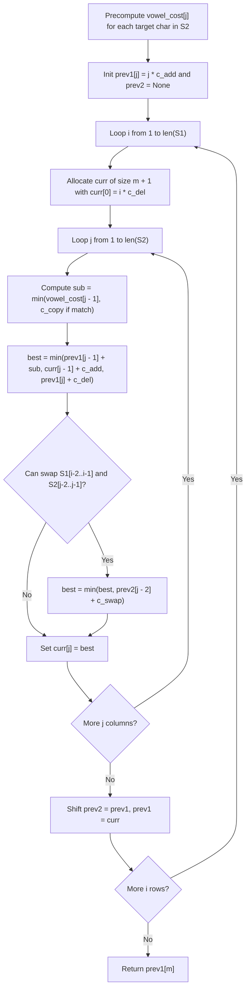

# These Vowels Feel Special

> [!info] Document Metadata
> **Course:** `=this.course` | **Topic:** `=this.topic` | **Status:** `=this.status` | **Difficulty:** `=this.difficulty`

**Tags:** #[[Computer Science]] #[[CSALGCM]] #[[Algorithms and Complexity]] #[[HackerRank]] #[[Lovers Arcana]] #[[Edit Distance DP]]
---

## Problem Description

The *Damerau-Levenshtein-Voweliera* distance extends the classic weighted Damerau-Levenshtein edit distance with a sixth operation specialized for vowels. Given two uppercase strings $S_1$ and $S_2$ and six operation costs $C_A, C_B, C_C, C_D, C_E, C_F$, compute the minimum total cost to transform $S_1$ into $S_2$ using:

1. **Add** ($C_A$): Insert a character into the current substring of $S_1$.
2. **Delete** ($C_B$): Remove a character from the current substring of $S_1$.
3. **Copy** ($C_C$): Match an identical character from $S_1$ to $S_2$ ($S_1[i-1] = S_2[j-1]$).
4. **Convert** ($C_D$): Replace a character of $S_1$ with any character in $S_2$.
5. **Swap** ($C_E$): Transpose the last two adjacent characters when $S_1[i-2] = S_2[j-1]$ and $S_1[i-1] = S_2[j-2]$.
6. **Vowelize** ($C_F$): Convert any character of $S_1$ into a vowel in $\{\text{A}, \text{E}, \text{I}, \text{O}, \text{U}\}$.

### Input Format
- The first line contains six space-separated integers $C_A, C_B, C_C, C_D, C_E, C_F$ representing the costs for Add, Delete, Copy, Convert, Swap, and Vowelize, respectively.
- The second line contains the source string $S_1$ (uppercase letters `A`–`Z`).
- The third line contains the target string $S_2$ (uppercase letters `A`–`Z`).

### Output Format
Output a single line containing the minimum edit distance required to transform $S_1$ into $S_2$.

### Constraints
- $1 \le |S_1|, |S_2| \le 2 \cdot 10^3$
- $1 \le C_A, C_B, C_C, C_D, C_E, C_F \le 2 \cdot 10^4$

### Sample Test Cases

**Sample Input 0**
```text
10 20 10 20 20 2
HADOKEN
SHORYUKEN
```

**Sample Output 0**
```text
76
```

*Explanation 0:* Optimal edit sequence (`HADOKEN` $\to$ `SHORYUKEN`):
Add `S` ($10$), Copy `H` ($10$), Vowelize `A` $\to$ `O` ($2$), Convert `D` $\to$ `R` ($20$), Add `Y` ($10$), Vowelize `O` $\to$ `U` ($2$), Copy `K` ($10$), Vowelize `E` $\to$ `E` ($2$, cheaper than Copy cost $10$), Copy `N` ($10$), for a total of $76$.

**Sample Input 1**
```text
67 33 33 13 6 3
HADOKEN
TATSUMAKISENPUKYAKU
```

**Sample Output 1**
```text
825
```

**Sample Input 2**
```text
67 67 67 67 67 1
TATSUMAKISENPUKYAKU
PAMUMUKADKADNGSAMPAGUITA
```

**Sample Output 2**
```text
946
```

---

## Approach & Intuition

- **Problem Abstraction:** Let $dp[i][j]$ be the minimum cost to transform prefix $S_1[0 \dots i - 1]$ into prefix $S_2[0 \dots j - 1]$. Notice that operation costs are independent (for instance, `Vowelize` can even be cheaper than `Copy` on matching vowels, as in Sample 0, and `Convert` can be cheaper than `Copy`, as in Sample 1). Therefore, the single-character substitution cost between $S_1[i-1]$ and $S_2[j-1]$ must take the minimum over all applicable one-to-one operations (`Convert`, `Vowelize`, and `Copy`).
- **Naive / Brute-Force Approach:** Unmemoized recursion over $(i, j)$ branches up to $4$ ways per character pair, resulting in $O(4^{|S_1| + |S_2|})$ time complexity and exponential recomputation of identical prefix pairs.
- **Optimal Strategy:** Use bottom-up 2D Dynamic Programming. Let $n = |S_1|$ and $m = |S_2|$:

$$
\text{sub}(i, j) = \min\Bigl(C_D,\; [S_2[j-1] \in V] \cdot C_F + [S_2[j-1] \notin V] \cdot \infty,\; [S_1[i-1] = S_2[j-1]] \cdot C_C + [S_1[i-1] \ne S_2[j-1]] \cdot \infty\Bigr)
$$

where $V = \{\text{A}, \text{E}, \text{I}, \text{O}, \text{U}\}$. Then for $1 \le i \le n$ and $1 \le j \le m$, with base cases $dp[0][j] = j \cdot C_A$ and $dp[i][0] = i \cdot C_B$:

$$
dp[i][j] = \min\Bigl(dp[i][j-1] + C_A,\;\; dp[i-1][j] + C_B,\;\; dp[i-1][j-1] + \text{sub}(i, j),\;\; \text{swap\_cost}(i, j)\Bigr)
$$

where $\text{swap\_cost}(i, j) = dp[i-2][j-2] + C_E$ if $i \ge 2$, $j \ge 2$, $S_1[i-2] = S_2[j-1]$, and $S_1[i-1] = S_2[j-2]$, and $\infty$ otherwise. Because transitions only inspect rows $i$, $i - 1$, and $i - 2$, maintaining just three rows (`curr`, `prev1`, `prev2`) lowers memory from $O(n \cdot m)$ to $O(m)$, keeping cache locality high in PyPy3/Python.

## Algorithm Walkthrough



## Step-by-Step Trace

Tracing **Sample Input 0** ($S_1 = \text{"HADOKEN"}$, $S_2 = \text{"SHORYUKEN"}$, costs $C = [10, 20, 10, 20, 20, 2]$):

| $S_1 \backslash S_2$ | $\emptyset$ | `S` | `H` | `O` | `R` | `Y` | `U` | `K` | `E` | `N` |
| :---: | :---: | :---: | :---: | :---: | :---: | :---: | :---: | :---: | :---: | :---: |
| $\emptyset$ | $0$ | $10$ | $20$ | $30$ | $40$ | $50$ | $60$ | $70$ | $80$ | $90$ |
| **`H`** | $20$ | $20$ | $20$ | $22$ | $32$ | $42$ | $52$ | $62$ | $72$ | $82$ |
| **`A`** | $40$ | $40$ | $40$ | $22$ | $32$ | $42$ | $44$ | $54$ | $64$ | $74$ |
| **`D`** | $60$ | $60$ | $60$ | $42$ | $42$ | $52$ | $44$ | $54$ | $56$ | $66$ |
| **`O`** | $80$ | $80$ | $80$ | $62$ | $62$ | $62$ | $54$ | $64$ | $56$ | $66$ |
| **`K`** | $100$ | $100$ | $100$ | $82$ | $82$ | $82$ | $64$ | $64$ | $66$ | $76$ |
| **`E`** | $120$ | $120$ | $120$ | $102$ | $102$ | $102$ | $84$ | $84$ | $66$ | $76$ |
| **`N`** | $140$ | $140$ | $140$ | $122$ | $122$ | $122$ | $104$ | $104$ | $86$ | **76** |

Result: $dp[7][9] = 76$. Notice at cell $(6, 8)$ (`'E'` $\to$ `'E'`), `dp[5][7] + c_vowel = 64 + 2 = 66` beats `dp[5][7] + c_copy = 64 + 10 = 74`.

## Complexity Analysis

| Metric | Complexity | Rationale |
| :--- | :--- | :--- |
| **Time** | $O(|S_1| \cdot |S_2|)$ | Evaluates $|S_1| \times |S_2|$ states (at most $4 \cdot 10^6$ cells), each in $O(1)$ operations. |
| **Space** | $O(|S_2|)$ | Maintains three rolling 1D DP rows (`prev2`, `prev1`, `curr`) plus `vowel_cost` of length $|S_2| + 1$. |

---

## Full Solution

### Partial-Credit Solution (Brute Force)

```python
import sys
sys.setrecursionlimit(10000)

def solve(costs, s1, s2):
    # compute and return answer here
    c_add, c_del, c_copy, c_conv, c_swap, c_vowel = costs
    vowels = set("AEIOU")
    def dfs(i, j):
        if i == 0: return j * c_add
        if j == 0: return i * c_del
        res = min(dfs(i, j - 1) + c_add, dfs(i - 1, j) + c_del, dfs(i - 1, j - 1) + c_conv)
        if s1[i - 1] == s2[j - 1]:
            res = min(res, dfs(i - 1, j - 1) + c_copy)
        if s2[j - 1] in vowels:
            res = min(res, dfs(i - 1, j - 1) + c_vowel)
        if i >= 2 and j >= 2 and s1[i - 2] == s2[j - 1] and s1[i - 1] == s2[j - 2]:
            res = min(res, dfs(i - 2, j - 2) + c_swap)
        return res
    return dfs(len(s1), len(s2))
```

### Optimal Solution (Full AC)

```python
def solve(costs, s1, s2):
    # compute and return answer here
    c_add, c_del, c_copy, c_conv, c_swap, c_vowel = costs
    n, m = len(s1), len(s2)
    # Precompute which characters of s2 can be produced by Vowelize
    vowel_cost = [min(c_conv, c_vowel) if ch in "AEIOU" else c_conv for ch in s2]
    
    # prev1 = dp[i - 1], prev2 = dp[i - 2]
    prev1 = [j * c_add for j in range(m + 1)]
    prev2 = None
    
    for i in range(1, n + 1):
        curr = [0] * (m + 1)
        curr[0] = i * c_del
        ch1 = s1[i - 1]
        prev_ch1 = s1[i - 2] if i >= 2 else ""
        
        for j in range(1, m + 1):
            ch2 = s2[j - 1]
            # Best 1-char replacement cost (Convert, Vowelize, or Copy)
            sub = vowel_cost[j - 1]
            if ch1 == ch2 and c_copy < sub:
                sub = c_copy
            
            best = prev1[j - 1] + sub
            if curr[j - 1] + c_add < best:
                best = curr[j - 1] + c_add
            if prev1[j] + c_del < best:
                best = prev1[j] + c_del
            if i >= 2 and j >= 2 and prev_ch1 == ch2 and ch1 == s2[j - 2]:
                if prev2[j - 2] + c_swap < best:
                    best = prev2[j - 2] + c_swap
            curr[j] = best
            
        prev2 = prev1
        prev1 = curr
        
    return prev1[m]
```

## References & Navigation

- **Previous Problem:** [[03 - Sequence Distillation]]
- **Next Problem:** [[05 - In My Restless Dreams, I See That Place]]
- **Parent Set:** [[[PS] Lovers Arcana|Lovers Arcana Index]]
- **Related Notes:** [[Dynamic Programming Introduction]], [[Divide and Conquer Introduction]]
