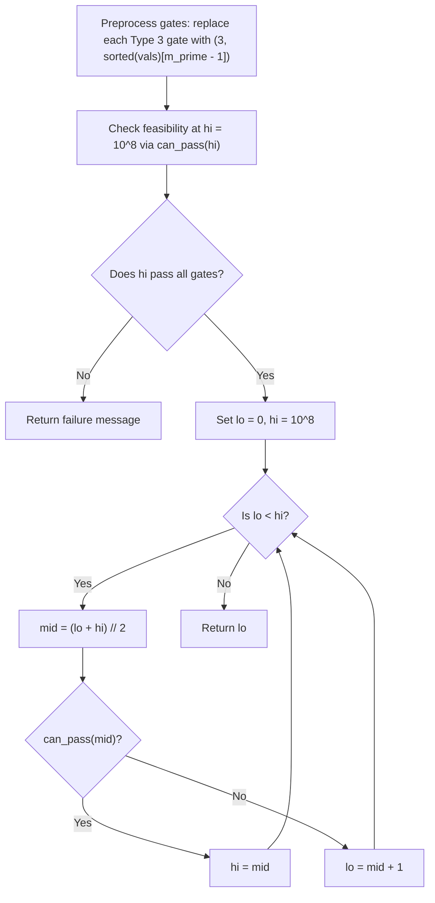

# In My Restless Dreams, I See That Place

> [!info] Document Metadata
> **Course:** `=this.course` | **Topic:** `=this.topic` | **Status:** `=this.status` | **Difficulty:** `=this.difficulty`

**Tags:** #[[Computer Science]] #[[CSALGCM]] #[[Algorithms and Complexity]] #[[HackerRank]] #[[Lovers Arcana]] #[[Binary Search]]
---

## Problem Description

Al Gocom must pass sequentially through $N$ gates inside a labyrinth. Given a non-negative integer *Mental Fortitude* $F \in [0, 10^8]$, his initial *atonement value* is:

$$
A = aF^2 + bF + c
$$

where $a, b, c \ge 0$ are given constants. Each of the $N$ gates modifies or tests $A$ in sequence:

- **Type 1 — Gate of Surrender** `(1, K_i)`: Adds $K_i$ to Al's current atonement value ($A \leftarrow A + K_i$).
- **Type 2 — Gate of Metamorphosis** `(2, K_i)`: Multiplies Al's current atonement value by $K_i$ ($A \leftarrow A \cdot K_i$).
- **Type 3 — Gate of Expiation** `(3, M_i, M'_i, E)`: Provides $M_i$ integers $E_1, \dots, E_{M_i}$. Al passes if and only if his current atonement value $A$ is greater than or equal to at least $M'_i$ of the $M_i$ values.

Find the smallest integer $F \in [0, 10^8]$ that passes every gate, or output `You promised you'd take me there again someday, but you never did...` if no such $F$ exists.

### Input Format
- The first line contains four space-separated integers $N, a, b, c$.
- $N$ gate descriptions follow:
  - Type 1: a single line containing `1` and $K_i$.
  - Type 2: a single line containing `2` and $K_i$.
  - Type 3: a line containing `3` and $M_i$, a line containing $M'_i$, and $M_i$ lines each containing an integer $E_j$.

### Output Format
Output a single line containing the minimum valid $F \in [0, 10^8]$, or `You promised you'd take me there again someday, but you never did...` if impossible.

### Constraints
- $1 \le N \le 10^5$
- $0 \le a, b, c, K_i \le 10^2$
- $1 \le M'_i \le M_i \le 800$
- $0 \le E_j \le 10^{16}$
- At most $\min(4 \cdot 10^4, N)$ gates are Gates of Expiation (Type 3).

### Sample Test Cases

**Sample Input 0**
```text
3 0 1 0
2 2
1 4
3 3
1
9
9
30
```

**Sample Output 0**
```text
3
```

*Explanation 0:* Initial atonement is $A = F$, transformed by gates $1$ and $2$ into $2F + 4$. Gate $3$ has $M_3 = 3$, $M'_3 = 1$, and values $\{9, 9, 30\}$, requiring $2F + 4 \ge 9$. Values $F \in \{0, 1, 2\}$ produce $A \in \{4, 6, 8\} < 9$ and fail, while $F = 3$ yields $A = 10 \ge 9$ and is the first to succeed. *(Note: The original PDF explanation describes passing $3$ values $\{1, 9, 9\}$, which similarly gives $F = 3$.)*

**Sample Input 1**
```text
3 1 2 3
2 0
1 9
3 1
1
100
```

**Sample Output 1**
```text
You promised you'd take me there again someday, but you never did...
```

*Explanation 1:* Gate $1$ multiplies by $0$, resetting $A$ to $0$ regardless of $F$. After Gate $2$, $A = 9 < 100$, so no $F \in [0, 10^8]$ passes Gate $3$.

**Sample Input 2**
```text
4 0 2 2
1 2
3 3
1
12
21
11
2 20
3 3
1
2
21
3000
```

**Sample Output 2**
```text
4
```

---

## Approach & Intuition

- **Problem Abstraction:** Determine the minimum $F \in [0, 10^8]$ satisfying a sequence of $N$ affine-nonnegative updates ($A \leftarrow A + K_i$, $A \leftarrow A \cdot K_i$) and order-statistic threshold checks ($|\{j : A \ge E_j\}| \ge M'_i$).
- **Naive / Brute-Force Approach:** Iterating $F$ linearly from $0$ to $10^8$ and counting values $\ge E_j$ inside each Type 3 gate takes up to $O(10^8 \cdot N \cdot M_i)$ operations, immediately timing out whenever the answer $F$ is nontrivial or impossible.
- **Optimal Strategy:** Combine three observations:
  1. **Monotonicity & Binary Search on $F$:** Because $a, b, c, K_i \ge 0$ and $F \ge 0$, every gate preserves monotonicity: if $F_1 \le F_2$, then $A(F_1) \le A(F_2)$ at every gate. Thus the feasibility predicate `can_pass(F)` is monotonic (`False, ..., False, True, ..., True`) and can be solved by binary search over $[0, 10^8]$ in $\lceil \log_2(10^8 + 1) \rceil = 27$ probes.
  2. **Threshold Precomputation:** Passing a Type 3 gate (`cur >=` at least $M'_i$ elements of $E$) is strictly equivalent to `cur >= sorted(E)[M'_i - 1]`. Sorting each Type 3 list once upfront reduces every Type 3 check inside `can_pass` to $O(1)$.
  3. **Arithmetic Overflow / BigInt Clamping:** Repeated Type 2 multiplications (up to $10^5$ times) can grow $A$ to hundreds of thousands of digits in Python, causing quadratic multiplication slowdowns. Since every test value satisfies $E_j \le 10^{16}$ and every non-zero multiplier/addend only keeps $A \ge 10^{16}$ (while $K_i = 0$ resets both clamped and unclamped values to $0$), clamping $A \leftarrow \min(A, 10^{16})$ after every update preserves exact equivalence:

$$
A_{\text{next}} = \min\bigl(10^{16},\; \text{op}(A)\bigr)
$$

## Algorithm Walkthrough



## Step-by-Step Trace

Tracing **Sample Input 2** ($N = 4, a = 0, b = 2, c = 2$, so $A_0 = 2F + 2$):

1. **Preprocessing `fast_gates`:**
   - Gate 1: `(1, 2)`
   - Gate 2: `(3, 3, 1, [12, 21, 11])` $\to$ `(3, 11)` (1st smallest of `[11, 12, 21]`)
   - Gate 3: `(2, 20)`
   - Gate 4: `(3, 3, 1, [2, 21, 3000])` $\to$ `(3, 2)` (1st smallest of `[2, 21, 3000]`)

2. **First few binary search probes (`lo = 0, hi = 10^8`):**

| Iteration | `lo` | `hi` | `mid` | $A$ at Gate 2 | $A$ at Gate 4 | `can_pass(mid)` | Update |
| :---: | :---: | :---: | :---: | :---: | :---: | :---: | :--- |
| Check `hi` | $0$ | $10^8$ | $10^8$ | $2 \cdot 10^8 + 4 \ge 11$ | $4 \cdot 10^9 + 80 \ge 2$ | `True` | Proceed |
| $\dots$ | $\dots$ | $\dots$ | $\dots$ | $\dots$ | $\dots$ | $\dots$ | Converges toward $4$ |
| Probe $F=3$ | $3$ | $4$ | $3$ | $2(3) + 4 = 10 < 11$ | — | `False` | `lo = 4` |
| End | $4$ | $4$ | — | $2(4) + 4 = 12 \ge 11$ | $12 \cdot 20 = 240 \ge 2$ | `True` | Return **4** |

## Complexity Analysis

| Metric | Complexity | Rationale |
| :--- | :--- | :--- |
| **Time** | $O\bigl(N + \sum M_i \log M_i + N \log 10^8\bigr)$ | Precomputing thresholds sorts each Type 3 gate once; binary search performs $27$ iterations of an $O(N)$ pass with $O(1)$-bounded integers ($\le 10^{16}$). |
| **Space** | $O(N)$ | Stores the simplified `fast_gates` list of size $N$. |

---

## Full Solution

### Partial-Credit Solution (Brute Force)

```python
def solve(n,a,b,c,gates):
    # compute and return answer here
    FAIL = "You promised you'd take me there again someday, but you never did..."
    for f in range(10**8 + 1):
        cur = a * f * f + b * f + c
        ok = True
        for g in gates:
            if g[0] == 1:
                cur += g[1]
            elif g[0] == 2:
                cur = min(10**16, cur * g[1])
            else:
                if sum(1 for v in g[3] if cur >= v) < g[2]:
                    ok = False
                    break
        if ok:
            return f
    return FAIL
```

### Optimal Solution (Full AC)

```python
def solve(n,a,b,c,gates):
    # compute and return answer here
    FAIL = "You promised you'd take me there again someday, but you never did..."
    CAP = 10**16
    
    # Precompute exact threshold needed for each Type 3 gate once
    fast_gates = []
    for g in gates:
        if g[0] == 3:
            # Need cur >= at least m_prime values -> cur >= m_prime-th smallest value
            thresh = sorted(g[3])[g[2] - 1]
            fast_gates.append((3, thresh))
        else:
            fast_gates.append(g)
            
    def can_pass(f):
        cur = a * f * f + b * f + c
        if cur > CAP:
            cur = CAP
        for gtype, val in fast_gates:
            if gtype == 1:
                cur += val
                if cur > CAP:
                    cur = CAP
            elif gtype == 2:
                cur *= val
                if cur > CAP:
                    cur = CAP
            else:
                if cur < val:
                    return False
        return True
        
    lo, hi = 0, 10**8
    if not can_pass(hi):
        return FAIL
    while lo < hi:
        mid = (lo + hi) // 2
        if can_pass(mid):
            hi = mid      # Try smaller Mental Fortitude F
        else:
            lo = mid + 1  # Need higher Mental Fortitude F
    return lo
```

## References & Navigation

- **Previous Problem:** [[04 - These Vowels Feel Special]]
- **Next Problem:** [[06 - Rollercoaster Sequences]]
- **Parent Set:** [[[PS] Lovers Arcana|Lovers Arcana Index]]
- **Related Notes:** [[Dynamic Programming Introduction]], [[Divide and Conquer Introduction]]
