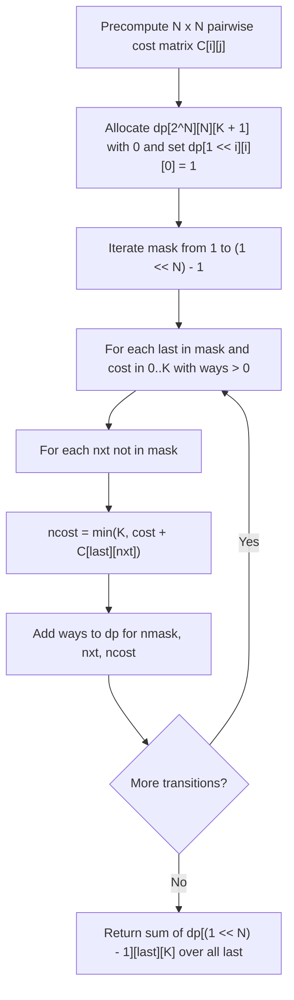

# Rollercoaster Sequences

> [!info] Document Metadata
> **Course:** `=this.course` | **Topic:** `=this.topic` | **Status:** `=this.status` | **Difficulty:** `=this.difficulty`

**Tags:** #[[Computer Science]] #[[CSALGCM]] #[[Algorithms and Complexity]] #[[HackerRank]] #[[Lovers Arcana]] #[[Bitmask DP]]
---

## Problem Description

Given a collection of $N$ integers $A = \{A_1, A_2, \dots, A_N\}$ and a threshold $K$, count how many permutations of the $N$ elements have an *RC Cost* $\ge K$. Duplicate values at distinct indices are treated as distinct items and counted separately (out of $N!$ index permutations).

The *RC Cost* of a sequence $(p_1, p_2, \dots, p_N)$ is defined as $\sum_{i=1}^{N-1} c(p_i, p_{i+1})$, where:

$$
c(a, b) = \begin{cases}
0 & \text{if } a = b \\
(a - b)^2 & \text{if } a > b \\
\left\lfloor \frac{b - a}{2} \right\rfloor & \text{if } a < b
\end{cases}
$$

### Input Format
- The first line contains two space-separated integers $N$ and $K$, indicating the number of integers and the RC cost threshold, respectively.
- The next $N$ lines each contain an integer $A_i$.

### Output Format
Output a single line containing the number of permutations whose RC Cost is $\ge K$.

### Constraints
- $1 \le N \le 12$
- $1 \le K \le 50$
- $0 \le A_i \le 10^2$

### Sample Test Cases

**Sample Input 0**
```text
3 10
9
8
3
```

**Sample Output 0**
```text
4
```

*Explanation 0:* Four permutations achieve RC Cost $\ge 10$: `(9, 8, 3)` (cost $26$), `(9, 3, 8)` (cost $38$), `(8, 9, 3)` (cost $36$), and `(8, 3, 9)` (cost $28$). The remaining two permutations `(3, 9, 8)` (cost $4$) and `(3, 8, 9)` (cost $2$) fall below $10$.

**Sample Input 1**
```text
3 11
0
1
1
```

**Sample Output 1**
```text
0
```

**Sample Input 2**
```text
4 13
10
1
13
10
```

**Sample Output 2**
```text
22
```

*Explanation 2:* Out of $4! = 24$ index permutations, $22$ achieve RC Cost $\ge 13$. Permutations swapping the two instances of `10` are counted as separate valid sequences.

---

## Approach & Intuition

- **Problem Abstraction:** Count all Hamiltonian paths on $N$ labeled vertices whose cumulative edge weights $\sum c(A_{\pi_i}, A_{\pi_{i+1}})$ meet or exceed $K$.
- **Naive / Brute-Force Approach:** Enumerating all $N!$ permutations and summing transition costs takes $O(N! \cdot N)$ time. At $N = 12$, $12! = 479{,}001{,}600$, far too slow to complete within time limits.
- **Optimal Strategy:** Combine **Subset Bitmask DP** (tracking used indices in $[0, 2^N)$) with **Capped Score DP**:
  1. Precompute the $N \times N$ pairwise transition cost matrix `C[i][j] = c(vals[i], vals[j])`.
  2. Notice that edge weights $c(a, b) \ge 0$ are always non-negative, and the final check only asks whether total cost $\ge K$ ($K \le 50$). Once an accumulated partial cost reaches or exceeds $K$, the exact surplus no longer matters, so clamp every intermediate cost to $K$.
  3. Define `dp[mask][last][cost]` as the number of partial permutations using the index subset encoded by `mask`, ending at index `last`, with capped cumulative cost `cost` $\in [0, K]$. Initialize `dp[1 << i][i][0] = 1` for each $0 \le i < N$, and transition forward for each unset index `nxt`:

$$
dp\bigl[\text{mask} \mid 2^{\text{nxt}}\bigr][\text{nxt}]\bigl[\min(K,\; \text{cost} + C[\text{last}][\text{nxt}])\bigr] \mathrel{+}= dp[\text{mask}][\text{last}][\text{cost}]
$$

The final answer is $\sum_{\text{last}=0}^{N-1} dp[2^N - 1][\text{last}][K]$.

*(Implementation note: Although the HackerRank starter docstring mistakenly stated `<= k`, the problem statement and all samples require `>= k`.)*

## Algorithm Walkthrough



## Step-by-Step Trace

Tracing **Sample Input 0** ($N = 3$, $K = 10$, `vals = [9, 8, 3]`):

- Transition matrix $C$:
  - $C[0][1] = (9 - 8)^2 = 1$, $C[0][2] = (9 - 3)^2 = 36$
  - $C[1][0] = \lfloor (9 - 8)/2 \rfloor = 0$, $C[1][2] = (8 - 3)^2 = 25$
  - $C[2][0] = \lfloor (9 - 3)/2 \rfloor = 3$, $C[2][1] = \lfloor (8 - 3)/2 \rfloor = 2$

| `mask` (binary) | Subset Used | Non-Zero `dp[mask][last][cost]` States |
| :---: | :--- | :--- |
| `001` | $\{0\}$ (`[9]`) | `last=0, cost=0`: `1` |
| `010` | $\{1\}$ (`[8]`) | `last=1, cost=0`: `1` |
| `100` | $\{2\}$ (`[3]`) | `last=2, cost=0`: `1` |
| `011` | $\{0, 1\}$ | `last=0, cost=0`: `1` (`8,9`); `last=1, cost=1`: `1` (`9,8`) |
| `101` | $\{0, 2\}$ | `last=0, cost=3`: `1` (`3,9`); `last=2, cost=10`: `1` (`9,3`) |
| `110` | $\{1, 2\}$ | `last=1, cost=2`: `1` (`3,8`); `last=2, cost=10`: `1` (`8,3`) |
| `111` | $\{0, 1, 2\}$ | `last=0`: `{2: 1, 10: 1}`; `last=1`: `{4: 1, 10: 1}`; `last=2`: `{10: 2}` |

Summing states with `cost = 10` at `mask = 111`: $1 + 1 + 2 = 4$.

## Complexity Analysis

| Metric | Complexity | Rationale |
| :--- | :--- | :--- |
| **Time** | $O(2^N \cdot N^2 \cdot K)$ | Iterates over $2^N$ masks, up to $N$ last indices, $K + 1$ capped costs, and $N$ next choices (skipping zero-way states for fast practical runtime). |
| **Space** | $O(2^N \cdot N \cdot K)$ | Stores the 3D DP table of size $2^{12} \times 12 \times 51 \approx 2.5 \cdot 10^6$ integers, plus the $N \times N$ cost matrix. |

---

## Full Solution

### Partial-Credit Solution (Brute Force)

```python
from itertools import permutations

def solve(n,k,vals):
    # compute and return answer here
    def step_cost(a, b):
        if a == b: return 0
        return (a - b) ** 2 if a > b else (b - a) // 2
        
    ans = 0
    for p in permutations(vals):
        cost = sum(step_cost(p[i], p[i + 1]) for i in range(n - 1))
        if cost >= k:
            ans += 1
    return ans
```

### Optimal Solution (Full AC)

```python
def solve(n,k,vals):
    # compute and return answer here
    # Precompute pairwise transition costs C[i][j]
    C = [[0] * n for _ in range(n)]
    for i in range(n):
        a = vals[i]
        for j in range(n):
            b = vals[j]
            if a > b:
                C[i][j] = (a - b) * (a - b)
            elif a < b:
                C[i][j] = (b - a) // 2
                
    # dp[mask][last][cost] = ways using subset `mask`, ending at `last`, with cost capped at `k`
    dp = [[[0] * (k + 1) for _ in range(n)] for _ in range(1 << n)]
    for i in range(n):
        dp[1 << i][i][0] = 1
        
    for mask in range(1, 1 << n):
        for last in range(n):
            if not (mask & (1 << last)):
                continue
            row = dp[mask][last]
            c_last = C[last]
            for cost in range(k + 1):
                ways = row[cost]
                if not ways:
                    continue
                for nxt in range(n):
                    if not (mask & (1 << nxt)):
                        nmask = mask | (1 << nxt)
                        ncost = cost + c_last[nxt]
                        if ncost > k:
                            ncost = k
                        dp[nmask][nxt][ncost] += ways
                        
    full_mask = (1 << n) - 1
    return sum(dp[full_mask][last][k] for last in range(n))
```

## References & Navigation

- **Previous Problem:** [[05 - In My Restless Dreams, I See That Place]]
- **Parent Set:** [[[PS] Lovers Arcana|Lovers Arcana Index]]
- **Related Notes:** [[Dynamic Programming Introduction]], [[Divide and Conquer Introduction]]
