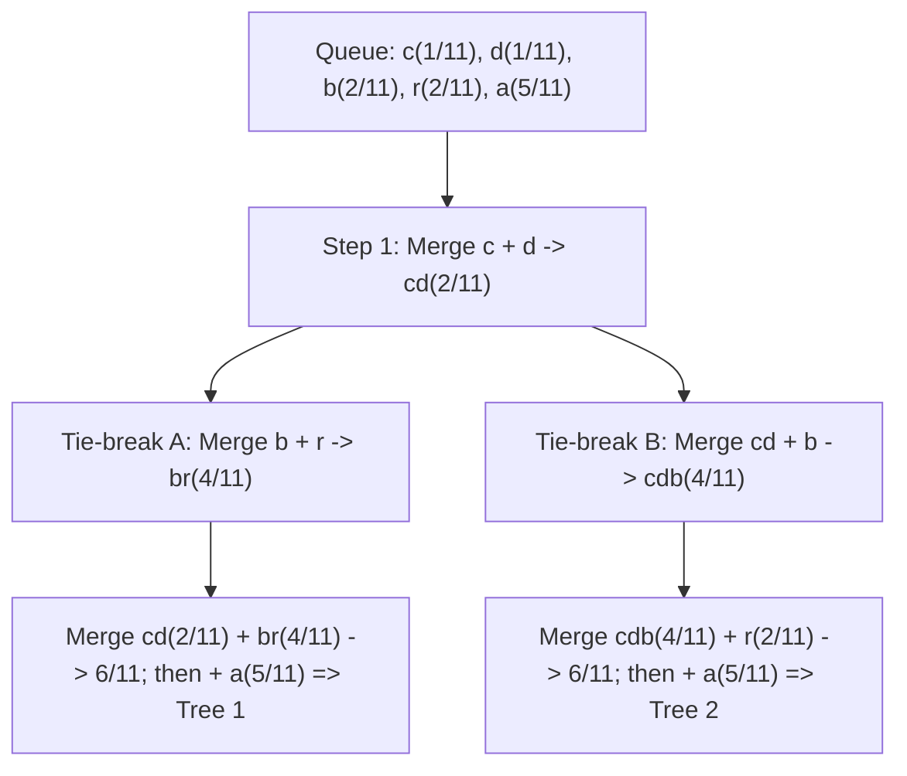

# [QZ] Huffman Encoding

> [!info] Document Metadata
> **Course:** `=this.course` | **Topic:** `=this.topic` | **Status:** `=this.status`

**Tags:** #[[Computer Science]] #[[CSALGCM]] #[[Algorithms]] #[[Quiz]] #[[Greedy Algorithms]] #[[Huffman Encoding]]

---

## Overview

Huffman encoding is a classic greedy algorithm that constructs an optimal binary prefix code given the frequency or probability distribution of characters in an alphabet. By assigning shorter bitstrings to more frequent symbols and longer bitstrings to rarer symbols, it minimizes the expected number of bits per character. Every Huffman code corresponds directly to a full binary tree whose leaves represent the symbols of the alphabet.

## Fixed-Length vs. Variable-Length Prefix Codes

| Property | Fixed-Length Code (e.g., ASCII) | Huffman Code |
| :--- | :--- | :--- |
| **Bits per symbol** | Constant $\lceil \log_2 \lvert \Sigma \rvert \rceil$ | Variable-length (shorter for frequent symbols, longer for rare symbols) |
| **Prefix-free property** | Automatically prefix-free | Guaranteed prefix-free (symbols only at leaves) |
| **Tree structure** | Balanced binary tree | Full binary tree (every internal node has 2 children) |
| **Optimality** | Optimal only for uniform distributions | Provably minimum average bits per symbol |

## Quiz Compilation & Explanations

### Question 1 (1 pt)

**Prompt:**
Consider designing a fixed-length code for an alphabet containing 29 characters. How many bits are needed to encode each character in the alphabet?

**Correct Answer:** **`5`**

**Rationale:**

- **Why `5` is correct:** With $k$ bits, at most $2^k$ distinct characters can be uniquely represented. We require the smallest integer $k$ such that $2^k \ge 29$:

$$k = \lceil \log_2 29 \rceil = 5 \quad (\text{since } 2^4 = 16 < 29 \le 32 = 2^5)$$

- **Why smaller or larger values are wrong:** $4$ bits can only distinguish $16$ characters (too few for $29$), while $6$ or more bits waste space unnecessarily when $5$ bits suffice.

---

### Question 2 (1 pt)

**Prompt:**
From the following, select all that are fixed-length codes.

**Choices:**

- Huffman code
- ASCII *(Correct)*
- Shannon-Fano codes
- LZ77

**Correct Answer:** **ASCII**

**Rationale:**

- **Why ASCII is correct:** Standard ASCII assigns every character a fixed codeword length (7 bits in standard ASCII, or 8 bits in byte-aligned extended ASCII), regardless of character frequency.
- **Why Huffman code is wrong:** Huffman coding assigns variable-length bitstrings based on symbol probabilities.
- **Why Shannon-Fano codes is wrong:** Shannon-Fano coding recursively partitions symbols by probability to build variable-length prefix codes.
- **Why LZ77 is wrong:** LZ77 is a dictionary-based sliding-window lossless compression algorithm that replaces repeated substrings with `(distance, length)` pointers, not a fixed-length character code.

---

### Question 3 (1 pt)

**Prompt:**
Consider a string $S = \texttt{abcaedeaaba}$ on the alphabet $\{\texttt{a}, \texttt{b}, \texttt{c}, \texttt{d}, \texttt{e}\}$, and consider the following variable-length binary encoding scheme $C$:

$$C(\texttt{a}) = 0;\quad C(\texttt{b}) = 00;\quad C(\texttt{c}) = 01;\quad C(\texttt{d}) = 10;\quad C(\texttt{e}) = 11.$$

Which of the following is a problem with this scheme? *(Multiple selections possible.)*

**Choices:**

- The length of the binary code of $S$ is longer than if we had used a fixed-length encoding instead.
- $C$ is not a prefix code *(Correct)*
- The time complexity to compute the code for $S$ is quadratic in the length of $S$.
- The space complexity to compute the code for $S$ is exponential in the length of $S$.

**Correct Answer:** **$C$ is not a prefix code**

**Rationale:**

- **Why "$C$ is not a prefix code" is correct:** $C(\texttt{a}) = 0$ is a prefix of both $C(\texttt{b}) = 00$ and $C(\texttt{c}) = 01$. This causes ambiguous decoding: for example, the encoded bitstring `00` could decode as either `aa` or `b`.
- **Why "longer than fixed-length encoding" is wrong:** For a 5-character alphabet, fixed-length encoding uses $\lceil \log_2 5 \rceil = 3$ bits/char, so $|S| = 11$ requires $11 \times 3 = 33$ bits. Under $C$, the 5 occurrences of `a` take $5 \times 1 = 5$ bits and the remaining 6 characters take $6 \times 2 = 12$ bits, totaling only $17$ bits ($17 < 33$).
- **Why "quadratic time complexity" is wrong:** Encoding $S$ looks up each character in $O(1)$ time, running in linear $O(|S|)$ time.
- **Why "exponential space complexity" is wrong:** Each character maps to at most $2$ bits, so output space is linear $O(|S|)$.

---

### Question 4 (2 pts)

**Prompt:**
Which of the following are correct about Huffman algorithm? *(Multiple selections possible.)*

**Choices:**

- Given the probability of occurrence of each character, it produces a prefix code. *(Correct)*
- Given the probability of occurrence of each character, it produces a binary code of minimum average number of bits per letter. *(Correct)*
- Given a string, it compresses the string without loss of information.
- It produces a binary tree that can be traversed to obtain the code for each symbol in the given alphabet. *(Correct)*

**Correct Answers:**

- **Given the probability of occurrence of each character, it produces a prefix code.**
- **Given the probability of occurrence of each character, it produces a binary code of minimum average number of bits per letter.**
- **It produces a binary tree that can be traversed to obtain the code for each symbol in the given alphabet.**

**Rationale:**

- **Why Option 1 is correct:** Because every alphabet character is placed exclusively at a leaf of the generated binary tree, no codeword can be a prefix of another codeword.
- **Why Option 2 is correct:** By the greedy-choice and optimal-substructure proofs (CLRS Chapter 16), Huffman's algorithm minimizes the expected codeword length $\sum_{x \in \Sigma} Pr(x) \cdot \text{depth}(x)$.
- **Why Option 3 is NOT selected (Incorrect):** Formally, Huffman's algorithm takes a set of characters and their **probabilities/frequencies** as input and outputs an optimal **prefix code / binary tree** — it does not directly take a raw string and perform compression itself (encoding/compressing a string is a separate step that applies the generated code table).
- **Why Option 4 is correct:** Labeling left edges `0` and right edges `1` in the resulting binary tree lets us traverse from the root to each leaf to read off that symbol's binary codeword.

---

### Question 5 (1 pt)

**Prompt:**
Which of the following is correct about the binary tree produced by Huffman algorithm? *(Refer to Appendix B.5 of Cormen et al. for terminology on binary trees.)*

**Choices:**

- It is complete.
- The number of leaves is equal to the size of the alphabet. *(Correct)*
- It is full. *(Correct)*
- Its height is equal to the size of the alphabet.

**Correct Answers:**

- **The number of leaves is equal to the size of the alphabet.**
- **It is full.**

**Rationale:**

- **Why "The number of leaves is equal to the size of the alphabet" is correct:** The algorithm initializes one leaf node per character in $\Sigma$ and only creates internal nodes by merging pairs of existing nodes; no leaf is ever removed or split, so there are exactly $|\Sigma|$ leaves.
- **Why "It is full" is correct:** In CLRS Appendix B.5, a **full binary tree** is one in which every node has either $0$ children (leaf) or $2$ children (internal node). Because every merge combines exactly two trees into one internal node, no node ever has degree $1$.
- **Why "It is complete" is wrong:** A complete binary tree has all levels fully filled (except possibly the last, filled left-to-right). Skewed probability distributions (such as Fibonacci frequencies) produce highly unbalanced, non-complete Huffman trees.
- **Why "Its height is equal to the size of the alphabet" is wrong:** A full binary tree with $|\Sigma| = n$ leaves has maximum possible height $n - 1$ (a skewed chain) and minimum height $\lceil \log_2 n \rceil$; its height can never equal $n$.

---

### Question 6 (4 pts)

**Prompt:**
Consider the following probability distribution on the alphabet $\{a, b, r, c, d\}$:

$$Pr(a) = 5/11,\quad Pr(b) = Pr(r) = 2/11,\quad Pr(c) = Pr(d) = 1/11.$$

From the list below, select a tree if it is a possible Huffman tree for the distribution above. *(Multiple selections allowed.)*

**Summary of Candidate Trees from Quiz:**

| Tree | Codewords (Left=0, Right=1) | Expected Bits/Symbol | Possible Huffman Tree? |
| :--- | :--- | :--- | :--- |
| **Tree 1** | $a:0,\; c:100,\; d:101,\; b:110,\; r:111$ | $\frac{5(1)+2(3)+2(3)+1(3)+1(3)}{11} = \frac{23}{11} \approx 2.09$ | **Yes (Correct)** |
| **Tree 2** | $a:0,\; r:11,\; b:101,\; c:1000,\; d:1001$ | $\frac{5(1)+2(2)+2(3)+1(4)+1(4)}{11} = \frac{23}{11} \approx 2.09$ | **Yes (Correct)** |
| **Tree 3** | $b:0,\; r:11,\; a:101,\; c:1000,\; d:1001$ | $\frac{2(1)+2(2)+5(3)+1(4)+1(4)}{11} = \frac{29}{11} \approx 2.64$ | **No (Incorrect)** |
| **Tree 4** | $a:0,\; c:100,\; b:101,\; d:110,\; r:111$ | $\frac{5(1)+2(3)+2(3)+1(3)+1(3)}{11} = \frac{23}{11}$ | **No (Incorrect)** |

**Correct Answers:** **Tree 1**, **Tree 2**

**Rationale:**

- **Step 1 (Forced):** The two strictly smallest probabilities are $c\,(1/11)$ and $d\,(1/11)$. Huffman's algorithm **must** merge $c$ and $d$ first into an internal node $cd$ of weight $2/11$. The priority queue is now $\{cd(2/11), b(2/11), r(2/11), a(5/11)\}$.
- **Why Tree 1 is correct:** At Step 2, there is a three-way tie at weight $2/11$ among $cd, b, r$. Choosing to merge $b$ and $r$ produces $br(4/11)$. Step 3 merges $cd(2/11)$ with $br(4/11)$ into $6/11$. Step 4 merges $a(5/11)$ with $6/11$ into $11/11$, yielding **Tree 1** (expected length $23/11$).
- **Why Tree 2 is correct:** Breaking the Step 2 tie by merging $cd(2/11)$ with $b(2/11)$ gives $cdb(4/11)$. Step 3 merges $cdb(4/11)$ with $r(2/11)$ into $6/11$. Step 4 merges $a(5/11)$ with $6/11$, yielding **Tree 2** (same optimal expected length $23/11$).
- **Why Tree 3 is wrong:** Tree 3 places $a\,(5/11)$ at depth 3 and $b\,(2/11)$ at depth 1, giving an expected length of $29/11 > 23/11$. Huffman's algorithm never merges $a(5/11)$ before the smaller weight $2/11$ nodes.
- **Why Tree 4 is wrong:** Even though Tree 4 happens to share the minimum expected length $23/11$, it pairs $(c, b)$ and $(d, r)$ as siblings instead of pairing $(c, d)$. Because $c(1/11)$ and $d(1/11)$ are the **unique** two smallest weights in Step 1, Huffman's greedy algorithm can never produce Tree 4.

## Multiple Choice Questions

1. What is the minimum number of bits per character required for a fixed-length binary encoding of an alphabet with 50 characters?
    - **A)** 5
    - **B)** 6
    - **C)** 7
    - **D)** 25

2. Why must a variable-length binary code be prefix-free for unambiguous left-to-right decoding?
    - **A)** So every codeword has the same length
    - **B)** So no codeword appears as the starting bits of any longer codeword
    - **C)** So the encoded string is always shorter than ASCII
    - **D)** So internal nodes can also store frequent characters

3. In a Huffman tree built for an alphabet of size $n \ge 2$, how many internal nodes exist?
    - **A)** $n$
    - **B)** $n - 1$
    - **C)** $2n - 1$
    - **D)** $\lceil \log_2 n \rceil$

4. Why can two different binary trees both be valid Huffman trees for the same probability distribution?
    - **A)** Because Huffman's algorithm randomly swaps leaf nodes at the end
    - **B)** Because ties among equal minimum weights in the priority queue can be broken differently
    - **C)** Because Huffman trees do not need to be full binary trees
    - **D)** Because prefix codes are not unique even without ties

5. What is the running time of building a Huffman tree for an alphabet of size $n$ using a binary min-heap?
    - **A)** $O(n)$
    - **B)** $O(n \log n)$
    - **C)** $O(n^2)$
    - **D)** $O(2^n)$

6. [INPUT] What is the minimum number of bits per character required for a fixed-length binary code over an alphabet of 29 characters?

7. [MSQ] Which properties ALWAYS hold for the binary tree produced by Huffman's algorithm on an alphabet $\Sigma$ with $|\Sigma| \ge 2$? (Select all that apply)
    - **A)** It is a complete binary tree
    - **B)** The number of leaves equals the size of the alphabet
    - **C)** It is a full binary tree where every internal node has two children
    - **D)** Its height equals the size of the alphabet

8. [MSQ] Which statements are correct about Huffman's algorithm? (Select all that apply)
    - **A)** Given symbol probabilities, it produces a prefix code
    - **B)** Given symbol probabilities, it produces a binary code with minimum average bits per symbol
    - **C)** It takes an arbitrary input string and directly compresses it without first building a code table
    - **D)** It produces a binary tree that can be traversed to obtain the codeword for each alphabet symbol

### Answer Key & Explanations

1. **B)** $\lceil \log_2 50 \rceil = 6$ because $2^5 = 32 < 50 \le 64 = 2^6$. A only encodes up to 32 symbols, while C and D use more bits than necessary.
2. **B)** Being prefix-free guarantees that as soon as a sequence of bits matches a codeword during a scan, it uniquely identifies that symbol without lookahead. A describes fixed-length codes, C is not guaranteed for all inputs, and D would violate the prefix property.
3. **B)** Starting with $n$ single-node trees, each merge reduces the number of trees by $1$ and creates $1$ internal node, so exactly $n - 1$ internal nodes are created. A counts leaves, C counts total nodes ($n + (n-1)$), and D is minimum height.
4. **B)** Whenever three or more nodes share the minimum weight (or two nodes tie for second smallest), different tie-breaking orders can yield structurally distinct trees that still achieve the exact same minimum expected length. A, C, and D are false.
5. **B)** Building the initial min-heap takes $O(n)$, followed by $n - 1$ iterations each doing two `EXTRACT-MIN` and one `INSERT` operation in $O(\log n)$ time, giving $O(n \log n)$ total. A ignores heap operations (unless input is already sorted and two queues are used), C corresponds to scanning an unsorted array, and D is exponential.
6. **[5; 5 bits]** With $k$ bits, at most $2^k$ distinct symbols can be represented. Because $2^4 = 16 < 29 \le 32 = 2^5$, we need $\lceil \log_2 29 \rceil = 5$ bits per character.
7. **B, C)** Huffman's algorithm initializes one leaf per alphabet symbol and merges two nodes per step into an internal node with two children, guaranteeing a full binary tree with $|\Sigma|$ leaves. Skewed weights break completeness (A), and maximum height is $|\Sigma| - 1$ (D).
8. **A, B, D)** Huffman's algorithm maps symbol probabilities/frequencies to a traversable full binary tree yielding a prefix-free code of minimum expected length. Compressing an actual string is a separate encoding pass that applies the resulting code table (C).

## References & Navigation

- **Previous Quiz:** [[[QZ] Dynamic Programming Problem 1]]
- **Next Quiz:** [[[QZ] Minimum Spanning Tree]]
- **Related Notes:** [[Greedy Algorithms Introduction]], [[Complexity Analysis]]
