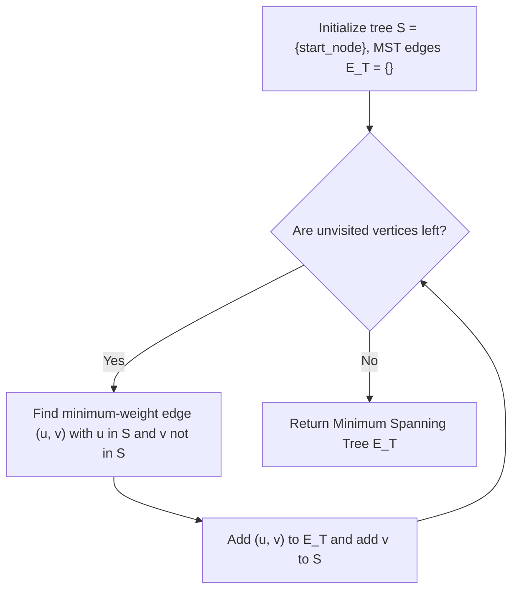

# [QZ] Minimum Spanning Tree

> [!info] Document Metadata
> **Course:** `=this.course` | **Topic:** `=this.topic` | **Status:** `=this.status`

**Tags:** #[[Computer Science]] #[[CSALGCM]] #[[Algorithms]] #[[Quiz]] #[[Greedy Algorithms]] #[[Minimum Spanning Tree]]

---

## Overview

A Minimum Spanning Tree (MST) of a connected, weighted, undirected graph $G = (V, E)$ is an acyclic subset of $|V| - 1$ edges that connects all vertices with minimum total edge weight. Prim's algorithm grows a single spanning tree greedily from an arbitrary starting vertex by repeatedly adding the lightest (safe) edge crossing the cut between the current tree $S$ and the remaining vertices $V \setminus S$. On complete Euclidean graphs in the $xy$-plane, each step simply selects the unvisited vertex with the smallest Euclidean distance to any vertex already in $S$.

## Prim's Algorithm Overview



```text
// Time Complexity: O(E log V) with binary min-heap, or O(V^2) with array (optimal for dense/complete graphs)
// Space Complexity: O(V) for key[] and parent[] arrays
PRIM(G, w, r)
-------------
for each u in G.V:
    u.key = INF
    u.pi = NIL
r.key = 0
Q = G.V
while Q is not empty:
    u = EXTRACT-MIN(Q)
    for each v in G.Adj[u]:
        if v in Q and w(u, v) < v.key:
            v.pi = u
            v.key = w(u, v)
```

## Quiz Compilation & Explanations

### Question 1 (10 pts)

**Prompt:**
Consider the undirected graph shown in the quiz figure. It has 9 vertices (`1` through `9`) lying on the $xy$-plane. Although the edges are not shown, assume that this is a **complete** graph (see Appendix B.4 of Cormen et al.) and that the weight of each edge is the Euclidean distance between the 2 vertices:

$$w(u, v) = \sqrt{(x_u - x_v)^2 + (y_u - y_v)^2}$$

If the starting node for Prim's algorithm for Minimum Spanning Tree is **Node 3**, then:

| Step | Prompt | Correct Answer (either `u,v` or `v,u`) |
| :--- | :--- | :--- |
| 1 | The first edge to be included is: | **`3,2`** (or `2,3`) |
| 2 | The second edge to be included is: | **`2,1`** (or `1,2`) |
| 3 | The third edge to be included is: | **`3,4`** (or `4,3`) |
| 4 | The fourth edge to be included is: | **`4,5`** (or `5,4`) |

**Approximate Vertex Coordinates from the Quiz Ruler Grid** *(origin at top-left border; $x \in [0, 15]$, $y \in [0, 4]$ in ruler units)*:

| Vertex | Approx. $(x, y)$ | Cluster Region |
| :--- | :--- | :--- |
| 1 | $(1.45, 2.55)$ | Left cluster (bottom-left) |
| 2 | $(2.50, 0.60)$ | Left cluster (top) |
| 3 | $(3.50, 1.50)$ | Left cluster (middle-right, **start**) |
| 4 | $(7.30, 0.60)$ | Center cluster (top-left) |
| 5 | $(8.20, 1.30)$ | Center cluster (bottom-right) |
| 6 | $(11.30, 2.50)$ | Lower-right cluster (upper) |
| 7 | $(11.30, 3.40)$ | Lower-right cluster (lower) |
| 8 | $(13.40, 0.50)$ | Upper-right cluster (left) |
| 9 | $(14.40, 0.50)$ | Upper-right cluster (right) |

**Step-by-Step Trace & Rationale (Why Correct vs. Why Competing Edges Lose):**

1. **First Edge: `3,2`**
   - **Current Cut:** $S = \{3\}$, $V \setminus S = \{1, 2, 4, 5, 6, 7, 8, 9\}$.
   - **Why `3,2` is correct:** Measuring from Node 3 to all other vertices:
     - $d(3, 2) \approx \sqrt{(3.50 - 2.50)^2 + (1.50 - 0.60)^2} = \sqrt{1.00 + 0.81} \approx 1.35$ **(minimum)**.
   - **Why other edges are not selected:**
     - `3,1` has $d(3, 1) \approx \sqrt{2.05^2 + 1.05^2} \approx 2.30 > 1.35$.
     - `3,4` has $d(3, 4) \approx \sqrt{3.80^2 + 0.90^2} \approx 3.91 > 1.35$.
     - `3,5`, `3,6`, `3,7`, `3,8`, `3,9` are all farther than $4.7$ units.
     - Any edge not incident to Node 3 (such as `8,9` or `6,7`, even though they are shorter globally) does **not** cross the cut $(S, V \setminus S)$, so Prim's algorithm cannot select them yet (unlike Kruskal's algorithm).

2. **Second Edge: `2,1`**
   - **Current Cut:** $S = \{3, 2\}$, $V \setminus S = \{1, 4, 5, 6, 7, 8, 9\}$.
   - **Why `2,1` is correct:** Now both Node 2 and Node 3 can reach outside vertices. Checking the closest candidate edges crossing the cut:
     - $d(2, 1) \approx \sqrt{(2.50 - 1.45)^2 + (0.60 - 2.55)^2} = \sqrt{1.10 + 3.80} \approx 2.21$ **(minimum)**.
   - **Why other edges are not selected:**
     - `3,1` is the closest competitor with $d(3, 1) \approx \sqrt{2.05^2 + 1.05^2} \approx 2.30 > 2.21$; Node 1 lies slightly closer to Node 2 than to Node 3.
     - `3,4` has $d(3, 4) \approx 3.91 > 2.21$, and `2,4` has $d(2, 4) \approx 4.80 > 2.21$.
     - All vertices $\{5, 6, 7, 8, 9\}$ are even farther from $\{2, 3\}$.

3. **Third Edge: `3,4`**
   - **Current Cut:** $S = \{3, 2, 1\}$, $V \setminus S = \{4, 5, 6, 7, 8, 9\}$.
   - **Why `3,4` is correct:** The entire left cluster $\{1, 2, 3\}$ is now in $S$, so Prim's must bridge across the gap to the nearest remaining vertex (in the center cluster $\{4, 5\}$):
     - $d(3, 4) \approx \sqrt{(7.30 - 3.50)^2 + (0.60 - 1.50)^2} = \sqrt{14.44 + 0.81} \approx 3.91$ **(minimum)**.
   - **Why other edges are not selected:**
     - `3,5` has $d(3, 5) \approx \sqrt{4.70^2 + 0.20^2} \approx 4.70 > 3.91$.
     - `2,4` has $d(2, 4) \approx 4.80 > 3.91$ (Node 2 is a full unit farther left than Node 3).
     - `1,4` and `1,5` are over $6.0$ units away.
     - Edges inside $\{1, 2, 3\}$ such as `3,1` would form a cycle and do not cross the cut $(S, V \setminus S)$.

4. **Fourth Edge: `4,5`**
   - **Current Cut:** $S = \{3, 2, 1, 4\}$, $V \setminus S = \{5, 6, 7, 8, 9\}$.
   - **Why `4,5` is correct:** Adding Node 4 to $S$ unlocks the short edge to its immediate neighbor Node 5:
     - $d(4, 5) \approx \sqrt{(8.20 - 7.30)^2 + (1.30 - 0.60)^2} = \sqrt{0.81 + 0.49} \approx 1.14$ **(minimum)**.
   - **Why other edges are not selected:**
     - `4,6` has $d(4, 6) \approx \sqrt{4.00^2 + 1.90^2} \approx 4.43 > 1.14$.
     - `4,8` has $d(4, 8) \approx 6.10 > 1.14$.
     - `3,5` has $d(3, 5) \approx 4.70 > 1.14$.
     - Short edges like `6,7` or `8,9` still have both endpoints in $V \setminus S$ and cannot yet be chosen by Prim's algorithm.

## Multiple Choice Questions

1. Which edge does Prim's algorithm select at each iteration?
    - **A)** The globally lightest remaining edge anywhere in the graph that does not form a cycle
    - **B)** The lightest edge with one endpoint in the current tree $S$ and the other endpoint in $V \setminus S$
    - **C)** The edge incident to the most recently added vertex with minimum weight
    - **D)** The edge that minimizes the total path length from the root vertex $r$

2. How many edges are in any Minimum Spanning Tree of a connected undirected graph with $9$ vertices?
    - **A)** 9
    - **B)** 8
    - **C)** 36
    - **D)** 10

3. Why could Prim's algorithm starting at Node 3 NOT pick a very short edge like `(8, 9)` on its first step?
    - **A)** Because `(8, 9)` creates a cycle
    - **B)** Because neither `8` nor `9` is in the current tree $S = \{3\}$, so `(8, 9)` does not cross the cut $(S, V \setminus S)$
    - **C)** Because Prim's algorithm only works on sparse graphs
    - **D)** Because `8` and `9` are not connected in a complete graph

4. What is the key difference between Prim's algorithm and Dijkstra's shortest-path algorithm?
    - **A)** Prim's stores the lightest single edge weight $w(u, v)$ connecting $v$ to the tree, whereas Dijkstra's stores cumulative path distance $d[u] + w(u, v)$ from the source
    - **B)** Prim's works only on directed graphs, whereas Dijkstra's works only on undirected graphs
    - **C)** Prim's allows cycles in the output, whereas Dijkstra's does not
    - **D)** Prim's runs in $O(V^3)$ time, whereas Dijkstra's runs in $O(V)$ time

5. For a complete graph with $|V| = n$ vertices and $|E| = \binom{n}{2} = \Theta(n^2)$ edges, which implementation of Prim's algorithm achieves the asymptotically fastest running time?
    - **A)** Binary min-heap in $O(n^2 \log n)$
    - **B)** Simple array for `key[]` extraction in $O(n^2)$
    - **C)** Adjacency list with linear search over all edges every step in $O(n^3)$
    - **D)** Depth-first search in $O(n)$

6. [BLANK] Complete the first four edges selected by Prim's algorithm starting at Node 3 on the 9-vertex Euclidean complete graph (enter each undirected edge as `u,v` or `v,u`):

| Step | Selected Edge |
| :--- | :--- |
| Step 1 | {{1}} |
| Step 2 | {{2}} |
| Step 3 | {{3}} |
| Step 4 | {{4}} |

7. [INPUT] How many edges are in any Minimum Spanning Tree of a complete undirected graph $K_{12}$ with $12$ vertices?

### Answer Key & Explanations

1. **B)** Prim's algorithm relies on the cut property: at each step, it selects a light edge crossing the cut $(S, V \setminus S)$. A describes Kruskal's algorithm, C ignores edges from earlier tree vertices (for instance, Step 3 picks `3,4` even though Node 1 was added in Step 2), and D describes Dijkstra's shortest-path tree.
2. **B)** Any spanning tree of a connected graph with $|V|$ vertices contains exactly $|V| - 1 = 9 - 1 = 8$ edges. A and D would introduce cycles, while C ($\binom{9}{2} = 36$) is the total number of edges in the complete graph $K_9$.
3. **B)** Prim's grows a single connected component starting from the root; an edge is only a candidate once exactly one of its endpoints lies inside $S$. Kruskal's algorithm, by contrast, could pick `(8, 9)` first. A, C, and D are false.
4. **A)** Both algorithms share the same priority-queue skeleton, differing only in the relaxation/key-update rule: Prim's compares `w(u, v) < v.key`, whereas Dijkstra's compares `u.d + w(u, v) < v.d`. B, C, and D are false.
5. **B)** When $|E| = \Theta(n^2)$, using an unsorted array takes $O(n)$ per `EXTRACT-MIN` ($n$ times = $O(n^2)$) and $O(1)$ per `DECREASE-KEY` ($O(n^2)$ times = $O(n^2)$), beating a binary min-heap's $O(E \log V) = O(n^2 \log n)$ (A). C is slower than needed, and D does not find an MST.
6. **[1: 3,2/2,3/3, 2/2, 3/3-2/2-3; 2: 2,1/1,2/2, 1/1, 2/2-1/1-2; 3: 3,4/4,3/3, 4/4, 3/3-4/4-3; 4: 4,5/5,4/4, 5/5, 4/4-5/5-4]** Starting from $S = \{3\}$, Prim's algorithm repeatedly selects the lightest edge crossing the cut $(S, V \setminus S)$: `(3,2)` ($d \approx 1.35$), then `(2,1)` ($d \approx 2.21$), then `(3,4)` ($d \approx 3.91$), and finally `(4,5)` ($d \approx 1.14$).
7. **[11; 11 edges]** Any spanning tree of a connected graph with $|V|$ vertices has exactly $|V| - 1$ edges, so $K_{12}$ requires $12 - 1 = 11$ edges.

## References & Navigation

- **Previous Quiz:** [[[QZ] Huffman Encoding]]
- **Next Quiz:** None
- **Related Notes:** [[Greedy Algorithms Introduction]], [[Complexity Analysis]]
