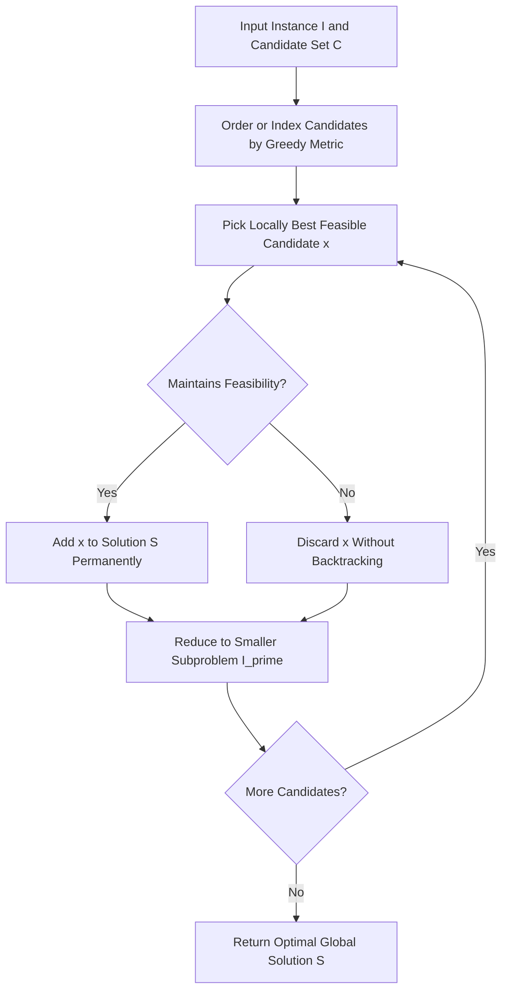

# Greedy Algorithms Introduction

> [!info] Document Metadata
> - **Course:** CSALGCM
> - **Module:** Module 4 - Greedy Algorithms
> - **Topic:** Greedy Algorithms Introduction

**Tags:** #[[Computer Science]] #[[CSALGCM]] #[[Algorithms]] #[[Greedy Algorithms]] #[[Greedy Algorithms Introduction]]

---

## Overview

A **greedy algorithm** constructs an optimal global solution incrementally by making the locally optimal (myopic) choice at each decision point without ever reversing earlier commitments or solving overlapping subproblems via tabular state storage. Whereas [[Dynamic Programming Introduction]] explores every feasible subproblem decision tree and selects the globally best combination bottom-up or top-down, a greedy strategy commits immediately to one candidate based on a fixed selection criterion (such as earliest finish time, highest value-to-weight ratio, lowest edge weight, or minimum symbol frequency).

Because greedy algorithms commit irreversibly at each step, they are typically asymptotically faster and require far less memory than dynamic programming—often running in $O(n \log n)$ time dominated by sorting or priority queue operations. However, a locally optimal choice only produces a globally optimal solution when the problem obeys strict mathematical invariants.

---

## Core Theoretical Invariants

For a greedy algorithm to be provably exact on all valid problem instances, two structural properties must hold:

1. **Greedy Choice Property (GCP):** A globally optimal solution can be reached by assembling a sequence starting from a locally optimal choice. Unlike Dynamic Programming—where the current choice depends on solving inner subproblems first—in a greedy algorithm we prove that *some* optimal solution includes the greedy choice first, leaving a strictly smaller subproblem.
2. **Optimal Substructure:** After making the first greedy choice $g_1$ on instance $I$, an optimal solution to $I$ consists of $g_1$ combined with an optimal solution to the remaining reduced subproblem $I'$.



---

## Standard Proof Techniques

Never rely on small hand-drawn examples to claim a greedy heuristic is correct. Instead, use one of two formal proof frameworks:

### 1. Exchange Argument
Assume an arbitrary optimal solution $O$ that differs from the greedy solution $G$. Show how to iteratively transform ("exchange") components of $O$ into those of $G$ step-by-step without violating feasibility and without degrading the objective value. After finitely many exchanges, $O$ matches $G$ with cost $\text{cost}(G) \le \text{cost}(O)$ (minimization) or $\text{val}(G) \ge \text{val}(O)$ (maximization).

### 2. Greedy Stays Ahead
Construct an inductive invariant showing that after $k$ steps, the partial state produced by the greedy algorithm is at least as good as (or finishes no later than) step $k$ of *any* optimal schedule $O$. For instance, in interval scheduling, if $f(g_k) \le f(o_k)$ for all $k$, then $O$ can never fit strictly more non-overlapping intervals than $G$.

---

## Classic Greedy Algorithms vs. Counterexamples

| Problem | Greedy Criterion | Optimal? | Complexity | Key Condition / Counterexample |
| :--- | :--- | :--- | :--- | :--- |
| **Activity Selection (Interval Scheduling)** | Earliest finish time $f_i$ | **Yes** | $O(n \log n)$ | Proven by *Greedy Stays Ahead*; earliest start time or shortest duration fail. |
| **Fractional Knapsack** | Decreasing $v_i / w_i$ | **Yes** | $O(n \log n)$ | Items can be split arbitrarily, eliminating capacity remainder waste. |
| **0/1 Knapsack** | Decreasing $v_i / w_i$ or $v_i$ | **No** | Exact DP: $O(nW)$ | Fails when partial remaining capacity is wasted (requires DP). |
| **Huffman Coding** | Two lowest frequencies $f_i + f_j$ | **Yes** | $O(n \log n)$ | Proven by exchanging deepest leaves in the prefix tree to minimum-frequency nodes. |
| **Minimum Spanning Tree (Kruskal / Prim)** | Lightest safe edge across cut | **Yes** | $O(E \log V)$ | Cut Property guarantees every minimum-weight crossing edge belongs to some MST. |
| **Coin Change (Arbitrary Denominations)** | Largest coin $\le R$ | **No** | Exact DP: $O(n \cdot A)$ | Fails for $\{1, 3, 4\}$ with target $6$ (greedy yields $4+1+1 = 3$ coins; optimal is $3+3 = 2$). |

---

## Worked Examples & Implementations

### Example 1: Activity Selection Problem
Given $n$ activities with start times $s_i$ and finish times $f_i$, select the maximum-size subset of mutually non-overlapping activities. Sorting by finish time ensures maximum room remains for future activities.

```python
def select_max_activities(intervals: list[tuple[int, int]]) -> list[tuple[int, int]]:
    # Sort strictly by earliest finish time f_i
    ordered = sorted(intervals, key=lambda x: x[1])
    chosen: list[tuple[int, int]] = []
    last_finish = float("-inf")
    for start, finish in ordered:
        if start >= last_finish:
            chosen.append((start, finish))
            last_finish = finish
    return chosen
```

**Complexity:** $O(n \log n)$ for sorting by $f_i$, followed by a single $O(n)$ linear scan with $O(1)$ auxiliary working variables.

### Example 2: Fractional Knapsack & Huffman Complexity
For **Fractional Knapsack**, sorting items by density $r_i = v_i / w_i$ descending and taking $\min(w_i, W_{\text{rem}})$ of each item takes $O(n \log n)$ time. For **Huffman Coding** over an alphabet of size $n$ with symbol frequencies $\{f_1, \dots, f_n\}$, a binary min-heap extracts the two smallest nodes ($O(\log n)$ each) and reinserts their combined parent $n - 1$ times, yielding total tree construction time $O(n \log n)$ and minimizing the weighted external path length:

$$B(T) = \sum_{c \in C} f(c) \cdot d_T(c)$$

where $d_T(c)$ denotes the depth (codeword bit length) of symbol $c$ in the optimal prefix-free binary tree $T$.

---

## Matroid Abstraction (Theoretical Link)

A finite **matroid** is a pair $M = (S, \mathcal{I})$ where $S$ is a finite ground set and $\mathcal{I}$ is a nonempty family of *independent* subsets satisfying:
1. **Hereditary property:** If $B \in \mathcal{I}$ and $A \subseteq B$, then $A \in \mathcal{I}$.
2. **Exchange property:** If $A, B \in \mathcal{I}$ with $|A| < |B|$, then there exists $x \in B \setminus A$ such that $A \cup \{x\} \in \mathcal{I}$.

Whenever a weighted optimization problem reduces to finding a maximum-weight (or minimum-weight) basis of a matroid (such as the graphic matroid for Kruskal's MST), the greedy algorithm is guaranteed to be 100% optimal.

---

## Multiple Choice Questions

1. Which two formal properties must hold for a greedy algorithm to guarantee a globally optimal solution across all inputs?
    - **A)** Overlapping subproblems and polynomial reducibility
    - **B)** The greedy choice property and optimal substructure
    - **C)** Memoization caching and strict topological ordering
    - **D)** Exponential branching and state-space compression

2. In the Activity Selection Problem, which sorting criterion guarantees a maximum-cardinality set of mutually compatible intervals?
    - **A)** Shortest duration (finish - start) ascending
    - **B)** Earliest start time ascending
    - **C)** Earliest finish time ascending
    - **D)** Fewest overlaps with all other intervals ascending

3. Why does the greedy heuristic that picks the highest value-to-weight ratio fail for the 0/1 Knapsack problem on certain instances?
    - **A)** Sorting items by value-to-weight ratio takes exponential time
    - **B)** Items cannot be divided fractionally, so picking the highest ratio item may leave unusable capacity that prevents a higher-total combination
    - **C)** The 0/1 Knapsack problem does not exhibit optimal substructure
    - **D)** Value-to-weight ratios are undefined when item weights are integers

4. Consider coin denominations {1, 3, 4} and target amount 6. How many coins does the standard greedy largest-coin-first heuristic select versus the true optimal solution?
    - **A)** Greedy picks 2 coins; optimal is 2 coins
    - **B)** Greedy picks 3 coins (4 + 1 + 1); optimal is 2 coins (3 + 3)
    - **C)** Greedy picks 4 coins (3 + 1 + 1 + 1); optimal is 2 coins (4 + 2)
    - **D)** Greedy picks 6 coins; optimal is 3 coins

5. How does an Exchange Argument prove the correctness of a greedy algorithm G?
    - **A)** It demonstrates by exhaustion that all smaller problem sizes have identical outputs
    - **B)** It assumes an arbitrary optimal solution O and transforms O into G step-by-step without degrading objective value or feasibility
    - **C)** It proves that O requires strictly more memory than G in the RAM model
    - **D)** It shows that every greedy decision can be undone during backtracking

6. What is the dominant asymptotic time complexity of building a Huffman code tree for n distinct characters using a binary min-heap?
    - **A)** O(n)
    - **B)** O(n log n)
    - **C)** O(n^2)
    - **D)** O(2^n)

7. In Huffman coding, what objective metric does the resulting prefix-free binary tree minimize?
    - **A)** Maximum character frequency in the input alphabet
    - **B)** Height of the resulting binary search tree only
    - **C)** Weighted average codeword bit length sum of f(c) * depth(c)
    - **D)** Total number of leaves plus internal nodes

8. In the "Greedy Stays Ahead" proof for interval scheduling, what inductive inequality relates the i-th interval selected by greedy g_i to the i-th interval o_i of any optimal schedule?
    - **A)** start(g_i) >= finish(o_i) for all i >= 1
    - **B)** finish(g_i) <= finish(o_i) for all i >= 1
    - **C)** duration(g_i) <= duration(o_i) for all i >= 1
    - **D)** finish(g_i) >= start(o_i) + finish(o_i) for all i >= 1

9. Which condition defines the Exchange Property of a matroid M = (S, I)?
    - **A)** Every subset of an independent set is also independent
    - **B)** If A, B are in I and |A| < |B|, then there exists x in B \ A such that A union {x} is in I
    - **C)** No independent set may contain more than two elements
    - **D)** All weights assigned to elements of S must be strictly negative

10. Why does Kruskal's Minimum Spanning Tree algorithm run safely as a greedy algorithm without dynamic programming?
    - **A)** Graph edges form a graphic matroid and satisfy the Cut Property for safe edge selection
    - **B)** Every graph contains only a single spanning tree
    - **C)** Shortest paths between all pairs always coincide with MST edges
    - **D)** Kruskal's algorithm uses memoized tabulation across all vertex subsets

### Answer Key & Explanations

1. **B)** A greedy algorithm is exact when the Greedy Choice Property ensures a locally optimal decision is part of a global optimum and Optimal Substructure guarantees the residual problem combines optimally.
2. **C)** Selecting by earliest finish time leaves the maximum possible remaining time for subsequent non-overlapping intervals; sorting by start time, duration, or conflict count all admit simple counterexamples.
3. **B)** In 0/1 Knapsack, indivisible items can strand residual capacity (e.g., capacity $50$ with item A weighted $10$ value $60$ [$r=6$], and two items weighted $20$ [$r=5$] and $30$ [$r=4$] totaling $220$ vs picking A + one partial? No, taking A leaves $40$ where optimal might combine $20+30=50$).
4. **B)** Choosing $4$ immediately reduces the target to $2$, forcing $1+1$ ($3$ coins total), whereas $3+3=6$ requires only $2$ coins.
5. **B)** An Exchange Argument begins with any optimal solution $O$ and swaps differing elements of $O$ with elements of $G$ while preserving feasibility and non-worsening cost, proving $G$ matches $O$'s optimality.
6. **B)** Building the heap takes $O(n)$ and performing $n - 1$ merge iterations (each with two `extract_min` calls and one `insert` call costing $O(\log n)$) yields $O(n \log n)$ overall.
7. **C)** Huffman's algorithm constructs an optimal prefix-free binary tree minimizing the weighted path length $B(T) = \sum f(c) \cdot d_T(c)$, which equals the encoded bit length of the message.
8. **B)** By induction, the $k$-th greedy activity always finishes no later than the $k$-th activity of any optimal solution ($f(g_k) \le f(o_k)$), guaranteeing $G$ matches $|O|$.
9. **B)** The hereditary property handles subsets of independent sets; the exchange (augmentation) property states that a smaller independent set $A$ can always be augmented by some element $x \in B \setminus A$ from a larger independent set $B$.
10. **A)** Spanning forests of an undirected graph form the independent sets of a graphic matroid, and the Cut Property proves the lightest edge crossing any cut is safe for an MST.

## References & Navigation

- **Previous Topic:** [[Dynamic Programming Introduction]]
- **Next Topic:** [[Intractability and NP-Completeness]]
- **Related Notes:** [[[PS] Chariot Arcana]], [[[PS] Hermit Arcana]], [[[PS] Justice Arcana]], [[MST]], [[[QZ] Huffman Encoding]], [[[QZ] Minimum Spanning Tree]]
