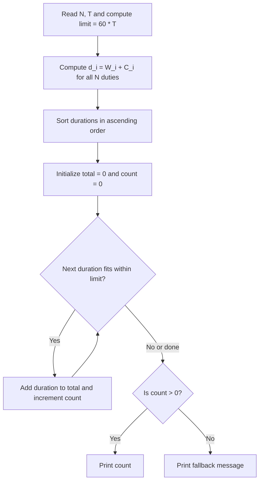

# Adventurer In Need (Tank Needed)

> [!info] Document Metadata
> **Course:** `=this.course` | **Topic:** `=this.topic` | **Status:** `=this.status` | **Difficulty:** `=this.difficulty`

**Tags:** #[[Computer Science]] #[[CSALGCM]] #[[Algorithms and Complexity]] #[[HackerRank]] #[[Chariot Arcana]] #[[Greedy Scheduling]]
---

## Problem Description

In the MMORPG Final Fantasy XIV, queueing for cooperative duties via the duty finder requires waiting for a party and then completing the duty. For each of $N$ distinct duties, you know the exact queue waiting time $W_i$ (in seconds) and completion time $C_i$ (in seconds).

Given an available time budget of $T$ minutes before your next class, and requiring that no duty be repeated, determine the maximum number of distinct duties you can queue for and complete within the $T$-minute window.

### Input Format
- The first line contains two space-separated integers $N$ and $T$, indicating the number of available duties and the available time limit in minutes.
- $2N$ lines follow in pairs:
  - The first line of each pair contains the duty's name (printable ASCII characters).
  - The second line contains two space-separated integers $W_i$ and $C_i$, denoting the duty's waiting time and completion time in seconds.

### Output Format
Output a single integer indicating the maximum number of duties that can be completed within $60T$ seconds. If zero duties can be completed within the time limit, print `"I need to find friends."` (without quotes).

### Constraints
- $1 \le N \le 2 \cdot 10^5$
- $1 \le T, W_i, C_i \le 10^9$

### Sample Test Cases

**Sample Input 0**
```text
3 10
Brayflox's Longstop
1 2
Sastasha
3 2
Urth's Fount
6 6
```

**Sample Output 0**
```text
3
```

*Explanation 0:* Total budget is $10 \times 60 = 600$ seconds. The total duty times are $1+2=3$, $3+2=5$, and $6+6=12$ seconds. Completing all $3$ duties takes $3 + 5 + 12 = 20 \le 600$ seconds.

**Sample Input 1**
```text
3 2
Copperbell Mines
13 14
Thornmarch (Hard)
227 228
The Aurum Vale
7 10
```

**Sample Output 1**
```text
2
```

*Explanation 1:* Total budget is $2 \times 60 = 120$ seconds. The two shortest duties take $7+10=17$ and $13+14=27$ seconds, totaling $44 \le 120$ seconds. Adding `Thornmarch (Hard)` ($227 + 228 = 455$ seconds) exceeds $120$ seconds.

**Sample Input 2**
```text
4 2
Haukke Manor
117 111
Thornmarch (Hard)
118 115
The World of Darkness
114 113
The Aery
114 110
```

**Sample Output 2**
```text
I need to find friends.
```

*Explanation 2:* Total budget is $120$ seconds, but even the shortest duty (`The Aery`) takes $114 + 110 = 224 > 120$ seconds, so zero duties fit.

---

## Approach & Intuition

- **Problem Abstraction:** Convert the time limit $T$ (minutes) into seconds $L = 60T$, and map each duty $i$ to its total required duration $d_i = W_i + C_i$. Find the maximum cardinality subset $S \subseteq \{1, \dots, N\}$ satisfying $\sum_{i \in S} d_i \le L$. The duty name strings are irrelevant to optimization.
- **Naive / Brute-Force Approach:** Checking all $2^N$ subsets or running a $0/1$ knapsack DP over capacity $L = 60T \le 6 \cdot 10^{10}$ is completely infeasible for $N \le 2 \cdot 10^5$ and $T \le 10^9$.
- **Optimal Strategy (Shortest Processing Time First & Exchange Proof):** Sort the durations $d_i = W_i + C_i$ in non-decreasing order $d_{(1)} \le d_{(2)} \le \dots \le d_{(N)}$ and greedily take the longest prefix whose sum does not exceed $60T$.
  - *Exchange Argument:* Suppose an optimal subset $OPT$ of size $k$ omits some duty $d_{(j)}$ among the $k$ shortest duties while containing a strictly longer duty $d_{(m)} \ge d_{(j)}$ ($m > k$). Replacing $d_{(m)}$ with $d_{(j)}$ keeps $|OPT| = k$ unchanged while reducing total elapsed time by $d_{(m)} - d_{(j)} \ge 0$, preserving feasibility $\le 60T$. Iterating this swap turns $OPT$ into the prefix $\{d_{(1)}, \dots, d_{(k)}\}$, proving greedy prefix selection is optimal.
  - *Unit & Boundary Note:* Remember to multiply $T$ by $60$ before comparing against $W_i + C_i$, and return `"I need to find friends."` when the longest feasible prefix has length $0$.

## Algorithm Walkthrough



## Step-by-Step Trace

Tracing **Sample Input 1** ($N = 3$, $T = 2 \implies \text{limit} = 120$ seconds):

| Step | Action | Duty / Duration ($W_i + C_i$) | Running Total | Status |
| :--- | :--- | :--- | :--- | :--- |
| 1 | Parse duties | `[27, 455, 17]` | `0` | Unsorted durations in seconds |
| 2 | Sort ascending | `[17, 27, 455]` | `0` | Ordered shortest-first |
| 3 | Check `17` | `0 + 17 = 17 <= 120` | `17` | Accepted (`count = 1`) |
| 4 | Check `27` | `17 + 27 = 44 <= 120` | `44` | Accepted (`count = 2`) |
| 5 | Check `455` | `44 + 455 = 499 > 120` | `44` | Exceeds limit; break and output `2` |

## Complexity Analysis

| Metric | Complexity | Rationale |
| :--- | :--- | :--- |
| **Time** | $O(N \log N)$ | Sorting $N$ total durations $W_i + C_i$ dominates the $O(N)$ input parsing and prefix scan. |
| **Space** | $O(N)$ | Stores all $N$ duty entries and the sorted list of $N$ durations. |

---

## Full Solution

```python
def solve(n, t, duties):
    limit = t * 60
    times = sorted(w + c for _, w, c in duties)
    total = 0
    count = 0
    for time in times:
        if total + time <= limit:
            total += time
            count += 1
        else:
            break
    return str(count) if count > 0 else "I need to find friends."

n, t = list(map(int, input().split(" ")))
duties = []

for i in range(n):
    name = input()
    w, c = list(map(int, input().split(" ")))
    duties.append([name, w, c])

print(solve(n, t, duties))
```

## References & Navigation

- **Next Problem:** [[02 - The Easiest College Degree of All Time]]
- **Parent Set:** [[[PS] Chariot Arcana|Chariot Arcana Index]]
- **Related Notes:** [[Greedy Algorithms Introduction]]
