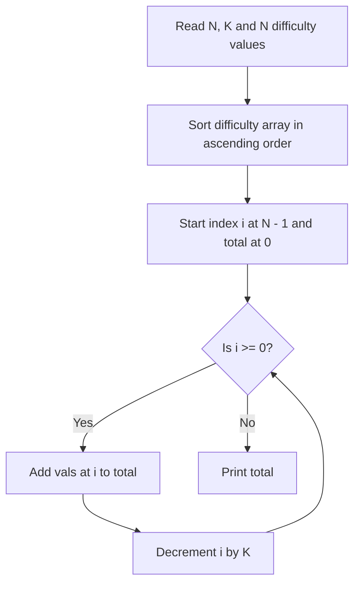

# The Easiest College Degree of All Time

> [!info] Document Metadata
> **Course:** `=this.course` | **Topic:** `=this.topic` | **Status:** `=this.status` | **Difficulty:** `=this.difficulty`

**Tags:** #[[Computer Science]] #[[CSALGCM]] #[[Algorithms and Complexity]] #[[HackerRank]] #[[Chariot Arcana]] #[[Greedy Batching]]
---

## Problem Description

Cherami Bartolini must complete $N$ courses that have no prerequisites, allowing her to schedule them across terms in any order. Due to social-life constraints, she refuses to take more than $K$ courses in any single term.

She defines a term's difficulty rating as the **maximum** difficulty rating $D_i$ among the courses taken during that term. Given all $N$ course difficulties $D_1, \dots, D_N$ and the per-term course cap $K$, determine the minimum possible sum of difficulty ratings across all terms needed to finish the degree.

### Input Format
- The first line contains two space-separated integers $N$ and $K$, denoting the total number of courses and the maximum number of courses permitted per term.
- The next $N$ lines each contain a single integer $D_i$, the difficulty rating of the $i$-th course.

### Output Format
Output a single integer representing the minimum possible total difficulty rating across all of Cherami's terms.

### Constraints
- $1 \le K \le N \le 2 \cdot 10^5$
- $1 \le D_i \le 10^9$

### Sample Test Cases

**Sample Input 0**
```text
5 3
6
10
2
3
8
```

**Sample Output 0**
```text
13
```

*Explanation 0:* Grouping `{10, 8, 6}` into Term 1 (difficulty $10$) and `{3, 2}` into Term 2 (difficulty $3$) achieves $10 + 3 = 13$.

**Sample Input 1**
```text
8 4
12
12
3
19
18
14
18
7
```

**Sample Output 1**
```text
31
```

*Explanation 1:* Grouping `{19, 18, 18, 14}` into Term 1 (difficulty $19$) and `{12, 12, 7, 3}` into Term 2 (difficulty $12$) yields $19 + 12 = 31$.

---

## Approach & Intuition

- **Problem Abstraction:** Partition a multiset of $N$ positive integers $\{D_1, \dots, D_N\}$ into non-empty subsets $B_1, B_2, \dots, B_m$, each of size $1 \le |B_j| \le K$, so as to minimize $\sum_{j=1}^{m} \max_{x \in B_j} x$.
- **Naive / Brute-Force Approach:** Searching over all set partitions with bounded block size $\le K$ grows super-exponentially with $N$, and bitmask DP is $O(3^N)$, far beyond the $N \le 2 \cdot 10^5$ limit.
- **Optimal Strategy (Greedy Largest-Batch Absorption & Exchange Proof):** Sort the difficulty values in non-decreasing order $D_{(1)} \le D_{(2)} \le \dots \le D_{(N)}$, then greedily form terms from the top down: the first term absorbs the $K$ hardest courses $\{D_{(N)}, \dots, D_{(N-K+1)}\}$ with cost $D_{(N)}$, the second term absorbs the next $K$ hardest courses with cost $D_{(N-K)}$, and so on until fewer than $K$ remain. In Python, this equates directly to summing `vals[i]` for `i` in `range(n - 1, -1, -k)`.
  - *Exchange Argument:* The hardest course overall, $D_{(N)}$, must appear in some term $B_1$, automatically contributing $D_{(N)}$ to the sum regardless of its companions. If $B_1$ omits one of the next $K - 1$ hardest courses $x$ (or has size $< K$ while another term $B_2$ holds $x$), we can move or swap $x$ into $B_1$ (displacing a strictly smaller element $y \le x$ into $B_2$ if $|B_1| = K$). Since $x \le D_{(N)}$, $\max(B_1)$ remains $D_{(N)}$, while $\max(B_2)$ can only decrease or stay equal (and if $B_2$ becomes empty, its term cost drops completely). By induction on the remaining $N - K$ courses, packing $K$ largest courses per batch from the top is globally optimal.

## Algorithm Walkthrough



## Step-by-Step Trace

Tracing **Sample Input 0** ($N = 5$, $K = 3$, sorted `vals = [2, 3, 6, 8, 10]`):

| Step | Index `i` | Selected Batch | Term Max `vals[i]` | Running Total |
| :--- | :--- | :--- | :--- | :--- |
| 1 | `4` (`n - 1`) | `[6, 8, 10]` (indices `2, 3, 4`) | `10` | `10` |
| 2 | `1` (`4 - 3`) | `[2, 3]` (indices `0, 1`) | `3` | `13` |
| 3 | `-2` (`1 - 3`) | Loop terminates (`i < 0`) | — | Output `13` |

## Complexity Analysis

| Metric | Complexity | Rationale |
| :--- | :--- | :--- |
| **Time** | $O(N \log N)$ | Sorting $N$ difficulty ratings dominates the strided summation taking $\lceil N / K \rceil \le N$ steps. |
| **Space** | $O(N)$ | Stores the sorted list of $N$ course difficulties. |

---

## Full Solution

```python
def solve(n, k, vals):
    return sum(vals[i] for i in range(n - 1, -1, -k))

n, k = list(map(int, input().strip().split(" ")))
vals = sorted([int(input()) for i in range(n)])

print(f"{solve(n, k, vals)}\n")
```

## References & Navigation

- **Previous Problem:** [[01 - Adventurer In Need (Tank Needed)]]
- **Next Problem:** [[03 - The Retribution of Salems Lot]]
- **Parent Set:** [[[PS] Chariot Arcana|Chariot Arcana Index]]
- **Related Notes:** [[Greedy Algorithms Introduction]]
