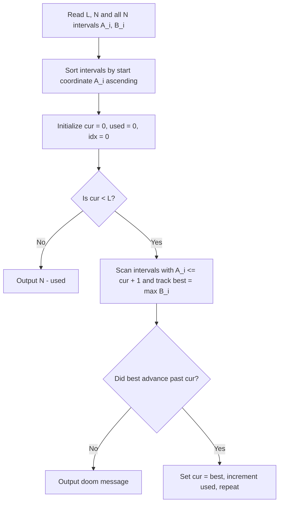

# The Retribution of 'Salem's Lot

> [!info] Document Metadata
> **Course:** `=this.course` | **Topic:** `=this.topic` | **Status:** `=this.status` | **Difficulty:** `=this.difficulty`

**Tags:** #[[Computer Science]] #[[CSALGCM]] #[[Algorithms and Complexity]] #[[HackerRank]] #[[Chariot Arcana]] #[[Interval Covering]]
---

## Problem Description

Father Callaghan and $N$ companions have cornered the remaining vampires inside the Marsten house, whose only exit is its front facade spanning discrete integer positions $1$ through $L$ (in meters). The $i$-th party member can guard all integer positions in the closed range $[A_i, B_i]$.

To prevent vampires from flanking them, at least one party member must guard every integer position from $1$ to $L$ inclusive. Simultaneously, as many companions as possible must leave their posts to enter the house and confront Barlow. Determine the maximum number of party members who can enter the house (equivalently, $N - \text{min guards needed}$), or report if full coverage is impossible.

### Input Format
- The first line contains two space-separated integers $L$ and $N$, indicating the facade length and the number of party members.
- The next $N$ lines each contain two space-separated integers $A_i$ and $B_i$, representing the left and right coverage bounds of the $i$-th party member.

### Output Format
Output a single integer denoting the maximum number of party members who can enter the house while keeping positions $1$ through $L$ covered. If covering $[1, L]$ is impossible, output `"'Salem's Lot is doomed."` (without quotes).

### Constraints
- $2 \le L \le 10^{18}$
- $1 \le N \le 3 \cdot 10^5$
- $1 \le A_i \le B_i \le L$

### Sample Test Cases

**Sample Input 0**
```text
10 3
1 4
5 10
1 8
```

**Sample Output 0**
```text
1
```

*Explanation 0:* Selecting members `[1, 4]` and `[5, 10]` covers every integer position in $\{1, \dots, 4\} \cup \{5, \dots, 10\} = \{1, \dots, 10\}$ using $2$ guards, allowing $3 - 2 = 1$ member to enter the house.

**Sample Input 1**
```text
10 3
1 4
5 9
1 8
```

**Sample Output 1**
```text
'Salem's Lot is doomed.
```

*Explanation 1:* No party member covers position $10$, so the facade cannot be fully guarded.

---

## Approach & Intuition

- **Problem Abstraction:** Given a discrete integer universe $\{1, 2, \dots, L\}$ and $N$ closed integer intervals $[A_i, B_i]$, find the minimum cardinality subset of intervals whose union equals $\{1, \dots, L\}$. Because positions are **discrete integers** rather than continuous reals, covering $[1, 4]$ followed by $[5, 10]$ leaves zero uncovered positions—the next required position after covering up to `cur` is `cur + 1`.
- **Naive / Brute-Force Approach:** Dynamic programming over positions $1 \dots L$ is impossible because $L \le 10^{18}$, and testing subsets takes $O(2^N)$. Even scanning all $N$ intervals at each greedy step yields $O(N^2)$ worst-case time, which times out for $N = 3 \cdot 10^5$.
- **Optimal Strategy (Greedy Maximum Right-Reach Sweep):** Sort intervals lexicographically by start coordinate $A_i$ ascending. Maintain the rightmost integer position `cur` covered so far (initially `cur = 0`, meaning positions $\le 0$ are covered and `1` is needed next). At each step while `cur < L`, advance a monotonic pointer `idx` through all intervals with `A_i <= cur + 1` and track `best = max(B_i)` among them.
  - *Failure Detection:* If no eligible interval extends past `cur` (`best == cur`), position `cur + 1` cannot be covered; return `"'Salem's Lot is doomed."`.
  - *Greedy Stays Ahead Proof:* Suppose an optimal cover uses intervals $O_1, O_2, \dots, O_m$ ordered by start coordinate, and our greedy cover chooses $G_1, G_2, \dots, G_k$. By induction, if $G_1 \cup \dots \cup G_j$ reaches at least as far right as $O_1 \cup \dots \cup O_j$ (say up to $R_j \ge R'_j$), then $O_{j+1}$ must satisfy $A(O_{j+1}) \le R'_j + 1 \le R_j + 1$, making $O_{j+1}$ eligible when greedy selects $G_{j+1}$. Since greedy picks the eligible interval with maximal right endpoint, $R_{j+1} \ge R'_{j+1}$. Thus greedy covers $[1, L]$ in no more intervals than any optimal solution ($k \le m$).

## Algorithm Walkthrough



## Step-by-Step Trace

Tracing **Sample Input 0** ($L = 10$, $N = 3$, sorted `coverage = [[1, 4], [1, 8], [5, 10]]`):

| Step | `cur` (Target $\le \text{cur}+1$) | Eligible Intervals Inspected | Max Reach `best` | Chosen & `used` |
| :--- | :--- | :--- | :--- | :--- |
| 1 | `0` (need `A_i <= 1`) | `[1, 4]`, `[1, 8]` (`idx` advances to `2`) | `8` | Pick `[1, 8]`, `cur = 8`, `used = 1` |
| 2 | `8` (need `A_i <= 9`) | `[5, 10]` (`idx` advances to `3`) | `10` | Pick `[5, 10]`, `cur = 10`, `used = 2` |
| 3 | `10` (`cur >= L`) | Loop exits | — | Return `3 - 2 = 1` |

*Note:* Even when greedy takes `[1, 8]` first instead of `[1, 4]`, the minimum guard count remains $2$ and the spare member count remains $1$.

## Complexity Analysis

| Metric | Complexity | Rationale |
| :--- | :--- | :--- |
| **Time** | $O(N \log N)$ | Sorting $N$ intervals takes $O(N \log N)$ time; the two-pointer scan advances `idx` monotonically from $0$ to $N$ in $O(N)$ total work. |
| **Space** | $O(N)$ | Stores the $N$ interval pairs `[A_i, B_i]` in memory. |

---

## Full Solution

```python
def solve(L, n, coverage):
    coverage.sort()
    cur = 0
    used = 0
    idx = 0
    while cur < L:
        best = cur
        while idx < n and coverage[idx][0] <= cur + 1:
            if coverage[idx][1] > best:
                best = coverage[idx][1]
            idx += 1
        if best == cur:
            return "'Salem's Lot is doomed."
        cur = best
        used += 1
    return n - used

L, n = list(map(int, input().rstrip().split(" ")))
coverage = [list(map(int, input().rstrip().split(" "))) for i in range(n)]
print(solve(L, n, coverage))
```

## References & Navigation

- **Previous Problem:** [[02 - The Easiest College Degree of All Time]]
- **Next Problem:** [[04 - The Fair Maiden Fangirls of Waterdeep]]
- **Parent Set:** [[[PS] Chariot Arcana|Chariot Arcana Index]]
- **Related Notes:** [[Greedy Algorithms Introduction]]
