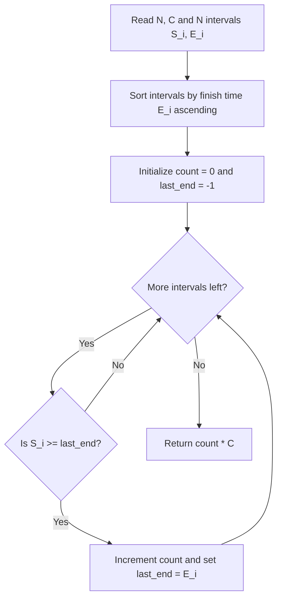

# The Fair Maiden Fangirls of Waterdeep

> [!info] Document Metadata
> **Course:** `=this.course` | **Topic:** `=this.topic` | **Status:** `=this.status` | **Difficulty:** `=this.difficulty`

**Tags:** #[[Computer Science]] #[[CSALGCM]] #[[Algorithms and Complexity]] #[[HackerRank]] #[[Chariot Arcana]] #[[Interval Scheduling]]
---

## Problem Description

Lucy and Elsa have identified $N$ time intervals during a single day when fangirls congregate in Waterdeep expecting a celebrity appearance from "Ben". Each active period spans from start time $S_i$ to end time $E_i$ (measured in seconds from midnight), and every appearance earns a flat fee of $C$ gold pieces.

Elsa can teleport them instantaneously from the end of one appearance to the start of the next ($S_j \ge E_i$ is permitted), but she cannot duplicate the illusion to appear in two places simultaneously. Determine the maximum total gold revenue Elsa and Lucy can earn in one day.

### Input Format
- The first line contains two space-separated integers $N$ and $C$, denoting the number of active intervals and the flat payment per appearance.
- The next $N$ lines each contain two space-separated integers $S_i$ and $E_i$, denoting the start and end times (in seconds from midnight) of the $i$-th active period.

### Output Format
Output a single integer representing the maximum revenue Elsa and Lucy can earn during one day.

### Constraints
- $0 \le N \le 2 \cdot 10^5$
- $0 \le C \le 10^9$
- $0 \le S_i < E_i \le 86400$

### Sample Test Cases

**Sample Input 0**
```text
3 5
0 4
0 7
4 5
```

**Sample Output 0**
```text
10
```

*Explanation 0:* Attending `[0, 4]` and instantly teleporting to `[4, 5]` yields $2$ appearances worth $2 \times 5 = 10$ gold pieces.

**Sample Input 1**
```text
5 8
0 8
1 7
2 6
3 5
4 5
```

**Sample Output 1**
```text
8
```

*Explanation 1:* All five intervals pairwise overlap (the earliest finish time is $5$, and no interval starts at or after $5$), so at most $1$ appearance can be attended for $1 \times 8 = 8$ gold.

---

## Approach & Intuition

- **Problem Abstraction:** Since every scheduled interval earns an identical constant reward $C \ge 0$, maximizing total revenue $\text{count} \times C$ is equivalent to the classic **unweighted Activity Selection (Interval Scheduling)** problem: find the maximum-cardinality subset of pairwise compatible half-open/touching intervals satisfying $S_j \ge E_i$.
- **Naive / Brute-Force Approach:** Enumerating compatible subsets takes $O(2^N)$, and unweighted DP over sorted endpoints with binary search takes $O(N \log N)$ with unnecessary DP array overhead; sorting by start time or shortest duration fails classic counterexamples (e.g., a long interval starting earliest or a short interval bridging two longer compatible intervals).
- **Optimal Strategy (Earliest Finish Time Greedy):** Sort all $N$ intervals in non-decreasing order of end time $E_i$. Initialize `last_end = -1` (strictly below the minimum possible $S_i \ge 0$) and iterate through the sorted list; whenever `s >= last_end`, accept the interval, increment `count`, and update `last_end = e`. Finally return `count * c`.
  - *Greedy Stays Ahead Proof:* Let $g_1, g_2, \dots, g_k$ be the intervals chosen by the greedy scan and $o_1, o_2, \dots, o_m$ be any optimal schedule ordered chronologically. For the base case, $E(g_1) \le E(o_1)$ by choice of earliest finish time. Inductively, if $E(g_r) \le E(o_r)$, then $o_{r+1}$ starts at $S(o_{r+1}) \ge E(o_r) \ge E(g_r)$, so $o_{r+1}$ is compatible with $g_r$ and therefore a candidate when greedy picks $g_{r+1}$; hence $E(g_{r+1}) \le E(o_{r+1})$. If $m > k$, $o_{k+1}$ would be compatible with $g_k$, contradicting greedy termination—so $k = m$.
  - *Edge Cases:* The boundary $N = 0$ is valid under the constraints ($0 \le N \le 2 \cdot 10^5$); the empty loop leaves `count = 0` and outputs `0`.

## Algorithm Walkthrough



## Step-by-Step Trace

Tracing **Sample Input 0** ($N = 3$, $C = 5$, sorted by finish time `vals = [[0, 4], [4, 5], [0, 7]]`):

| Step | Interval `[S, E]` | Condition `S >= last_end` | Action | `count` | `last_end` |
| :--- | :--- | :--- | :--- | :--- | :--- |
| 1 | `[0, 4]` | `0 >= -1` (True) | Accept | `1` | `4` |
| 2 | `[4, 5]` | `4 >= 4` (True) | Accept | `2` | `5` |
| 3 | `[0, 7]` | `0 >= 5` (False) | Reject (overlaps) | `2` | `5` |
| 4 | End of list | — | Output `2 * 5 = 10` | `2` | `5` |

## Complexity Analysis

| Metric | Complexity | Rationale |
| :--- | :--- | :--- |
| **Time** | $O(N \log N)$ | Sorting $N$ intervals by finish time $E_i$ dominates the $O(N)$ linear selection scan. |
| **Space** | $O(N)$ | Stores all $N$ `[S_i, E_i]` pairs in memory. |

---

## Full Solution

```python
def solve(n, c, vals):
    vals.sort(key=lambda x: x[1])
    count = 0
    last_end = -1
    for s, e in vals:
        if s >= last_end:
            count += 1
            last_end = e
    return count * c

n, c = list(map(int, input().strip().split(" ")))
vals = [list(map(int, input().strip().split(" "))) for i in range(n)]
print("{}".format(solve(n, c, vals)))
```

## References & Navigation

- **Previous Problem:** [[03 - The Retribution of Salems Lot]]
- **Next Problem:** [[05 - Hiding In The Tranquiline Halls of Valhalla]]
- **Parent Set:** [[[PS] Chariot Arcana|Chariot Arcana Index]]
- **Related Notes:** [[Greedy Algorithms Introduction]]
