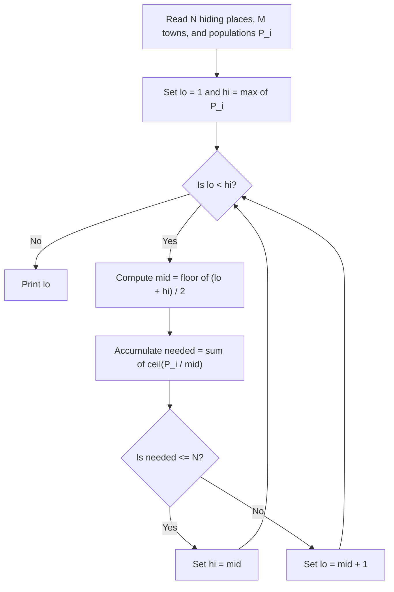

# Hiding In The Tranquiline Halls of Valhalla

> [!info] Document Metadata
> **Course:** `=this.course` | **Topic:** `=this.topic` | **Status:** `=this.status` | **Difficulty:** `=this.difficulty`

**Tags:** #[[Computer Science]] #[[CSALGCM]] #[[Algorithms and Complexity]] #[[HackerRank]] #[[Chariot Arcana]] #[[Binary Search on Answer]]
---

## Problem Description

To surprise Thor on his 1055th birthday in the Halls of Valhalla, citizens from $M$ towns of Asgard must hide across $N$ available hiding places in the throne room. Initially, each of the $M$ towns claims exactly $1$ hiding place ($M \le N$).

Because citizens from different towns refuse to mix, people from the same town may repeatedly split into two groups and move one subgroup into a vacant hiding place whenever vacant spots remain. Determine the minimum possible value of the **maximum** number of citizens occupying any single hiding place after an optimal allocation of hiding spots.

### Input Format
- The first line contains two space-separated integers $N$ and $M$, representing the total number of hiding places and the number of towns, respectively.
- The next $M$ lines each contain a single integer $P_i$, denoting the population of the $i$-th town.

### Output Format
Output a single integer denoting the minimum achievable maximum number of citizens in any single hiding place.

### Constraints
- $1 \le M \le N \le 10^5$
- $1 \le P_i \le 10^9$

### Sample Test Cases

**Sample Input 0**
```text
3 1
10
```

**Sample Output 0**
```text
4
```

*Explanation 0:* Town 1's $10$ citizens split across all $3$ spots as $(4, 3, 3)$, giving a maximum group size of $4$.

**Sample Input 1**
```text
6 2
12
5
```

**Sample Output 1**
```text
3
```

*Explanation 1:* Town 1 splits into $(3, 3, 3, 3)$ across $4$ spots and Town 2 splits into $(3, 2)$ across $2$ spots, using $4 + 2 = 6$ spots with maximum size $3$.

**Sample Input 2**
```text
10 5
2
3
1
1
4
```

**Sample Output 2**
```text
2
```

*Explanation 2:* A cap of $2$ requires $\lceil 2/2 \rceil + \lceil 3/2 \rceil + \lceil 1/2 \rceil + \lceil 1/2 \rceil + \lceil 4/2 \rceil = 1 + 2 + 1 + 1 + 2 = 7 \le 10$ hiding spots (and extra spots can further subdivide groups of $2$ into $(1, 1)$). A cap of $1$ would require $2 + 3 + 1 + 1 + 4 = 11 > 10$ spots, which is infeasible.

---

## Approach & Intuition

- **Problem Abstraction:** Assign a positive integer number of hiding spots $h_i \ge 1$ to each town $i \in \{1, \dots, M\}$ subject to $\sum_{i=1}^{M} h_i \le N$, minimizing $\max_{1 \le i \le M} \lceil P_i / h_i \rceil$. Notice that although the problem describes sequential binary splits, any positive integer count $h_i$ is reachable by performing $h_i - 1$ splits on town $i$, and distributing $P_i$ people as evenly as possible across $h_i$ spots always attains $\lceil P_i / h_i \rceil$.
- **Naive / Brute-Force Approach:** Greedily giving one extra hiding spot at a time to whichever town currently has the largest per-spot load $\lceil P_i / h_i \rceil$ via a max-heap requires $N - M$ heap operations—fast when $N \le 10^5$, yet unnecessary if $N$ were larger—while testing every candidate cap $X$ linearly from $1$ to $\max P_i$ takes $O(M \cdot \max P_i)$ time and times out when $P_i \le 10^9$.
- **Optimal Strategy (Binary Search on the Answer & Monotonicity):** Fix a candidate cap $X \in [1, \max P_i]$ on the maximum number of citizens per hiding place. Town $i$ needs at least $h_i(X) = \lceil P_i / X \rceil = \lfloor (P_i + X - 1) / X \rfloor$ hiding spots so no spot exceeds $X$ people.
  - *Monotonicity:* As $X$ increases, each $\lceil P_i / X \rceil$ is non-increasing, so the minimum required spots $F(X) = \sum_{i=1}^M \lceil P_i / X \rceil$ is monotonically non-increasing in $X$.
  - *Feasibility Predicate:* $X$ is feasible if and only if $F(X) \le N$ (guaranteed valid at $X = \max P_i$ since $F(\max P_i) = M \le N$). Lower-bound binary search finds the smallest $X$ satisfying $F(X) \le N$.
  - *Variable Naming Note:* The Staging implementation reads the first line into `p, n` where `p` holds $N$ (total hiding places) and `n` holds $M$ (number of towns).

## Algorithm Walkthrough



## Step-by-Step Trace

Tracing **Sample Input 1** ($N = 6$, $M = 2$, `towns = [12, 5]`, initial `lo = 1, hi = 12`):

| Iteration | `lo` | `hi` | `mid` | Spots Needed $\lceil 12 / \text{mid} \rceil + \lceil 5 / \text{mid} \rceil$ | `needed <= 6`? | Update |
| :--- | :--- | :--- | :--- | :--- | :--- | :--- |
| 1 | `1` | `12` | `6` | `2 + 1 = 3` | Yes (`3 <= 6`) | `hi = 6` |
| 2 | `1` | `6` | `3` | `4 + 2 = 6` | Yes (`6 <= 6`) | `hi = 3` |
| 3 | `1` | `3` | `2` | `6 + 3 = 9` | No (`9 > 6`) | `lo = 3` |
| 4 | `3` | `3` | — | Loop exits (`lo == hi`) | — | Output `3` |

## Complexity Analysis

| Metric | Complexity | Rationale |
| :--- | :--- | :--- |
| **Time** | $O\bigl(M \log(\max_i P_i)\bigr)$ | Binary search performs $\lceil \log_2(\max_i P_i) \rceil \le 30$ iterations, each scanning at most $M$ towns with early exit when `needed > p`. |
| **Space** | $O(M)$ | Stores the $M$ town population integers in `towns`. |

---

## Full Solution

```python
p, n = list(map(int, input().rstrip().split(" ")))
towns = [int(input().rstrip()) for _ in range(n)]

lo, hi = 1, max(towns)
while lo < hi:
    mid = (lo + hi) // 2
    needed = 0
    for pop in towns:
        needed += (pop + mid - 1) // mid
        if needed > p:
            break
    if needed <= p:
        hi = mid
    else:
        lo = mid + 1

print(lo)
```

## References & Navigation

- **Previous Problem:** [[04 - The Fair Maiden Fangirls of Waterdeep]]
- **Next Problem:** [[06 - Optimizing Chicken Jay]]
- **Parent Set:** [[[PS] Chariot Arcana|Chariot Arcana Index]]
- **Related Notes:** [[Greedy Algorithms Introduction]]
