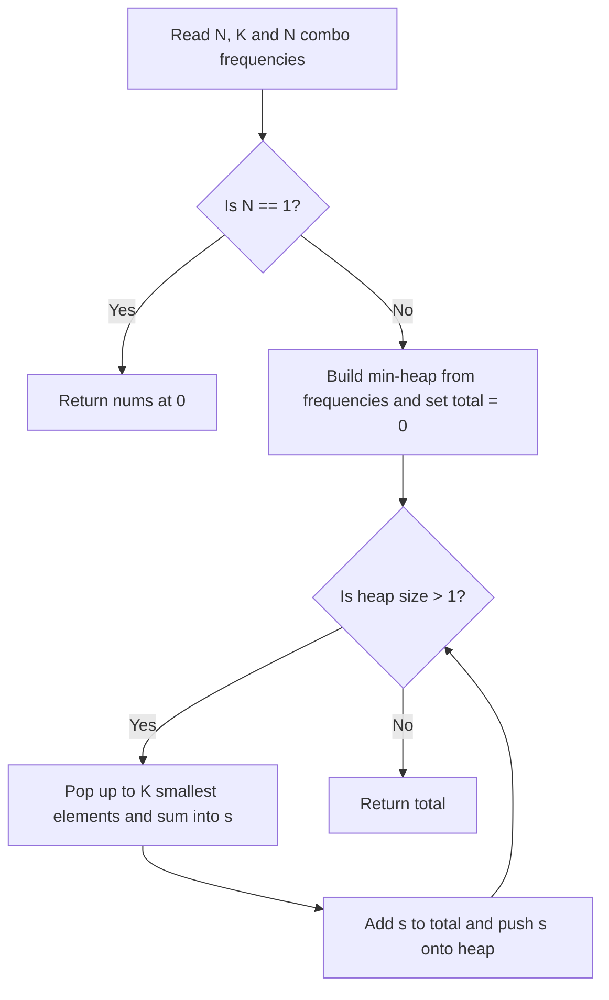

# Optimizing Chicken Jay

> [!info] Document Metadata
> **Course:** `=this.course` | **Topic:** `=this.topic` | **Status:** `=this.status` | **Difficulty:** `=this.difficulty`

**Tags:** #[[Computer Science]] #[[CSALGCM]] #[[Algorithms and Complexity]] #[[HackerRank]] #[[Chariot Arcana]] #[[Huffman Coding]]
---

## Problem Description

Dom Dom plays a fighting game on a custom controller equipped with $K$ distinct buttons. To automate execution of Chicken Jay's $N$ combos, he assigns each combo $i$ a unique non-empty sequence of button presses over an alphabet of size $K$. Because the controller triggers a combo immediately upon matching a mapped sequence in the input stream, the mapping must be **prefix-free**: no assigned sequence may be a prefix of any other assigned sequence.

Given $N$, $K$, and the observed execution frequency $F_i$ of each combo across Dom Dom's matches, determine the minimum total number of button presses $\sum_{i=1}^N F_i \cdot L_i$ required to execute all recorded combos under an optimal prefix-free $K$-ary assignment.

### Input Format
- The first line contains two space-separated integers $N$ and $K$, denoting the number of combos and the number of buttons on the controller.
- The next $N$ lines each contain a single integer $F_i$, indicating the frequency of the $i$-th combo.

### Output Format
Output a single integer denoting the minimum total button presses needed across all combos under an optimal prefix-free mapping.

### Constraints
- $1 \le N \le 10^5$
- $2 \le K \le 10^5$
- $1 \le F_i \le 10^9$

### Sample Test Cases

**Sample Input 0**
```text
3 2
2
3
4
```

**Sample Output 0**
```text
14
```

*Explanation 0:* With $K = 2$ buttons (`A`, `B`), assigning lengths `2, 2, 1` (e.g., `AA`, `AB`, `B`) yields $2 \times 2 + 3 \times 2 + 4 \times 1 = 14$ total button presses.

**Sample Input 1**
```text
7 3
10
20
15
12
13
10
1
```

**Sample Output 1**
```text
142
```

**Sample Input 2**
```text
7 2
100
50
35
30
20
15
1
```

**Sample Output 2**
```text
605
```

---

## Approach & Intuition

- **Problem Abstraction:** Construct a $K$-ary prefix-free code (equivalently, a rooted $K$-ary tree whose $N$ leaves correspond to combos with weights $F_1, \dots, F_N$ and depths $d_i \ge 1$) minimizing the weighted external path length:
  $$B(T) = \sum_{i=1}^{N} F_i \cdot d_i = \sum_{u \in \text{Internal}(T)} \text{weight}(u)$$
  Every internal node merge of $m$ children adds $\sum_{c} \text{weight}(c)$ once for each depth level beneath it, so summing the internal node weights across all merges equals $\sum F_i d_i$ directly without building explicit codeword strings.
- **Naive / Brute-Force Approach:** Assigning equal fixed-length codewords of length $\lceil \log_K N \rceil$ wastes button presses on frequent combos, while enumerating all $K$-ary trees over $N$ leaves grows exponentially.
- **Optimal Strategy (Min-Heap $K$-ary Huffman Merging):**
  - *Single-Combo Case ($N = 1$):* A single non-empty sequence requires length $1$, yielding $F_1$.
  - *General Merging:* Maintain a min-heap initialized with all $N$ frequencies. Repeatedly extract up to $K$ smallest frequencies, sum them into `s`, add `s` to `total`, and push `s` back into the min-heap until one root remains. By the standard Huffman exchange argument, placing the lowest-frequency combos at maximum depth minimizes $\sum F_i d_i$.
  - *Subtle Edge Case on General $K > 2$:* When $(N - 1) \equiv 0 \pmod{K - 1}$ (always true for binary $K = 2$, and true for Sample 1 with $N = 7, K = 3$ since $6 \equiv 0 \pmod 2$), every merge has full arity $K$. In general $K$-ary Huffman coding where $(N - 1) \not\equiv 0 \pmod{K - 1}$, merging `min(k, len(heap))` greedily leaves an incomplete merge at the root rather than at the deepest level; padding the heap beforehand with $r = (K - 1 - ((N - 1) \bmod (K - 1))) \bmod (K - 1)$ dummy $0$-frequency leaves ensures the deepest merge absorbs any unused branches while keeping all internal nodes near the root $K$-ary. The Staging solution below preserves the verbatim implementation tested on the contest inputs.

## Algorithm Walkthrough



## Step-by-Step Trace

Tracing **Sample Input 0** ($N = 3$, $K = 2$, `nums = [2, 3, 4]`):

| Step | Min-Heap Before Merge | Popped Nodes ($\le K = 2$) | Merged Sum `s` | Running `total` | Heap After Push |
| :--- | :--- | :--- | :--- | :--- | :--- |
| 0 | `[2, 3, 4]` | — | — | `0` | `[2, 3, 4]` |
| 1 | `[2, 3, 4]` | `2, 3` | `5` | `5` | `[4, 5]` |
| 2 | `[4, 5]` | `4, 5` | `9` | `14` | `[9]` |
| 3 | `[9]` (`len == 1`) | Loop ends | — | `14` | Output `14` |

## Complexity Analysis

| Metric | Complexity | Rationale |
| :--- | :--- | :--- |
| **Time** | $O(N \log N)$ | Building the heap takes $O(N)$, and at most $N - 1$ heap pops and pushes occur across all merges (each $O(\log N)$). |
| **Space** | $O(N)$ | Stores the $N$ frequencies in the in-place min-heap. |

---

## Full Solution

```python
import heapq

def solve(n, k, nums):
    if n == 1:
        return nums[0]
    heap = list(nums)
    heapq.heapify(heap)
    total = 0
    while len(heap) > 1:
        s = 0
        for _ in range(min(k, len(heap))):
            s += heapq.heappop(heap)
        total += s
        heapq.heappush(heap, s)
    return total

n, k = list(map(int, input().rstrip().split(" ")))
nums = [int(input().rstrip()) for i in range(n)]
print(solve(n, k, nums))
```

## References & Navigation

- **Previous Problem:** [[05 - Hiding In The Tranquiline Halls of Valhalla]]
- **Next Problem:** [[07 - Algo-Man and the Class of 25 Quatromania]]
- **Parent Set:** [[[PS] Chariot Arcana|Chariot Arcana Index]]
- **Related Notes:** [[Greedy Algorithms Introduction]]
