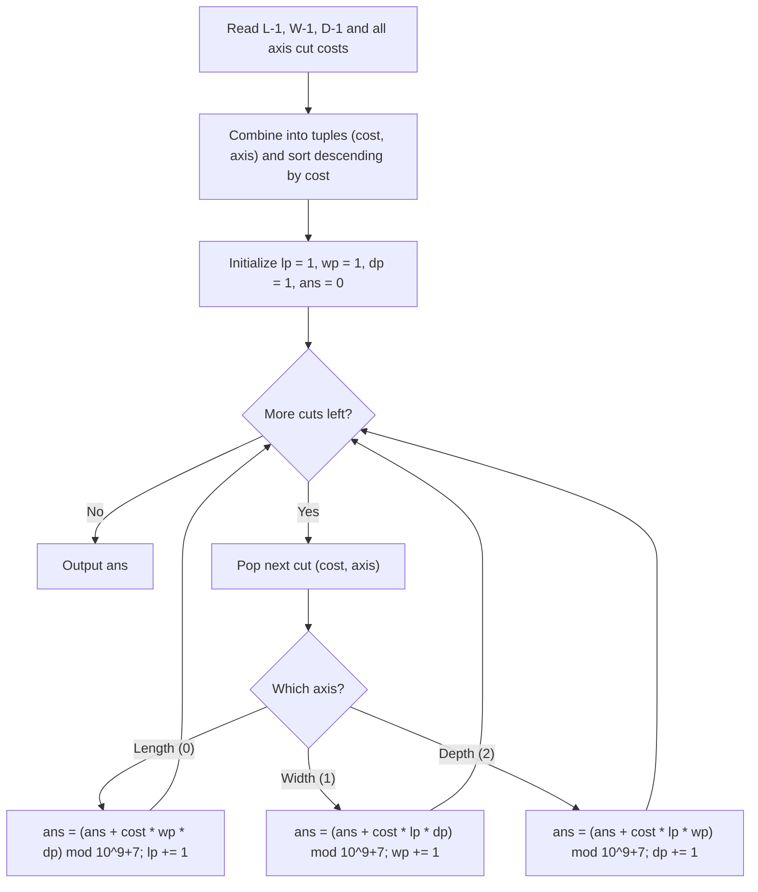

# Algo-Man and the Class of '25: Quatromania

> [!info] Document Metadata
> **Course:** `=this.course` | **Topic:** `=this.topic` | **Status:** `=this.status` | **Difficulty:** `=this.difficulty`

**Tags:** #[[Computer Science]] #[[CSALGCM]] #[[Algorithms and Complexity]] #[[HackerRank]] #[[Chariot Arcana]] #[[3D Greedy Cutting]]
---

## Problem Description

Algo-Man needs to slice an integer-dimension rectangular prism of size $L \times W \times D$ into $L \cdot W \cdot D$ unit cubes of size $1 \times 1 \times 1$ by making cuts along all designated integer grid planes:

- $L - 1$ cutting planes across the length, with instability factors $I_{1,i}$;
- $W - 1$ cutting planes across the width, with instability factors $I_{2,i}$;
- $D - 1$ cutting planes across the depth, with instability factors $I_{3,i}$.

When a cut is performed along one axis, it slices simultaneously through every cross-sectional piece currently created by prior cuts along the two orthogonal axes. Thus, if the prism has already been partitioned into `lp` length sections, `wp` width sections, and `dp` depth sections (initially `lp = wp = dp = 1`), cutting a length plane adds $I_{1,i} \cdot \text{wp} \cdot \text{dp}$ to total instability and increments `lp` by $1$ (and symmetrically for width and depth planes). Find the minimum total instability attainable, printed modulo $10^9 + 7$.

### Input Format
- The first line contains three space-separated integers $L - 1$, $W - 1$, and $D - 1$, giving the number of cutting planes along the length, width, and depth axes respectively.
- The next $L - 1$ lines each contain an integer $I_{1,i}$, the instability factor of the $i$-th length cutting plane.
- The next $W - 1$ lines each contain an integer $I_{2,i}$, the instability factor of the $i$-th width cutting plane.
- The next $D - 1$ lines each contain an integer $I_{3,i}$, the instability factor of the $i$-th depth cutting plane.

### Output Format
Output a single integer denoting the minimum achievable instability modulo $10^9 + 7$.

### Constraints
- $1 \le L, W, D \le 100001$
- $0 \le I_{1,i}, I_{2,i}, I_{3,i} \le 10^9$

### Sample Test Cases

**Sample Input 0**
```text
2 1 1
2
3
4
3
```

**Sample Output 0**
```text
30
```

**Sample Input 1**
```text
2 2 2
1
4
2
1
5
1
```

**Sample Output 1**
```text
40
```

**Sample Input 2**
```text
2 5 6
4
6
7
0
1
3
2
0
6
1
6
2
2
```

**Sample Output 2**
```text
214
```

---

## Approach & Intuition

- **Problem Abstraction:** Every complete decomposition into $1 \times 1 \times 1$ unit cubes must eventually execute all $(L - 1) + (W - 1) + (D - 1)$ cuts—only their **ordering** varies. Let `lp`, `wp`, and `dp` track the current piece count along each axis (`1` initially). A cut on axis $X$ with instability cost $c$ pays $c \times (\text{product of piece counts on the other two axes})$ and increases axis $X$'s piece count by $1$. Note that the Staging implementation reads $L - 1$, $W - 1$, and $D - 1$ directly into variables `l`, `w`, and `d`.
- **Naive / Brute-Force Approach:** Searching over permutations of up to $3 \cdot 10^5$ cuts or running 3D DP over `(cuts_l, cuts_w, cuts_d)` states takes $\Omega(L \cdot W \cdot D)$ time and memory, completely infeasible when $L, W, D \le 10^5 + 1$.
- **Optimal Strategy (Descending Cost Ordering & 3D Exchange Proof):** Pool all $(L - 1) + (W - 1) + (D - 1)$ cutting planes into one list of `(cost, axis)` pairs and sort them in **descending** order of `cost`. Greedily execute the most expensive remaining cut first, multiplying its `cost` by the product of the other two axes' current piece counts and accumulating the total modulo $10^9 + 7$.
  - *Exchange Argument:* Suppose an optimal cut sequence performs two adjacent cuts on different axes—first cut $A$ with cost $c_A$ on axis $A$, then cut $B$ with cost $c_B$ on axis $B$—when the three axes currently have $(p_A, p_B, p_C)$ sections. The combined cost of performing $A$ then $B$ is:
    $$c_A (p_B p_C) + c_B ((p_A + 1) p_C) = (c_A p_B + c_B p_A) p_C + c_B p_C$$
    Swapping them to perform $B$ then $A$ leaves the final piece counts $(p_A + 1, p_B + 1, p_C)$ identical (hence affecting no subsequent cuts) and yields combined cost:
    $$c_B (p_A p_C) + c_A ((p_B + 1) p_C) = (c_A p_B + c_B p_A) p_C + c_A p_C$$
    Subtracting gives $\text{Cost}(A, B) - \text{Cost}(B, A) = (c_B - c_A) p_C$. Because $p_C \ge 1$, ordering $c_A \ge c_B$ always achieves cost less than or equal to the reverse order, and parallel cuts on the same axis commute identically. Repeating adjacent swaps sorts any optimal sequence into non-increasing cost order without increasing total instability.
  - *Implementation Detail:* Sorting uses actual un-modded `cost` values (`0 <= cost <= 10^9`) and applies `% MOD` only when adding `cost * other_pieces` into `ans`. Python's arbitrary-precision integers avoid 64-bit overflow when `cost * wp * dp` reaches $10^9 \cdot 10^5 \cdot 10^5 = 10^{19}$. When any dimension equals $1$ (e.g., $L - 1 = 0$), zero cuts are read for that axis safely.

## Algorithm Walkthrough



## Step-by-Step Trace

Tracing **Sample Input 0** (`l = 2, w = 1, d = 1`, length costs `[2, 3]`, width costs `[4]`, depth costs `[3]`):

Sorted cuts descending: `[(4, 1), (3, 0), (3, 2), (2, 0)]` (where axis `0 = length`, `1 = width`, `2 = depth`).

| Step | Cut `(cost, axis)` | Multiplier (Other Two Pieces) | Added Instability | Updated `(lp, wp, dp)` | Running `ans` |
| :--- | :--- | :--- | :--- | :--- | :--- |
| 0 | Initial state | — | `0` | `(1, 1, 1)` | `0` |
| 1 | `(4, width)` | `lp * dp = 1 * 1 = 1` | `4 * 1 = 4` | `(1, 2, 1)` | `4` |
| 2 | `(3, length)` | `wp * dp = 2 * 1 = 2` | `3 * 2 = 6` | `(2, 2, 1)` | `10` |
| 3 | `(3, depth)` | `lp * wp = 2 * 2 = 4` | `3 * 4 = 12` | `(2, 2, 2)` | `22` |
| 4 | `(2, length)` | `wp * dp = 2 * 2 = 4` | `2 * 4 = 8` | `(3, 2, 2)` | `30` |

Output: `30`.

## Complexity Analysis

| Metric | Complexity | Rationale |
| :--- | :--- | :--- |
| **Time** | $O\bigl((L + W + D) \log(L + W + D)\bigr)$ | Sorting all $K = (L - 1) + (W - 1) + (D - 1)$ cutting planes dominates the single $O(K)$ linear sweep. |
| **Space** | $O(L + W + D)$ | Stores the axis cost lists and combined `cuts` tuple list of length $(L - 1) + (W - 1) + (D - 1)$. |

---

## Full Solution

```python
def solve(l, w, d, length_costs, width_costs, depth_costs):
    MOD = int(1e9 + 7)
    cuts = [(c, 0) for c in length_costs] + [(c, 1) for c in width_costs] + [(c, 2) for c in depth_costs]
    cuts.sort(key=lambda x: x[0], reverse=True)
    
    lp = wp = dp = 1
    ans = 0
    for cost, axis in cuts:
        if axis == 0:
            ans = (ans + cost * wp * dp) % MOD
            lp += 1
        elif axis == 1:
            ans = (ans + cost * lp * dp) % MOD
            wp += 1
        else:
            ans = (ans + cost * lp * wp) % MOD
            dp += 1
    return ans

l, w, d = list(map(int, input().split(" ")))
length_costs = [int(input()) for i in range(l)]
width_costs = [int(input()) for i in range(w)]
depth_costs = [int(input()) for i in range(d)]

print(solve(l, w, d, length_costs, width_costs, depth_costs))
```

## References & Navigation

- **Previous Problem:** [[06 - Optimizing Chicken Jay]]
- **Parent Set:** [[[PS] Chariot Arcana|Chariot Arcana Index]]
- **Related Notes:** [[Greedy Algorithms Introduction]]
