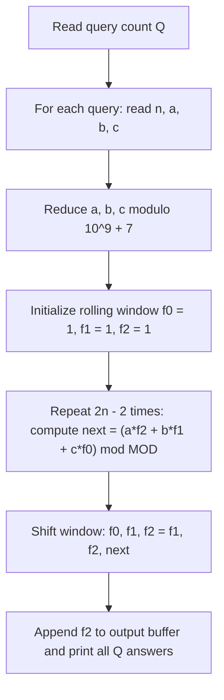

# You're Like an Electron - You're So Negative

> [!info] Document Metadata
> **Course:** `=this.course` | **Topic:** `=this.topic` | **Status:** `=this.status` | **Difficulty:** `=this.difficulty`

**Tags:** #[[Computer Science]] #[[CSALGCM]] #[[Algorithms and Complexity]] #[[HackerRank]] #[[Hermit Arcana]] #[[Linear Recurrence]]
---

## Problem Description

Consider the third-order linear recurrence parameterized by constants $a, b, c$ and an initial target index $n_0$ (denoting the given value of $n$):

$$F(n) = a \cdot F(n-1) + b \cdot F(n-2) + c \cdot F(n-3)$$

with query-dependent negative-index base cases:

$$F(-n_0 + 2) = 1, \qquad F(-n_0 + 1) = 1, \qquad F(-n_0) = 1$$

Given $Q$ independent queries, each specifying $n$, $a$, $b$, and $c$, compute $F(n) \bmod (10^9 + 7)$.

### Input Format
- The first line contains a single integer $Q$, indicating the number of queries.
- $Q$ lines follow, each containing four space-separated integers $n$, $a$, $b$, and $c$.

### Output Format
Output consists of $Q$ lines, the $i$-th of which contains the value of $F(n) \bmod (10^9 + 7)$ for the $n$, $a$, $b$, and $c$ given in the $i$-th query.

### Constraints
- $1 \le Q \le 3 \cdot 10^3$
- $2 \le n \le 3 \cdot 10^3$
- $1 \le a, b, c \le 10^9$

### Sample Test Cases

**Sample Input 0**
```text
1
2 1 2 3
```

**Sample Output 0**
```text
11
```

*Explanation 0:* With $n_0 = 2$ and $(a, b, c) = (1, 2, 3)$, the base cases are $F(-2) = F(-1) = F(0) = 1$. Advancing forward gives $F(1) = 1(1) + 2(1) + 3(1) = 6$ and $F(2) = 1(6) + 2(1) + 3(1) = 11$.

**Sample Input 1**
```text
2
2 2 3 4
3 3 4 1
```

**Sample Output 1**
```text
25
484
```

**Sample Input 2**
```text
2
6 1 1 1
5 2 1 2
```

**Sample Output 2**
```text
653
4449
```

---

## Approach & Intuition

- **Problem Abstraction:** Because the base cases sit at $-n_0, -n_0 + 1, -n_0 + 2$, shifting all indices by $+n_0$ via $G(k) = F(k - n_0)$ converts the recurrence into a standard zero-indexed sequence:
  $$G(0) = G(1) = G(2) = 1, \qquad G(k) = \bigl(a \cdot G(k-1) + b \cdot G(k-2) + c \cdot G(k-3)\bigr) \bmod (10^9 + 7)$$
  The desired answer $F(n)$ equals $G(2n)$.
- **Naive / Brute-Force Approach:** Direct top-down recursion without memoization branches into three recursive calls per state, taking $\Theta(3^{2n})$ time and timing out immediately even for small $n \approx 30$. A full bottom-up DP array of size $2n + 1$ works in $O(n)$ time per query, though it allocates unnecessary memory per query.
- **Optimal Strategy (Rolling-Variable Bottom-Up DP):** Each state $G(k)$ depends strictly on its three immediate predecessors $G(k-1)$, $G(k-2)$, and $G(k-3)$. Maintaining three rolling variables $(f_0, f_1, f_2)$ initialized to $(1, 1, 1)$ and advancing $2n - 2$ iterations computes $G(2n) = F(n)$ in $O(n)$ time and $O(1)$ space per query. Reducing $a, b, c$ modulo $10^9 + 7$ up front and taking modulo after every recurrence step keeps all intermediate integers bounded.

## Algorithm Walkthrough



## Step-by-Step Trace

Tracing **Sample Input 0** ($n = 2$, $a = 1$, $b = 2$, $c = 3$, shifted length $2n - 2 = 2$ steps):

| Step | Shifted Index $k$ | Original Index $k - n_0$ | Window $(f_0, f_1, f_2)$ Before | Recurrence Computation | Updated $f_2$ |
| :--- | :--- | :--- | :--- | :--- | :--- |
| Init | $2$ | $0$ | $(1, 1, 1)$ | Base cases $F(-2) = F(-1) = F(0) = 1$ | $1$ |
| 1 | $3$ | $1$ | $(1, 1, 1)$ | $1 \cdot 1 + 2 \cdot 1 + 3 \cdot 1 = 6$ | $6$ |
| 2 | $4$ | $2$ | $(1, 1, 6)$ | $1 \cdot 6 + 2 \cdot 1 + 3 \cdot 1 = 11$ | $11$ |

Final output for the query: `11`.

## Complexity Analysis

| Metric | Complexity | Rationale |
| :--- | :--- | :--- |
| **Time** | $O(Q \cdot n)$ | Each of the $Q$ queries executes $2n - 2$ constant-time arithmetic transitions, totaling at most $\approx 1.8 \cdot 10^7$ iterations when $Q, n = 3 \cdot 10^3$. |
| **Space** | $O(Q)$ | The rolling recurrence uses $O(1)$ auxiliary variables per query, and `outs` stores $Q$ output strings for batched printing. |

---

## Full Solution

```python
import sys

def solve(n, a, b, c):
    MOD = 1000000007
    if n <= 1:
        return 1
    a %= MOD
    b %= MOD
    c %= MOD
    f0, f1, f2 = 1, 1, 1
    for _ in range(2 * n - 2):
        f0, f1, f2 = f1, f2, (a * f2 + b * f1 + c * f0) % MOD
    return f2

def main():
    input = sys.stdin.readline
    q = int(input())
    outs = []
    for _ in range(q):
        n, a, b, c = map(int, input().split())
        outs.append(str(solve(n, a, b, c)))
    print("\n".join(outs))

if __name__ == "__main__":
    main()
```

## References & Navigation

- **Next Problem:** [[02 - Welcome to Algo Burger]]
- **Parent Set:** [[[PS] Hermit Arcana|Hermit Arcana Index]]
- **Related Notes:** [[Greedy Algorithms Introduction]], [[Dynamic Programming Introduction]]
