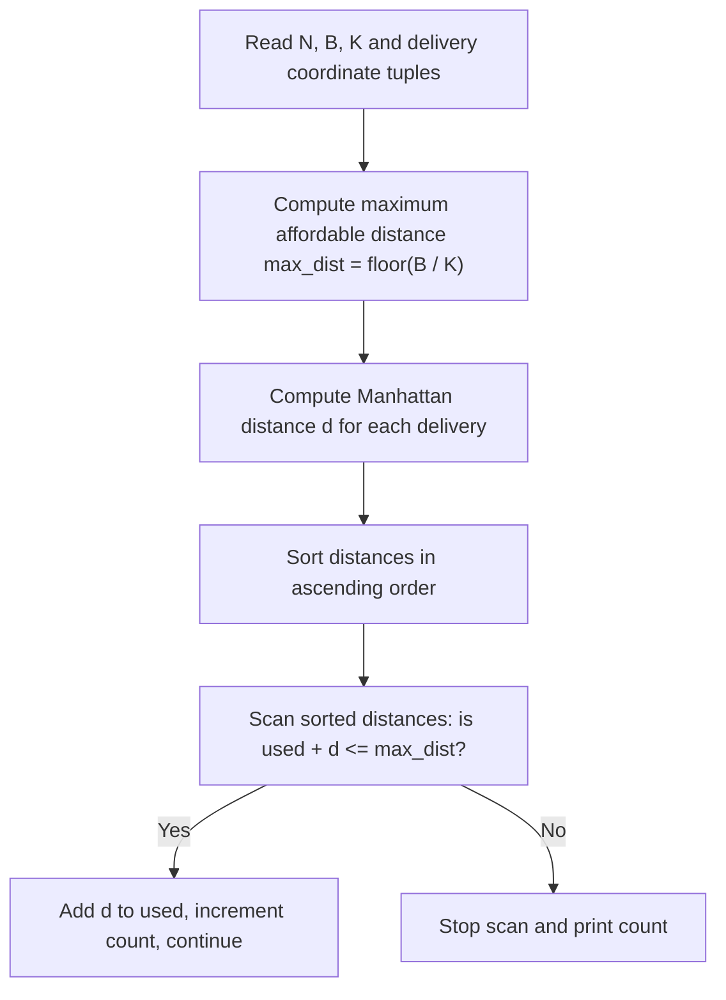

# Welcome to Algo Burger, Home of the Algo Burger, May I Take Your Order?

> [!info] Document Metadata
> **Course:** `=this.course` | **Topic:** `=this.topic` | **Status:** `=this.status` | **Difficulty:** `=this.difficulty`

**Tags:** #[[Computer Science]] #[[CSALGCM]] #[[Algorithms and Complexity]] #[[HackerRank]] #[[Hermit Arcana]] #[[Greedy Sorting]]
---

## Problem Description

As the delivery logistics officer of Algo Burger, you have $N$ pending deliveries. Each delivery $i$ specifies a branch coordinate $(x_b, y_b)$ and a customer coordinate $(x_c, y_c)$. The Manhattan distance of a delivery is:

$$d = |x_b - x_c| + |y_b - y_c|$$

Each unit of distance costs $K$ pesos to complete. Given the total delivery budget $B$, find the maximum number of deliveries you can complete without the total cost exceeding $B$.

### Input Format
- The first line contains three space-separated integers $N$, $B$, and $K$, indicating the number of deliveries, the total budget, and the cost per distance unit.
- $N$ lines follow, each containing four space-separated integers $x_b$, $y_b$, $x_c$, and $y_c$.

### Output Format
Output a single line containing the maximum number of deliveries that can be completed.

### Constraints
- $1 \le N \le 2 \cdot 10^5$
- $0 \le |x_b|, |y_b|, |x_c|, |y_c| \le 10^9$
- $1 \le B, K \le 10^9$

### Sample Test Cases

**Sample Input 0**
```text
3 100 2
4 -9 0 4
0 -4 8 0
-10 -3 6 -4
```

**Sample Output 0**
```text
3
```

*Explanation 0:* The three deliveries have distances $17$, $12$, and $17$ (total distance $46$, total cost $46 \cdot 2 = 92 \le 100$), so all $3$ deliveries can be completed.

**Sample Input 1**
```text
5 260 11
-10 -21 7 -18
-5 1 -16 18
10 -12 24 12
-25 -17 -15 -12
-8 -13 -13 14
```

**Sample Output 1**
```text
1
```

*Explanation 1:* Delivery 4 has cost $11 \cdot (|-25 - (-15)| + |-17 - (-12)|) = 11 \cdot 15 = 165 \le 260$, whereas the next cheapest delivery costs $220$. No pair of deliveries costs at most $260$, so the maximum is $1$.

---

## Approach & Intuition

- **Problem Abstraction:** Since every delivery incurs a cost of $K \cdot d_i$ and contributes an identical reward of $+1$ to the completed count, maximizing the count subject to $\sum_{i \in S} K \cdot d_i \le B$ is equivalent to finding the largest subset $S \subseteq \{1, \dots, N\}$ satisfying:
  $$\sum_{i \in S} d_i \le \left\lfloor \frac{B}{K} \right\rfloor$$
- **Naive / Brute-Force Approach:** Testing all $2^N$ subsets is exponential, and a $0/1$ knapsack DP over capacity $B$ requires $O(N \cdot B)$ time, which is impossible for $N \le 2 \cdot 10^5$ and $B \le 10^9$.
- **Optimal Strategy (Greedy Exchange Proof):** Compute $d_i = |x_{b,i} - x_{c,i}| + |y_{b,i} - y_{c,i}|$ for each delivery, sort distances in non-decreasing order $d_{(1)} \le d_{(2)} \le \dots \le d_{(N)}$, and greedily add deliveries until the next delivery exceeds `max_dist = B // K`.
  - *Exchange Argument:* Suppose an optimal feasible set $OPT$ skips some smaller-distance delivery $d_{(j)}$ in favor of a larger-distance delivery $d_{(m)}$ ($d_{(j)} \le d_{(m)}$). Swapping $d_{(m)}$ out for $d_{(j)}$ maintains $|OPT|$ while changing total distance by $d_{(j)} - d_{(m)} \le 0$, keeping the selection feasible. Thus, a prefix of the sorted distances always achieves the maximum cardinality.

## Algorithm Walkthrough



## Step-by-Step Trace

Tracing **Sample Input 1** ($N = 5$, $B = 260$, $K = 11$, so $\text{max\_dist} = \lfloor 260 / 11 \rfloor = 23$):

| Step | Delivery Coordinates | Manhattan Distance $d$ | Sorted Rank | Cumulative Distance (`used`) | Comparison vs `max_dist = 23` | Action |
| :--- | :--- | :--- | :--- | :--- | :--- | :--- |
| 1 | `(-25, -17)` to `(-15, -12)` | $\vert -25 + 15\vert + \vert -17 + 12\vert = 15$ | 1st (`15`) | $0 + 15 = 15$ | $15 \le 23$ | Accept (`count = 1`) |
| 2 | `(-10, -21)` to `(7, -18)` | $\vert -10 - 7\vert + \vert -21 + 18\vert = 20$ | 2nd (`20`) | $15 + 20 = 35$ | $35 > 23$ | Break and return `1` |
| - | `(-5, 1)` to `(-16, 18)` | $11 + 17 = 28$ | 3rd (`28`) | - | Not reached | Terminated early |
| - | `(-8, -13)` to `(-13, 14)` | $5 + 27 = 32$ | 4th (`32`) | - | Not reached | Terminated early |
| - | `(10, -12)` to `(24, 12)` | $14 + 24 = 38$ | 5th (`38`) | - | Not reached | Terminated early |

## Complexity Analysis

| Metric | Complexity | Rationale |
| :--- | :--- | :--- |
| **Time** | $O(N \log N)$ | Computing $N$ Manhattan distances takes $O(N)$, sorting them takes $O(N \log N)$, and the greedy prefix scan takes $O(N)$. |
| **Space** | $O(N)$ | Stores the $N$ input tuples and the distance list `dists` of length $N$. |

---

## Full Solution

```python
import sys

def solve(n, b, k, delivs):
    max_dist = b // k
    dists = [abs(xb - xc) + abs(yb - yc) for xb, yb, xc, yc in delivs]
    dists.sort()
    used = 0
    count = 0
    for d in dists:
        if used + d <= max_dist:
            used += d
            count += 1
        else:
            break
    return count

def main():
    input = sys.stdin.readline
    n, b, k = map(int, input().split())
    delivs = [list(map(int, input().split())) for _ in range(n)]
    print("{}".format(solve(n, b, k, delivs)))

if __name__ == "__main__":
    main()
```

## References & Navigation

- **Previous Problem:** [[01 - Youre Like an Electron - Youre So Negative]]
- **Next Problem:** [[03 - Its a Matter of Fusion]]
- **Parent Set:** [[[PS] Hermit Arcana|Hermit Arcana Index]]
- **Related Notes:** [[Greedy Algorithms Introduction]], [[Dynamic Programming Introduction]]
