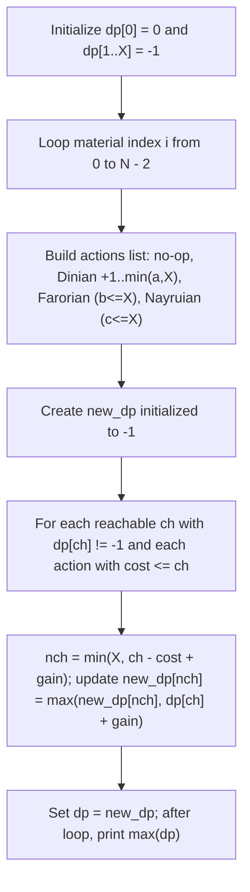

# It's a Matter of Fusion

> [!info] Document Metadata
> **Course:** `=this.course` | **Topic:** `=this.topic` | **Status:** `=this.status` | **Difficulty:** `=this.difficulty`

**Tags:** #[[Computer Science]] #[[CSALGCM]] #[[Algorithms and Complexity]] #[[HackerRank]] #[[Hermit Arcana]] #[[State-Space DP]]
---

## Problem Description

You are given a sequence of $N$ chemical materials with positive integer reaction values $V_1, V_2, \dots, V_N$, starting with $0$ charges. On each material $i$, you may induce at most one reaction (or none):

- **Dinian Reaction:** Adds $k \in \{1, \dots, a\}$ to the reaction value $V_i$, costing $k$ charges.
- **Farorian Reaction:** Doubles the reaction value ($V_i' = 2 V_i$), costing $b$ charges.
- **Nayruian Reaction:** Squares the reaction value ($V_i' = V_i^2$), costing $c$ charges.

Since you begin with $0$ charges and every reaction costs at least $1$ charge, no reaction can be induced on the first material. When transitioning from material $i$ (with modified value $V_i'$) to material $i + 1$ (with unmodified value $V_{i+1}$), you gain $|V_i' - V_{i+1}|$ charges—capped so total charges never exceed $X$—and release $|V_i' - V_{i+1}|$ units of **residual reaction energy**.

Determine the maximum total residual reaction energy that can be released across all $N$ materials.

### Input Format
- The first line contains five space-separated integers $N$, $X$, $a$, $b$, and $c$.
- $N$ lines follow, the $i$-th line containing the integer $V_i$.

### Output Format
Output a single line containing one integer: the maximum total residual reaction energy that can be released.

### Constraints
- $1 \le N, X, a, b, c, V_i \le 186$ for all $1 \le i \le N$

### Sample Test Cases

**Sample Input 0**
```text
3 5 2 1 3
4
3
2
```

**Sample Output 0**
```text
5
```

*Explanation 0:* Do nothing at index $1$ ($V_1 = 4 \to V_2 = 3$), releasing $1$ residual energy and gaining $1$ charge. At index $2$, spend $b = 1$ charge to double $V_2 = 3 \to 6$; moving to index $3$ ($V_3 = 2$) releases $|6 - 2| = 4$ residual energy. Total energy is $1 + 4 = 5$.

**Sample Input 1**
```text
4 5 2 5 2
3
3
1
5
```

**Sample Output 1**
```text
6
```

*Explanation 1:* Doing nothing at indices $1, 2, 3$ yields $|3 - 3| + |3 - 1| + |1 - 5| = 0 + 2 + 4 = 6$ residual energy, which cannot be improved by any affordable reaction.

---

## Approach & Intuition

- **Problem Abstraction:** At step $i \in \{0, \dots, N-2\}$ (transitioning from material $i$ to $i+1$), the reaction chosen on material $i$ determines a pair $(\text{cost}, \text{gain})$, where $\text{gain} = |V_i' - V_{i+1}|$ both increases the uncapped cumulative residual energy and updates the available charges via $ch' = \min(X, ch - \text{cost} + \text{gain})$. Because future feasibility depends solely on the current material index $i$ and the current charge count $ch \in [0, X]$, the problem exhibits optimal substructure over state $(i, ch)$. Note that modifying material $N$ yields no further transition, so only indices $0 \dots N-2$ affect the total energy.
- **Naive / Brute-Force Approach:** Branching across up to $a + 3$ reactions per material explores $\Omega((a+3)^{N-1})$ action sequences, which explodes exponentially when $N, a \le 186$. A greedy choice that maximizes immediate gain $|V_i' - V_{i+1}|$ can also fail by burning charges needed for a higher-payoff Farorian or Nayruian reaction at a later step.
- **Optimal Strategy (1D Rolling DP over Charges):** Let $dp[ch]$ represent the maximum residual reaction energy accumulated upon reaching the current material with $ch$ charges ($-1$ if unreachable), initialized to $dp[0] = 0$ and $dp[1 \dots X] = -1$. At each step $i \in [0, N-2]$, precompute all valid $(\text{cost}, \text{gain})$ pairs with $\text{cost} \le X$ (no-op, Dinian $+1 \dots +\min(a, X)$, Farorian if $b \le X$, Nayruian if $c \le X$). For every reachable `ch` and affordable action (`cost <= ch`), update:
  $$new\_dp\bigl[\min(X, ch - \text{cost} + \text{gain})\bigr] = \max\Bigl(new\_dp\bigl[\min(X, ch - \text{cost} + \text{gain})\bigr],\; dp[ch] + \text{gain}\Bigr)$$
  After $N - 1$ steps, the answer is $\max_{0 \le ch \le X} dp[ch]$.

## Algorithm Walkthrough



## Step-by-Step Trace

Tracing **Sample Input 0** ($N = 3$, $X = 5$, $a = 2$, $b = 1$, $c = 3$, $V = [4, 3, 2]$):

1. **Initialization:** `dp = [0, -1, -1, -1, -1, -1]`.
2. **Step $i = 0$ ($V_1 = 4 \to V_2 = 3$):**
   - Candidate actions: `none (0, 1)`, `+1 (1, 2)`, `+2 (2, 3)`, `x2 (1, 5)`, `sq (3, 13)`.
   - Only `ch = 0` is reachable (`dp[0] = 0`), so only `none (0, 1)` satisfies `cost <= 0`.
   - Next state: `nch = min(5, 0 - 0 + 1) = 1`, `new_dp[1] = 0 + 1 = 1`.
   - `dp` becomes `[-1, 1, -1, -1, -1, -1]`.
3. **Step $i = 1$ ($V_2 = 3 \to V_3 = 2$):**
   - Candidate actions: `none (0, 1)`, `+1 (1, 2)`, `+2 (2, 3)`, `x2 (1, 4)`, `sq (3, 7)`.
   - Only `ch = 1` is reachable (`dp[1] = 1`). Affordable transitions (`cost <= 1`):

| Action | `(cost, gain)` | New Charges `min(5, 1 - cost + gain)` | Candidate Energy | Updated `new_dp[nch]` |
| :--- | :--- | :--- | :--- | :--- |
| No-op | `(0, 1)` | `min(5, 1 - 0 + 1) = 2` | $1 + 1 = 2$ | `new_dp[2] = 2` |
| Dinian (`+1`) | `(1, 2)` | `min(5, 1 - 1 + 2) = 2` | $1 + 2 = 3$ | `new_dp[2] = 3` |
| Farorian (`x2`) | `(1, 4)` | `min(5, 1 - 1 + 4) = 4` | $1 + 4 = 5$ | `new_dp[4] = 5` |

   - `dp` becomes `[-1, -1, 3, -1, 5, -1]`. Maximum value: `5`.

## Complexity Analysis

| Metric | Complexity | Rationale |
| :--- | :--- | :--- |
| **Time** | $O\bigl(N \cdot X \cdot \min(a, X)\bigr)$ | Each of the $N - 1$ steps iterates over $X + 1$ charge levels and at most $\min(a, X) + 3$ valid actions. Under $N, X, a \le 186$, this executes at most $\approx 6.5 \cdot 10^6$ inner transitions. |
| **Space** | $O(X)$ | Rolling 1D arrays `dp` and `new_dp` store $X + 1$ integers, plus at most $\min(a, X) + 3$ tuples in `actions`. |

---

## Full Solution

```python
import sys

def solve(n, x, a, b, c, vals):
    dp = [-1] * (x + 1)
    dp[0] = 0

    for i in range(n - 1):
        v = vals[i]
        nxt_v = vals[i + 1]

        # Precompute (charge_cost, energy_gain) for all valid reactions on material i
        actions = [(0, abs(v - nxt_v))]
        max_k = a if a <= x else x
        for k in range(1, max_k + 1):
            actions.append((k, abs((v + k) - nxt_v)))
        if b <= x:
            actions.append((b, abs((v * 2) - nxt_v)))
        if c <= x:
            actions.append((c, abs((v * v) - nxt_v)))

        new_dp = [-1] * (x + 1)
        for ch in range(x + 1):
            cur = dp[ch]
            if cur == -1:
                continue
            for cost, gain in actions:
                if cost <= ch:
                    nch = ch - cost + gain
                    if nch > x:
                        nch = x
                    cand = cur + gain
                    if cand > new_dp[nch]:
                        new_dp[nch] = cand
        dp = new_dp

    return max(dp)

def main():
    input = sys.stdin.readline
    n, x, a, b, c = map(int, input().split())
    vals = [int(input()) for _ in range(n)]
    print("{}".format(solve(n, x, a, b, c, vals)))

if __name__ == "__main__":
    main()
```

## References & Navigation

- **Previous Problem:** [[02 - Welcome to Algo Burger]]
- **Next Problem:** [[04 - These Ghosts Are So Annoying]]
- **Parent Set:** [[[PS] Hermit Arcana|Hermit Arcana Index]]
- **Related Notes:** [[Greedy Algorithms Introduction]], [[Dynamic Programming Introduction]]
