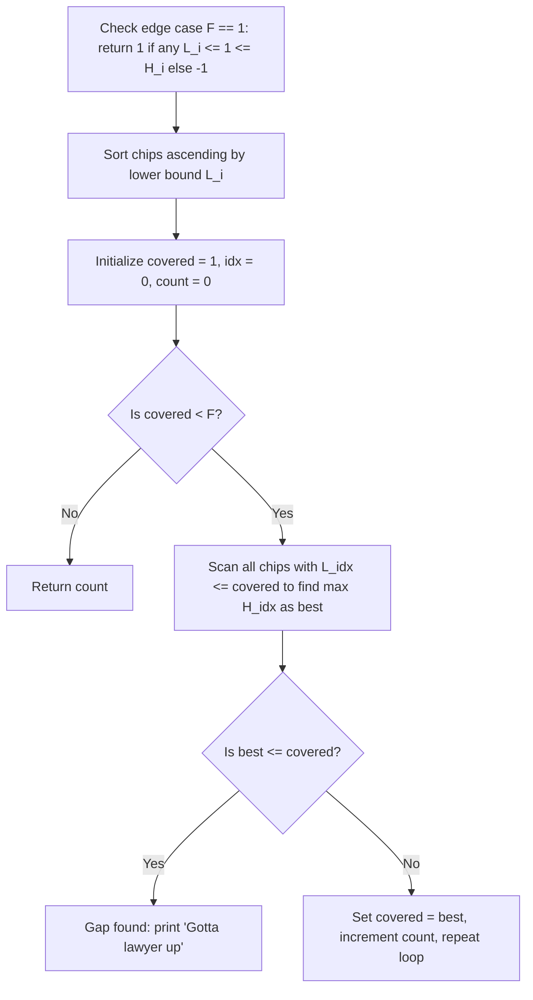

# These Ghosts Are So Annoying

> [!info] Document Metadata
> **Course:** `=this.course` | **Topic:** `=this.topic` | **Status:** `=this.status` | **Difficulty:** `=this.difficulty`

**Tags:** #[[Computer Science]] #[[CSALGCM]] #[[Algorithms and Complexity]] #[[HackerRank]] #[[Hermit Arcana]] #[[Interval Covering]]
---

## Problem Description

You are configuring a supernatural phenomena detection system that must monitor the entire spectral frequency range from $1$ to $F$ without leaving any uncovered gaps. There are $N$ spectral detector chips available; the $i$-th chip covers all frequencies in the closed interval $[L_i, H_i]$. Because installing extra chips increases system failure probability, determine the minimum number of chips needed to cover the full interval $[1, F]$, or report that complete coverage is impossible.

### Input Format
- The first line contains two space-separated integers $N$ and $F$, indicating the number of chips and the maximum spectral frequency to cover.
- $N$ lines follow, each containing two space-separated integers $L_i$ and $H_i$ indicating the lower bound and upper bound of the $i$-th chip's detection range.

### Output Format
Output a single line containing the minimum number of chips needed to cover the entire spectrum from $1$ to $F$. If it is impossible to cover the entire spectrum, print `"Gotta lawyer up"` (without quotes).

### Constraints
- $1 \le N \le 2 \cdot 10^5$
- $1 \le F \le 10^9$
- $1 \le L_i < H_i \le 10^9$ for all $1 \le i \le N$

### Sample Test Cases

**Sample Input 0**
```text
3 10
2 9
1 6
8 10
```

**Sample Output 0**
```text
3
```

*Explanation 0:* All three chips—$[1, 6]$, $[2, 9]$, and $[8, 10]$—are required to cover $[1, 10]$ continuously without leaving any gap between $6$ and $8$.

**Sample Input 1**
```text
4 18
7 16
11 11
8 16
7 12
```

**Sample Output 1**
```text
Gotta lawyer up
```

*Explanation 1:* Frequencies in $[1, 6]$ and $[17, 18]$ are uncovered by every available chip, making full coverage impossible.

---

## Approach & Intuition

- **Problem Abstraction:** This is the classic **Minimum Interval Covering** problem over the continuous range $[1, F]$: choose a minimum-cardinality subset of intervals $\{[L_i, H_i]\}$ whose union contains $[1, F]$.
  - If $F = 1$, a single chip suffices whenever some chip satisfies $L_i \le 1 \le H_i$.
  - For $F > 1$, once a prefix $[1, \text{covered}]$ is covered ($\text{covered} = 1$ initially), any next chip must satisfy $L_i \le \text{covered}$ so that no gap $(\text{covered}, L_i)$ remains uncovered.
- **Naive / Brute-Force Approach:** Checking all $2^N$ chip subsets takes exponential time, and coordinate-compressing endpoints for DP requires $O(N^2)$ transitions in the worst case—too slow for $N \le 2 \cdot 10^5$.
- **Optimal Strategy (Greedy Furthest-Reach Scan):** Sort all chips in ascending order of $L_i$. Maintain `covered = 1` and a pointer `idx = 0`. While `covered < F`:
  1. Advance `idx` over all chips with $L_{\text{idx}} \le \text{covered}$, tracking `best = max(best, H_idx)`.
  2. If `best <= covered`, no available chip extends the covered prefix strictly past `covered`, so return `-1` (`"Gotta lawyer up"`).
  3. Otherwise set `covered = best` and increment `count`.
  - *Exchange Argument:* Among all valid intervals with $L_i \le \text{covered}$ that can bridge the point `covered`, selecting the one with maximum $H_i$ strictly dominates every other choice, because any interval chosen later that connects to a shorter $H_j \le H_i$ also connects to $H_i$.

## Algorithm Walkthrough



## Step-by-Step Trace

Tracing **Sample Input 0** ($N = 3$, $F = 10$):

Sorted chips by $L_i$: `[(1, 6), (2, 9), (8, 10)]`. Initialize `covered = 1`, `idx = 0`, `count = 0`.

| Iteration | `covered` Before | Eligible Chips ($L_i \le \text{covered}$) | `best` Found | `covered` After | `count` |
| :--- | :--- | :--- | :--- | :--- | :--- |
| 1 | $1$ | `(1, 6)` ($1 \le 1$) | $6$ | $6$ | $1$ |
| 2 | $6$ | `(2, 9)` ($2 \le 6$) | $9$ | $9$ | $2$ |
| 3 | $9$ | `(8, 10)` ($8 \le 9$) | $10$ | $10$ | $3$ |

Since `covered = 10 >= F = 10`, the loop terminates and prints `3`.

## Complexity Analysis

| Metric | Complexity | Rationale |
| :--- | :--- | :--- |
| **Time** | $O(N \log N)$ | Sorting $N$ chip intervals takes $O(N \log N)$, and the two-pointer `idx` scan examines each chip at most once in $O(N)$ total time. |
| **Space** | $O(N)$ | Stores the $N$ interval tuples in `chips` (and Timsort's $O(N)$ worst-case scratch buffer). |

---

## Full Solution

```python
import sys

def solve(n, f, chips):
    if f == 1:
        return 1 if any(l <= 1 <= h for l, h in chips) else -1

    chips.sort()
    covered = 1
    idx = 0
    count = 0

    while covered < f:
        best = covered
        while idx < n and chips[idx][0] <= covered:
            if chips[idx][1] > best:
                best = chips[idx][1]
            idx += 1
        if best <= covered:
            return -1
        covered = best
        count += 1

    return count

def main():
    data = sys.stdin.read().split()
    n = int(data[0])
    f = int(data[1])
    chips = [(int(data[i]), int(data[i + 1])) for i in range(2, 2 + 2 * n, 2)]

    ans = solve(n, f, chips)
    if ans == -1:
        print("Gotta lawyer up")
    else:
        print(ans)

if __name__ == "__main__":
    main()
```

## References & Navigation

- **Previous Problem:** [[03 - Its a Matter of Fusion]]
- **Next Problem:** [[05 - We Got a 4-D Dynamic Programming Problem in CSALGCM Before GTA VII]]
- **Parent Set:** [[[PS] Hermit Arcana|Hermit Arcana Index]]
- **Related Notes:** [[Greedy Algorithms Introduction]], [[Dynamic Programming Introduction]]
