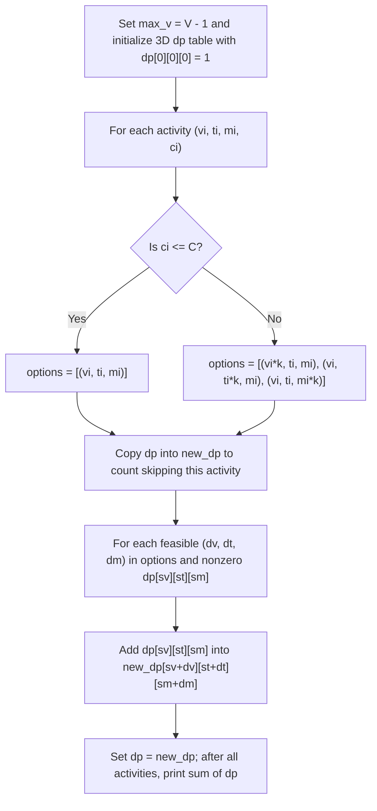

# We Got a 4-D Dynamic Programming Problem in CSALGCM Before GTA VII

> [!info] Document Metadata
> **Course:** `=this.course` | **Topic:** `=this.topic` | **Status:** `=this.status` | **Difficulty:** `=this.difficulty`

**Tags:** #[[Computer Science]] #[[CSALGCM]] #[[Algorithms and Complexity]] #[[HackerRank]] #[[Hermit Arcana]] #[[Multidimensional DP]]
---

## Problem Description

Before the inevitability of death, Alison Gomez-Copado wants to check off items from a bucket list of $N$ distinct activities (none of which can be repeated). Starting with initial vitality $V$, initial time $T$, initial money $M$, coolness $C$, and multiplier $k$, each activity $i$ specifies four costs $(V_i, T_i, M_i, C_i)$:

- Completing activity $i$ reduces vitality by its vitality cost, time by its time cost, and money by its money cost.
- Remaining vitality must stay **strictly greater than $0$** ($V - \Delta V > 0$), while remaining time and money must stay **at least $0$** ($T - \Delta T \ge 0$ and $M - \Delta M \ge 0$).
- If $C_i \le C$, all three costs $(V_i, T_i, M_i)$ apply at face value.
- If $C_i > C$, Alison must choose **exactly one** of $(V_i, T_i, M_i)$ to multiply by $k$—yielding three distinct choices: $(k \cdot V_i, T_i, M_i)$, $(V_i, k \cdot T_i, M_i)$, or $(V_i, T_i, k \cdot M_i)$.

Count the total number of valid ways Alison can choose activities (including which cost receives the multiplier whenever $C_i > C$) without violating the resource bounds.

### Input Format
- The first line contains six space-separated integers $N$, $V$, $T$, $M$, $C$, and $k$ (note: the PDF prose mentions "five space-separated integers" before listing all six parameters $N, V, T, M, C, k$).
- $N$ lines follow, each containing four space-separated integers $V_i$, $T_i$, $M_i$, and $C_i$.

### Output Format
Output consists of a single line containing an integer representing the total number of valid ways Alison can choose activities (note: the original PDF output section mistakenly says "maximum number of activities", whereas the prompt question *"how many ways"* and Sample Output 1 confirm the required value is the total count of valid choices).

### Constraints
- $1 \le N, V, T, M \le 40$
- $0 \le C, V_i, T_i, M_i, C_i \le 40$ for all $1 \le i \le N$
- $1 \le k \le 10$

### Sample Test Cases

**Sample Input 0**
```text
3 1 3 3 3 1
1 0 2 3
1 1 1 2
2 0 1 2
```

**Sample Output 0**
```text
1
```

*Explanation 0:* Initial vitality is $V = 1$, so maximum allowed vitality spent is $V - 1 = 0$. Every activity costs $V_i \ge 1$, leaving only $1$ valid way: choosing no activities.

**Sample Input 1**
```text
3 3 3 2 1 1
0 3 0 1
2 0 3 1
0 0 2 2
```

**Sample Output 1**
```text
8
```

*Explanation 1:* Activity 1 `(0, 3, 0, 1)` can be either skipped or taken ($2$ options). Activity 2 `(2, 0, 3, 1)` cannot be taken since $M_2 = 3 > M = 2$. Activity 3 `(0, 0, 2, 2)` has $C_3 = 2 > C = 1$, giving $1$ skip option plus $3$ distinct multiplier choices (apply $k=1$ to $V_3$, $T_3$, or $M_3$), for $2 \times (1 + 3) = 8$ total ways. *(Note: the PDF's Explanation 1 refers to these feasible items using shifted 1-based labels.)*

---

## Approach & Intuition

- **Problem Abstraction:** This is a **0/1 Multidimensional Knapsack Counting** problem with three constrained capacities: spendable vitality $\text{max\_v} = V - 1$, time $T$, and money $M$. Each item $i$ offers either $1$ take option (when $C_i \le C$) or $3$ mutually exclusive take options (when $C_i > C$), in addition to skipping item $i$.
- **Naive / Brute-Force Approach:** Enumerating all combinations recursively explores up to $4^N$ branches (skip or 3 multiplier assignments per item), which is intractable for $N = 40$. A non-rolling 4D table `dp[i][dv][dt][dm]` works in time, though allocating $N + 1$ copies of a $40^3$ table consumes excessive memory.
- **Optimal Strategy (Rolling 3D Counting DP):** Store `dp[dv][dt][dm]` equal to the number of ways to spend $(dv, dt, dm)$ across the prefix of activities seen so far, starting with `dp[0][0][0] = 1`. For each activity:
  1. Construct `options` as `[(vi, ti, mi)]` if $C_i \le C$, or `[(vi * k, ti, mi), (vi, ti * k, mi), (vi, ti, mi * k)]` if $C_i > C$.
  2. Copy `dp` into `new_dp` (representing skipping the activity).
  3. For each option $(dv, dt, dm)$ fitting within $(\text{max\_v}, T, M)$ and each reachable source state $(sv, st, sm)$ with nonzero count, add `dp[sv][st][sm]` to `new_dp[sv + dv][st + dt][sm + dm]`.
  4. Replace `dp = new_dp`, and finally sum all entries in `dp`.

## Algorithm Walkthrough



## Step-by-Step Trace

Tracing **Sample Input 1** ($N = 3, V = 3 \implies \text{max\_v} = 2, T = 3, M = 2, C = 1, k = 1$):

Initial state: `dp[(0, 0, 0)] = 1`.

| Step | Activity `(Vi, Ti, Mi, Ci)` | Generated `options` | Reachable `(dv, dt, dm): ways` After Step | Total Ways |
| :--- | :--- | :--- | :--- | :--- |
| Init | - | - | `(0, 0, 0): 1` | $1$ |
| 1 | `(0, 3, 0, 1)` ($C_1 \le 1$) | `[(0, 3, 0)]` | `(0, 0, 0): 1`, `(0, 3, 0): 1` | $2$ |
| 2 | `(2, 0, 3, 1)` ($C_2 \le 1$) | `[(2, 0, 3)]` ($dm = 3 > 2$, skipped) | `(0, 0, 0): 1`, `(0, 3, 0): 1` | $2$ |
| 3 | `(0, 0, 2, 2)` ($C_3 > 1$) | `[(0, 0, 2), (0, 0, 2), (0, 0, 2)]` | `(0, 0, 0): 1`, `(0, 0, 2): 3`, `(0, 3, 0): 1`, `(0, 3, 2): 3` | $8$ |

Summing all counts yields `1 + 3 + 1 + 3 = 8`.

## Complexity Analysis

| Metric | Complexity | Rationale |
| :--- | :--- | :--- |
| **Time** | $O(N \cdot V \cdot T \cdot M)$ | Each of the $N$ activities performs at most $3$ transitions over the $V \times (T + 1) \times (M + 1)$ state space (at most $3 \cdot 40^4 = 7.68 \cdot 10^6$ operations, skipping zero states). |
| **Space** | $O(V \cdot T \cdot M)$ | Rolling 3D tables `dp` and `new_dp` store $V \cdot (T + 1) \cdot (M + 1) \le 67{,}240$ integers at a time instead of $O(N \cdot V \cdot T \cdot M)$. |

---

## Full Solution

```python
import sys

def solve(n, v, t, m, c, k, acts):
    max_v = v - 1  # Remaining vitality must stay strictly > 0
    dp = [[[0] * (m + 1) for _ in range(t + 1)] for _ in range(max_v + 1)]
    dp[0][0][0] = 1

    for vi, ti, mi, ci in acts:
        if ci <= c:
            options = [(vi, ti, mi)]
        else:
            options = [(vi * k, ti, mi), (vi, ti * k, mi), (vi, ti, mi * k)]

        new_dp = [[row[:] for row in plane] for plane in dp]

        for dv, dt, dm in options:
            if dv > max_v or dt > t or dm > m:
                continue
            for sv in range(max_v - dv + 1):
                src_v = dp[sv]
                dst_v = new_dp[sv + dv]
                for st in range(t - dt + 1):
                    src_row = src_v[st]
                    dst_row = dst_v[st + dt]
                    for sm in range(m - dm + 1):
                        val = src_row[sm]
                        if val:
                            dst_row[sm + dm] += val

        dp = new_dp

    total = 0
    for plane in dp:
        for row in plane:
            total += sum(row)
    return total

def main():
    input = sys.stdin.readline
    n, v, t, m, c, k = map(int, input().split())
    acts = [list(map(int, input().split())) for _ in range(n)]
    print("{}".format(solve(n, v, t, m, c, k, acts)))

if __name__ == "__main__":
    main()
```

## References & Navigation

- **Previous Problem:** [[04 - These Ghosts Are So Annoying]]
- **Next Problem:** [[06 - Great Expectations]]
- **Parent Set:** [[[PS] Hermit Arcana|Hermit Arcana Index]]
- **Related Notes:** [[Greedy Algorithms Introduction]], [[Dynamic Programming Introduction]]
