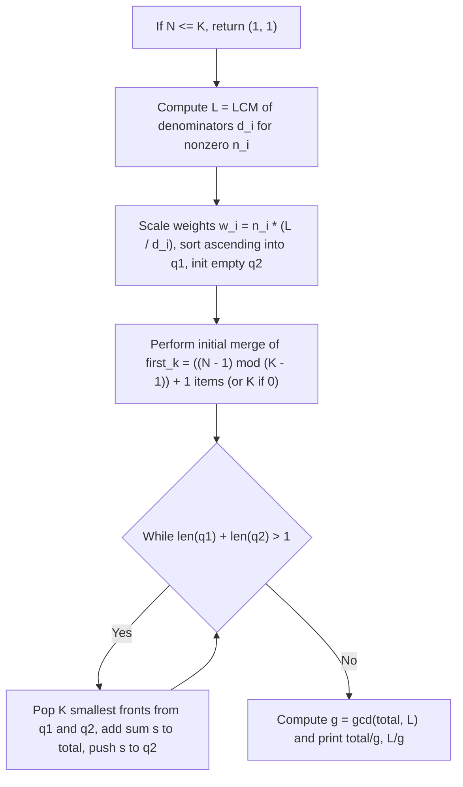

# Great Expectations!

> [!info] Document Metadata
> **Course:** `=this.course` | **Topic:** `=this.topic` | **Status:** `=this.status` | **Difficulty:** `=this.difficulty`

**Tags:** #[[Computer Science]] #[[CSALGCM]] #[[Algorithms and Complexity]] #[[HackerRank]] #[[Hermit Arcana]] #[[Huffman Coding]]
---

## Problem Description

Dr. Carl Samuel Albert Gorman Commington must design an optimal prefix-free encoding over an alphabet of $K$ distinct symbols for $N$ phrases $P_1, \dots, P_N$. Each phrase $P_i$ occurs with probability $p_i = \frac{n_i}{d_i}$ (with $\sum_{i=1}^N p_i = 1$) and receives a codeword $E_i$ of length $|E_i|$ symbols such that no codeword is a prefix of another. Determine the minimum possible expected encoding length:

$$\eta = \sum_{i=1}^N \bigl(|E_i| \cdot p_i\bigr)$$

expressed as an irreducible fraction $\frac{n'}{d'}$ with $\gcd(n', d') = 1$.

### Input Format
- The first line contains two space-separated integers $N$ and $K$, representing the number of phrases and the alphabet size.
- $N$ lines follow, the $i$-th line containing two space-separated integers $n_i$ and $d_i$ such that $p_i = \frac{n_i}{d_i}$.

### Output Format
Output a single line containing two space-separated integers $n'$ and $d'$ such that $\frac{n'}{d'}$ is the minimum possible $\eta$ and $\gcd(n', d') = 1$.

### Constraints
- $1 \le N, K \le 2 \cdot 10^5$
- $0 \le n_i \le 10^9$
- $1 \le d_i \le 10^9$
- $\sum_{i=1}^N \frac{n_i}{d_i} = 1$
- $\forall i \left(0 \le \frac{n_i}{d_i} \le 1 \land \gcd(n_i, d_i) = 1\right)$

### Sample Test Cases

**Sample Input 0**
```text
3 2
1 5
7 10
1 10
```

**Sample Output 0**
```text
13 10
```

*Explanation 0:* Using binary symbols $\alpha, \beta$, assigning $\alpha\alpha \mapsto P_1$, $\beta \mapsto P_2$, and $\alpha\beta \mapsto P_3$ yields $\eta = 2 \cdot \frac{1}{5} + 1 \cdot \frac{7}{10} + 2 \cdot \frac{1}{10} = \frac{13}{10}$.

**Sample Input 1**
```text
3 3
1 14
3 14
5 7
```

**Sample Output 1**
```text
1 1
```

*Explanation 1:* Since $N = K = 3$, each phrase gets a $1$-symbol codeword ($\alpha, \beta, \gamma$), giving $\eta = 1 \cdot \left(\frac{1}{14} + \frac{3}{14} + \frac{5}{7}\right) = \frac{1}{1}$.

---

## Approach & Intuition

- **Problem Abstraction:** Minimizing $\sum_{i=1}^N |E_i| \cdot p_i$ subject to the prefix-free constraint over a $K$-ary alphabet is **Optimal $K$-ary Huffman Coding**. Each internal merge of $K$ nodes contributes the sum of their weights to the external path length of every descendant leaf, so minimizing total merge cost equals minimizing $\eta$.
  - If $N \le K$, every phrase receives a distinct $1$-symbol codeword, so $\eta = \sum_{i=1}^N 1 \cdot p_i = 1$, giving `1 1`.
- **Naive / Brute-Force Approach:** Enumerating $K$-ary prefix trees is super-exponential in $N$. Using floating-point probabilities introduces rounding error that breaks exact fraction output, while repeatedly operating on `fractions.Fraction` objects inside an $O(N \log N)$ priority queue incurs heavy GCD overhead for $N \le 2 \cdot 10^5$.
- **Optimal Strategy (LCM Integer Scaling + Two-Queue $K$-ary Huffman):**
  1. Compute $L = \operatorname{lcm}\{d_i \mid n_i \neq 0\}$ so every probability scales to an exact integer weight $w_i = n_i \cdot (L / d_i)$.
  2. Sort `weights` ascending into queue `q1`, and keep an initially empty queue `q2` for merged internal nodes.
  3. In a full $K$-ary tree, each merge reduces node count by $K - 1$. To avoid placing fewer than $K$ real leaves near the root, pad implicitly with dummy $0$-weight leaves at the deepest level: the first merge pops `first_k = ((N - 1) % (K - 1)) + 1` elements (or `K` if the remainder is `0`).
  4. Repeatedly merge the $K$ smallest front elements across `q1` and `q2` and append their sum to `q2` until one node remains. Since both `q1` and newly appended sums in `q2` are monotonically non-decreasing, selecting `min(q1[0], q2[0])` maintains optimality without a heap.
  5. Divide the accumulated merge sum `total` and `L` by $\gcd(\text{total}, L)$ to output the reduced fraction.

## Algorithm Walkthrough



## Step-by-Step Trace

Tracing **Sample Input 0** ($N = 3$, $K = 2$):

1. **LCM & Scaling:** $L = \operatorname{lcm}(5, 10, 10) = 10$. Scaled weights: $[1 \cdot 2, 7 \cdot 1, 1 \cdot 1] = [2, 7, 1]$.
2. **Sort & First Merge Count:** `q1 = [1, 2, 7]`, `q2 = []`. Remainder `(3 - 1) % (2 - 1) = 0`, so `first_k = 2`.

| Merge Step | Popped Elements | Merge Sum $s$ | Running `total` | `q1` After Step | `q2` After Step |
| :--- | :--- | :--- | :--- | :--- | :--- |
| Initial (`first_k = 2`) | `1` (`q1`), `2` (`q1`) | $3$ | $3$ | `[7]` | `[3]` |
| Loop 1 ($K = 2$) | `3` (`q2`), `7` (`q1`) | $10$ | $13$ | `[]` | `[10]` |

3. **Reduction:** `len(q1) + len(q2) = 1`. $\gcd(13, 10) = 1$, outputting `13 10`.

## Complexity Analysis

| Metric | Complexity | Rationale |
| :--- | :--- | :--- |
| **Time** | $O(N \log N)$ | Sorting the $N$ scaled integer weights takes $O(N \log N)$ time, while the two-queue $K$-ary Huffman simulation performs each pop and push in $O(1)$ amortized time over $O(N)$ merges. |
| **Space** | $O(N)$ | Stores the $N$ input pairs, sorted weights in `q1`, and at most $\lceil (N - 1) / (K - 1) \rceil$ merged internal sums in `q2` (assuming bounded integer word size for scaled weights). |

---

## Full Solution

```python
import sys
import math
from collections import deque

def solve(n, k, vals):
    if n <= k:
        return 1, 1

    # Compute common denominator L of all non-zero probabilities
    L = 1
    for num, den in vals:
        if num != 0:
            L = L // math.gcd(L, den) * den

    weights = [num * (L // den) for num, den in vals]
    weights.sort()

    q1 = deque(weights)
    q2 = deque()

    rem = (n - 1) % (k - 1)
    first_k = rem + 1 if rem != 0 else k

    total = 0

    # First merge (equivalent to padding with k - first_k dummy zeros)
    s = 0
    for _ in range(first_k):
        s += q1.popleft()
    total += s
    q2.append(s)

    # All remaining merges combine the k smallest available weights
    while len(q1) + len(q2) > 1:
        s = 0
        for _ in range(k):
            if not q1:
                s += q2.popleft()
            elif not q2:
                s += q1.popleft()
            elif q1[0] <= q2[0]:
                s += q1.popleft()
            else:
                s += q2.popleft()
        total += s
        q2.append(s)

    g = math.gcd(total, L)
    return total // g, L // g

def main():
    input = sys.stdin.readline
    n, k = map(int, input().split())
    vals = [list(map(int, input().split())) for _ in range(n)]

    num, den = solve(n, k, vals)
    print("{} {}".format(num, den))

if __name__ == "__main__":
    main()
```

## References & Navigation

- **Previous Problem:** [[05 - We Got a 4-D Dynamic Programming Problem in CSALGCM Before GTA VII]]
- **Parent Set:** [[[PS] Hermit Arcana|Hermit Arcana Index]]
- **Related Notes:** [[Greedy Algorithms Introduction]], [[Dynamic Programming Introduction]]
