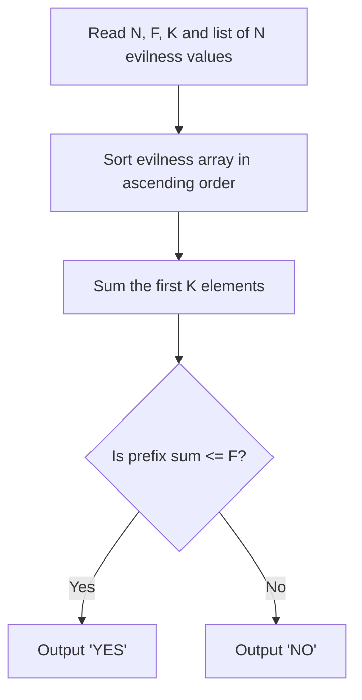

# The Tragedy of 'Salem's Lot

> [!info] Document Metadata
> **Course:** `=this.course` | **Topic:** `=this.topic` | **Status:** `=this.status` | **Difficulty:** `=this.difficulty`

**Tags:** #[[Computer Science]] #[[CSALGCM]] #[[Algorithms and Complexity]] #[[HackerRank]] #[[Justice Arcana]] #[[Greedy Sorting]]
---

## Problem Description

The town of 'Salem's Lot has been overrun by $N$ vampires. Father Callaghan possesses a single wooden stake blessed with holy water whose initial lasting power equals his faith $F$. Staking a vampire with evilness $E_i$ diminishes the stake's remaining power by $E_i$. If staking a vampire would cause the stake's power to drop strictly below $0$, the stake is overwhelmed with evil and crumbles to dust before destroying the vampire.

Re-blessing the stake requires standing still and is impossible, nor can Father Callaghan wait for sunrise without staking any vampires. Given that the sun rises in the time required to stake $K$ distinct vampires, determine whether Father Callaghan can choose $K$ vampires to stake without his stake's power ever falling below $0$.

### Input Format
- The first line contains three space-separated integers $N$, $F$, and $K$:
  - $N$ is the number of vampires roaming around 'Salem's Lot.
  - $F$ is Father Callaghan's faith, representing the initial total power of his stake.
  - $K$ is the number of vampires Father Callaghan must stake before sunrise.
- The next $N$ lines each contain one integer $E_i$, representing the evilness of the $i$-th vampire.

### Output Format
Output a single line containing `"YES"` (without quotes) if Father Callaghan can stake $K$ vampires without his stake crumbling (total evilness $\le F$), or `"NO"` otherwise.

### Constraints
- $1 \le K \le N \le 10^6$
- $1 \le F, E_i \le 10^9$

### Sample Test Cases

**Sample Input 0**
```text
5 3 2
1
2
3
4
5
```

**Sample Output 0**
```text
YES
```

*Explanation 0:* Staking the vampires with evilness $1$ and $2$ lowers the stake's power from $3$ to $3 - (1 + 2) = 0 \ge 0$, completing $K = 2$ stakes safely.

**Sample Input 1**
```text
5 3 2
5
1
3
3
4
```

**Sample Output 1**
```text
NO
```

*Explanation 1:* The two weakest vampires have evilness $1$ and $3$, totaling $4 > 3$. Any selection of $K = 2$ vampires drops the stake's power below $0$.

---

## Approach & Intuition

- **Problem Abstraction:** Given an array $E = [E_1, \dots, E_N]$ of positive integers, a budget $F$, and a target count $K$, decide whether there exists a subset $S \subseteq \{1, \dots, N\}$ of size $|S| = K$ such that $\sum_{i \in S} E_i \le F$. Because every $E_i \ge 1$, the cumulative power spent after $K$ stakes depends only on the sum of the $K$ chosen evilness values, not on the order in which they are staked.
- **Naive / Brute-Force Approach:** Enumerating all $\binom{N}{K}$ subsets of size $K$ takes $\Omega\bigl(\binom{N}{K}\bigr)$ time, which grows exponentially for $N \le 10^6$. A $0/1$ subset-sum DP over capacity $F$ is equally infeasible since $F \le 10^9$.
- **Optimal Strategy (Greedy Choice & Exchange Proof):** Sort the vampire evilness values in non-decreasing order $E_{(1)} \le E_{(2)} \le \dots \le E_{(N)}$ and select the $K$ smallest values $E_{(1)}, \dots, E_{(K)}$.
  - *Exchange Argument:* Suppose some feasible subset $S$ of size $K$ achieves $\sum_{i \in S} E_i \le F$ and omits one of the $K$ smallest vampires $E_{(j)}$ ($1 \le j \le K$) while containing a vampire $E_{(m)}$ with $m > K$. Replacing $E_{(m)}$ with $E_{(j)}$ yields a subset $S'$ of size $K$ whose sum changes by $E_{(j)} - E_{(m)} \le 0$, preserving feasibility $\sum_{i \in S'} E_i \le F$. Repeating this exchange transforms any valid $K$-subset into the $K$ weakest vampires, proving that checking $\sum_{j=1}^{K} E_{(j)} \le F$ is both necessary and sufficient.

## Algorithm Walkthrough



## Step-by-Step Trace

Tracing **Sample Input 1** ($N = 5$, $F = 3$, $K = 2$, $E = [5, 1, 3, 3, 4]$):

| Step | Operation | Array / Value State | Comparison against $F = 3$ |
| :--- | :--- | :--- | :--- |
| 1 | Read input | `vamps = [5, 1, 3, 3, 4]` | Initial faith $F = 3$, target $K = 2$ |
| 2 | Sort ascending | `vamps = [1, 3, 3, 4, 5]` | Weakest vampires ordered first |
| 3 | Slice `vamps[:2]` | `[1, 3]` | Selected $K = 2$ candidates |
| 4 | Compute sum | `1 + 3 = 4` | $4 > 3 \implies$ Stake crumbles; output `NO` |

## Complexity Analysis

| Metric | Complexity | Rationale |
| :--- | :--- | :--- |
| **Time** | $O(N \log N)$ | Sorting $N$ integers with Timsort takes $O(N \log N)$ time, dominating the $O(K)$ prefix summation ($K \le N$). |
| **Space** | $O(N)$ | Stores all $N$ vampire evilness values in memory, plus $O(K)$ for the slice `vamps[:k]` and Timsort's $O(N)$ worst-case buffer. |

---

## Full Solution

```python
n, f, k = list(map(int,input().rstrip().split(" ")))
vamps = [int(input()) for x in range(n)]
ans = ""
# solve answer here
vamps.sort()
ans = "YES" if sum(vamps[:k]) <= f else "NO"

print(ans)
```

## References & Navigation

- **Next Problem:** [[02 - Its The End Of The World As We Know It]]
- **Parent Set:** [[[PS] Justice Arcana|Justice Arcana Index]]
- **Related Notes:** [[Greedy Algorithms Introduction]]
