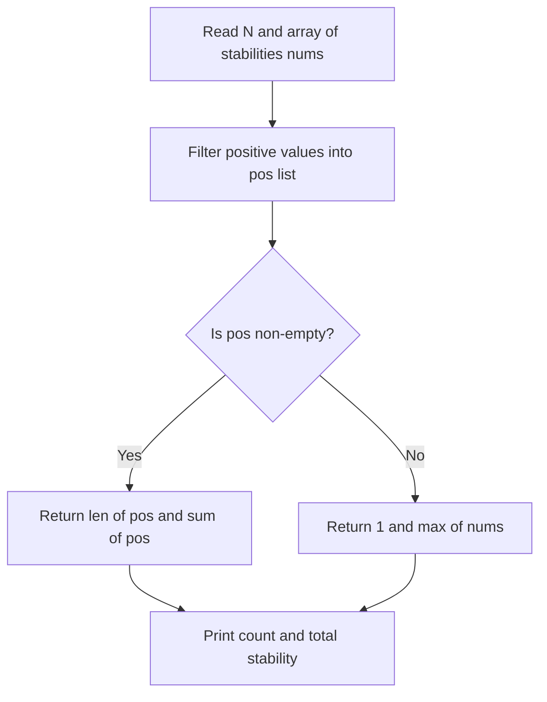

# It's The End Of The World As We Know It (And I Feel Fine)

> [!info] Document Metadata
> **Course:** `=this.course` | **Topic:** `=this.topic` | **Status:** `=this.status` | **Difficulty:** `=this.difficulty`

**Tags:** #[[Computer Science]] #[[CSALGCM]] #[[Algorithms and Complexity]] #[[HackerRank]] #[[Justice Arcana]] #[[Subset Maximization]]
---

## Problem Description

Mother Abagail has gathered $N$ followers in Boulder, where the $i$-th follower has a non-zero integer stability level $S_i$ (which may be positive or negative). She needs to dispatch a team of followers against Randall Flagg as a preventive measure.

She may choose any subset of her followers, provided that **at least one person** is sent, and her objective is to maximize the total stability of the selected team. Determine both the number of people sent and the maximum total stability attainable.

### Input Format
- The first line contains a single integer $N$, denoting the number of followers.
- The next $N$ lines each contain a single integer $S_i$, denoting the stability level of the $i$-th person.

### Output Format
Output two space-separated integers on a single line: the number of people being sent, followed by the maximum total stability possible.

### Constraints
- $1 \le N \le 10^6$
- $1 \le \vert S_i \vert \le 10^3$

### Sample Test Cases

**Sample Input 0**
```text
5
-2
3
-2
5
7
```

**Sample Output 0**
```text
3 15
```

*Explanation 0:* Selecting the three followers with positive stabilities $3, 5, 7$ yields the maximum total stability $3 + 5 + 7 = 15$.

**Sample Input 1**
```text
10
-16
2
17
-8
-4
16
5
18
3
9
```

**Sample Output 1**
```text
7 70
```

*Explanation 1:* Sending the $7$ positive-stability followers ($2, 17, 16, 5, 18, 3, 9$) achieves a total stability of $70$.

**Sample Input 2**
```text
5
-1
-2
-3
-4
-5
```

**Sample Output 2**
```text
1 -1
```

*Explanation 2:* Because at least one person must be sent and all stabilities are negative, sending only the single follower with stability $-1$ maximizes the sum.

---

## Approach & Intuition

- **Problem Abstraction:** Given an array $S = [S_1, \dots, S_N]$ of non-zero integers ($S_i \ne 0$ since $1 \le \vert S_i \vert$), choose a non-empty subset $T \subseteq \{1, \dots, N\}$ ($T \ne \emptyset$) that maximizes $\sum_{i \in T} S_i$, and report $(\vert T \vert, \sum_{i \in T} S_i)$.
- **Naive / Brute-Force Approach:** Testing every non-empty subset takes $O(2^N)$ time, which is completely intractable for $N \le 10^6$. Sorting $S$ and taking a suffix also incurs an unnecessary $O(N \log N)$ factor when only the sign of each element governs inclusion.
- **Optimal Strategy (Greedy Choice & Proof):** Let $P = \{i : S_i > 0\}$ be the set of followers with strictly positive stability.
  - *Case 1 ($P \ne \emptyset$):* Including any follower $j \notin P$ ($S_j < 0$) strictly decreases the team's total stability, while omitting any follower $i \in P$ ($S_i > 0$) strictly decreases the total stability. Because $S_i \ne 0$ for all $i$, $T = P$ is the unique non-empty subset maximizing $\sum_{i \in T} S_i$, with team size $\vert P \vert$ and total stability $\sum_{i \in P} S_i$.
  - *Case 2 ($P = \emptyset$):* Every follower has $S_i < 0$. Adding any second follower strictly reduces the total sum, so an optimal non-empty subset must contain exactly one element: $\arg\max_i S_i$, yielding team size $1$ and total stability $\max_{1 \le i \le N} S_i$.

## Algorithm Walkthrough



## Step-by-Step Trace

Tracing **Sample Input 0** ($N = 5$, $S = [-2, 3, -2, 5, 7]$) and **Sample Input 2** ($N = 5$, $S = [-1, -2, -3, -4, -5]$):

| Instance | Input $S$ | Filtered Positive List `pos` | Branch Taken | Output |
| :--- | :--- | :--- | :--- | :--- |
| Sample 0 | `[-2, 3, -2, 5, 7]` | `[3, 5, 7]` | `pos` is non-empty | `3 15` |
| Sample 2 | `[-1, -2, -3, -4, -5]` | `[]` | `pos` is empty; select `max(nums) = -1` | `1 -1` |

## Complexity Analysis

| Metric | Complexity | Rationale |
| :--- | :--- | :--- |
| **Time** | $O(N)$ | Performs a single linear pass to collect positive elements, followed by $O(N)$ summation or maximum lookup. |
| **Space** | $O(N)$ | Stores the input list `nums` of length $N$ and the filtered positive list `pos` of size at most $N$. |

---

## Full Solution

```python
def solve(n,nums):
    # solve and return answer here
    pos = [x for x in nums if x > 0]
    return (len(pos), sum(pos)) if pos else (1, max(nums))

n = int(input())
nums = [int(input()) for i in range(n)]
ans, total = solve(n,nums)

print("{} {}".format(ans,total))
```

## References & Navigation

- **Previous Problem:** [[01 - The Tragedy of Salems Lot]]
- **Next Problem:** [[03 - Logic The Unsundering]]
- **Parent Set:** [[[PS] Justice Arcana|Justice Arcana Index]]
- **Related Notes:** [[Greedy Algorithms Introduction]]
