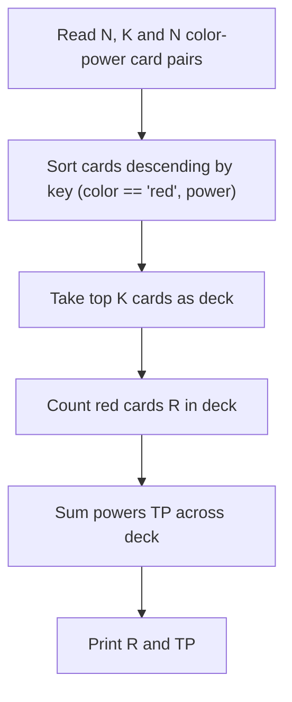

# Logic: The Unsundering

> [!info] Document Metadata
> **Course:** `=this.course` | **Topic:** `=this.topic` | **Status:** `=this.status` | **Difficulty:** `=this.difficulty`

**Tags:** #[[Computer Science]] #[[CSALGCM]] #[[Algorithms and Complexity]] #[[HackerRank]] #[[Justice Arcana]] #[[Composite Sorting]]
---

## Problem Description

Jason is playtesting a trading card game prototype featuring two card colors: `"red"` and `"blue"`. He has $N$ available cards, where the $i$-th card has color $C_i \in \{\text{"red"}, \text{"blue"}\}$ and non-negative integer power $P_i$.

Jason must construct a deck containing exactly $K$ cards. Under the prototype's evaluation rules, one $K$-card deck is strictly stronger than another if it contains strictly more `"red"` cards; if two decks tie on the number of `"red"` cards, the deck with the higher total power $\sum P_i$ across all $K$ cards is stronger. Determine the number of `"red"` cards $R$ and the total power $TP$ of the strongest possible $K$-card deck.

### Input Format
- The first line contains two space-separated integers $N$ and $K$, indicating the number of available cards and the required deck size.
- The next $N$ lines each contain a space-separated pair $C_i$ and $P_i$, where $C_i$ is either `"red"` or `"blue"` (without quotes) and $P_i$ is an integer representing the card's power.

### Output Format
Output two space-separated integers $R$ and $TP$, where $R$ is the number of red cards in the strongest deck and $TP$ is the sum of powers $P_i$ of all $K$ cards in that deck.

### Constraints
- $1 \le K \le N \le 3 \cdot 10^5$
- $C_i \in \{\text{red}, \text{blue}\}$
- $0 \le P_i \le 10^9$

### Sample Test Cases

**Sample Input 0**
```text
5 3
red 1
red 1
blue 5
blue 7
blue 9
```

**Sample Output 0**
```text
2 11
```

*Explanation 0:* Both red cards (`red 1`, `red 1`) are taken first to maximize the red count ($R = 2$), and the third slot is filled with the strongest blue card (`blue 9`), giving $TP = 1 + 1 + 9 = 11$.

**Sample Input 1**
```text
6 3
blue 13
blue 8
blue 2
blue 6
red 6
blue 2
```

**Sample Output 1**
```text
1 27
```

*Explanation 1:* Taking the sole red card (`red 6`) plus the two highest-power blue cards (`blue 13`, `blue 8`) yields $R = 1$ and $TP = 6 + 13 + 8 = 27$.

**Sample Input 2**
```text
7 4
red 4
blue 6
red 3
red 12
red 8
blue 1
red 3
```

**Sample Output 2**
```text
4 27
```

*Explanation 2:* Five red cards exist, so $K = 4$ slots can all be filled with red cards. Choosing the four highest-power red cards (`12, 8, 4, 3`) gives $R = 4$ and $TP = 27$.

---

## Approach & Intuition

- **Problem Abstraction:** Given $N$ items $(C_i, P_i)$, select a subset $D$ of cardinality $\vert D \vert = K$ that lexicographically maximizes the objective pair:
  $$\bigl(\vert \{i \in D : C_i = \text{"red"}\} \vert,\; \sum_{i \in D} P_i\bigr)$$
- **Naive / Brute-Force Approach:** Enumerating all $\binom{N}{K}$ decks is exponential in $N$, and standard $0/1$ knapsack DP over card count and red count is redundant when there are no per-card weight capacities beyond cardinality $K$.
- **Optimal Strategy (Lexicographic Greedy Choice & Exchange Proof):** Define a total order on cards using the tuple key `(c[0] == "red", int(c[1]))` sorted in descending order, then pick the first $K$ cards.
  - *Exchange Proof:* Let $R_{\text{avail}}$ be the total number of red cards. Any optimal deck must take $R = \min(K, R_{\text{avail}})$ red cards; if it had fewer than $R$ red cards, swapping one blue card in the deck for an unused red card strictly increases the primary objective. With $R$ fixed, the remaining $K - R$ slots must come from blue cards. Within each color class, if the deck omits a higher-power card in favor of a lower-power card of the same color, exchanging them preserves $R$ and strictly increases (or preserves) $TP$. Sorting descending by `(is_red, power)` and slicing `cards[:k]` automatically selects the top $R$ red cards followed by the top $K - R$ blue cards.

## Algorithm Walkthrough



## Step-by-Step Trace

Tracing **Sample Input 2** ($N = 7$, $K = 4$):

| Rank after Sort | Original Card | Sort Key `(is_red, power)` | Selected in `cards[:4]`? | Running $(R, TP)$ |
| :---: | :--- | :--- | :--- | :--- |
| 1 | `red 12` | `(True, 12)` | Yes | `(1, 12)` |
| 2 | `red 8` | `(True, 8)` | Yes | `(2, 20)` |
| 3 | `red 4` | `(True, 4)` | Yes | `(3, 24)` |
| 4 | `red 3` | `(True, 3)` | Yes | `(4, 27)` |
| 5 | `red 3` | `(True, 3)` | No | — |
| 6 | `blue 6` | `(False, 6)` | No | — |
| 7 | `blue 1` | `(False, 1)` | No | — |

Final output: `4 27`.

## Complexity Analysis

| Metric | Complexity | Rationale |
| :--- | :--- | :--- |
| **Time** | $O(N \log N)$ | Sorting $N$ cards by the 2-element tuple key `(is_red, power)` takes $O(N \log N)$ time, followed by two $O(K)$ passes over the slice ($K \le N$). |
| **Space** | $O(N)$ | Stores all $N$ card records in `cards`, the $K$-element slice `deck`, and Timsort's $O(N)$ worst-case scratch buffer. |

---

## Full Solution

```python
def solve(n,k,cards):
    cards.sort(key=lambda c: (c[0] == "red", int(c[1])), reverse=True)
    deck = cards[:k]
    return sum(c[0] == "red" for c in deck), sum(int(c[1]) for c in deck)

n,k = list(map(int,input().strip().split(' ')))
cards = [list(input().strip().split(' ')) for i in range(n)]

red, tp = solve(n,k,cards)

print(f"{red} {tp}")
```

## References & Navigation

- **Previous Problem:** [[02 - Its The End Of The World As We Know It]]
- **Next Problem:** [[04 - A Chain of Memories in Castle Oblivion]]
- **Parent Set:** [[[PS] Justice Arcana|Justice Arcana Index]]
- **Related Notes:** [[Greedy Algorithms Introduction]]
